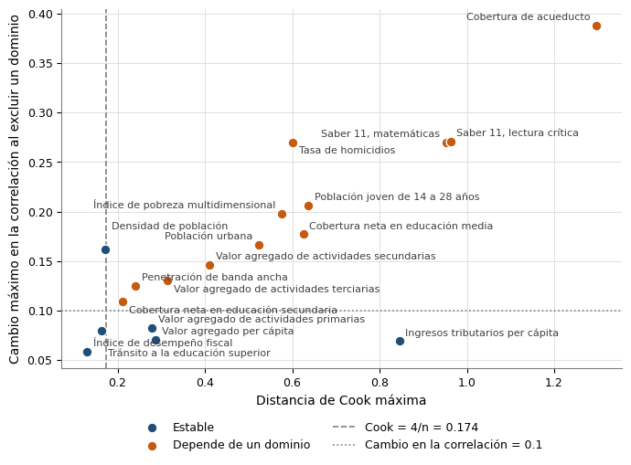
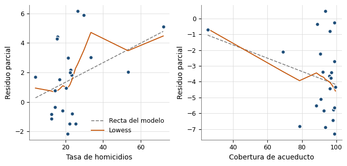

# analisis__eda_seleccion_covariables


## Celda 0

```python
%md
# Diagnóstico y selección final de covariables

Este notebook **decide**. La caracterización de los datos se hizo antes, en
`analisis_descriptivo`, y no se repite aquí. La selección es **cualitativa**: se
apoya en lo que el análisis descriptivo mostró sobre cada covariable (univariado y
bivariado), en el pre-filtrado y en diagnósticos de estadística básica, y cada
covariable entra o sale por una razón única que se puede leer en su fila de la ficha
de decisión.

Los 23 dominios son ciudades o ciudades con su área metropolitana («Cali A.M.»); en los 7
dominios A.M. las covariables son el promedio ponderado de sus municipios
(`adicion_covariables`), de modo que respuesta y covariables describen el mismo territorio.

## Qué no se hace y por qué

| Procedimiento | Decisión | Motivo |
|---|---|---|
| Sensibilidad al umbral de correlación | **No se hace** | Contaría cuántas covariables superan umbrales sobre un conjunto ya recortado por ese mismo umbral. |
| Shapiro-Wilk sobre las covariables | **No se hace** | El modelo supone normalidad de los efectos aleatorios y de los errores de muestreo, no de las covariables. |
| Índice de Moran (sobre la respuesta y sobre los residuos) | **No se hace aquí** | El selector de covariables no lo necesita: el contraste de dependencia espacial se aplica a los residuos del benchmark y de las variantes espaciales en `modelo/fay_herriot_espacial.py`, donde sí informa la comparación entre el Fay-Herriot clásico y el espacial. |
| Búsqueda exhaustiva de especificaciones por AIC | **No se hace** | Con 23 dominios produciría docenas de especificaciones equivalentes y reutilizaría los datos que ajustan el modelo; la elección entre ellas volvería a ser una regla añadida. La comparación entre especificaciones se hace en el notebook del modelo (significancia de los coeficientes y AIC). |
| Ranking compuesto C y Q, nivel de respaldo L | **No se usan** | Pesos y topes arbitrarios; el nivel L complicaría el análisis sin decidir nada. |
| Modelo Fay-Herriot univariado por covariable | **Se hace** | La respuesta tiene error de muestreo de varianza ψ_d distinta en cada dominio; el modelo la incorpora y la correlación no (G7-B8). Su p-valor para la pendiente, ajustado por Benjamini-Hochberg sobre todas las candidatas (G7-B9), decide la elegibilidad; Pearson, Spearman y Fisher quedan como descripción. |
| Filtro de robustez (Cook y dejar-uno-fuera) | **No se aplica como filtro (R-03)** | La regla `4/n` sirve para inspeccionar observaciones, no para excluir variables; el umbral de cambio (0,10) queda por debajo del error de muestreo de r con n = 23 y separaba casos casi idénticos. Morales et al. (pp. 453-454) no usan la influencia como criterio de selección. |
| Influencia y estabilidad | **Se hace, como diagnóstico** | Distancia de Cook y exclusión de dominios, sobre el mismo Fay-Herriot univariado. Se reportan en la ficha (`Robustez`) y su motivo advierte las covariables elegibles que dependen de un dominio; ninguna se descarta. |
| Soporte en los municipios objetivo | **Se hace, como advertencia (R-02)** | Proporción de los municipios objetivo dentro del rango [mín, máx] de los dominios, sin usar la respuesta. La ficha advierte las que extrapolan (por debajo de `SOPORTE_MINIMO`). Una covariable incompleta en los objetivos no es candidata (condición (iii) del catálogo). |
| Redundancia | **Se hace** | Un representante por grupo de covariables equivalentes. |
| Forma funcional | **Se hace** | Curvatura y escala logarítmica en el Fay-Herriot univariado, y residuos parciales del conjunto elegido (G7-B13). Es un diagnóstico: ninguna covariable se transforma, y la ficha advierte las que conviene revisar. |
| Ficha de decisión | **Se hace** | Reúne por covariable la evidencia descriptiva (signo esperado y observado, intervalo de la correlación), el Fay-Herriot univariado y los diagnósticos, y aplica reglas explícitas. |

## Procedimiento de selección

```
candidatas conceptualmente elegibles (catálogo de literatura)
  → 1. asociación:   correlación con la respuesta y su intervalo (descripción), Fay-Herriot
                      univariado con ψ_d (decisión y medida única), signo esperado y forma
                      funcional
  → 2. robustez:     diagnóstico de si la asociación depende de un solo dominio (en el
                      Fay-Herriot univariado); se reporta, no descarta
  → 3. redundancia:  un representante por grupo de covariables equivalentes (el primer
                      integrante elegible por orden de Cook: retroceso)
  → 4. decisión:     elegibles = pendiente del FH univariado con q de Benjamini-Hochberg
                      ≤ Q_FDR_ELEGIBILIDAD (el signo esperado es diagnóstico);
                      seleccionadas = las de mayor correlación ponderada hasta la cota de
                      parsimonia, `cota_covariables(n)` = n // 10 (R-07); el soporte en los
                      objetivos se advierte
  → 5. verificación: multicolinealidad y residuos parciales del conjunto elegido
```

## Salidas

* `tesis.preprocesamiento.diagnosticos_covariables` (incluye la lectura de robustez)
* `tesis.preprocesamiento.soporte_covariables`
* `tesis.preprocesamiento.redundancia_covariables`
* `tesis.preprocesamiento.decision_covariables`
* `tesis.preprocesamiento.verificacion_seleccion`
* `tesis.preprocesamiento.trazabilidad_covariables`
* `tesis.preprocesamiento.covariables_seleccionadas`
* Figuras en el volumen `figuras_eda`, con prefijo `eda_`.
```


## Celda 1

```python
import os
import sys

import numpy as np
import pandas as pd
from pyspark.sql import functions as F


# R-67: `code/` en sys.path (el notebook está en code/<carpeta>/); `comun.entorno` hace el resto
_ruta_nb = (
    dbutils.notebook.entry_point.getDbutils()
    .notebook()
    .getContext()
    .notebookPath()
    .get()
)
CODE_DIR = "/Workspace" + os.path.dirname(os.path.dirname(_ruta_nb))
sys.path.insert(0, CODE_DIR)

from preprocesamiento.shared.config import *
from analisis.shared import descriptivos as desc
from analisis.shared import diagnosticos as diag
from analisis.shared import seleccion as sel
from analisis.shared.datos_analisis import cargar_datos_analisis

# ── Carga (la misma que analisis_descriptivo, R-32) ──────────────────────────
datos = cargar_datos_analisis(
    spark,
    TBL_PREFILTRADAS,
    TBL_DIM_INDICADORES,
    METADATA_COLS,
    VARIABLE_OBJETIVO,
    tabla_objetivos=TBL_SIN_ENCUESTA,
)
df_full = datos["df_full"]
indicadores_dict = datos["indicadores_dict"]
df_meta, df_pd = datos["df_meta"], datos["df_pd"]
# PSI = ψ_d = SE² (G7-B8): la misma varianza de muestreo que usa el modelo Fay-Herriot.
Y, PSI, entidades = datos["Y"], datos["PSI"], datos["entidades"]
reporte_catalogo = datos["reporte_catalogo"]
CANDIDATAS, ALIAS, SIGNO, DIMENSION = (
    datos["CANDIDATAS"],
    datos["ALIAS"],
    datos["SIGNO"],
    datos["DIMENSION"],
)
df_cand = datos["df_cand"]
# Municipios objetivo con las candidatas (R-02): mide el soporte y exige completitud.
df_objetivos = datos["df_objetivos"]

print(f"Dominios: {len(Y)}  |  Candidatas conceptualmente elegibles: {len(CANDIDATAS)}")
```

**Salida:**

```
Catálogo de elegibilidad conceptual: 18 de 18 entradas activas (6 variables de la literatura excluidas o sin dato utilizable)
  · activa: 18
  · sin dato utilizable: sin dato en los dominios con encuesta para el período de estimación: 1
  · sin dato utilizable: la serie termina en 2016; no existe dato para 2018: 1
  · sin dato utilizable: solo se publica para departamentos y 23 ciudades principales; no existe en los municipios objetivo sin encuesta, por lo que no permite predicción sintética: 1
  · sin dato utilizable: solo se publica a nivel departamental: 1
  · sin dato utilizable: solo existe para 2022-2023; el IICA se evaluó como proxy y se excluyó (ver IICA_CONFLICTO), así que no tiene sustituto: 1
  · excluida del catálogo (R-01): mide la incidencia del conflicto en el propio municipio (expulsión, presencia armada), no la recepción de desplazados del argumento de Ibáñez (2008); en los 23 dominios es casi la tasa de homicidios (r = 0.92), solo toma 13 valores distintos por redondeo y Quibdó aporta cerca de la mitad de su suma de cuadrados; en los 83 municipios objetivo llega a 0.8 frente a un máximo de 0.1 en los dominios, donde la relación estimada en capitales urbanas no aplica (Morales et al., p. 454): 1
Dominios: 23  |  Candidatas conceptualmente elegibles: 18

```


## Celda 2

```python
%md
**Una sola cadena (R-32).** Los pasos de selección (Fay-Herriot univariado, robustez,
redundancia, ficha de decisión y verificación de multicolinealidad) se ejecutan con
`sel.ejecutar_seleccion`, la misma función que repite el notebook del modelo dentro de
su validación cruzada. Las secciones siguientes muestran el resultado de cada paso.
```


## Celda 3

```python
# Cota de parsimonia calculada desde n (R-07): 23 dominios → 2 covariables.
P_MAXIMO = cota_covariables(len(Y))
print(f"Cota de covariables: {P_MAXIMO} ({OBS_POR_PARAMETRO} dominios por covariable)")
# R-04: si ninguna candidata resulta elegible, la cadena avisa y devuelve el conjunto vacío;
# el notebook sigue, escribe todas sus tablas y el modelo será de solo intercepto (EC0).
SELECCION = sel.ejecutar_seleccion(
    df_cand,
    CANDIDATAS,
    Y,
    PSI,
    entidades,
    SIGNO,
    alias=ALIAS,
    dimension=DIMENSION,
    p_maximo=P_MAXIMO,
    q_fdr=Q_FDR_ELEGIBILIDAD,
    umbral_delta=UMBRAL_DELTA_LOO,
    umbral_redundancia=UMBRAL_REDUNDANCIA,
    vif_max=VIF_MAXIMO,
    alfa_ic=ALFA_IC_CORRELACION,
    df_objetivos=df_objetivos,
    soporte_minimo=SOPORTE_MINIMO,
    con_forma=True,
    silencioso=False,
)
# Fay-Herriot univariado (G7-B8) y forma funcional de las elegibles (R-62). Sin elegibles no
# hay forma funcional: una tabla vacía con la columna de unión permite escribir los diagnósticos.
df_fh, df_forma = SELECCION["df_fh"], SELECCION["df_forma"]
if df_forma is None:
    df_forma = pd.DataFrame(columns=["Codigo", "Alias"])
# Intervalo de Fisher: solo descripción en la tabla bivariada, ya no entra a la ficha (R-62).
df_ic = diag.tabla_ic_correlacion(
    df_cand, CANDIDATAS, Y, alias=ALIAS, alfa=ALFA_IC_CORRELACION
)
df_influencia, df_estabilidad = (
    SELECCION["df_influencia"],
    SELECCION["df_estabilidad"],
)
```

**Salida:**

```
Cota de covariables: 2 (10 dominios por covariable)
Diagnóstico de robustez: 12 de 18 covariables dependen de un dominio (se reporta; no se descarta ninguna)
Resolución de redundancia (|r| >= 0.8): 18 → 14 covariables (14 grupos)
Ficha de decisión: 18 candidatas → 3 elegibles → 2 seleccionadas
  · no elegible: 11
  · descartada: 4
  · seleccionada: 2
  · no seleccionada: 1
Verificación de multicolinealidad: VIF máximo 1.984 (umbral 5.0)

```


## Celda 4

```python
%md
# 1. Asociación con la respuesta y su incertidumbre

Se retoma la tabla bivariada del análisis descriptivo (Pearson y Spearman) y se le añade
el **intervalo de confianza de Fisher** del coeficiente de Pearson. Con 23 dominios el error estándar de una
correlación es grande, y un valor puntual comunica más certeza de la que hay.

**La decisión se toma con el modelo, no con la correlación (G7-B8).** La respuesta es
una estimación directa con error de muestreo, θ̂_d = θ_d + e_d con Var(e_d) = ψ_d, y ψ_d
cambia de un dominio a otro. Pearson y Spearman dan el mismo peso a todos. Por eso se
ajusta, para cada covariable, el **Fay-Herriot univariado**
θ̂_d = β0 + β1·x_d + u_d + e_d, con Var(u_d) = A estimada por REML: la misma estructura
del modelo final, que pesa cada dominio por 1/(Â + ψ_d). Su intervalo al 95 % de β1 y
su p-valor describen la asociación; la elegibilidad la decide el q de
Benjamini-Hochberg (ver «Multiplicidad»). La correlación y su intervalo de Fisher se conservan como
descripción. La columna `r_ponderada` expresa la pendiente del modelo en escala de
correlación y `Razon_pesos` (peso máximo / peso mínimo) muestra cuánto se aparta el
ajuste de uno con pesos iguales.

**Una sola medida (G7-B13).** La misma correlación ponderada es la que ordena las
elegibles en la parsimonia y fija el signo observado. Antes el orden usaba Spearman cuando
valores extremos condicionaban a Pearson, mientras el intervalo que decidía era de Pearson
y la covariable entraba sin transformar a un modelo lineal: tres medidas para una sola
decisión. Spearman queda como descripción de la asociación monótona.

**Forma funcional (G7-B13).** Antes de fijar el predictor lineal se examina, en el mismo
modelo univariado, si la relación tiene **curvatura** (prueba de Wald del término
cuadrático de la covariable estandarizada) y si la **escala logarítmica** la describe
mejor (AIC con log(x) frente a x, cuando x es positiva). Es un diagnóstico: ninguna
covariable se transforma de forma automática, porque elegir la escala mirando la
respuesta sería otra selección sobre los mismos 23 dominios, y una transformación tendría
que aplicarse también a los municipios objetivo en el notebook del modelo. Si una
covariable elegible queda en «revisar», la ficha lo advierte. Se calcula solo para las
candidatas elegibles (R-62); las que ya quedaron fuera por la asociación no se examinan.

**Multiplicidad (G7-B9).** Exigir que el intervalo al 95 % de cada candidata excluya el
cero es la misma prueba al 5 % repetida 19 veces sin corrección. Por eso la elegibilidad
se decide con el p-valor de β1 ajustado por **Benjamini-Hochberg** sobre todas las
candidatas (`q_FH`): es elegible la que tiene `q_FH ≤ Q_FDR_ELEGIBILIDAD` (0,10), lo que
controla en 10 % la proporción esperada de falsos descubrimientos entre las elegibles. Es
un tamizaje previo al modelo; la decisión final sobre los coeficientes la toma el
notebook del modelo. La estabilidad de la selección frente al remuestreo de dominios no se
calcula aquí (R-62): la frecuencia con que se elige cada covariable al repetir toda la
cadena es `fh_validacion_cruzada_frecuencia` (G7-B19, notebook del modelo).

La tabla trae también el **signo esperado** del catálogo. Es un **diagnóstico de
coherencia sustantiva, no un filtro** (G7-B12): una asociación de signo contrario a la
literatura puede contener información, y el signo bivariado no tiene por qué coincidir
con el coeficiente parcial del modelo. La ficha lo registra y lo advierte, y la sección 5
muestra qué cambiaría si se excluyeran las covariables de signo inesperado.
```


## Celda 5

```python
bivariado = desc.tabla_bivariada(df_cand, CANDIDATAS, Y, alias=ALIAS)

df_asociacion = (
    df_ic.merge(bivariado.drop(columns=["Alias", "Pearson_r"]), on="Codigo")
    .merge(df_fh.drop(columns=["Alias"]), on="Codigo")
    .assign(
        Dimension=lambda t: [DIMENSION[c] for c in t["Codigo"]],
        Signo_esperado=lambda t: [SIGNO[c] for c in t["Codigo"]],
    )
    .sort_values("Pearson_r", key=abs, ascending=False)
)
display(spark.createDataFrame(df_asociacion))

n_con_cero = int((df_ic["IC_contiene_cero"] == "sí").sum())
n_con_cero_fh = int((df_fh["IC_FH_contiene_cero"] == "sí").sum())
n_q = int((df_fh["q_FH"] <= Q_FDR_ELEGIBILIDAD).sum())
print(
    f"Con q de Benjamini-Hochberg ≤ {Q_FDR_ELEGIBILIDAD}: {n_q} de {len(CANDIDATAS)} (decide). "
    f"Intervalo al 95 % sin cero, sin corrección: {len(CANDIDATAS) - n_con_cero_fh} en el "
    f"Fay-Herriot univariado y {len(CANDIDATAS) - n_con_cero} con Fisher (descriptivos)."
)
print(
    f"Razón entre el mayor y el menor peso 1/(Â + ψ_d): de {df_fh['Razon_pesos'].min():.3f} "
    f"a {df_fh['Razon_pesos'].max():.3f} según la covariable "
    f"(ψ_d entre {PSI.min():.3f} y {PSI.max():.3f}; Â entre {df_fh['A_hat_FH'].min():.2f} "
    f"y {df_fh['A_hat_FH'].max():.2f})."
)
```

**Salida:**

| Alias | Codigo | Pearson_r | IC_inf | IC_sup | IC_contiene_cero | Spearman_rho | Discrepancia | N_extremos_IQR | Medida_interpretable | Motivo | A_hat_FH | Razon_pesos | r_ponderada | Beta_FH | SE_FH | IC_FH_inf | IC_FH_sup | IC_FH_contiene_cero | p_FH | q_FH | Dimension | Signo_esperado |
|---|---|---|---|---|---|---|---|---|---|---|---|---|---|---|---|---|---|---|---|---|---|---|
| TASA_HOMICIDIOS | 060010003 | 0.519 | 0.135 | 0.767 | no | 0.393 | 0.125 | 2 | Spearman | valores extremos condicionan la relación lineal | 5.5288 | 1.0273 | 0.516 | 0.09926001414168742 | 0.03594912477125225 | 0.028801024314296306 | 0.16971900396907852 | no | 0.005760268878609083 | 0.07870502233170855 | Conflicto armado y seguridad ciudadana | + |
| COB_ACUEDUCTO | 030010004 | -0.489 | -0.75 | -0.096 | no | -0.176 | 0.313 | 3 | Spearman | valores extremos condicionan la relación lineal | 5.7568 | 1.0262 | -0.486 | -0.08329330965340138 | 0.03264889415621602 | -0.14728396633464502 | -0.01930265297215776 | no | 0.010735788260548482 | 0.07870502233170855 | Vivienda y acceso a servicios públicos | - |
| COB_NET_MEDIA | 040010010 | -0.476 | -0.742 | -0.079 | no | -0.513 | 0.037 | 1 | Pearson | relación aproximadamente lineal, sin punto dominante | 5.8213 | 1.0259 | -0.475 | -0.22876278547812284 | 0.09222211832771691 | -0.4095148159784392 | -0.048010754977806464 | no | 0.013117503721951423 | 0.07870502233170855 | Educación | - |
| IND_POB_MULT | 140010004 | 0.441 | 0.035 | 0.722 | no | 0.184 | 0.257 | 2 | Spearman | valores extremos condicionan la relación lineal | 6.0967 | 1.0247 | 0.438 | 0.12066490074030924 | 0.05397114258251944 | 0.014883405074095052 | 0.22644639640652342 | no | 0.025369464927009994 | 0.10106944615681351 | Pobreza | + |
| VA_PCT_PRIM | 120210008 | 0.432 | 0.024 | 0.717 | no | 0.499 | 0.067 | 0 | Pearson | relación aproximadamente lineal, sin punto dominante | 6.1308 | 1.0246 | 0.431 | 0.42174781992676424 | 0.19221817313194517 | 0.04500712341406704 | 0.7984885164394615 | no | 0.02822750101322588 | 0.10106944615681351 | Economía | ± |
| ING_TRIB_PC | 070010020 | -0.421 | -0.71 | -0.011 | no | -0.489 | 0.068 | 1 | Pearson | relación aproximadamente lineal, sin punto dominante | 6.2088 | 1.0243 | -0.42 | -5.281227485150947e-06 | 2.4867289793678876e-06 | -1.0155126724024054e-05 | -4.0732824627784e-07 | no | 0.033689815385604505 | 0.10106944615681351 | Finanzas públicas | - |
| COB_NET_SEC | 040010009 | -0.372 | -0.68 | 0.047 | sí | -0.393 | 0.021 | 0 | Pearson | relación aproximadamente lineal, sin punto dominante | 6.4998 | 1.0232 | -0.372 | -0.16271630586274624 | 0.08859684088160981 | -0.3363629231347274 | 0.010930311409234866 | sí | 0.066270054707606 | 0.13517952221292429 | Educación | - |
| VA_PCT_SEC | 120210009 | -0.367 | -0.677 | 0.053 | sí | -0.286 | 0.081 | 1 | Pearson | relación aproximadamente lineal, sin punto dominante | 6.541 | 1.0231 | -0.365 | -0.15046121287761458 | 0.08357143887400618 | -0.3142582232068573 | 0.013335797451628162 | sí | 0.07179902198985069 | 0.13517952221292429 | Economía | ± |
| VA_PC | 120210002 | -0.364 | -0.675 | 0.056 | sí | -0.385 | 0.021 | 1 | Pearson | relación aproximadamente lineal, sin punto dominante | 6.5589 | 1.023 | -0.362 | -1.920972607067328e-07 | 1.0768004186657969e-07 | -4.0314626461899416e-07 | 1.895174320552854e-08 | sí | 0.07442960187897718 | 0.13517952221292429 | Economía | - |
| TASA_TRAN_EDU_SUP | 040010028 | 0.36 | -0.061 | 0.673 | sí | 0.425 | 0.065 | 3 | Pearson | relación aproximadamente lineal, sin punto dominante | 6.548 | 1.023 | 0.361 | 0.1338348429475461 | 0.0751942499052498 | -0.013543178711247855 | 0.2812128646063401 | sí | 0.07509973456273572 | 0.13517952221292429 | Educación | - |
| IDF | 070100007 | -0.315 | -0.644 | 0.112 | sí | -0.406 | 0.091 | 0 | Pearson | relación aproximadamente lineal, sin punto dominante | 6.797 | 1.0222 | -0.315 | -0.23437895026649966 | 0.1539818995188483 | -0.5361779275945078 | 0.06742002706150849 | sí | 0.12797898076188732 | 0.20196855382137477 | Finanzas públicas | - |
| PCT_JOVENES | 020090021 | 0.309 | -0.118 | 0.64 | sí | 0.211 | 0.098 | 1 | Pearson | relación aproximadamente lineal, sin punto dominante | 6.8394 | 1.0221 | 0.307 | 0.5674898551422685 | 0.3828640495153961 | -0.1829098928830678 | 1.3178896031676048 | sí | 0.13828099984677414 | 0.20196855382137477 | Demografía y población | + |
| SABER11_LEC | 040040002 | -0.305 | -0.637 | 0.122 | sí | -0.085 | 0.22 | 2 | Spearman | valores extremos condicionan la relación lineal | 6.8687 | 1.022 | -0.302 | -0.35174710020397754 | 0.24186876320731168 | -0.825801165075555 | 0.12230696466759988 | sí | 0.14586617775988178 | 0.20196855382137477 | Educación | - |
| DENS_POB | 010010010 | -0.282 | -0.622 | 0.147 | sí | -0.358 | 0.075 | 2 | Pearson | relación aproximadamente lineal, sin punto dominante | 6.9493 | 1.0217 | -0.282 | -0.0004103885699583631 | 0.00030418433713075976 | -0.0010065789153958422 | 0.0001858017754791159 | sí | 0.177290615799379 | 0.2279450774563444 | Demografía y población | ± |
| SABER11_MAT | 040040001 | -0.269 | -0.613 | 0.161 | sí | -0.068 | 0.201 | 2 | Spearman | valores extremos condicionan la relación lineal | 7.026 | 1.0215 | -0.266 | -0.22432315662836477 | 0.17737347074721452 | -0.571968771105774 | 0.1233224578490445 | sí | 0.20598105696324798 | 0.24717726835589757 | Educación | - |
| VA_PCT_TERC | 120210010 | 0.2 | -0.232 | 0.565 | sí | 0.138 | 0.061 | 0 | Pearson | relación aproximadamente lineal, sin punto dominante | 7.2609 | 1.0208 | 0.198 | 0.08804453267229985 | 0.0948926547140007 | -0.09794165296453651 | 0.2740307183091362 | sí | 0.3534942241715382 | 0.39768100219298047 | Economía | ± |
| BANDA_ANCHA | 030010003 | -0.121 | -0.508 | 0.306 | sí | -0.078 | 0.043 | 0 | Pearson | relación aproximadamente lineal, sin punto dominante | 7.4521 | 1.0203 | -0.12 | -0.06866002044448312 | 0.12428071154606184 | -0.3122457390477756 | 0.17492569815880932 | sí | 0.5806337916070354 | 0.6147887205250964 | Vivienda y acceso a servicios públicos | - |
| PCT_URBANA | 020040003 | -0.017 | -0.426 | 0.398 | sí | 0.052 | 0.069 | 1 | Pearson | relación aproximadamente lineal, sin punto dominante | 7.5566 | 1.02 | -0.017 | -0.006074739599864803 | 0.0778229742657985 | -0.1586049663306173 | 0.1464554871308877 | sí | 0.9377815701103678 | 0.9377815701103678 | Demografía y población | + |
```
Con q de Benjamini-Hochberg ≤ 0.1: 3 de 18 (decide). Intervalo al 95 % sin cero, sin corrección: 6 en el Fay-Herriot univariado y 6 con Fisher (descriptivos).
Razón entre el mayor y el menor peso 1/(Â + ψ_d): de 1.020 a 1.027 según la covariable (ψ_d entre 0.041 y 0.193; Â entre 5.53 y 7.56).

```


## Celda 6

```python
# Curvatura y escala logarítmica (G7-B13): diagnóstico, no transformación.
if df_forma.empty:
    print("Sin candidatas elegibles: no hay forma funcional que examinar (R-04).")
else:
    display(spark.createDataFrame(df_forma))
    a_revisar = df_forma.loc[df_forma["Forma_funcional"] == "revisar", "Alias"].tolist()
    print(
        f"Forma lineal adecuada en {len(df_forma) - len(a_revisar)} de {len(df_forma)} "
        f"candidatas elegibles; a revisar: {', '.join(a_revisar) if a_revisar else 'ninguna'}."
    )
```

**Salida:**

| Alias | Codigo | p_curvatura | Curvatura | dAIC_log | Log_mejora | Forma_funcional |
|---|---|---|---|---|---|---|
| COB_NET_MEDIA | 040010010 | 0.46 | no | -0.196 | no | lineal adecuada |
| TASA_HOMICIDIOS | 060010003 | 0.6022 | no | 2.923 | no | lineal adecuada |
| COB_ACUEDUCTO | 030010004 | 0.3875 | no | -0.612 | no | lineal adecuada |
```
Forma lineal adecuada en 3 de 3 candidatas elegibles; a revisar: ninguna.

```


## Celda 7

```python
%md
### Soporte en los municipios objetivo (R-02)

El modelo se usa para predecir los municipios sin encuesta con `x'β̂`, pero la asociación se
mide solo en los 23 dominios urbanos. Para cada candidata se calcula, **sin usar la
respuesta**, qué proporción de los municipios objetivo cae dentro del rango [mín, máx] de
los dominios: fuera de él la predicción extrapola y su varianza crece con la distancia a la
muestra (Morales et al., p. 441), y un buen ajuste dentro de la muestra puede dar
predicciones absurdas fuera de ella (p. 453). Es una **advertencia, no un filtro**: por
debajo de `SOPORTE_MINIMO` la ficha lo dice en el motivo de la covariable. La completitud sí
es condición del catálogo (iii): una candidata con faltantes en los objetivos no entra.
```


## Celda 8

```python
df_soporte = SELECCION["soporte"]
display(spark.createDataFrame(df_soporte))
con_aviso = df_soporte.loc[df_soporte["Soporte"] == "advertencia", "Alias"].tolist()
print(
    f"Soporte ≥ {SOPORTE_MINIMO:.0%} de los objetivos en el rango de los dominios: "
    f"{len(CANDIDATAS) - len(con_aviso)} de {len(CANDIDATAS)} candidatas; con advertencia: "
    f"{', '.join(con_aviso) if con_aviso else 'ninguna'}."
)
```

**Salida:**

| Alias | Codigo | N_objetivos | N_faltantes | Min_dominios | Max_dominios | N_fuera_rango | Prop_en_rango | Soporte |
|---|---|---|---|---|---|---|---|---|
| COB_NET_MEDIA | 040010010 | 83 | 0 | 33.8 | 57.01 | 40 | 0.518 | advertencia |
| COB_NET_SEC | 040010009 | 83 | 0 | 75.17314648000794 | 98.36 | 69 | 0.169 | advertencia |
| SABER11_MAT | 040040001 | 83 | 0 | 43.64 | 57.49 | 19 | 0.771 | advertencia |
| SABER11_LEC | 040040002 | 83 | 0 | 47.89 | 57.67 | 25 | 0.699 | advertencia |
| TASA_TRAN_EDU_SUP | 040010028 | 83 | 0 | 30.48 | 61.48 | 69 | 0.169 | advertencia |
| VA_PC | 120210002 | 83 | 0 | 10000311.98 | 30632130.72 | 37 | 0.554 | advertencia |
| VA_PCT_PRIM | 120210008 | 83 | 0 | 0.023781313863491416 | 9.54 | 69 | 0.169 | advertencia |
| VA_PCT_SEC | 120210009 | 83 | 0 | 6.62 | 36.95 | 28 | 0.663 | advertencia |
| VA_PCT_TERC | 120210010 | 83 | 0 | 62.95 | 86.41 | 52 | 0.373 | advertencia |
| IND_POB_MULT | 140010004 | 83 | 0 | 9.0 | 45.1 | 21 | 0.747 | advertencia |
| PCT_URBANA | 020040003 | 83 | 0 | 67.07 | 99.86662659640284 | 61 | 0.265 | advertencia |
| DENS_POB | 010010010 | 83 | 0 | 42.03 | 7769.602087455012 | 19 | 0.771 | advertencia |
| PCT_JOVENES | 020090021 | 83 | 0 | 23.13 | 28.88 | 23 | 0.723 | advertencia |
| IDF | 070100007 | 83 | 0 | 68.79 | 85.32 | 41 | 0.506 | advertencia |
| ING_TRIB_PC | 070010020 | 83 | 0 | 108474.55 | 1095947.75 | 34 | 0.59 | advertencia |
| TASA_HOMICIDIOS | 060010003 | 83 | 0 | 4.06 | 71.96 | 21 | 0.747 | advertencia |
| COB_ACUEDUCTO | 030010004 | 83 | 0 | 25.21 | 99.48 | 11 | 0.867 | completo |
| BANDA_ANCHA | 030010003 | 83 | 0 | 7.59 | 24.111263900954455 | 65 | 0.217 | advertencia |
```
Soporte ≥ 80% de los objetivos en el rango de los dominios: 1 de 18 candidatas; con advertencia: COB_NET_MEDIA, COB_NET_SEC, SABER11_MAT, SABER11_LEC, TASA_TRAN_EDU_SUP, VA_PC, VA_PCT_PRIM, VA_PCT_SEC, VA_PCT_TERC, IND_POB_MULT, PCT_URBANA, DENS_POB, PCT_JOVENES, IDF, ING_TRIB_PC, TASA_HOMICIDIOS, BANDA_ANCHA.

```


## Celda 9

```python
%md
# 2. Robustez: ¿la asociación depende de un solo dominio?

Con 23 observaciones un único territorio puede determinar la pendiente de una
regresión. Se calculan dos evidencias sobre el **Fay-Herriot univariado** de la sección 1
(G7-B8) y se **reportan como diagnóstico (R-03), no como filtro**:

* la distancia de Cook señala que un dominio domina el ajuste (umbral 4/n). Es la
  misma fórmula que usa el notebook del modelo (`distancia_cook`), con  fijo;
* al excluir un dominio y reajustar el modelo, reestimando Â, la correlación ponderada
  cambia más de `UMBRAL_DELTA_LOO` o la pendiente invierte su signo.

Una covariable «depende de un dominio» si se cumplen ambas (evaluadas sobre cualquier
dominio). Antes eso la descartaba; con 23 dominios eliminó 12 de 19 candidatas, cuatro
con q ≤ 0,10. `4/n` es una regla para inspeccionar observaciones, no para excluir variables,
y el umbral de 0,10 queda por debajo del error de muestreo de r con n = 23. Ahora la
covariable sigue compitiendo y, si resulta elegible, su motivo en la ficha advierte la
dependencia para que se interprete en el documento. La exclusión recorre los 23 dominios.

**Ninguna observación se elimina.** Los dominios extremos son territorios reales
—capitales de gran tamaño, ciudades con historia de conflicto, periferias con baja
cobertura— y no errores de medición.
```


## Celda 10

```python

```


## Celda 11

```python
display(spark.createDataFrame(df_influencia))
```

**Salida:**

| Alias | Codigo | Cook_max | Umbral | N_influyentes | Dominios_influyentes |
|---|---|---|---|---|---|
| COB_NET_MEDIA | 040010010 | 0.6252 | 0.1739 | 2 | Quibdó (0.301); Armenia (0.625) |
| COB_NET_SEC | 040010009 | 0.2125 | 0.1739 | 2 | Quibdó (0.204); Armenia (0.212) |
| SABER11_MAT | 040040001 | 0.9526 | 0.1739 | 2 | Quibdó (0.953); Santa Marta (0.239) |
| SABER11_LEC | 040040002 | 0.9623 | 0.1739 | 2 | Quibdó (0.962); Santa Marta (0.206) |
| TASA_TRAN_EDU_SUP | 040010028 | 0.1633 | 0.1739 | 0 | — |
| VA_PC | 120210002 | 0.2863 | 0.1739 | 2 | Bogotá (0.286); Quibdó (0.217) |
| VA_PCT_PRIM | 120210008 | 0.2783 | 0.1739 | 2 | Quibdó (0.275); Neiva (0.278) |
| VA_PCT_SEC | 120210009 | 0.4106 | 0.1739 | 1 | Quibdó (0.411) |
| VA_PCT_TERC | 120210010 | 0.3151 | 0.1739 | 2 | Cartagena (0.177); Quibdó (0.315) |
| IND_POB_MULT | 140010004 | 0.5766 | 0.1739 | 1 | Quibdó (0.577) |
| PCT_URBANA | 020040003 | 0.5242 | 0.1739 | 1 | Riohacha (0.524) |
| DENS_POB | 010010010 | 0.1717 | 0.1739 | 0 | — |
| PCT_JOVENES | 020090021 | 0.6368 | 0.1739 | 2 | Quibdó (0.614); Armenia (0.637) |
| IDF | 070100007 | 0.1301 | 0.1739 | 0 | — |
| ING_TRIB_PC | 070010020 | 0.8451 | 0.1739 | 2 | Bogotá (0.845); Quibdó (0.191) |
| TASA_HOMICIDIOS | 060010003 | 0.6009 | 0.1739 | 2 | Quibdó (0.601); Cali A.M. (0.310) |
| COB_ACUEDUCTO | 030010004 | 1.2966 | 0.1739 | 1 | Quibdó (1.297) |
| BANDA_ANCHA | 030010003 | 0.2414 | 0.1739 | 2 | Quibdó (0.216); Armenia (0.241) |


## Celda 12

```python
display(spark.createDataFrame(df_estabilidad))
```

**Salida:**

| Alias | Codigo | r_completo | Delta_max | Delta_max_abs | Dominio_critico | Invierte_signo |
|---|---|---|---|---|---|---|
| COB_NET_MEDIA | 040010010 | -0.475 | -0.177 | 0.177 | Armenia | — |
| COB_NET_SEC | 040010009 | -0.372 | -0.109 | 0.109 | Armenia | — |
| SABER11_MAT | 040040001 | -0.266 | 0.27 | 0.27 | Quibdó | Quibdó |
| SABER11_LEC | 040040002 | -0.302 | 0.271 | 0.271 | Quibdó | — |
| TASA_TRAN_EDU_SUP | 040010028 | 0.361 | -0.08 | 0.08 | Santa Marta | — |
| VA_PC | 120210002 | -0.362 | -0.07 | 0.07 | Santa Marta | — |
| VA_PCT_PRIM | 120210008 | 0.431 | -0.082 | 0.082 | Quibdó | — |
| VA_PCT_SEC | 120210009 | -0.365 | 0.146 | 0.146 | Quibdó | — |
| VA_PCT_TERC | 120210010 | 0.198 | -0.13 | 0.13 | Cartagena | — |
| IND_POB_MULT | 140010004 | 0.438 | -0.198 | 0.198 | Quibdó | — |
| PCT_URBANA | 020040003 | -0.017 | 0.166 | 0.166 | Riohacha | Barranquilla A.M., Bogotá, Quibdó, Riohacha, Bucaramanga A.M. |
| DENS_POB | 010010010 | -0.282 | 0.162 | 0.162 | Barranquilla A.M. | — |
| PCT_JOVENES | 020090021 | 0.307 | -0.206 | 0.206 | Quibdó | — |
| IDF | 070100007 | -0.315 | -0.058 | 0.058 | Santa Marta | — |
| ING_TRIB_PC | 070010020 | -0.42 | -0.069 | 0.069 | Bogotá | — |
| TASA_HOMICIDIOS | 060010003 | 0.516 | -0.27 | 0.27 | Quibdó | — |
| COB_ACUEDUCTO | 030010004 | -0.486 | 0.388 | 0.388 | Quibdó | — |
| BANDA_ANCHA | 030010003 | -0.12 | -0.125 | 0.125 | Armenia | — |


## Celda 13

```python
%md
**Cómo leer la figura.** Cada punto es una covariable. El eje horizontal es la
distancia de Cook máxima entre los 23 dominios (cuánto domina un solo territorio el
Fay-Herriot univariado de la tasa sobre esa covariable) y el vertical es cuánto cambia
la correlación ponderada al excluir el dominio que más la altera. Las líneas grises son los dos
umbrales. Las covariables del cuadrante superior derecho, en naranja, «dependen de un
dominio»: en ellas un dominio domina la regresión *y* su exclusión cambia la asociación
(o invierte su signo); se reportan, no se descartan. Una
covariable a la derecha pero abajo tiene un dominio extremo que no altera la relación;
una arriba pero a la izquierda cambia algo al excluir un dominio sin que ninguno
domine.
```


## Celda 14

```python
fig = diag.figura_robustez(df_influencia, df_estabilidad, umbral_delta=UMBRAL_DELTA_LOO)
desc.guardar_figura(fig, "eda_robustez", VOLUMEN_FIGURAS)
display(fig)
print(
    diag.interpretar_robustez(
        df_influencia, df_estabilidad, umbral_delta=UMBRAL_DELTA_LOO
    )
)
```

**Salida:**

```
  figura guardada: /Volumes/tesis/preprocesamiento/figuras_eda/eda_robustez.png

```

```
INTERPRETACIÓN DEL PLANO DE ROBUSTEZ:
  Covariables con un dominio que domina la regresión (Cook > 0.174): 15 de 18
  Dominios que más veces resultan influyentes: Quibdó (14), Armenia (4), Santa Marta (2)
  Covariables cuya correlación cambia más de 0.1 o invierte el signo al excluir un dominio: 13
  Covariables que cumplen ambas condiciones («depende de un dominio»; se reportan, no se descartan): 12 (COB_NET_MEDIA, COB_NET_SEC, SABER11_MAT, SABER11_LEC, VA_PCT_SEC, VA_PCT_TERC, IND_POB_MULT, PCT_URBANA, PCT_JOVENES, TASA_HOMICIDIOS, COB_ACUEDUCTO, BANDA_ANCHA)

```



## Celda 15

```python
df_robustez = SELECCION["df_robustez"]
display(spark.createDataFrame(df_robustez))
```

**Salida:**

| Alias | Codigo | Cook_max | Delta_LOO_max | Invierte_signo | Lectura | Motivo |
|---|---|---|---|---|---|---|
| COB_NET_MEDIA | 040010010 | 0.6252 | 0.177 | no | depende de un dominio | Cook máxima 0.625 > 0.174 en Quibdó (0.301); Armenia (0.625), y al excluir Armenia la correlación cambia 0.177 |
| COB_NET_SEC | 040010009 | 0.2125 | 0.109 | no | depende de un dominio | Cook máxima 0.212 > 0.174 en Quibdó (0.204); Armenia (0.212), y al excluir Armenia la correlación cambia 0.109 |
| SABER11_MAT | 040040001 | 0.9526 | 0.27 | sí | depende de un dominio | Cook máxima 0.953 > 0.174 en Quibdó (0.953); Santa Marta (0.239), y al excluir Quibdó la correlación cambia 0.270 e invierte el signo |
| SABER11_LEC | 040040002 | 0.9623 | 0.271 | no | depende de un dominio | Cook máxima 0.962 > 0.174 en Quibdó (0.962); Santa Marta (0.206), y al excluir Quibdó la correlación cambia 0.271 |
| TASA_TRAN_EDU_SUP | 040010028 | 0.1633 | 0.08 | no | estable | asociación estable ante la exclusión de cualquier dominio |
| VA_PC | 120210002 | 0.2863 | 0.07 | no | estable | un dominio domina la regresión (Cook 0.286) pero la correlación solo cambia 0.070 al excluirlo |
| VA_PCT_PRIM | 120210008 | 0.2783 | 0.082 | no | estable | un dominio domina la regresión (Cook 0.278) pero la correlación solo cambia 0.082 al excluirlo |
| VA_PCT_SEC | 120210009 | 0.4106 | 0.146 | no | depende de un dominio | Cook máxima 0.411 > 0.174 en Quibdó (0.411), y al excluir Quibdó la correlación cambia 0.146 |
| VA_PCT_TERC | 120210010 | 0.3151 | 0.13 | no | depende de un dominio | Cook máxima 0.315 > 0.174 en Cartagena (0.177); Quibdó (0.315), y al excluir Cartagena la correlación cambia 0.130 |
| IND_POB_MULT | 140010004 | 0.5766 | 0.198 | no | depende de un dominio | Cook máxima 0.577 > 0.174 en Quibdó (0.577), y al excluir Quibdó la correlación cambia 0.198 |
| PCT_URBANA | 020040003 | 0.5242 | 0.166 | sí | depende de un dominio | Cook máxima 0.524 > 0.174 en Riohacha (0.524), y al excluir Riohacha la correlación cambia 0.166 e invierte el signo |
| DENS_POB | 010010010 | 0.1717 | 0.162 | no | estable | la correlación cambia 0.162 al excluir un dominio, sin que ninguno domine la regresión (Cook 0.172) |
| PCT_JOVENES | 020090021 | 0.6368 | 0.206 | no | depende de un dominio | Cook máxima 0.637 > 0.174 en Quibdó (0.614); Armenia (0.637), y al excluir Quibdó la correlación cambia 0.206 |
| IDF | 070100007 | 0.1301 | 0.058 | no | estable | asociación estable ante la exclusión de cualquier dominio |
| ING_TRIB_PC | 070010020 | 0.8451 | 0.069 | no | estable | un dominio domina la regresión (Cook 0.845) pero la correlación solo cambia 0.069 al excluirlo |
| TASA_HOMICIDIOS | 060010003 | 0.6009 | 0.27 | no | depende de un dominio | Cook máxima 0.601 > 0.174 en Quibdó (0.601); Cali A.M. (0.310), y al excluir Quibdó la correlación cambia 0.270 |
| COB_ACUEDUCTO | 030010004 | 1.2966 | 0.388 | no | depende de un dominio | Cook máxima 1.297 > 0.174 en Quibdó (1.297), y al excluir Quibdó la correlación cambia 0.388 |
| BANDA_ANCHA | 030010003 | 0.2414 | 0.125 | no | depende de un dominio | Cook máxima 0.241 > 0.174 en Quibdó (0.216); Armenia (0.241), y al excluir Armenia la correlación cambia 0.125 |


## Celda 16

```python
%md
# 3. Redundancia: un representante por grupo de covariables equivalentes

Los bloques identificados en el análisis multivariado se resuelven aquí. Los grupos se
forman por **enlace completo** sobre la distancia 1 − |r|, de modo que dentro de un grupo
**todos** los pares tienen correlación de magnitud mayor o igual que
`UMBRAL_REDUNDANCIA`. No se usan componentes conexas: la correlación alta no es
transitiva, y dos covariables con |r| < 0,80 terminarían juntas solo por estar
correlacionadas con una tercera (G7-B10). Dentro de cada grupo entra una sola.

**Representante con retroceso (G7-B11).** Los integrantes se ordenan por la asociación
menos dependiente de un dominio individual (menor distancia de Cook máxima) y entra el
**primero que cumple las reglas de elegibilidad** de la ficha de decisión (intervalo de
la pendiente del Fay-Herriot univariado sin cero). Si el de menor Cook no es elegible se pasa al siguiente, en
lugar de dejarlo como representante y perder después toda la dimensión. Si ninguno es
elegible, queda el de menor Cook y la ficha lo declara no elegible.

El orden no usa la magnitud de la correlación con la respuesta. El retroceso consulta
las mismas reglas que la ficha aplicaría de todos modos, de modo que no añade ningún
criterio sobre la variable dependiente: solo evita que el orden de los pasos elimine una
dimensión. Cubrir dimensiones distintas no es una regla impuesta: es la consecuencia
natural de no admitir dos covariables que midan lo mismo.
```


## Celda 17

```python
# Con el retroceso (G7-B11) el representante usa las reglas de elegibilidad de la ficha
# (q de Benjamini-Hochberg del FH univariado), df_elegibilidad.
df_elegibilidad = SELECCION["df_elegibilidad"]
df_redundancia = SELECCION["df_redundancia"]
display(spark.createDataFrame(df_redundancia))
```

**Salida:**

| Alias | Codigo | Grupo | Tamano_grupo | Representante | Motivo |
|---|---|---|---|---|---|
| BANDA_ANCHA | 030010003 | 1 | 2 | sí | representante del grupo: la asociación menos dependiente de un dominio (Cook máxima 0.241) |
| IND_POB_MULT | 140010004 | 1 | 2 | no | redundante con BANDA_ANCHA (|r| >= 0.8) |
| SABER11_MAT | 040040001 | 2 | 2 | sí | representante del grupo: la asociación menos dependiente de un dominio (Cook máxima 0.953) |
| SABER11_LEC | 040040002 | 2 | 2 | no | redundante con SABER11_MAT (|r| >= 0.8) |
| VA_PC | 120210002 | 3 | 2 | sí | representante del grupo: la asociación menos dependiente de un dominio (Cook máxima 0.286) |
| ING_TRIB_PC | 070010020 | 3 | 2 | no | redundante con VA_PC (|r| >= 0.8) |
| VA_PCT_TERC | 120210010 | 4 | 2 | sí | representante del grupo: la asociación menos dependiente de un dominio (Cook máxima 0.315) |
| VA_PCT_SEC | 120210009 | 4 | 2 | no | redundante con VA_PCT_TERC (|r| >= 0.8) |
| DENS_POB | 010010010 | 5 | 1 | sí | sin covariables redundantes |
| PCT_URBANA | 020040003 | 6 | 1 | sí | sin covariables redundantes |
| PCT_JOVENES | 020090021 | 7 | 1 | sí | sin covariables redundantes |
| COB_ACUEDUCTO | 030010004 | 8 | 1 | sí | sin covariables redundantes |
| COB_NET_SEC | 040010009 | 9 | 1 | sí | sin covariables redundantes |
| COB_NET_MEDIA | 040010010 | 10 | 1 | sí | sin covariables redundantes |
| TASA_TRAN_EDU_SUP | 040010028 | 11 | 1 | sí | sin covariables redundantes |
| TASA_HOMICIDIOS | 060010003 | 12 | 1 | sí | sin covariables redundantes |
| IDF | 070100007 | 13 | 1 | sí | sin covariables redundantes |
| VA_PCT_PRIM | 120210008 | 14 | 1 | sí | sin covariables redundantes |


## Celda 18

```python
%md
# 4. Ficha de decisión

Una fila por candidata con toda la evidencia reunida: signo esperado y observado,
coeficiente interpretable, intervalo de la correlación, pendiente del Fay-Herriot
univariado con su intervalo, lectura de robustez, soporte en los objetivos y redundancia.
Sobre ella se aplican, en orden, reglas explícitas:

1. la robustez (R-03) y el soporte (R-02) son **diagnósticos, no filtros**: no descartan,
   pero el motivo de una covariable elegible advierte si depende de un dominio o extrapola;
2. redundante con otra (no representante de su grupo) → fuera; con el retroceso del
   paso 3 el representante ya es el primer integrante elegible del grupo;
3. p-valor de la pendiente del Fay-Herriot univariado (G7-B8) con q de
   Benjamini-Hochberg mayor que `Q_FDR_ELEGIBILIDAD` → **no elegible**: la evidencia no
   alcanza para distinguir la asociación del azar entre las candidatas evaluadas
   (G7-B9);
4. signo observado contrario a la asociación del catálogo → **se conserva** y su motivo
   lo advierte: el signo es un diagnóstico que se interpreta en el documento, no un
   filtro (G7-B12);
5. entre las **elegibles**, se seleccionan las `P_MAXIMO` de mayor correlación
   ponderada del Fay-Herriot univariado en valor absoluto, la misma medida que decide la
   elegibilidad (G7-B13). La cota se calcula desde n (R-07): `cota_covariables(n)` =
   n // 10, es decir 2 con 23 dominios. Es la regla de 10 observaciones por parámetro
   (convención externa a Morales et al., que piden no sobreparametrizar al predecir fuera
   de la muestra, p. 453). Con una cota de 2, el modelo compara EC1 con las variantes que
   quitan una covariable, así que un conjunto de 2 incluye también cada covariable sola;
6. forma funcional a revisar → **se conserva** y su motivo lo advierte: la covariable
   entra en su escala original y la advertencia se resuelve en el documento (G7-B13).

Las elegibles que quedan fuera por la cota no son inservibles: son candidatas
legítimas si el número de dominios con encuesta aumenta, y se conservan en la tabla de
candidatas.
```


## Celda 19

```python
# La ficha ya refleja el conjunto final, tras la verificación de multicolinealidad de la
# sección 5 (las que entran o salen por VIF llevan la nota en su motivo).
df_ficha = SELECCION["ficha"]
SELECCIONADAS = SELECCION["seleccionadas"]
display(spark.createDataFrame(df_ficha))

print("\nCovariables seleccionadas:")
for codigo in SELECCIONADAS:
    print(f"  · {ALIAS[codigo]:20s} {indicadores_dict.get(codigo, codigo)[:60]}")
if not SELECCIONADAS:
    # R-04: el conjunto vacío no detiene el flujo (el código muestra el proceso completo).
    print(
        "  ⚠ ADVERTENCIA: ninguna. Se escribe la tabla de seleccionadas sin covariables y el "
        "notebook del modelo ajusta el Fay-Herriot de solo intercepto (EC0)."
    )
```

**Salida:**

| Alias | Codigo | Dimension | Signo_esperado | Signo_observado | Signo_coherente | Medida | r_interpretable | r_ponderada | Beta_FH | IC_FH_inf | IC_FH_sup | IC_FH_contiene_cero | p_FH | q_FH | p_curvatura | dAIC_log | Forma_funcional | Robustez | Prop_objetivos_en_rango | Soporte | Redundancia | Decision | Motivo |
|---|---|---|---|---|---|---|---|---|---|---|---|---|---|---|---|---|---|---|---|---|---|---|---|
| TASA_HOMICIDIOS | 060010003 | Conflicto armado y seguridad ciudadana | + | + | sí | r ponderada (FH) | 0.516 | 0.516 | 0.09926001414168742 | 0.028801024314296306 | 0.16971900396907852 | no | 0.005760268878609083 | 0.07870502233170855 | 0.6022 | 2.923 | lineal adecuada | depende de un dominio | 0.747 | advertencia | representante | seleccionada | elegible; puesto 1 de 3 por asociación con la respuesta (|r ponderada (FH)| = 0.52), dentro de la cota de 2 covariables; q de Benjamini-Hochberg = 0.079; la asociación depende de un dominio (Cook máxima 0.601 > 0.174 en Quibdó (0.601); Cali A.M. (0.310), y al excluir Quibdó la correlación cambia 0.270): se conserva, pero requiere interpretación (R-03); soporte: solo 75% de los 83 municipios objetivo queda dentro del rango de los dominios, así que la predicción extrapola (R-02) |
| COB_ACUEDUCTO | 030010004 | Vivienda y acceso a servicios públicos | - | - | sí | r ponderada (FH) | -0.486 | -0.486 | -0.08329330965340138 | -0.14728396633464502 | -0.01930265297215776 | no | 0.010735788260548482 | 0.07870502233170855 | 0.3875 | -0.612 | lineal adecuada | depende de un dominio | 0.867 | completo | representante | seleccionada | elegible; puesto 2 de 3 por asociación con la respuesta (|r ponderada (FH)| = 0.49), dentro de la cota de 2 covariables; q de Benjamini-Hochberg = 0.079; la asociación depende de un dominio (Cook máxima 1.297 > 0.174 en Quibdó (1.297), y al excluir Quibdó la correlación cambia 0.388): se conserva, pero requiere interpretación (R-03) |
| COB_NET_MEDIA | 040010010 | Educación | - | - | sí | r ponderada (FH) | -0.475 | -0.475 | -0.22876278547812284 | -0.4095148159784392 | -0.048010754977806464 | no | 0.013117503721951423 | 0.07870502233170855 | 0.46 | -0.196 | lineal adecuada | depende de un dominio | 0.518 | advertencia | representante | no seleccionada | elegible; puesto 3 de 3 por asociación (|r ponderada (FH)| = 0.47), fuera de la cota de 2 covariables; q de Benjamini-Hochberg = 0.079; la asociación depende de un dominio (Cook máxima 0.625 > 0.174 en Quibdó (0.301); Armenia (0.625), y al excluir Armenia la correlación cambia 0.177): se conserva, pero requiere interpretación (R-03); soporte: solo 52% de los 83 municipios objetivo queda dentro del rango de los dominios, así que la predicción extrapola (R-02) |
| VA_PCT_PRIM | 120210008 | Economía | ± | + | — | r ponderada (FH) | 0.431 | 0.431 | 0.42174781992676424 | 0.04500712341406704 | 0.7984885164394615 | no | 0.02822750101322588 | 0.10106944615681351 | None | None | None | estable | 0.169 | advertencia | representante | no elegible | p-valor de la pendiente del Fay-Herriot univariado ajustado por Benjamini-Hochberg sobre 18 candidatas: q = 0.101 > 0.1 (p sin ajustar = 0.028) |
| COB_NET_SEC | 040010009 | Educación | - | - | sí | r ponderada (FH) | -0.372 | -0.372 | -0.16271630586274624 | -0.3363629231347274 | 0.010930311409234866 | sí | 0.066270054707606 | 0.13517952221292429 | None | None | None | depende de un dominio | 0.169 | advertencia | representante | no elegible | p-valor de la pendiente del Fay-Herriot univariado ajustado por Benjamini-Hochberg sobre 18 candidatas: q = 0.135 > 0.1 (p sin ajustar = 0.066) |
| VA_PC | 120210002 | Economía | - | - | sí | r ponderada (FH) | -0.362 | -0.362 | -1.920972607067328e-07 | -4.0314626461899416e-07 | 1.895174320552854e-08 | sí | 0.07442960187897718 | 0.13517952221292429 | None | None | None | estable | 0.554 | advertencia | representante | no elegible | p-valor de la pendiente del Fay-Herriot univariado ajustado por Benjamini-Hochberg sobre 18 candidatas: q = 0.135 > 0.1 (p sin ajustar = 0.074) |
| TASA_TRAN_EDU_SUP | 040010028 | Educación | - | + | no | r ponderada (FH) | 0.361 | 0.361 | 0.1338348429475461 | -0.013543178711247855 | 0.2812128646063401 | sí | 0.07509973456273572 | 0.13517952221292429 | None | None | None | estable | 0.169 | advertencia | representante | no elegible | p-valor de la pendiente del Fay-Herriot univariado ajustado por Benjamini-Hochberg sobre 18 candidatas: q = 0.135 > 0.1 (p sin ajustar = 0.075) |
| IDF | 070100007 | Finanzas públicas | - | - | sí | r ponderada (FH) | -0.315 | -0.315 | -0.23437895026649966 | -0.5361779275945078 | 0.06742002706150849 | sí | 0.12797898076188732 | 0.20196855382137477 | None | None | None | estable | 0.506 | advertencia | representante | no elegible | p-valor de la pendiente del Fay-Herriot univariado ajustado por Benjamini-Hochberg sobre 18 candidatas: q = 0.202 > 0.1 (p sin ajustar = 0.128) |
| PCT_JOVENES | 020090021 | Demografía y población | + | + | sí | r ponderada (FH) | 0.307 | 0.307 | 0.5674898551422685 | -0.1829098928830678 | 1.3178896031676048 | sí | 0.13828099984677414 | 0.20196855382137477 | None | None | None | depende de un dominio | 0.723 | advertencia | representante | no elegible | p-valor de la pendiente del Fay-Herriot univariado ajustado por Benjamini-Hochberg sobre 18 candidatas: q = 0.202 > 0.1 (p sin ajustar = 0.138) |
| DENS_POB | 010010010 | Demografía y población | ± | - | — | r ponderada (FH) | -0.282 | -0.282 | -0.0004103885699583631 | -0.0010065789153958422 | 0.0001858017754791159 | sí | 0.177290615799379 | 0.2279450774563444 | None | None | None | estable | 0.771 | advertencia | representante | no elegible | p-valor de la pendiente del Fay-Herriot univariado ajustado por Benjamini-Hochberg sobre 18 candidatas: q = 0.228 > 0.1 (p sin ajustar = 0.177) |
| SABER11_MAT | 040040001 | Educación | - | - | sí | r ponderada (FH) | -0.266 | -0.266 | -0.22432315662836477 | -0.571968771105774 | 0.1233224578490445 | sí | 0.20598105696324798 | 0.24717726835589757 | None | None | None | depende de un dominio | 0.771 | advertencia | representante | no elegible | p-valor de la pendiente del Fay-Herriot univariado ajustado por Benjamini-Hochberg sobre 18 candidatas: q = 0.247 > 0.1 (p sin ajustar = 0.206) |
| VA_PCT_TERC | 120210010 | Economía | ± | + | — | r ponderada (FH) | 0.198 | 0.198 | 0.08804453267229985 | -0.09794165296453651 | 0.2740307183091362 | sí | 0.3534942241715382 | 0.39768100219298047 | None | None | None | depende de un dominio | 0.373 | advertencia | representante | no elegible | p-valor de la pendiente del Fay-Herriot univariado ajustado por Benjamini-Hochberg sobre 18 candidatas: q = 0.398 > 0.1 (p sin ajustar = 0.353) |
| BANDA_ANCHA | 030010003 | Vivienda y acceso a servicios públicos | - | - | sí | r ponderada (FH) | -0.12 | -0.12 | -0.06866002044448312 | -0.3122457390477756 | 0.17492569815880932 | sí | 0.5806337916070354 | 0.6147887205250964 | None | None | None | depende de un dominio | 0.217 | advertencia | representante | no elegible | p-valor de la pendiente del Fay-Herriot univariado ajustado por Benjamini-Hochberg sobre 18 candidatas: q = 0.615 > 0.1 (p sin ajustar = 0.581) |
| PCT_URBANA | 020040003 | Demografía y población | + | - | no | r ponderada (FH) | -0.017 | -0.017 | -0.006074739599864803 | -0.1586049663306173 | 0.1464554871308877 | sí | 0.9377815701103678 | 0.9377815701103678 | None | None | None | depende de un dominio | 0.265 | advertencia | representante | no elegible | p-valor de la pendiente del Fay-Herriot univariado ajustado por Benjamini-Hochberg sobre 18 candidatas: q = 0.938 > 0.1 (p sin ajustar = 0.938) |
| IND_POB_MULT | 140010004 | Pobreza | + | + | sí | r ponderada (FH) | 0.438 | 0.438 | 0.12066490074030924 | 0.014883405074095052 | 0.22644639640652342 | no | 0.025369464927009994 | 0.10106944615681351 | None | None | None | depende de un dominio | 0.747 | advertencia | redundante | descartada | redundancia: redundante con BANDA_ANCHA (|r| >= 0.8) |
| ING_TRIB_PC | 070010020 | Finanzas públicas | - | - | sí | r ponderada (FH) | -0.42 | -0.42 | -5.281227485150947e-06 | -1.0155126724024054e-05 | -4.0732824627784e-07 | no | 0.033689815385604505 | 0.10106944615681351 | None | None | None | estable | 0.59 | advertencia | redundante | descartada | redundancia: redundante con VA_PC (|r| >= 0.8) |
| VA_PCT_SEC | 120210009 | Economía | ± | - | — | r ponderada (FH) | -0.365 | -0.365 | -0.15046121287761458 | -0.3142582232068573 | 0.013335797451628162 | sí | 0.07179902198985069 | 0.13517952221292429 | None | None | None | depende de un dominio | 0.663 | advertencia | redundante | descartada | redundancia: redundante con VA_PCT_TERC (|r| >= 0.8) |
| SABER11_LEC | 040040002 | Educación | - | - | sí | r ponderada (FH) | -0.302 | -0.302 | -0.35174710020397754 | -0.825801165075555 | 0.12230696466759988 | sí | 0.14586617775988178 | 0.20196855382137477 | None | None | None | depende de un dominio | 0.699 | advertencia | redundante | descartada | redundancia: redundante con SABER11_MAT (|r| >= 0.8) |
```

Covariables seleccionadas:
  · TASA_HOMICIDIOS      Tasa de homicidios por cada 100.000 habitantes
  · COB_ACUEDUCTO        Cobertura de acueducto (Censo)

```


## Celda 20

```python
%md
# 5. Verificación del conjunto elegido

**Multicolinealidad.** Si algún factor de inflación de la varianza supera
`VIF_MAXIMO`, la covariable responsable sale del conjunto y entra la siguiente
elegible por asociación; el proceso se repite hasta que el conjunto sea utilizable. Se
calcula sobre el conjunto elegido y no sobre el universo de candidatas: con 23
dominios, un sistema con muchas más covariables que grados de libertad produce un
factor sin sentido.

Los coeficientes del modelo Fay-Herriot sobre este conjunto, su signo y su precisión
se reportan en `fay_herriot`, que además compara el conjunto con sus variantes
dejando una covariable fuera.
```


## Celda 21

```python
df_vif, sustituciones = SELECCION["df_vif"], SELECCION["sustituciones"]
display(spark.createDataFrame(df_vif))
for mensaje in sustituciones:
    print(f"  sustitución: {mensaje}")

df_verificacion = df_vif.assign(
    Umbral_VIF=VIF_MAXIMO,
    Sustituciones="; ".join(sustituciones) if sustituciones else "ninguna",
)
```

**Salida:**

| Alias | Codigo | VIF |
|---|---|---|
| TASA_HOMICIDIOS | 060010003 | 1.984 |
| COB_ACUEDUCTO | 030010004 | 1.984 |


## Celda 22

```python
%md
**Sensibilidad al signo esperado (G7-B12).** Se repiten la redundancia, la ficha y la
verificación exigiendo el signo esperado como filtro, que era la regla anterior. Si el
conjunto final coincide, el signo no condiciona la selección; si difiere, la tabla dice
qué covariables entran o salen, y el documento interpreta el signo inesperado en lugar
de ocultarlo.
```


## Celda 23

```python
# Reutiliza los diagnósticos de la cadena principal; solo cambia la regla de elegibilidad. Si
# exigir el signo no deja ninguna elegible, el resultado es el conjunto vacío (R-04).
SELECCION_SIGNO = sel.ejecutar_seleccion(
    df_cand,
    CANDIDATAS,
    Y,
    PSI,
    entidades,
    SIGNO,
    alias=ALIAS,
    dimension=DIMENSION,
    p_maximo=P_MAXIMO,
    q_fdr=Q_FDR_ELEGIBILIDAD,
    umbral_delta=UMBRAL_DELTA_LOO,
    umbral_redundancia=UMBRAL_REDUNDANCIA,
    vif_max=VIF_MAXIMO,
    alfa_ic=ALFA_IC_CORRELACION,
    exigir_signo=True,
    diagnosticos=SELECCION,
)
df_ficha_signo = SELECCION_SIGNO["ficha"]
seleccionadas_signo = SELECCION_SIGNO["seleccionadas"]
df_sensibilidad_signo = sel.sensibilidad_signo(
    df_ficha, SELECCIONADAS, df_ficha_signo, seleccionadas_signo, alias=ALIAS
)
# R-62: el resultado es una línea impresa, no una tabla (sin tabla en Unity Catalog).
print(
    "Sensibilidad al signo esperado (selección exigiendo el signo): "
    + df_sensibilidad_signo.loc[1, "Diferencia_con_base"]
    + f". Elegibles de signo inesperado en el base: "
    + df_sensibilidad_signo.loc[0, "Elegibles_signo_inesperado"]
    + "."
)
```

**Salida:**

```
Sensibilidad al signo esperado: mismo conjunto
Sensibilidad al signo esperado (selección exigiendo el signo): mismo conjunto. Elegibles de signo inesperado en el base: —.

```


## Celda 24

```python
%md
**Correlación entre las covariables seleccionadas.** Tras la resolución de redundancia y
la verificación de multicolinealidad no debe quedar ningún par con |r| alto; si lo
hubiera, el factor de inflación de la varianza de la celda anterior lo habría señalado.
Con dos o tres covariables la matriz tiene uno o tres valores, así que se imprime en
lugar de dibujarse (D-40: la figura `eda_correlacion_finales` dejó de generarse).
```


## Celda 25

```python
if len(SELECCIONADAS) >= 2:
    corr_sel = df_cand[SELECCIONADAS].astype(float).corr()
    for i, a in enumerate(SELECCIONADAS):
        for b in SELECCIONADAS[i + 1 :]:
            print(
                f"r de Pearson entre {ALIAS.get(a, a)} y {ALIAS.get(b, b)}: "
                f"{corr_sel.loc[a, b]:.2f}"
            )
elif SELECCIONADAS:
    print("Una sola covariable seleccionada: no hay correlaciones entre covariables.")
else:
    print("Conjunto vacío (solo intercepto): no hay correlaciones que mostrar (R-04).")
```

**Salida:**

```
r de Pearson entre TASA_HOMICIDIOS y COB_ACUEDUCTO: -0.70

```


## Celda 26

```python
%md
**Residuos parciales (G7-B13).** Cada panel muestra, para una covariable seleccionada,
la parte de la tasa que queda tras descontar las demás covariables en el Fay-Herriot con
todo el conjunto. La línea discontinua es la recta del modelo y la naranja una curva
suavizada (lowess). Si la forma lineal es adecuada, ambas siguen la misma tendencia; una
curva que se aparta de la recta de forma sistemática, y no solo por uno o dos dominios,
indicaría que el predictor lineal no recoge la relación.
```


## Celda 27

```python
if SELECCIONADAS:
    fig = diag.figura_residuos_parciales(df_cand, SELECCIONADAS, Y, PSI, alias=ALIAS)
    desc.guardar_figura(fig, "eda_residuos_parciales", VOLUMEN_FIGURAS)
    display(fig)
else:
    print(
        "Conjunto vacío (solo intercepto): no hay residuos parciales que mostrar (R-04)."
    )
```

**Salida:**

```
  figura guardada: /Volumes/tesis/preprocesamiento/figuras_eda/eda_residuos_parciales.png

```




## Celda 28

```python
%md
# 6. Trazabilidad

Una fila por variable de la revisión de literatura, con su recorrido completo: si llegó
a candidata, qué mostró cada diagnóstico, en qué paso quedó fuera y por qué motivo. Las
covariables descartadas durante el pre-filtrado no aparecen aquí una a una porque su
exclusión se explica por el criterio del filtro, registrado en
`cascada_prefiltrado` y en el reporte de variabilidad.
```


## Celda 29

```python
ficha_idx = df_ficha.set_index("Codigo")
ic_idx = df_ic.set_index("Codigo")
influencia_idx = df_influencia.set_index("Codigo")
estabilidad_idx = df_estabilidad.set_index("Codigo")
redundancia_idx = df_redundancia.set_index("Codigo")

filas_traza = []
for _, entrada in reporte_catalogo.iterrows():
    codigo = entrada["Codigo"]
    fila = {
        "Alias": entrada["Alias"],
        "Codigo": codigo,
        "Dimension": entrada["Dimension"],
        "Signo_esperado": entrada["Signo_esperado"],
        "Prefiltrado": entrada["Estado"],
        "r_ponderada": None,
        "IC_contiene_cero": None,
        "IC_FH_contiene_cero": None,
        "q_FH": None,
        "Signo_observado": None,
        "Cook_max": None,
        "Delta_LOO_max": None,
        "Robustez": None,
        "Prop_objetivos_en_rango": None,
        "Soporte": None,
        "Grupo_redundancia": None,
        "Representante": None,
        "Decision_final": None,
        "Motivo_final": None,
    }

    if entrada["Estado"] != "activa":
        fila["Decision_final"] = "no evaluada"
        fila["Motivo_final"] = entrada["Estado"]
        filas_traza.append(fila)
        continue

    fila["r_ponderada"] = float(ficha_idx.loc[codigo, "r_interpretable"])
    fila["IC_contiene_cero"] = ic_idx.loc[codigo, "IC_contiene_cero"]
    fila["IC_FH_contiene_cero"] = ficha_idx.loc[codigo, "IC_FH_contiene_cero"]
    fila["q_FH"] = float(ficha_idx.loc[codigo, "q_FH"])
    fila["Signo_observado"] = ficha_idx.loc[codigo, "Signo_observado"]
    fila["Cook_max"] = float(influencia_idx.loc[codigo, "Cook_max"])
    fila["Delta_LOO_max"] = float(estabilidad_idx.loc[codigo, "Delta_max_abs"])
    fila["Robustez"] = ficha_idx.loc[codigo, "Robustez"]
    fila["Prop_objetivos_en_rango"] = ficha_idx.loc[codigo, "Prop_objetivos_en_rango"]
    fila["Soporte"] = ficha_idx.loc[codigo, "Soporte"]
    if codigo in redundancia_idx.index:
        fila["Grupo_redundancia"] = int(redundancia_idx.loc[codigo, "Grupo"])
        fila["Representante"] = redundancia_idx.loc[codigo, "Representante"]
    else:
        fila["Representante"] = "no evaluada"
    fila["Decision_final"] = ficha_idx.loc[codigo, "Decision"]
    fila["Motivo_final"] = ficha_idx.loc[codigo, "Motivo"]
    filas_traza.append(fila)

df_trazabilidad = pd.DataFrame(filas_traza)
display(spark.createDataFrame(df_trazabilidad))
```

**Salida:**

| Alias | Codigo | Dimension | Signo_esperado | Prefiltrado | r_ponderada | IC_contiene_cero | IC_FH_contiene_cero | q_FH | Signo_observado | Cook_max | Delta_LOO_max | Robustez | Prop_objetivos_en_rango | Soporte | Grupo_redundancia | Representante | Decision_final | Motivo_final |
|---|---|---|---|---|---|---|---|---|---|---|---|---|---|---|---|---|---|---|
| COB_NET_MEDIA | 040010010 | Educación | - | activa | -0.475 | no | no | 0.07870502233170855 | - | 0.6252 | 0.177 | depende de un dominio | 0.518 | advertencia | 10.0 | sí | no seleccionada | elegible; puesto 3 de 3 por asociación (|r ponderada (FH)| = 0.47), fuera de la cota de 2 covariables; q de Benjamini-Hochberg = 0.079; la asociación depende de un dominio (Cook máxima 0.625 > 0.174 en Quibdó (0.301); Armenia (0.625), y al excluir Armenia la correlación cambia 0.177): se conserva, pero requiere interpretación (R-03); soporte: solo 52% de los 83 municipios objetivo queda dentro del rango de los dominios, así que la predicción extrapola (R-02) |
| COB_NET_SEC | 040010009 | Educación | - | activa | -0.372 | sí | sí | 0.13517952221292429 | - | 0.2125 | 0.109 | depende de un dominio | 0.169 | advertencia | 9.0 | sí | no elegible | p-valor de la pendiente del Fay-Herriot univariado ajustado por Benjamini-Hochberg sobre 18 candidatas: q = 0.135 > 0.1 (p sin ajustar = 0.066) |
| SABER11_MAT | 040040001 | Educación | - | activa | -0.266 | sí | sí | 0.24717726835589757 | - | 0.9526 | 0.27 | depende de un dominio | 0.771 | advertencia | 2.0 | sí | no elegible | p-valor de la pendiente del Fay-Herriot univariado ajustado por Benjamini-Hochberg sobre 18 candidatas: q = 0.247 > 0.1 (p sin ajustar = 0.206) |
| SABER11_LEC | 040040002 | Educación | - | activa | -0.302 | sí | sí | 0.20196855382137477 | - | 0.9623 | 0.271 | depende de un dominio | 0.699 | advertencia | 2.0 | no | descartada | redundancia: redundante con SABER11_MAT (|r| >= 0.8) |
| TASA_TRAN_EDU_SUP | 040010028 | Educación | - | activa | 0.361 | sí | sí | 0.13517952221292429 | + | 0.1633 | 0.08 | estable | 0.169 | advertencia | 11.0 | sí | no elegible | p-valor de la pendiente del Fay-Herriot univariado ajustado por Benjamini-Hochberg sobre 18 candidatas: q = 0.135 > 0.1 (p sin ajustar = 0.075) |
| VA_PC | 120210002 | Economía | - | activa | -0.362 | sí | sí | 0.13517952221292429 | - | 0.2863 | 0.07 | estable | 0.554 | advertencia | 3.0 | sí | no elegible | p-valor de la pendiente del Fay-Herriot univariado ajustado por Benjamini-Hochberg sobre 18 candidatas: q = 0.135 > 0.1 (p sin ajustar = 0.074) |
| VA_PCT_PRIM | 120210008 | Economía | ± | activa | 0.431 | no | no | 0.10106944615681351 | + | 0.2783 | 0.082 | estable | 0.169 | advertencia | 14.0 | sí | no elegible | p-valor de la pendiente del Fay-Herriot univariado ajustado por Benjamini-Hochberg sobre 18 candidatas: q = 0.101 > 0.1 (p sin ajustar = 0.028) |
| VA_PCT_SEC | 120210009 | Economía | ± | activa | -0.365 | sí | sí | 0.13517952221292429 | - | 0.4106 | 0.146 | depende de un dominio | 0.663 | advertencia | 4.0 | no | descartada | redundancia: redundante con VA_PCT_TERC (|r| >= 0.8) |
| VA_PCT_TERC | 120210010 | Economía | ± | activa | 0.198 | sí | sí | 0.39768100219298047 | + | 0.3151 | 0.13 | depende de un dominio | 0.373 | advertencia | 4.0 | sí | no elegible | p-valor de la pendiente del Fay-Herriot univariado ajustado por Benjamini-Hochberg sobre 18 candidatas: q = 0.398 > 0.1 (p sin ajustar = 0.353) |
| IND_POB_MULT | 140010004 | Pobreza | + | activa | 0.438 | no | no | 0.10106944615681351 | + | 0.5766 | 0.198 | depende de un dominio | 0.747 | advertencia | 1.0 | no | descartada | redundancia: redundante con BANDA_ANCHA (|r| >= 0.8) |
| PCT_URBANA | 020040003 | Demografía y población | + | activa | -0.017 | sí | sí | 0.9377815701103678 | - | 0.5242 | 0.166 | depende de un dominio | 0.265 | advertencia | 6.0 | sí | no elegible | p-valor de la pendiente del Fay-Herriot univariado ajustado por Benjamini-Hochberg sobre 18 candidatas: q = 0.938 > 0.1 (p sin ajustar = 0.938) |
| DENS_POB | 010010010 | Demografía y población | ± | activa | -0.282 | sí | sí | 0.2279450774563444 | - | 0.1717 | 0.162 | estable | 0.771 | advertencia | 5.0 | sí | no elegible | p-valor de la pendiente del Fay-Herriot univariado ajustado por Benjamini-Hochberg sobre 18 candidatas: q = 0.228 > 0.1 (p sin ajustar = 0.177) |
| PCT_JOVENES | 020090021 | Demografía y población | + | activa | 0.307 | sí | sí | 0.20196855382137477 | + | 0.6368 | 0.206 | depende de un dominio | 0.723 | advertencia | 7.0 | sí | no elegible | p-valor de la pendiente del Fay-Herriot univariado ajustado por Benjamini-Hochberg sobre 18 candidatas: q = 0.202 > 0.1 (p sin ajustar = 0.138) |
| IDF | 070100007 | Finanzas públicas | - | activa | -0.315 | sí | sí | 0.20196855382137477 | - | 0.1301 | 0.058 | estable | 0.506 | advertencia | 13.0 | sí | no elegible | p-valor de la pendiente del Fay-Herriot univariado ajustado por Benjamini-Hochberg sobre 18 candidatas: q = 0.202 > 0.1 (p sin ajustar = 0.128) |
| ING_TRIB_PC | 070010020 | Finanzas públicas | - | activa | -0.42 | no | no | 0.10106944615681351 | - | 0.8451 | 0.069 | estable | 0.59 | advertencia | 3.0 | no | descartada | redundancia: redundante con VA_PC (|r| >= 0.8) |
| TASA_HOMICIDIOS | 060010003 | Conflicto armado y seguridad ciudadana | + | activa | 0.516 | no | no | 0.07870502233170855 | + | 0.6009 | 0.27 | depende de un dominio | 0.747 | advertencia | 12.0 | sí | seleccionada | elegible; puesto 1 de 3 por asociación con la respuesta (|r ponderada (FH)| = 0.52), dentro de la cota de 2 covariables; q de Benjamini-Hochberg = 0.079; la asociación depende de un dominio (Cook máxima 0.601 > 0.174 en Quibdó (0.601); Cali A.M. (0.310), y al excluir Quibdó la correlación cambia 0.270): se conserva, pero requiere interpretación (R-03); soporte: solo 75% de los 83 municipios objetivo queda dentro del rango de los dominios, así que la predicción extrapola (R-02) |
| COB_ACUEDUCTO | 030010004 | Vivienda y acceso a servicios públicos | - | activa | -0.486 | no | no | 0.07870502233170855 | - | 1.2966 | 0.388 | depende de un dominio | 0.867 | completo | 8.0 | sí | seleccionada | elegible; puesto 2 de 3 por asociación con la respuesta (|r ponderada (FH)| = 0.49), dentro de la cota de 2 covariables; q de Benjamini-Hochberg = 0.079; la asociación depende de un dominio (Cook máxima 1.297 > 0.174 en Quibdó (1.297), y al excluir Quibdó la correlación cambia 0.388): se conserva, pero requiere interpretación (R-03) |
| BANDA_ANCHA | 030010003 | Vivienda y acceso a servicios públicos | - | activa | -0.12 | sí | sí | 0.6147887205250964 | - | 0.2414 | 0.125 | depende de un dominio | 0.217 | advertencia | 1.0 | sí | no elegible | p-valor de la pendiente del Fay-Herriot univariado ajustado por Benjamini-Hochberg sobre 18 candidatas: q = 0.615 > 0.1 (p sin ajustar = 0.581) |
| TASA_ANALFABETISMO | 040030003 | Educación | — | sin dato utilizable: sin dato en los dominios con encuesta para el período de estimación | None | None | None | None | None | None | None | None | None | None | None | None | no evaluada | sin dato utilizable: sin dato en los dominios con encuesta para el período de estimación |
| DENS_EMPRESARIAL | 160080001 | Economía | — | sin dato utilizable: la serie termina en 2016; no existe dato para 2018 | None | None | None | None | None | None | None | None | None | None | None | None | no evaluada | sin dato utilizable: la serie termina en 2016; no existe dato para 2018 |
| POBREZA_MONETARIA | 140060001 | Pobreza | — | sin dato utilizable: solo se publica para departamentos y 23 ciudades principales; no existe en los municipios objetivo sin encuesta, por lo que no permite predicción sintética | None | None | None | None | None | None | None | None | None | None | None | None | no evaluada | sin dato utilizable: solo se publica para departamentos y 23 ciudades principales; no existe en los municipios objetivo sin encuesta, por lo que no permite predicción sintética |
| GINI | 140010003 | Pobreza | — | sin dato utilizable: solo se publica a nivel departamental | None | None | None | None | None | None | None | None | None | None | None | None | no evaluada | sin dato utilizable: solo se publica a nivel departamental |
| VICTIMAS_DESPLAZAMIENTO | 260030002 | Conflicto armado y seguridad ciudadana | — | sin dato utilizable: solo existe para 2022-2023; el IICA se evaluó como proxy y se excluyó (ver IICA_CONFLICTO), así que no tiene sustituto | None | None | None | None | None | None | None | None | None | None | None | None | no evaluada | sin dato utilizable: solo existe para 2022-2023; el IICA se evaluó como proxy y se excluyó (ver IICA_CONFLICTO), así que no tiene sustituto |
| IICA_CONFLICTO | 260020003 | Conflicto armado y seguridad ciudadana | — | excluida del catálogo (R-01): mide la incidencia del conflicto en el propio municipio (expulsión, presencia armada), no la recepción de desplazados del argumento de Ibáñez (2008); en los 23 dominios es casi la tasa de homicidios (r = 0.92), solo toma 13 valores distintos por redondeo y Quibdó aporta cerca de la mitad de su suma de cuadrados; en los 83 municipios objetivo llega a 0.8 frente a un máximo de 0.1 en los dominios, donde la relación estimada en capitales urbanas no aplica (Morales et al., p. 454) | None | None | None | None | None | None | None | None | None | None | None | None | no evaluada | excluida del catálogo (R-01): mide la incidencia del conflicto en el propio municipio (expulsión, presencia armada), no la recepción de desplazados del argumento de Ibáñez (2008); en los 23 dominios es casi la tasa de homicidios (r = 0.92), solo toma 13 valores distintos por redondeo y Quibdó aporta cerca de la mitad de su suma de cuadrados; en los 83 municipios objetivo llega a 0.8 frente a un máximo de 0.1 en los dominios, donde la relación estimada en capitales urbanas no aplica (Morales et al., p. 454) |


## Celda 30

```python
%md
**Sensibilidad al umbral q de Benjamini-Hochberg (D-18).** El umbral
`Q_FDR_ELEGIBILIDAD` decide qué candidatas pasan a la ficha, y con 23 dominios puede decidir
si el modelo tiene covariables. Se repite la ficha y la verificación con cada umbral de
`Q_FDR_SENSIBILIDAD` (0.05, 0.10 y 0.15), reutilizando los diagnósticos de la cadena
principal; la tabla `sensibilidad_q_fdr` dice cuántas son elegibles, cuáles se
seleccionan y si el conjunto coincide con el de la corrida. La decisión no cambia: se
sigue tomando con `Q_FDR_ELEGIBILIDAD`.
```


## Celda 31

```python
resultados_q = {}
for q in Q_FDR_SENSIBILIDAD:
    resultados_q[q] = (
        SELECCION
        if np.isclose(q, Q_FDR_ELEGIBILIDAD)
        else sel.ejecutar_seleccion(
            df_cand,
            CANDIDATAS,
            Y,
            PSI,
            entidades,
            SIGNO,
            alias=ALIAS,
            dimension=DIMENSION,
            p_maximo=P_MAXIMO,
            q_fdr=q,
            umbral_delta=UMBRAL_DELTA_LOO,
            umbral_redundancia=UMBRAL_REDUNDANCIA,
            vif_max=VIF_MAXIMO,
            alfa_ic=ALFA_IC_CORRELACION,
            df_objetivos=df_objetivos,
            soporte_minimo=SOPORTE_MINIMO,
            diagnosticos=SELECCION,
        )
    )
q_base = next(q for q in resultados_q if np.isclose(q, Q_FDR_ELEGIBILIDAD))
df_sensibilidad_q = sel.sensibilidad_q_fdr(
    resultados_q, q_base, alias=ALIAS, q_fh=df_fh["q_FH"]
)
display(df_sensibilidad_q)
for _, fila in df_sensibilidad_q.iterrows():
    print(
        f"q ≤ {fila['Q_FDR']:.2f}: {fila['N_elegibles']} elegibles; seleccionadas: "
        f"{fila['Seleccionadas']}"
        + ("  (umbral de la corrida)" if fila["Es_base"] == "sí" else "")
    )
print(
    f"Menor q de Benjamini-Hochberg entre las candidatas: "
    f"{df_sensibilidad_q['q_minimo_observado'].iloc[0]:.3f}."
)
```

**Salida:**

| Q_FDR | Es_base | N_elegibles | Elegibles | N_seleccionadas | Seleccionadas | Igual_a_base | Solo_intercepto | q_minimo_observado |
|---|---|---|---|---|---|---|---|---|
| 0.05 | no | 0 | — | 0 | — (solo intercepto) | no | sí | 0.07870502233170855 |
| 0.1 | sí | 3 | COB_NET_MEDIA, TASA_HOMICIDIOS, COB_ACUEDUCTO | 2 | TASA_HOMICIDIOS, COB_ACUEDUCTO | sí | no | 0.07870502233170855 |
| 0.15 | no | 10 | COB_NET_MEDIA, COB_NET_SEC, TASA_TRAN_EDU_SUP, VA_PC, VA_PCT_PRIM, VA_PCT_SEC, IND_POB_MULT, ING_TRIB_PC, TASA_HOMICIDIOS, COB_ACUEDUCTO | 2 | TASA_HOMICIDIOS, COB_ACUEDUCTO | sí | no | 0.07870502233170855 |
```
q ≤ 0.05: 0 elegibles; seleccionadas: — (solo intercepto)
q ≤ 0.10: 3 elegibles; seleccionadas: TASA_HOMICIDIOS, COB_ACUEDUCTO  (umbral de la corrida)
q ≤ 0.15: 10 elegibles; seleccionadas: TASA_HOMICIDIOS, COB_ACUEDUCTO
Menor q de Benjamini-Hochberg entre las candidatas: 0.079.

```


## Celda 32

```python
df_diagnosticos = (
    df_ic.merge(df_fh.drop(columns=["Alias"]), on="Codigo")
    .merge(df_forma.drop(columns=["Alias"]), on="Codigo", how="left")
    .merge(df_influencia.drop(columns=["Alias"]), on="Codigo")
    .merge(df_estabilidad.drop(columns=["Alias"]), on="Codigo")
    # R-63: la lectura de robustez va aquí en lugar de una tabla aparte que repetía
    # Cook_max, Delta_LOO_max e Invierte_signo.
    .merge(
        df_robustez[["Codigo", "Lectura", "Motivo"]].rename(
            columns={"Lectura": "Robustez_lectura", "Motivo": "Robustez_nota"}
        ),
        on="Codigo",
    )
)

for tabla, destino in [
    (df_diagnosticos, TBL_DIAGNOSTICOS),
    (df_redundancia, TBL_REDUNDANCIA),
    (df_soporte, TBL_SOPORTE),
    (df_ficha, TBL_DECISION),
    (df_verificacion, TBL_VERIFICACION),
    (df_trazabilidad, TBL_TRAZABILIDAD),
    (df_sensibilidad_q, TBL_SENSIBILIDAD_Q_FDR),
]:
    (
        spark.createDataFrame(tabla)
        .write.mode("overwrite")
        .option("overwriteSchema", "true")
        .saveAsTable(destino)
    )
    print(f"Tabla escrita: {destino}")
```

**Salida:**

```
Tabla escrita: tesis.preprocesamiento.diagnosticos_covariables
Tabla escrita: tesis.preprocesamiento.redundancia_covariables
Tabla escrita: tesis.preprocesamiento.soporte_covariables
Tabla escrita: tesis.preprocesamiento.decision_covariables
Tabla escrita: tesis.preprocesamiento.verificacion_seleccion
Tabla escrita: tesis.preprocesamiento.trazabilidad_covariables
Tabla escrita: tesis.preprocesamiento.sensibilidad_q_fdr

```


## Celda 33

```python
# Solo las covariables del conjunto elegido, que es la entrada del notebook del modelo. Las
# elegibles que quedaron fuera por la cota se consultan en `decision_covariables`
# (Decision = «no seleccionada»); ya no se escribe una tabla aparte de candidatas (R-63).


def escribir_base(codigos, destino):
    """Escribe los metadatos más las covariables indicadas, renombradas a su alias.

    Args:
        codigos (list[str]): Códigos de indicador a incluir.
        destino (str): Nombre completo de la tabla Unity Catalog.

    Returns:
        pyspark.sql.DataFrame: La tabla escrita, para mostrarla.

    Example:
        >>> escribir_base(SELECCIONADAS, TBL_SELECCIONADAS)  # doctest: +SKIP
    """
    cols = METADATA_COLS + [c for c in codigos if c not in METADATA_COLS]
    base = df_full.select(cols)
    for codigo in codigos:
        base = base.withColumnRenamed(codigo, ALIAS[codigo])
    base.write.mode("overwrite").option("overwriteSchema", "true").saveAsTable(destino)
    print(f"Tabla escrita: {destino}  ({[ALIAS[c] for c in codigos]})")
    return base


display(escribir_base(SELECCIONADAS, TBL_SELECCIONADAS))
```

**Salida:**

```
Tabla escrita: tesis.preprocesamiento.covariables_seleccionadas  (['TASA_HOMICIDIOS', 'COB_ACUEDUCTO'])

```
| PER | MES | PERIODO | N_MESES_VENTANA | CODIGO_DEPARTAMENTO | DEPARTAMENTO | CODIGO_DOMINIO | NOMBRE_DOMINIO | TIPO_DOMINIO | N_MUNICIPIOS | N_PEA | N_DESOCUPADOS | PEA_EXPANDIDA | TASA_DESEMPLEO_PCT | SE_BOOTSTRAP_PCT | IC_INF_PCT | IC_SUP_PCT | AMPLITUD_IC | CV_PORCENTAJE | SE_TAYLOR_PCT | N_VIVIENDAS | TD_DANE_PCT | DIF_TD_PP | TASA_HOMICIDIOS | COB_ACUEDUCTO |
|---|---|---|---|---|---|---|---|---|---|---|---|---|---|---|---|---|---|---|---|---|---|---|---|---|
| 2018 | 12 | Ene-Dic 2018 | 12 | 05 | ANTIOQUIA | 05001 | Medellín A.M. | CIUDAD_AM | 10 | 21615 | 2548 | 2040764.1497329017 | 11.837792024340981 | 0.2382233805694716 | 11.349424365236075 | 12.303094282043793 | 0.9536699168077174 | 2.012397076073261 | 0.2321531281890359 | 11274 | 11.837783320635884 | 8.70370509709062e-06 | 22.61000278807191 | 97.1869846653461 |
| 2018 | 12 | Ene-Dic 2018 | 12 | 08 | ATLÁNTICO | 08001 | Barranquilla A.M. | CIUDAD_AM | 2 | 20333 | 1732 | 938958.6916910572 | 8.147876963504446 | 0.20364320313348963 | 7.758369144028984 | 8.539067924476932 | 0.7806987804479473 | 2.4993406754377596 | 0.20227860631932773 | 8765 | 8.147853101147122 | 2.3862357323878314e-05 | 25.299250994299353 | 98.80317921693403 |
| 2018 | 12 | Ene-Dic 2018 | 12 | 11 | BOGOTÁ, D.C. | 11001 | Bogotá | CIUDAD | 1 | 18637 | 1974 | 4333474.215495609 | 10.369891846009237 | 0.23470569243768638 | 9.923013925606222 | 10.842821595503773 | 0.9198076698975512 | 2.2633379009445584 | 0.23779264282685864 | 9526 | 10.369894873040097 | -3.0270308606361596e-06 | 14.31 | 99.48 |
| 2018 | 12 | Ene-Dic 2018 | 12 | 13 | BOLÍVAR | 13001 | Cartagena | CIUDAD | 1 | 13211 | 1146 | 403260.57932271744 | 8.348479134679252 | 0.2616260061808899 | 7.831033367314714 | 8.846062553114713 | 1.0150291857999987 | 3.13381637493835 | 0.2606218125063337 | 6965 | 8.348511694053844 | -3.2559374592011636e-05 | 22.3 | 93.66999999999999 |
| 2018 | 12 | Ene-Dic 2018 | 12 | 15 | BOYACÁ | 15001 | Tunja | CIUDAD | 1 | 9801 | 1121 | 83439.43078171973 | 11.31387295825135 | 0.3258870132527561 | 10.699802124751084 | 11.955660713295213 | 1.255858588544129 | 2.8804195915518265 | 0.3364846488784757 | 5569 | 11.313852210726902 | 2.074752444869432e-05 | 4.06 | 98.90000000000002 |
| 2018 | 12 | Ene-Dic 2018 | 12 | 17 | CALDAS | 17001 | Manizales A.M. | CIUDAD_AM | 2 | 12968 | 1467 | 236030.68581083228 | 11.237104562268692 | 0.2842853489085462 | 10.677125697287714 | 11.766479884078391 | 1.0893541867906773 | 2.5298807831966186 | 0.2848882724745271 | 7307 | 11.236977346196051 | 0.000127216072641545 | 16.835920400103394 | 95.94273430033002 |
| 2018 | 12 | Ene-Dic 2018 | 12 | 18 | CAQUETÁ | 18001 | Florencia | CIUDAD | 1 | 9796 | 1321 | 69607.81369492254 | 12.940077494574945 | 0.37147473231937 | 12.194454102742279 | 13.654308492082206 | 1.4598543893399274 | 2.870730352852282 | 0.3645259854600956 | 5868 | 12.94001027184473 | 6.722273021431135e-05 | 21.38 | 90.7 |
| 2018 | 12 | Ene-Dic 2018 | 12 | 19 | CAUCA | 19001 | Popayán | CIUDAD | 1 | 12701 | 1403 | 132019.3508940908 | 10.67751322056855 | 0.29563369653389177 | 10.089364929882032 | 11.262680455663931 | 1.1733155257818986 | 2.768750461150448 | 0.299812301472087 | 6957 | 10.67742014895555 | 9.307161299965117e-05 | 20.44 | 96.12 |
| 2018 | 12 | Ene-Dic 2018 | 12 | 20 | CESAR | 20001 | Valledupar | CIUDAD | 1 | 12703 | 1874 | 205750.73131105743 | 14.450446813558157 | 0.32883821097383414 | 13.808108840333103 | 15.075758351899072 | 1.2676495115659687 | 2.2756265963022067 | 0.3366087407085093 | 6490 | 14.450372598884815 | 7.421467334189913e-05 | 15.71 | 88.84 |
| 2018 | 12 | Ene-Dic 2018 | 12 | 23 | CÓRDOBA | 23001 | Montería | CIUDAD | 1 | 13713 | 1393 | 202389.90258019697 | 9.467462710346696 | 0.2654040885773768 | 8.960236794390546 | 9.987294280335615 | 1.0270574859450683 | 2.8033285865211264 | 0.2717789915904437 | 6391 | 9.467364988388754 | 9.772195794255367e-05 | 18.54 | 88.43 |
| 2018 | 12 | Ene-Dic 2018 | 12 | 27 | CHOCÓ | 27001 | Quibdó | CIUDAD | 1 | 8997 | 1616 | 49680.683823311 | 17.81311521809962 | 0.43966546604740253 | 16.965277330589636 | 18.65399710505331 | 1.6887197744636744 | 2.468212104756755 | 0.44078451237259886 | 5176 | 17.812734308560156 | 0.0003809095394657902 | 71.96 | 25.21 |
| 2018 | 12 | Ene-Dic 2018 | 12 | 41 | HUILA | 41001 | Neiva | CIUDAD | 1 | 12725 | 1480 | 166938.4471683553 | 11.533679893497528 | 0.3105304705479978 | 10.957320227344109 | 12.152495187147814 | 1.1951749598037047 | 2.6923798251334254 | 0.30900394115747837 | 6929 | 11.533738472551269 | -5.85790537410702e-05 | 23.22 | 96.82000000000001 |
| 2018 | 12 | Ene-Dic 2018 | 12 | 44 | LA GUAJIRA | 44001 | Riohacha | CIUDAD | 1 | 13582 | 1957 | 58310.39000778933 | 13.883929931442381 | 0.3222469880485139 | 13.244348539171455 | 14.499344763582675 | 1.2549962244112205 | 2.3210070177517537 | 0.32634787140688726 | 7288 | 13.8834343728831 | 0.000495558559281406 | 33.51 | 69.02 |
| 2018 | 12 | Ene-Dic 2018 | 12 | 47 | MAGDALENA | 47001 | Santa Marta | CIUDAD | 1 | 14754 | 1249 | 219826.13831085642 | 8.316388353479095 | 0.23289852902875874 | 7.862394844520332 | 8.765618289567136 | 0.9032234450468044 | 2.8004768311634636 | 0.23568482568403623 | 7740 | 8.316445014591052 | -5.666111195701262e-05 | 21.03 | 78.62 |
| 2018 | 12 | Ene-Dic 2018 | 12 | 50 | META | 50001 | Villavicencio | CIUDAD | 1 | 12177 | 1448 | 262642.13549784943 | 11.873324720682339 | 0.3195548786894929 | 11.256153798843128 | 12.509159080810065 | 1.2530052819669368 | 2.691368139985719 | 0.31960334391576795 | 6685 | 11.873280098689376 | 4.4621992962845525e-05 | 22.4 | 92.27 |
| 2018 | 12 | Ene-Dic 2018 | 12 | 52 | NARIÑO | 52001 | Pasto | CIUDAD | 1 | 11830 | 1062 | 167862.90853465357 | 8.815888010228242 | 0.28462155223699975 | 8.243614039563761 | 9.37576973229564 | 1.132155692731878 | 3.2285068946744815 | 0.27993345521493146 | 6202 | 8.815982104427576 | -9.409419933348317e-05 | 12.47 | 98.38000000000001 |
| 2018 | 12 | Ene-Dic 2018 | 12 | 54 | NORTE DE SANTANDER | 54001 | Cúcuta A.M. | CIUDAD_AM | 4 | 11656 | 1875 | 446606.4078507225 | 15.983358846687304 | 0.36633003644268847 | 15.25287005567311 | 16.706657085403627 | 1.4537870297305169 | 2.291946517353039 | 0.37285390934612567 | 5926 | 15.983421647468186 | -6.280078088138907e-05 | 26.469257262866154 | 93.50652570218645 |
| 2018 | 12 | Ene-Dic 2018 | 12 | 63 | QUINDÍO | 63001 | Armenia | CIUDAD | 1 | 12693 | 1996 | 158573.68096283954 | 15.491457817733293 | 0.34182720974203185 | 14.842391474475553 | 16.1839066166701 | 1.341515142194547 | 2.206552887170744 | 0.34255752284685154 | 6798 | 15.491529966340583 | -7.214860728943506e-05 | 29.810000000000002 | 98.88 |
| 2018 | 12 | Ene-Dic 2018 | 12 | 66 | RISARALDA | 66001 | Pereira A.M. | CIUDAD_AM | 3 | 13033 | 1175 | 340084.0804418231 | 8.866599810615549 | 0.26887918331041705 | 8.343048715211525 | 9.390700217855924 | 1.047651502644399 | 3.0324948577074733 | 0.2674950783964665 | 7030 | 8.86655943825643 | 4.037235911802384e-05 | 23.58244991612328 | 98.02272279972767 |
| 2018 | 12 | Ene-Dic 2018 | 12 | 68 | SANTANDER | 68001 | Bucaramanga A.M. | CIUDAD_AM | 4 | 13778 | 1204 | 637258.9811706132 | 8.739145745214026 | 0.27610015993199827 | 8.23020348177573 | 9.311636656466158 | 1.081433174690428 | 3.1593495289079474 | 0.2706166200877431 | 6283 | 8.739146877486235 | -1.1322722084372572e-06 | 12.539913212683738 | 92.84364580642857 |
| 2018 | 12 | Ene-Dic 2018 | 12 | 70 | SUCRE | 70001 | Sincelejo | CIUDAD | 1 | 15737 | 1558 | 135144.64941063352 | 9.60566705797104 | 0.25141368003718423 | 9.132009036096445 | 10.112102041572097 | 0.980093005475652 | 2.617347431676329 | 0.2494779390892907 | 7219 | 9.605441572832094 | 0.00022548513894626865 | 14.4 | 90.86 |
| 2018 | 12 | Ene-Dic 2018 | 12 | 73 | TOLIMA | 73001 | Ibagué | CIUDAD | 1 | 12477 | 1788 | 273059.24838054465 | 13.99413661480143 | 0.3293502028833267 | 13.36433135640577 | 14.644770227091156 | 1.2804388706853853 | 2.353487120705803 | 0.3283163868737748 | 6579 | 13.99411117357206 | 2.5441229370315455e-05 | 15.48 | 96.36 |
| 2018 | 12 | Ene-Dic 2018 | 12 | 76 | VALLE DEL CAUCA | 76001 | Cali A.M. | CIUDAD_AM | 2 | 15827 | 1808 | 1229927.9858649364 | 11.651373436219085 | 0.28404039180662977 | 11.073815873311904 | 12.205851595403628 | 1.1320357220917234 | 2.4378275519319548 | 0.2796511550000639 | 8182 | 11.651373088505993 | 3.4771309209702395e-07 | 53.23561715086947 | 98.80763765475561 |
