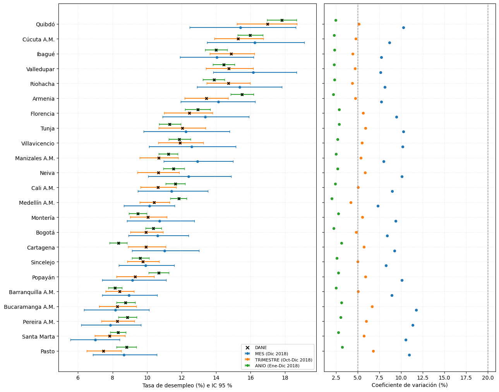

# manual__sensibilidad_ventana_temporal


## Celda 0

```python
%md
# Sensibilidad de la estimación directa a la ventana temporal (G7-B2)

El comentario G7-B2 pide justificar con evidencia el período de la tasa directa. Este notebook
calcula la tasa de desempleo de los 23 dominios (ciudades y ciudades A.M.) con tres ventanas que
cierran en el mismo mes (por defecto diciembre de 2018) y las compara. **No cambia el
pipeline**: la tasa que usa el modelo sale de `preprocesamiento/estimacion_directa.py`, que desde
esta sensibilidad usa el **año** como ventana por defecto (`n_meses_ventana = 12`; el trimestre
queda como opción con `n_meses_ventana = 3`).

| Ventana | Meses | Período (cierre 2018-12) | Validación contra el DANE |
|---|---|---|---|
| `MES` | 1 | Dic 2018 | No hay cifra mensual por ciudad |
| `TRIMESTRE` | 3 | Oct-Dic 2018 (ventana opcional) | Tasa publicada por ciudad (`datos_municipales`) |
| `ANIO` | 12 | Ene-Dic 2018 (ventana del modelo) | Reconstruida con los 4 trimestres (ver abajo) |

Por dominio y ventana se reporta la muestra (personas de 15+, PEA y desocupados muestrales), la
tasa (Hájek con `FEX_C18`), su error estándar bootstrap, el IC 95 %, el CV y la diferencia con
el DANE.

## Criterios para elegir la ventana

1. **Representatividad por diseño.** La GEIH publica resultados mensuales solo para agregados
   (13 ciudades, 11 intermedias, total nacional); por ciudad capital con su A.M. la desagregación
   mínima es trimestral, y también hay semestral y anual (Metodología GEIH v9, PDF 9). Diciembre
   solo queda como referencia de precisión.
2. **Precisión.** CV, error estándar y tamaño de muestra. La nota SAE del DANE exige a las
   estimaciones directas que entran al Fay-Herriot un tamaño de muestra efectivo ≥ 40 (DANE, nota
   SAE 2024, PDF 22), y el modelo supone conocida la varianza de muestreo (Morales et al., p. 425):
   cuanta más muestra, más creíble es ese supuesto.
3. **Se pueden juntar meses.** En las capitales un segmento no se repite en por lo menos tres
   años (GEIH v9, PDF 12): sumar 3 o 12 meses suma muestras distintas, no los mismos hogares.
4. **Alineación con las covariables.** Los indicadores de TerriData son anuales con corte a
   diciembre (celda «TerriData»): una tasa anual describe el mismo período que sus covariables.
5. **Validación externa** contra el DANE, por dominio y en el agregado de los 23 dominios.

## TD anual oficial por ciudad

El anexo DANE no publica la serie anual por ciudad. Las cifras trimestrales son promedios de tres
meses, así que la TD anual es la razón de las sumas de los cuatro trimestres que no se pisan
(Ene-Mar, Abr-Jun, Jul-Sep, Oct-Dic): `TD = Σ_q DESEMPLEADOS_q / Σ_q PEA_q × 100`. La fórmula se
comprueba contra los dos totales anuales que el anexo sí publica (hoja «Anuales»): «Total 13
ciudades y áreas metropolitanas» y «Total 10 ciudades» (`tesis.geih_bronce.datos_anuales`).

## PEA = ocupados + desocupados

En `tesis.geih_oro.mercado_laboral` la bandera `PEA` estaba mal en enero-marzo de 2018: todas las
personas de 15+ quedaban como PEA (la unión con inactivos no encontraba a nadie), lo que subestimaba
la tasa de esos meses. G7-B5 lo corrigió (lectura de CSV por nombre de columna) y hoy la bandera
coincide con `OCUPADO + DESOCUPADO` en los 12 meses. Aquí la PEA se sigue definiendo como
`OCUPADO + DESOCUPADO`, que no depende de la bandera; la celda «Reconciliación» muestra mes a
mes que ambas definiciones coinciden.

## Limitación

El error estándar es el del bootstrap por viviendas dentro del dominio de `EstimacionDirecta`
(G7-B3), que no reproduce el estrato interno ni el segmento de la GEIH. Sirve para comparar
ventanas entre sí, no como varianza de diseño.

## Salidas

* `tesis.preprocesamiento.sensibilidad_ventana_temporal`: una fila por ventana y dominio
* `tesis.preprocesamiento.resumen_ventana_temporal`: una fila por ventana
* `tesis.preprocesamiento.validacion_anual_totales`: comprobación de la fórmula anual
* Figura `ventana_sensibilidad` en `/Volumes/tesis/preprocesamiento/figuras_eda`
```


## Celda 1

```python
import os
import sys

import pandas as pd
from pyspark.sql import functions as F


# R-67: `code/` en sys.path (el notebook está en code/<carpeta>/); `comun.entorno` hace el resto
_ruta_nb = (
    dbutils.notebook.entry_point.getDbutils()
    .notebook()
    .getContext()
    .notebookPath()
    .get()
)
CODE_DIR = "/Workspace" + os.path.dirname(os.path.dirname(_ruta_nb))
sys.path.insert(0, CODE_DIR)

from preprocesamiento.shared.config import *
from preprocesamiento.shared.estimador_sae import EstimacionDirecta
from analisis.shared import descriptivos as desc
from analisis.shared import ventana_temporal as vt

PER_ESTIMACION, MES_ESTIMACION = resolver_periodo(dbutils)
print(f"Mes de cierre de las ventanas: {PER_ESTIMACION}-{MES_ESTIMACION:02d}")
for nombre, n in VENTANAS_TEMPORALES.items():
    print(f"  {nombre:<10} {vt.etiqueta_ventana(PER_ESTIMACION, MES_ESTIMACION, n)}")
```

**Salida:**

```
Mes de cierre de las ventanas: 2018-12
  MES        Dic 2018
  TRIMESTRE  Oct-Dic 2018
  ANIO       Ene-Dic 2018

```


## Celda 2

```python
# Meses de la ventana más larga. N_DIFERENCIA > 0 marca los meses en que la bandera PEA cuenta
# inactivos; ahí TD_BANDERA_PCT queda por debajo de TD_OC_DS_PCT.
reconciliacion = vt.reconciliacion_pea(
    spark,
    meses_ventana(PER_ESTIMACION, MES_ESTIMACION, max(VENTANAS_TEMPORALES.values())),
)
display(reconciliacion)
meses_afectados = reconciliacion[reconciliacion["N_DIFERENCIA"] != 0]
if meses_afectados.empty:
    print("La bandera PEA coincide con OCUPADO + DESOCUPADO en todos los meses.")
else:
    print(
        f"⚠ La bandera PEA no coincide con OCUPADO + DESOCUPADO en {len(meses_afectados)} meses: "
        + ", ".join(f"{r.PER}-{r.MES:02d}" for r in meses_afectados.itertuples())
        + ". Este notebook usa OCUPADO + DESOCUPADO (ver la documentación; corrección de fondo: G7-B5)."
    )
```

**Salida:**

| PER | MES | N_PERSONAS_15MAS | N_PEA_BANDERA | N_OCUPADOS_MAS_DESOCUPADOS | TD_BANDERA_PCT | TD_OC_DS_PCT | N_DIFERENCIA |
|---|---|---|---|---|---|---|---|
| 2018 | 1 | 38942 | 25540 | 25540 | 13.47745810778005 | 13.47745810778005 | 0 |
| 2018 | 2 | 40140 | 26459 | 26459 | 11.903314588609499 | 11.903314588609499 | 0 |
| 2018 | 3 | 39724 | 26418 | 26418 | 10.737365513037762 | 10.737365513037762 | 0 |
| 2018 | 4 | 40481 | 26808 | 26808 | 10.73340590010288 | 10.73340590010288 | 0 |
| 2018 | 5 | 41034 | 27308 | 27308 | 10.32520781356413 | 10.32520781356413 | 0 |
| 2018 | 6 | 39019 | 25867 | 25867 | 11.01090835150742 | 11.01090835150742 | 0 |
| 2018 | 7 | 39526 | 26335 | 26335 | 10.136790641526797 | 10.136790641526797 | 0 |
| 2018 | 8 | 40796 | 26891 | 26891 | 10.22468760068372 | 10.22468760068372 | 0 |
| 2018 | 9 | 39365 | 26169 | 26169 | 10.595434412422826 | 10.595434412422826 | 0 |
| 2018 | 10 | 39285 | 25934 | 25934 | 10.250447338034501 | 10.250447338034501 | 0 |
| 2018 | 11 | 39500 | 26063 | 26063 | 9.939863304712665 | 9.939863304712665 | 0 |
| 2018 | 12 | 38032 | 24952 | 24952 | 10.778607992659527 | 10.778607992659527 | 0 |
```
La bandera PEA coincide con OCUPADO + DESOCUPADO en todos los meses.

```


## Celda 3

```python
# Cuántos indicadores de TerriData tienen dato en cada mes del año de cierre: si casi todos están en
# diciembre, las covariables describen el año calendario (criterio 4).
corte_terridata = (
    spark.table(TBL_TERRIDATA_BRONCE)
    .filter(F.col("ANO") == PER_ESTIMACION)
    .groupBy("MES")
    .agg(F.countDistinct("CODIGO_INDICADOR").alias("N_INDICADORES"))
    .orderBy("MES")
    .toPandas()
)
corte_terridata["PROPORCION"] = (
    corte_terridata["N_INDICADORES"] / corte_terridata["N_INDICADORES"].sum()
)
display(corte_terridata)
en_diciembre = corte_terridata.loc[corte_terridata["MES"] == 12, "PROPORCION"].sum()
print(
    f"Indicadores de TerriData {PER_ESTIMACION} con corte a diciembre: {100 * en_diciembre:.1f} %"
)
```

**Salida:**

| MES | N_INDICADORES | PROPORCION |
|---|---|---|
| 3 | 6 | 0.007416563658838072 |
| 6 | 19 | 0.023485784919653894 |
| 9 | 8 | 0.009888751545117428 |
| 11 | 57 | 0.07045735475896168 |
| 12 | 719 | 0.8887515451174289 |
```
Indicadores de TerriData 2018 con corte a diciembre: 88.9 %

```


## Celda 4

```python
df_municipales = spark.table(TBL_DATOS_MUNICIPALES).toPandas()
df_anuales = spark.table(TBL_DATOS_ANUALES).toPandas()

# Comprobación de la fórmula anual (solo para el año calendario: ventana de 12 meses que cierra
# en diciembre).
validacion_anual = pd.DataFrame()
if MES_ESTIMACION == 12:
    validacion_anual = vt.validar_formula_anual(
        df_municipales, df_anuales, PER_ESTIMACION
    )
    display(validacion_anual)
    for r in validacion_anual.itertuples():
        print(
            f"[{'PASS' if r.COINCIDE else 'FAIL'}] fórmula anual, {r.CONJUNTO}: reconstruida "
            f"{r.TD_RECONSTRUIDA:.4f} vs publicada {r.TD_PUBLICADA:.4f} (dif. {r.DIF_PP:+.4f} pp)"
        )
else:
    print(
        "El cierre no es diciembre: la ventana de 12 meses no es un año calendario y no se valida."
    )
```

**Salida:**

| CONJUNTO | ANIO | TD_RECONSTRUIDA | TD_PUBLICADA | DIF_PP | COINCIDE |
|---|---|---|---|---|---|
| Total 13 ciudades y áreas metropolitanas | 2018 | 10.697577606253821 | 10.697582005 | -4.398746177969315e-06 | True |
| Total 10 ciudades | 2018 | 12.061678683411616 | 12.061672778 | 5.905411615714229e-06 | True |
```
[PASS] fórmula anual, Total 13 ciudades y áreas metropolitanas: reconstruida 10.6976 vs publicada 10.6976 (dif. -0.0000 pp)
[PASS] fórmula anual, Total 10 ciudades: reconstruida 12.0617 vs publicada 12.0617 (dif. +0.0000 pp)

```


## Celda 5

```python
# Misma estimación que estimacion_directa.py (Hájek con FEX_C18, bootstrap por viviendas dentro
# del dominio con la misma semilla y número de réplicas) sobre los meses de cada ventana.
estimador = EstimacionDirecta(
    spark, num_replicas=BOOTSTRAP_REPLICAS, seed=BOOTSTRAP_SEED
)
bloques = []
total_23_dane = {}
for ventana, n_meses in VENTANAS_TEMPORALES.items():
    periodo = vt.etiqueta_ventana(PER_ESTIMACION, MES_ESTIMACION, n_meses)
    print(f"\n── {ventana}: {periodo} ──")
    df_pea, conteos, meses_presentes = vt.preparar_datos_ventana(
        spark, PER_ESTIMACION, MES_ESTIMACION, n_meses
    )
    faltantes = set(meses_ventana(PER_ESTIMACION, MES_ESTIMACION, n_meses)) - set(
        meses_presentes
    )
    if faltantes:
        print(f"⚠ Sin datos en GEIH para: {sorted(faltantes)}")

    resultado = estimador.estimar(dataframe=df_pea, grupo_cols=GRUPO_COLS)
    dane = vt.td_dane_ventana(df_municipales, PER_ESTIMACION, MES_ESTIMACION, n_meses)
    total = dane.loc[dane["CIUDAD"] == NOMBRE_TOTAL_23, "TD_DANE"]
    total_23_dane[ventana] = None if total.empty else float(total.iloc[0])

    bloque = (
        resultado.merge(conteos, on="CODIGO_DOMINIO", how="left", validate="one_to_one")
        .merge(
            dane.rename(columns={"CIUDAD": "NOMBRE_DOMINIO"}),
            on="NOMBRE_DOMINIO",
            how="left",
            validate="one_to_one",
        )
        .assign(VENTANA=ventana, N_MESES_VENTANA=n_meses, PERIODO=periodo)
    )
    bloque["TD_DANE"] = bloque["TD_DANE"].astype(float)
    bloque["DIF_PP"] = bloque["TASA_DESEMPLEO_PCT"] - bloque["TD_DANE"]
    bloques.append(bloque[vt.COLUMNAS_DETALLE])

detalle = pd.concat(bloques, ignore_index=True)
display(detalle)
```

**Salida:**

```

── MES: Dic 2018 ──
Convirtiendo a Pandas...
Datos: 24,952 filas — 23 dominios — remuestreo por conglomerado ID_VIVIENDA

✔ Bootstrap: 2,000 réplicas por dominio — 23 dominios estimados
Aproximación a la varianza del diseño: no reproduce el estrato interno, el segmento ni la calibración del FEX de la GEIH (G7-B3, R-25).

── TRIMESTRE: Oct-Dic 2018 ──
Convirtiendo a Pandas...
Datos: 76,949 filas — 23 dominios — remuestreo por conglomerado ID_VIVIENDA

✔ Bootstrap: 2,000 réplicas por dominio — 23 dominios estimados
Aproximación a la varianza del diseño: no reproduce el estrato interno, el segmento ni la calibración del FEX de la GEIH (G7-B3, R-25).

── ANIO: Ene-Dic 2018 ──
Convirtiendo a Pandas...
Datos: 314,744 filas — 23 dominios — remuestreo por conglomerado ID_VIVIENDA

✔ Bootstrap: 2,000 réplicas por dominio — 23 dominios estimados
Aproximación a la varianza del diseño: no reproduce el estrato interno, el segmento ni la calibración del FEX de la GEIH (G7-B3, R-25).

```
| VENTANA | N_MESES_VENTANA | PERIODO | CODIGO_DOMINIO | NOMBRE_DOMINIO | TIPO_DOMINIO | N_PERSONAS_15MAS | N_PEA | N_DESOCUPADOS | N_MESES | PEA_EXPANDIDA | TASA_DESEMPLEO_PCT | SE_BOOTSTRAP_PCT | IC_INF_PCT | IC_SUP_PCT | CV_PORCENTAJE | TD_DANE | DIF_PP |
|---|---|---|---|---|---|---|---|---|---|---|---|---|---|---|---|---|---|
| MES | 1 | Dic 2018 | 05001 | Medellín A.M. | CIUDAD_AM | 2676 | 1815 | 183 | 1 | 2097882.075832479 | 10.140985052897614 | 0.7460832553692059 | 8.652185617673318 | 11.606446299582988 | 7.357108323081743 | None | None |
| MES | 1 | Dic 2018 | 08001 | Barranquilla A.M. | CIUDAD_AM | 2408 | 1612 | 141 | 1 | 950544.9372992365 | 8.951795493306872 | 0.8022627601259794 | 7.405710754064796 | 10.593715649423112 | 8.96203181502325 | None | None |
| MES | 1 | Dic 2018 | 11001 | Bogotá | CIUDAD | 1874 | 1356 | 150 | 1 | 4452907.832228691 | 10.619117635606477 | 0.8935129502291382 | 8.938044552548034 | 12.402901614583527 | 8.414192034497676 | None | None |
| MES | 1 | Dic 2018 | 13001 | Cartagena | CIUDAD | 1736 | 1073 | 122 | 1 | 412566.4153904556 | 11.017013106926923 | 1.0201722631087278 | 9.124090297681681 | 13.000646057028328 | 9.259971402478378 | None | None |
| MES | 1 | Dic 2018 | 15001 | Tunja | CIUDAD | 1205 | 754 | 96 | 1 | 83631.87291513917 | 12.254965746640261 | 1.2591222622577645 | 9.79657323125293 | 14.79452097090588 | 10.274384182615583 | None | None |
| MES | 1 | Dic 2018 | 17001 | Manizales A.M. | CIUDAD_AM | 1769 | 1039 | 139 | 1 | 231084.17011875974 | 12.927587945503666 | 1.036647135672373 | 10.964161678598416 | 14.994082356605965 | 8.01887513774701 | None | None |
| MES | 1 | Dic 2018 | 18001 | Florencia | CIUDAD | 1184 | 744 | 104 | 1 | 71275.73082442016 | 13.362953602049588 | 1.2686128852584977 | 10.891746435944547 | 15.909794438735329 | 9.493506623145947 | None | None |
| MES | 1 | Dic 2018 | 19001 | Popayán | CIUDAD | 1618 | 1013 | 100 | 1 | 136618.51946531303 | 9.154173415962326 | 0.9229747924698862 | 7.407285806444175 | 11.100445233129411 | 10.082557436157758 | None | None |
| MES | 1 | Dic 2018 | 20001 | Valledupar | CIUDAD | 1578 | 1030 | 165 | 1 | 211710.7918664169 | 16.1558195230159 | 1.2365113301736457 | 13.836261685455797 | 18.662180047605332 | 7.653658970453881 | None | None |
| MES | 1 | Dic 2018 | 23001 | Montería | CIUDAD | 1636 | 1099 | 120 | 1 | 204498.7968534942 | 10.730116697891457 | 1.0089060020165055 | 8.84936704134847 | 12.746074228426089 | 9.402563181952742 | None | None |
| MES | 1 | Dic 2018 | 27001 | Quibdó | CIUDAD | 1115 | 681 | 109 | 1 | 46562.49847276689 | 15.420065451909428 | 1.5846704517730368 | 12.469553372225525 | 18.616551452607368 | 10.276677856622268 | None | None |
| MES | 1 | Dic 2018 | 41001 | Neiva | CIUDAD | 1473 | 928 | 110 | 1 | 161684.1492270983 | 12.413290414440482 | 1.251903623657133 | 10.074636618227402 | 14.871249587762945 | 10.085187584113743 | None | None |
| MES | 1 | Dic 2018 | 44001 | Riohacha | CIUDAD | 1603 | 1003 | 159 | 1 | 57728.14672767678 | 15.372436322343205 | 1.2523309654686934 | 12.900898861415167 | 17.81791029134473 | 8.146600442562782 | None | None |
| MES | 1 | Dic 2018 | 47001 | Santa Marta | CIUDAD | 1887 | 1197 | 89 | 1 | 224035.02930239117 | 6.991887687966491 | 0.73768637578243 | 5.556310644998248 | 8.41721790673565 | 10.550603909900296 | None | None |
| MES | 1 | Dic 2018 | 50001 | Villavicencio | CIUDAD | 1404 | 955 | 112 | 1 | 266220.45440885524 | 12.575646806812912 | 1.2788640626116736 | 10.118058395597814 | 15.137344418135193 | 10.169370071039555 | None | None |
| MES | 1 | Dic 2018 | 52001 | Pasto | CIUDAD | 1506 | 954 | 83 | 1 | 160642.79916696638 | 8.66975650588512 | 0.9490874054560086 | 6.870153024594977 | 10.57162892825403 | 10.947105663368497 | None | None |
| MES | 1 | Dic 2018 | 54001 | Cúcuta A.M. | CIUDAD_AM | 1459 | 934 | 153 | 1 | 453847.4089792102 | 16.236825581316836 | 1.4099022316942833 | 13.482871888284548 | 19.122966992213602 | 8.683361317353867 | None | None |
| MES | 1 | Dic 2018 | 63001 | Armenia | CIUDAD | 1637 | 1061 | 152 | 1 | 157464.75464532556 | 14.130432678362833 | 1.0955001250670697 | 11.965269112940415 | 16.265405411430052 | 7.752771270369871 | None | None |
| MES | 1 | Dic 2018 | 66001 | Pereira A.M. | CIUDAD_AM | 1638 | 1090 | 88 | 1 | 339328.45031044015 | 7.876462960296522 | 0.8956552095090178 | 6.190067086091155 | 9.653085492066657 | 11.371287010728219 | None | None |
| MES | 1 | Dic 2018 | 68001 | Bucaramanga A.M. | CIUDAD_AM | 1503 | 1016 | 86 | 1 | 629131.5991270213 | 8.166433832206385 | 0.9604198827458077 | 6.352092724319987 | 10.114157623748753 | 11.760578760317024 | None | None |
| MES | 1 | Dic 2018 | 70001 | Sincelejo | CIUDAD | 1844 | 1337 | 142 | 1 | 138382.11023509756 | 9.919298873811815 | 0.8191457527903262 | 8.364728219378044 | 11.580737165335886 | 8.258101335699978 | None | None |
| MES | 1 | Dic 2018 | 73001 | Ibagué | CIUDAD | 1538 | 1059 | 155 | 1 | 277179.7308254994 | 14.048354368473062 | 1.0857998230148231 | 11.920811175541862 | 16.185437851174846 | 7.729017894448519 | None | None |
| MES | 1 | Dic 2018 | 76001 | Cali A.M. | CIUDAD_AM | 1741 | 1202 | 130 | 1 | 1224090.0982070016 | 11.410938710247564 | 1.0273281177277542 | 9.477496507137564 | 13.518616326978616 | 9.003011442039952 | None | None |
| TRIMESTRE | 3 | Oct-Dic 2018 | 05001 | Medellín A.M. | CIUDAD_AM | 7997 | 5369 | 556 | 3 | 2062541.8658536386 | 10.40852488317267 | 0.43838441061731853 | 9.57474699387054 | 11.306784127010488 | 4.211782318223104 | 10.408524884121231 | -9.485603413850185e-10 |
| TRIMESTRE | 3 | Oct-Dic 2018 | 08001 | Barranquilla A.M. | CIUDAD_AM | 7435 | 5012 | 438 | 3 | 955104.6568003739 | 8.403929811708212 | 0.42348510072264406 | 7.594602503805628 | 9.245164514975421 | 5.039131813460076 | 8.403929814365158 | -2.656946662682458e-09 |
| TRIMESTRE | 3 | Oct-Dic 2018 | 11001 | Bogotá | CIUDAD | 6134 | 4366 | 443 | 3 | 4360821.924927834 | 9.94855235469736 | 0.48108057832423307 | 9.04568667834882 | 10.913957654877414 | 4.835684239999837 | 9.948552355375835 | -6.784741657384075e-10 |
| TRIMESTRE | 3 | Oct-Dic 2018 | 13001 | Cartagena | CIUDAD | 5390 | 3345 | 344 | 3 | 419313.79350185493 | 9.943526110066529 | 0.568524624324825 | 8.895591942682001 | 11.087343234612307 | 5.717535389676984 | 9.94352606478372 | 4.528280861393341e-08 |
| TRIMESTRE | 3 | Oct-Dic 2018 | 15001 | Tunja | CIUDAD | 3770 | 2371 | 292 | 3 | 84521.70106632043 | 12.04459094203273 | 0.7136547974141022 | 10.688276919952877 | 13.386001731551541 | 5.925106139749573 | 12.04459072570175 | 2.16330979796453e-07 |
| TRIMESTRE | 3 | Oct-Dic 2018 | 17001 | Manizales A.M. | CIUDAD_AM | 5137 | 3092 | 335 | 3 | 233892.6960955401 | 10.679372577966378 | 0.5729878242404434 | 9.573911731766875 | 11.789365928667337 | 5.365369735508888 | 10.679372533006902 | 4.495947614202578e-08 |
| TRIMESTRE | 3 | Oct-Dic 2018 | 18001 | Florencia | CIUDAD | 3847 | 2394 | 314 | 3 | 70865.88928516704 | 12.452147397202037 | 0.7017933834569978 | 10.994802715515714 | 13.789092545811371 | 5.635922552721219 | 12.452147875864755 | -4.786627183506198e-07 |
| TRIMESTRE | 3 | Oct-Dic 2018 | 19001 | Popayán | CIUDAD | 4993 | 3063 | 302 | 3 | 133704.27195184727 | 9.316164407090385 | 0.5521958847180679 | 8.238161187783968 | 10.41128293757228 | 5.927287890044108 | 9.3161645807801 | -1.736897150550476e-07 |
| TRIMESTRE | 3 | Oct-Dic 2018 | 20001 | Valledupar | CIUDAD | 4977 | 3245 | 478 | 3 | 213558.724782284 | 14.7421268865658 | 0.6930271480388711 | 13.406484942505228 | 16.14674200629002 | 4.700998393050142 | 14.74212680804328 | 7.852252004170168e-08 |
| TRIMESTRE | 3 | Oct-Dic 2018 | 23001 | Montería | CIUDAD | 5040 | 3396 | 361 | 3 | 203052.94641596722 | 10.04456605111384 | 0.5597563147244151 | 9.009452403686847 | 11.153475703031713 | 5.572727700489797 | 10.044566061036834 | -9.92299398205887e-09 |
| TRIMESTRE | 3 | Oct-Dic 2018 | 27001 | Quibdó | CIUDAD | 3457 | 2156 | 376 | 3 | 48892.1623178483 | 16.971008907970287 | 0.8754729523037852 | 15.21342312153713 | 18.69550127003419 | 5.158638222696513 | 16.971009129772785 | -2.218024981459621e-07 |
| TRIMESTRE | 3 | Oct-Dic 2018 | 41001 | Neiva | CIUDAD | 4725 | 2972 | 313 | 3 | 161588.13972009634 | 10.644766109107467 | 0.6238949251578019 | 9.436684305761412 | 11.876873092490936 | 5.861048695320875 | 10.644765988899856 | 1.202076109763084e-07 |
| TRIMESTRE | 3 | Oct-Dic 2018 | 44001 | Riohacha | CIUDAD | 4937 | 3218 | 495 | 3 | 58144.86923617233 | 14.723859364958441 | 0.6483065740544586 | 13.461647716578124 | 15.966072263516285 | 4.403102189344285 | 14.723859728569458 | -3.636110168514506e-07 |
| TRIMESTRE | 3 | Oct-Dic 2018 | 47001 | Santa Marta | CIUDAD | 5720 | 3662 | 293 | 3 | 223238.72752840267 | 7.820125039383326 | 0.44877330198435955 | 6.986284955035351 | 8.736299480081007 | 5.7386972679371455 | 7.820125063067388 | -2.3684061822848435e-08 |
| TRIMESTRE | 3 | Oct-Dic 2018 | 50001 | Villavicencio | CIUDAD | 4455 | 3121 | 361 | 3 | 270153.1408734484 | 11.921194994615963 | 0.6546927007566911 | 10.646471254899497 | 13.263435601351937 | 5.491837865686901 | 11.921194988587594 | 6.028368915167448e-09 |
| TRIMESTRE | 3 | Oct-Dic 2018 | 52001 | Pasto | CIUDAD | 4448 | 2825 | 215 | 3 | 162771.16121523536 | 7.476596428331093 | 0.5084542931165136 | 6.499478145127485 | 8.496754398417998 | 6.800611722064145 | 7.476596545256562 | -1.1692546930675007e-07 |
| TRIMESTRE | 3 | Oct-Dic 2018 | 54001 | Cúcuta A.M. | CIUDAD_AM | 4525 | 2865 | 439 | 3 | 448849.8215394172 | 15.280565288534989 | 0.7332667329471221 | 13.910251164151994 | 16.74180972513841 | 4.798688524287072 | 15.280565278008556 | 1.0526433058544171e-08 |
| TRIMESTRE | 3 | Oct-Dic 2018 | 63001 | Armenia | CIUDAD | 4743 | 3141 | 428 | 3 | 160000.93056320993 | 13.446073879648301 | 0.6364306715520336 | 12.174142027213453 | 14.687009757765956 | 4.733208200762022 | 13.446073872003641 | 7.644660016126181e-09 |
| TRIMESTRE | 3 | Oct-Dic 2018 | 66001 | Pereira A.M. | CIUDAD_AM | 4849 | 3250 | 273 | 3 | 341042.0590689029 | 8.273292577356104 | 0.4962506419582484 | 7.354600861876002 | 9.2727724591147 | 5.998224253744877 | 8.273292571616023 | 5.7400804109875025e-09 |
| TRIMESTRE | 3 | Oct-Dic 2018 | 68001 | Bucaramanga A.M. | CIUDAD_AM | 4732 | 3224 | 264 | 3 | 633351.7977373672 | 8.274968286281892 | 0.5505132663277965 | 7.214024605904003 | 9.375742335507466 | 6.652753790494019 | 8.274968328778613 | -4.2496720809026556e-08 |
| TRIMESTRE | 3 | Oct-Dic 2018 | 70001 | Sincelejo | CIUDAD | 5376 | 3904 | 405 | 3 | 138031.86160573663 | 9.75942122827978 | 0.4882467780903052 | 8.85222344146487 | 10.710211979404995 | 5.002825133477354 | 9.759421366446105 | -1.3816632460361689e-07 |
| TRIMESTRE | 3 | Oct-Dic 2018 | 73001 | Ibagué | CIUDAD | 4479 | 3071 | 469 | 3 | 276971.83678524283 | 14.871331435685226 | 0.6609001870530066 | 13.62971942402906 | 16.21347927715976 | 4.444122504506297 | 14.871331484868621 | -4.918339513437786e-08 |
| TRIMESTRE | 3 | Oct-Dic 2018 | 76001 | Cali A.M. | CIUDAD_AM | 5651 | 3887 | 405 | 3 | 1223867.545987171 | 10.6416102251473 | 0.5375912371599706 | 9.614982160926475 | 11.676624623671852 | 5.051784699740113 | 10.641610231896777 | -6.749477421408301e-09 |
| ANIO | 12 | Ene-Dic 2018 | 05001 | Medellín A.M. | CIUDAD_AM | 32153 | 21615 | 2548 | 12 | 2040764.1497329015 | 11.837792024340981 | 0.2382233805694716 | 11.349424365236075 | 12.303094282043793 | 2.012397076073261 | 11.837783320635884 | 8.70370509709062e-06 |
| ANIO | 12 | Ene-Dic 2018 | 08001 | Barranquilla A.M. | CIUDAD_AM | 29977 | 20333 | 1732 | 12 | 938958.6916910573 | 8.147876963504446 | 0.20364320313348963 | 7.758369144028984 | 8.539067924476932 | 2.4993406754377596 | 8.147853101147122 | 2.3862357323878314e-05 |
| ANIO | 12 | Ene-Dic 2018 | 11001 | Bogotá | CIUDAD | 25966 | 18637 | 1974 | 12 | 4333474.215495608 | 10.369891846009237 | 0.23470569243768638 | 9.923013925606222 | 10.842821595503773 | 2.2633379009445584 | 10.369894873040097 | -3.0270308606361596e-06 |
| ANIO | 12 | Ene-Dic 2018 | 13001 | Cartagena | CIUDAD | 21888 | 13211 | 1146 | 12 | 403260.57932271744 | 8.348479134679252 | 0.2616260061808899 | 7.831033367314714 | 8.846062553114713 | 3.13381637493835 | 8.348511694053844 | -3.2559374592011636e-05 |
| ANIO | 12 | Ene-Dic 2018 | 15001 | Tunja | CIUDAD | 15555 | 9801 | 1121 | 12 | 83439.43078171973 | 11.31387295825135 | 0.3258870132527561 | 10.699802124751084 | 11.955660713295213 | 2.8804195915518265 | 11.313852210726902 | 2.074752444869432e-05 |
| ANIO | 12 | Ene-Dic 2018 | 17001 | Manizales A.M. | CIUDAD_AM | 21370 | 12968 | 1467 | 12 | 236030.68581083228 | 11.237104562268692 | 0.2842853489085462 | 10.677125697287714 | 11.766479884078391 | 2.5298807831966186 | 11.236977346196051 | 0.000127216072641545 |
| ANIO | 12 | Ene-Dic 2018 | 18001 | Florencia | CIUDAD | 15746 | 9796 | 1321 | 12 | 69607.81369492256 | 12.940077494574945 | 0.37147473231937 | 12.194454102742279 | 13.654308492082206 | 2.870730352852282 | 12.94001027184473 | 6.722273021431135e-05 |
| ANIO | 12 | Ene-Dic 2018 | 19001 | Popayán | CIUDAD | 21140 | 12701 | 1403 | 12 | 132019.3508940908 | 10.67751322056855 | 0.29563369653389177 | 10.089364929882032 | 11.262680455663931 | 2.768750461150448 | 10.67742014895555 | 9.307161299965117e-05 |
| ANIO | 12 | Ene-Dic 2018 | 20001 | Valledupar | CIUDAD | 19758 | 12703 | 1874 | 12 | 205750.73131105737 | 14.450446813558157 | 0.32883821097383414 | 13.808108840333103 | 15.075758351899072 | 2.2756265963022067 | 14.450372598884815 | 7.421467334189913e-05 |
| ANIO | 12 | Ene-Dic 2018 | 23001 | Montería | CIUDAD | 20440 | 13713 | 1393 | 12 | 202389.90258019697 | 9.467462710346696 | 0.2654040885773768 | 8.960236794390546 | 9.987294280335615 | 2.8033285865211264 | 9.467364988388754 | 9.772195794255367e-05 |
| ANIO | 12 | Ene-Dic 2018 | 27001 | Quibdó | CIUDAD | 14169 | 8997 | 1616 | 12 | 49680.68382331101 | 17.81311521809962 | 0.43966546604740253 | 16.965277330589636 | 18.65399710505331 | 2.468212104756755 | 17.812734308560156 | 0.0003809095394657902 |
| ANIO | 12 | Ene-Dic 2018 | 41001 | Neiva | CIUDAD | 19427 | 12725 | 1480 | 12 | 166938.44716835534 | 11.533679893497528 | 0.3105304705479978 | 10.957320227344109 | 12.152495187147814 | 2.6923798251334254 | 11.533738472551269 | -5.85790537410702e-05 |
| ANIO | 12 | Ene-Dic 2018 | 44001 | Riohacha | CIUDAD | 20063 | 13582 | 1957 | 12 | 58310.390007789334 | 13.883929931442381 | 0.3222469880485139 | 13.244348539171455 | 14.499344763582675 | 2.3210070177517537 | 13.8834343728831 | 0.000495558559281406 |
| ANIO | 12 | Ene-Dic 2018 | 47001 | Santa Marta | CIUDAD | 23028 | 14754 | 1249 | 12 | 219826.13831085642 | 8.316388353479095 | 0.23289852902875874 | 7.862394844520332 | 8.765618289567136 | 2.8004768311634636 | 8.316445014591052 | -5.666111195701262e-05 |
| ANIO | 12 | Ene-Dic 2018 | 50001 | Villavicencio | CIUDAD | 17780 | 12177 | 1448 | 12 | 262642.1354978495 | 11.873324720682339 | 0.3195548786894929 | 11.256153798843128 | 12.509159080810065 | 2.691368139985719 | 11.873280098689376 | 4.4621992962845525e-05 |
| ANIO | 12 | Ene-Dic 2018 | 52001 | Pasto | CIUDAD | 17889 | 11830 | 1062 | 12 | 167862.9085346535 | 8.815888010228242 | 0.28462155223699975 | 8.243614039563761 | 9.37576973229564 | 3.2285068946744815 | 8.815982104427576 | -9.409419933348317e-05 |
| ANIO | 12 | Ene-Dic 2018 | 54001 | Cúcuta A.M. | CIUDAD_AM | 18116 | 11656 | 1875 | 12 | 446606.4078507225 | 15.983358846687304 | 0.36633003644268847 | 15.25287005567311 | 16.706657085403627 | 2.291946517353039 | 15.983421647468186 | -6.280078088138907e-05 |
| ANIO | 12 | Ene-Dic 2018 | 63001 | Armenia | CIUDAD | 19178 | 12693 | 1996 | 12 | 158573.68096283954 | 15.491457817733293 | 0.34182720974203185 | 14.842391474475553 | 16.1839066166701 | 2.206552887170744 | 15.491529966340583 | -7.214860728943506e-05 |
| ANIO | 12 | Ene-Dic 2018 | 66001 | Pereira A.M. | CIUDAD_AM | 19429 | 13033 | 1175 | 12 | 340084.0804418232 | 8.866599810615549 | 0.26887918331041705 | 8.343048715211525 | 9.390700217855924 | 3.0324948577074733 | 8.86655943825643 | 4.037235911802384e-05 |
| ANIO | 12 | Ene-Dic 2018 | 68001 | Bucaramanga A.M. | CIUDAD_AM | 19794 | 13778 | 1204 | 12 | 637258.9811706132 | 8.739145745214026 | 0.27610015993199827 | 8.23020348177573 | 9.311636656466158 | 3.1593495289079474 | 8.739146877486235 | -1.1322722084372572e-06 |
| ANIO | 12 | Ene-Dic 2018 | 70001 | Sincelejo | CIUDAD | 21836 | 15737 | 1558 | 12 | 135144.64941063352 | 9.60566705797104 | 0.25141368003718423 | 9.132009036096445 | 10.112102041572097 | 2.617347431676329 | 9.605441572832094 | 0.00022548513894626865 |
| ANIO | 12 | Ene-Dic 2018 | 73001 | Ibagué | CIUDAD | 18340 | 12477 | 1788 | 12 | 273059.24838054465 | 13.99413661480143 | 0.3293502028833267 | 13.36433135640577 | 14.644770227091156 | 2.353487120705803 | 13.99411117357206 | 2.5441229370315455e-05 |
| ANIO | 12 | Ene-Dic 2018 | 76001 | Cali A.M. | CIUDAD_AM | 22802 | 15827 | 1808 | 12 | 1229927.9858649364 | 11.651373436219085 | 0.28404039180662977 | 11.073815873311904 | 12.205851595403628 | 2.4378275519319548 | 11.651373088505993 | 3.4771309209702395e-07 |


## Celda 6

```python
# 1. La ventana que usa el modelo (N_MESES_VENTANA de la estimación directa; por defecto ANIO)
#    debe reproducir su tasa: confirma que este notebook estima lo mismo que estimacion_directa.py
#    (la PEA por ocupados + desocupados coincide con la bandera PEA desde la corrección G7-B5).
actual = spark.table(TBL_ESTIMACION_DIRECTA).toPandas()
actual = actual[(actual["PER"] == PER_ESTIMACION) & (actual["MES"] == MES_ESTIMACION)]
if actual.empty:
    print(
        f"{TBL_ESTIMACION_DIRECTA} no tiene el período {PER_ESTIMACION}-{MES_ESTIMACION:02d}: no se compara."
    )
else:
    n_meses_modelo = int(actual["N_MESES_VENTANA"].iloc[0])
    del_modelo = detalle[detalle["N_MESES_VENTANA"] == n_meses_modelo]
    ventana_modelo = (
        del_modelo["VENTANA"].iloc[0] if len(del_modelo) else str(n_meses_modelo)
    )
    comparada = del_modelo.merge(
        actual[["CODIGO_DOMINIO", "TASA_DESEMPLEO_PCT"]],
        on="CODIGO_DOMINIO",
        suffixes=("", "_ACTUAL"),
    )
    dif_max = (
        (comparada["TASA_DESEMPLEO_PCT"] - comparada["TASA_DESEMPLEO_PCT_ACTUAL"])
        .abs()
        .max()
    )
    print(
        f"[{'PASS' if dif_max < 1e-8 and len(comparada) == len(actual) else 'FAIL'}] la ventana "
        f"{ventana_modelo} (la del modelo) reproduce {TBL_ESTIMACION_DIRECTA} ({len(comparada)} de "
        f"{len(actual)} dominios; dif. máx. {dif_max:.2e} pp)"
    )

# 2. Cada dominio y el agregado de los 23 contra el DANE, por ventana.
for ventana, g in detalle.groupby("VENTANA", sort=False):
    con_dane = g["TD_DANE"].notna()
    if not con_dane.any():
        print(f"[N/A ] {ventana}: el DANE no publica esta ventana por ciudad")
        continue
    ok = g.loc[con_dane, "DIF_PP"].abs() <= vt.TOLERANCIA_PP
    print(
        f"[{'PASS' if ok.all() and con_dane.all() else 'FAIL'}] {ventana}: {int(ok.sum())} de "
        f"{len(g)} dominios coinciden con el DANE (tolerancia {vt.TOLERANCIA_PP} pp)"
    )
    if not ok.all():
        display(
            g.loc[con_dane][~ok][
                ["NOMBRE_DOMINIO", "TASA_DESEMPLEO_PCT", "TD_DANE", "DIF_PP"]
            ]
        )
    total = total_23_dane.get(ventana)
    if total is not None:
        dif = vt.agregado_dominios(g) - total
        print(
            f"[{'PASS' if abs(dif) <= vt.TOLERANCIA_PP else 'FAIL'}] {ventana}: agregado de los "
            f"dominios vs «{NOMBRE_TOTAL_23}» {total:.4f} (dif. {dif:+.4f} pp)"
        )
```

**Salida:**

```
[PASS] la ventana ANIO (la del modelo) reproduce tesis.preprocesamiento.tasa_desempleo_municipal (23 de 23 dominios; dif. máx. 0.00e+00 pp)
[N/A ] MES: el DANE no publica esta ventana por ciudad
[PASS] TRIMESTRE: 23 de 23 dominios coinciden con el DANE (tolerancia 0.01 pp)
[PASS] TRIMESTRE: agregado de los dominios vs «Total 23 ciudades y A.M.» 10.3251 (dif. +0.0000 pp)
[PASS] ANIO: 23 de 23 dominios coinciden con el DANE (tolerancia 0.01 pp)
[PASS] ANIO: agregado de los dominios vs «Total 23 ciudades y A.M.» 10.8340 (dif. +0.0000 pp)

```


## Celda 7

```python
resumen = vt.resumen_ventanas(detalle, total_23_dane)
comparacion = vt.comparar_ventanas(detalle)
display(resumen)
display(comparacion)
```

**Salida:**

| VENTANA | N_MESES_VENTANA | PERIODO | N_DOMINIOS | N_PEA_MIN | N_PEA_MEDIANA | N_DESOCUPADOS_MIN | SE_MEDIANA_PP | CV_MEDIANA | CV_MAXIMO | N_CONFIABLES | N_ACEPTABLES | N_NO_CONFIABLES | N_CON_CIFRA_DANE | N_COINCIDEN_DANE | TD_AGREGADA_PCT | TD_TOTAL_23_DANE | DIF_AGREGADO_PP |
|---|---|---|---|---|---|---|---|---|---|---|---|---|---|---|---|---|---|
| MES | 1 | Dic 2018 | 23 | 681 | 1039.0 | 83 | 1.0273281177277542 | 9.259971402478378 | 11.760578760317024 | 0 | 23 | 0 | 0 | 0 | 10.778607992659504 | None | None |
| TRIMESTRE | 3 | Oct-Dic 2018 | 23 | 2156 | 3218.0 | 215 | 0.568524624324825 | 5.365369735508888 | 6.800611722064145 | 7 | 16 | 0 | 23 | 23 | 10.325100841601568 | 10.325100841171988 | 4.2957992718584137e-10 |
| ANIO | 12 | Ene-Dic 2018 | 23 | 8997 | 12968.0 | 1062 | 0.28462155223699975 | 2.617347431676329 | 3.2285068946744815 | 23 | 0 | 0 | 23 | 23 | 10.834004965581583 | 10.834004590313047 | 3.7526853624569867e-07 |
| VENTANA_A | VENTANA_B | CORRELACION_TD | DIF_ABS_MEDIA_PP | DIF_ABS_MAX_PP | RAZON_SE_MEDIANA | RAZON_SE_ESPERADA |
|---|---|---|---|---|---|---|
| MES | TRIMESTRE | 0.9478371429269125 | 0.8144412504962502 | 2.248215367537288 | 1.8048444350110744 | 1.763287027525356 |
| MES | ANIO | 0.8920145116135393 | 1.0297413004621225 | 2.668533972247671 | 3.616838123597376 | 3.532878706352899 |
| TRIMESTRE | ANIO | 0.946293179520843 | 0.7829986016276517 | 2.045383938084992 | 2.001656047829537 | 2.01703045771866 |


## Celda 8

```python
fig = vt.figura_ventanas(detalle)
desc.guardar_figura(fig, "ventana_sensibilidad", VOLUMEN_FIGURAS)
display(fig)
print(vt.interpretar_ventanas(resumen, comparacion))
```

**Salida:**

```
  figura guardada: /Volumes/tesis/preprocesamiento/figuras_eda/ventana_sensibilidad.png

```

```
INTERPRETACIÓN:
  MES (Dic 2018): PEA muestral mínima 681 y mediana 1,039; desocupados muestrales mínimo 83. CV mediano 9.3 % (máx. 11.8 %): 0 confiables, 23 aceptables, 0 no confiables. Sin cifra dane por dominio contra la cual validar.
  TRIMESTRE (Oct-Dic 2018): PEA muestral mínima 2,156 y mediana 3,218; desocupados muestrales mínimo 215. CV mediano 5.4 % (máx. 6.8 %): 7 confiables, 16 aceptables, 0 no confiables. Reproduce la cifra dane en 23 de 23 dominios.
  ANIO (Ene-Dic 2018): PEA muestral mínima 8,997 y mediana 12,968; desocupados muestrales mínimo 1,062. CV mediano 2.6 % (máx. 3.2 %): 23 confiables, 0 aceptables, 0 no confiables. Reproduce la cifra dane en 23 de 23 dominios.
  MES vs TRIMESTRE: correlación de la tasa entre dominios r = 0.95; diferencia media 0.81 pp (máx. 2.25); el SE de MES es 1.80 veces el de TRIMESTRE (la muestra predice 1.76).
  MES vs ANIO: correlación de la tasa entre dominios r = 0.89; diferencia media 1.03 pp (máx. 2.67); el SE de MES es 3.62 veces el de ANIO (la muestra predice 3.53).
  TRIMESTRE vs ANIO: correlación de la tasa entre dominios r = 0.95; diferencia media 0.78 pp (máx. 2.05); el SE de TRIMESTRE es 2.00 veces el de ANIO (la muestra predice 2.02).
  Lectura: el diseño GEIH solo hace representativa por ciudad la ventana trimestral o mayor (GEIH v9, PDF 9), así que el mes queda como referencia de precisión. Entre el trimestre y el año, la elección se apoya en la ganancia de precisión de esta tabla, en la validación contra el DANE y en que las covariables de TerriData son anuales con corte a diciembre.

```



## Celda 9

```python
for tabla, df in [
    (TBL_SENSIBILIDAD_VENTANA, detalle),
    (TBL_RESUMEN_VENTANA, resumen),
    (TBL_VALIDACION_ANUAL, validacion_anual),
]:
    if df.empty:
        print(f"Sin filas para {tabla}: no se escribe.")
        continue
    (
        spark.createDataFrame(df)
        .write.mode("overwrite")
        .option("overwriteSchema", "true")
        .saveAsTable(tabla)
    )
    print(f"Tabla escrita: {tabla} ({len(df)} filas)")
```

**Salida:**

```
Tabla escrita: tesis.preprocesamiento.sensibilidad_ventana_temporal (69 filas)
Tabla escrita: tesis.preprocesamiento.resumen_ventana_temporal (3 filas)
Tabla escrita: tesis.preprocesamiento.validacion_anual_totales (2 filas)

```
