# modelo__fay_herriot


## Celda 0

```python
%md
# Modelo Fay-Herriot

Las decisiones metodológicas se apoyan en Morales et al. (2021), *A Course on Small
Area Estimation and Mixed Models*.

Es el modelo base (**benchmark**) Fay-Herriot **clásico**: efectos aleatorios
independientes por dominio, sin componente espacial. La comparación con las variantes
espaciales del objetivo 1 (`fay_herriot_espacial`) cerró sin evidencia de dependencia
espacial, así que la tabla final (R-11, D-03) lleva
`MODELO_FUENTE = FH_CLASICO_BENCHMARK_NO_ESPACIAL` y
`ESTADO_RESULTADO = FINAL_TRAS_COMPARACION_ESPACIAL`. Â se estima por REML, β̂ por
mínimos cuadrados generalizados y el AIC con la verosimilitud ML
(`shared/fay_herriot.py`).

**G7-B15 — EC1…EC5 no son los modelos finales del objetivo 1.** Son *especificaciones
candidatas del modelo base Fay-Herriot clásico*; de ellas sale el benchmark
seleccionado. La comparación del objetivo 1 se hace después, en
`fay_herriot_espacial`, entre ese benchmark y las especificaciones espaciales.

1. **MSE del EBLUP.** Estimador de Prasad-Rao para REML del libro (p. 440), con
   `g3 = D²/(D+Â)³ · avar(Â)`.
2. **De dónde salen las covariables.** El conjunto lo elige
   `eda_seleccion_covariables` (EC1) y aquí se compara con **todos sus subconjuntos no
   vacíos** (EC2…; R-05), para responder si cada covariable aporta, y con el **modelo de
   solo intercepto, EC0** (R-04), para responder si las covariables aportan algo frente a
   no usarlas. Con la cota n // 10 = 2 son 4 especificaciones. Si la selección no dejó
   ninguna covariable, el notebook advierte y sigue solo con EC0: el código muestra el
   proceso completo y ninguna decisión del modelo detiene la ejecución.
3. **Cómo se elige el benchmark.** El modelo se usa para predecir municipios sin
   encuesta. Según Morales et al. (p. 453), los modelos de área suelen servir para
   predecir lo observado y admiten sobreparametrizar; pero si además se predice fuera de
   muestra (aquí, la predicción sintética) no conviene sobreparametrizar y se recomienda
   que todas las covariables sean significativas (p < 0.05). Esa es la regla estricta que
   se aplica: solo compiten las especificaciones que la cumplen. El libro admite incluir
   alguna covariable con p > 0.05 si tiene interpretación razonable (p. 454); eso debe
   reportarse como excepción explícita, no aplicarse en silencio. Entre las que compiten
   se elige la de menor AIC y, entre las equivalentes (ΔAIC ≤ 2), la de menos covariables.
   EC0 cumple la regla de forma trivial (no tiene covariables), así que gana si ninguna
   especificación con covariables lo supera en AIC por más de 2. La tabla de selección
   muestra además `RMSE_LOAO`, el error de predecir cada dominio retirado (descriptivo).
   **R-05:** si ninguna especificación cumple la regla, el notebook no se detiene (se
   muestra el proceso completo): compiten todas con el mismo criterio, se imprime un aviso
   con las covariables no significativas y la columna `Criterio` de `fh_seleccion_modelo`
   lo registra como excepción; su justificación va en el documento de tesis.
   El umbral ΔAIC ≤ 2 y el AICc son convenciones externas al libro. **G7-B16:** el **AICc** se calcula
   como complemento (no cambia la decisión) porque con 23 dominios el AIC penaliza poco; en
   Fay-Herriot es una aproximación (la fórmula viene de regresión con errores iid y aquí las
   D_i son heterogéneas), y el libro remite a Marhuenda et al. (2014) para criterios de
   información propios del modelo (p. 420). Cuando varias especificaciones tienen soporte
   similar, la parsimonia descarta las de más covariables y, entre las del mismo número de
   covariables, decide el menor AIC; la redacción impresa dice cuál de las dos reglas
   decidió en la corrida (D-36). El MSE del EBLUP y la
   distancia de Cook se muestran después como diagnósticos del benchmark: ganancia de
   precisión y robustez.
4. **Avisos.** Encuesta sin peso en el EBLUP (Â ≈ 0), tasas fuera de [0, 100] y
   municipios cuya predicción sintética es una extrapolación. La celda 10a (B20)
   documenta la extrapolación: rango de cada covariable en dominios y municipios, qué
   covariable saca a cada municipio del rango, cuántos puntos de su predicción vienen de
   fuera y cuánto cambia la predicción con las covariables acotadas al rango o al quitar
   un dominio. La tasa publicada no cambia (`shared/extrapolacion.py`). La celda 11a
   (B21) lleva ese estado a la tabla final: `CALIDAD_REPORTADA` dice que el CV de un
   municipio es condicional al modelo y, si extrapola, lo marca como extrapolado.
5. **Municipios objetivo.** Municipios de `municipios_sin_encuesta` (sin estimación
   directa propia), que reciben la predicción sintética x_m'β̂ del benchmark seleccionado.
6. **Benchmarking en dos niveles** (`shared/benchmarking.py`, donde está la sustentación
   completa). Nivel 1: los 23 EBLUP se ajustan para que, ponderados por la PEA expandida,
   reproduzcan la tasa directa del total de las 23 ciudades (la cifra oficial del DANE).
   Nivel 2: los municipios de un dominio A.M. (Cali y Yumbo) se ajustan para que,
   ponderados por su población de 15 años y más, reproduzcan el valor ya ajustado de su
   dominio. Es el ajuste de razón de Fay y Herriot (1979) que usan el DANE (nota SAE 2024)
   y el INE de Chile (ENUSC 2018). La celda 12 lo verifica.

Dominio: PER + MES + `CODIGO_DOMINIO` (código DIVIPOLA de la capital). Cada dominio es una
ciudad o una ciudad con su área metropolitana («Cali A.M.»), porque el campo `AREA` de la
GEIH no separa los municipios del A.M.; sus covariables son el promedio ponderado de los
municipios miembro (`adicion_covariables`). La tabla final tiene dos niveles (dominio y
municipio) y toma los nombres de `dim_dominio_geih` y `dim_divipola` por código.
```


## Celda 1

```python
%md
## Nota sobre las varianzas de muestreo

El modelo Fay-Herriot trata las varianzas de muestreo σ²_d de las estimaciones directas
como **conocidas**. El libro (Morales et al., 2021, p. 427) da dos maneras de
fijarlas: (a) tomar la varianza estimada con los microdatos de la encuesta y tratarla
como constante conocida, o (b) suavizarla con una función de varianza generalizada
(GVF). Aquí se usa la alternativa (a): σ²_d es la varianza **bootstrap por viviendas
dentro de cada dominio** de la estimación directa (`estimacion_directa`, G7-B3), sin
suavizar: se remuestrean viviendas completas, con el dominio como estrato (p. 61).

Limitación: los microdatos no traen el estrato interno ni el segmento de la GEIH, así que
σ²_d es una aproximación a la varianza del diseño. No se sabe si esta es mayor o menor,
ni por cuánto. `modelo/sensibilidad_varianza.py` reajusta el modelo con otras σ²_d
(bootstrap por personas, Taylor, dos GVF y σ²_d multiplicada por factores de 1/3 a 3) y
muestra cuánto cambian el ganador, los coeficientes, los EBLUP y las predicciones.
```


## Celda 2

```python
import os
import sys

import numpy as np
import pandas as pd
import matplotlib.pyplot as plt


# R-67: `code/` en sys.path (el notebook está en code/<carpeta>/); `comun.entorno` hace el resto
_ruta_nb = (
    dbutils.notebook.entry_point.getDbutils()
    .notebook()
    .getContext()
    .notebookPath()
    .get()
)
CODE_DIR = "/Workspace" + os.path.dirname(os.path.dirname(_ruta_nb))
sys.path.insert(0, CODE_DIR)

from comun.entorno import agregar_rutas

agregar_rutas(CODE_DIR, "modelo")

from shared.config import *
from shared.fay_herriot import FayHerriotClasico
from shared.seleccion_modelo import (
    etiqueta_especificacion,
    subconjuntos_covariables,
    distancia_cook,
    tabla_diagnosticos,
    tabla_cook,
    tabla_seleccion,
    elegir_ganador,
    redaccion_seleccion,  # G7-B16: texto de soporte de la selección (AIC + AICc)
    sensibilidad_cook,
    figura_cook,
    interpretar_cook,
)
from shared.estabilidad_coeficientes import (
    ADVERTENCIA_POST_SELECCION,
    reajustes_sin_dominio,  # R-39: los 23 reajustes dejar-un-dominio-fuera, una sola vez
    resumen_ajustes,  # R-41: fallidos y problemas de convergencia
    dejar_uno_fuera_coeficientes,
    resumen_dejar_uno_fuera,
    bootstrap_dominios,
    resumen_bootstrap,
    tabla_estabilidad,
    interpretar_estabilidad,
    dejar_uno_fuera_predicciones,  # G7-B18: LOAO completo y efecto en predicciones
    resumen_influencia_dominios,
    top_dominios_por_parametro,
    interpretar_influencia,
    figura_influencia,
)
from shared.diagnosticos import (
    NOTA_MEDIA_RESIDUOS,
    lectura_normalidad,
    graficar_validacion,
    explicacion_graficas,
    interpretar_validacion,
    figura_cv_directo_vs_eblup,
    interpretar_cv,
    graficar_supuestos,
    interpretar_supuestos,
    aviso_encuesta_sin_peso,
    marca_fuera_de_rango,
)
from shared.extrapolacion import (
    ESTADO_DENTRO,
    estado_extrapolacion,
    rangos_covariables,
    sensibilidad_quitar_dominio,
    figura_rangos,
    figura_sensibilidad,
    interpretar_extrapolacion,
)
from shared.consolidacion import (
    construir_tabla_final,
    resumen_calidad,
    interpretar_calidad,
)

# R-40: la preparación de datos, la predicción sintética y la escritura viven en shared/.
from shared.datos_modelo import alias_desde_catalogo, periodo_unico, preparar_municipios
from shared.modelo_area_pequena import prediccion_sintetica
from shared.escritura import EscrituraDiferida
from shared.figuras import guardar_figura as guardar_png

# G7-B19: la validación predictiva repite la selección de covariables del análisis. Se importa
# por ruta completa (`shared` aquí es modelo/shared) y el config del preprocesamiento como
# módulo, para no pisar los nombres de `shared.config`.
from preprocesamiento.shared import config as cfg_pre
from analisis.shared.catalogo_literatura import resolver_catalogo, mapas_catalogo
from analisis.shared.seleccion import seleccionar_covariables
from shared.validacion_predictiva import (
    EJERCICIO_NULO,
    ajustar_benchmark,
    crear_selector,
    loao_covariables_fijas,
    loao_procedimiento_completo,
    rmse_loao_especificaciones,  # R-04: RMSE dejar-un-dominio-fuera por especificación
    advertencia_validacion,  # R-04: aviso si el procedimiento pierde frente al nulo
    metricas_validacion_cruzada,
    frecuencia_seleccion,
    resumen_seleccion,
    interpretar_validacion as interpretar_validacion_cruzada,  # no pisar la de diagnosticos
    figura_validacion,
)

# Cifra oficial del DANE de la ventana de la estimación directa (año reconstruido o trimestre
# publicado). Se importa por ruta completa porque `shared` aquí es modelo/shared.
from preprocesamiento.shared.ventana import td_dane_ventana
from shared.benchmarking import (
    promedio_ponderado,
    benchmark_nivel1,
    benchmark_nivel2,
    brecha_agregacion,
    rmse_benchmark,
    verificar_benchmark,
)

import warnings


def guardar_figura(fig, nombre: str) -> None:
    """Guarda una figura en el volumen de figuras del modelo con el prefijo `fh_` (R-45).

    Misma regla que el Fay-Herriot espacial: cada figura se muestra en el notebook y se guarda en
    `VOLUMEN_FIGURAS_MODELO`; si el volumen no existe solo avisa.

    Args:
        fig (matplotlib.figure.Figure): Figura a guardar.
        nombre (str): Nombre del archivo sin extensión (se antepone `fh_`).

    Returns:
        None: no devuelve nada; el efecto es el PNG guardado en el volumen de figuras.

    Example:
        >>> guardar_figura(fig, "cv_directo_vs_eblup")  # doctest: +SKIP
    """
    guardar_png(fig, nombre, "fh_", VOLUMEN_FIGURAS_MODELO)


warnings.filterwarnings("ignore")

# R-38: las celdas registran sus tablas aquí y la celda 13 las escribe todas, después de la
# verificación del benchmarking (celda 12). Si una verificación falla, no se publica nada.
pendientes = EscrituraDiferida(spark)

```


## Celda 3

```python
# La tabla de seleccionadas conserva los alias del catálogo; el mapa código → alias del
# catálogo de literatura (R-63) sirve para reconocer qué columnas son covariables y, más
# adelante, para renombrar la tabla de dominios objetivo, que conserva los códigos de indicador.
mapa_alias = alias_desde_catalogo()
alias_a_codigo = {alias: codigo for codigo, alias in mapa_alias.items()}

df = spark.table(TBL_COVARIABLES_SELECCIONADAS).toPandas()
# Período único de la tabla: ventana del benchmarking y columnas PER/MES de los diagnósticos.
PERIODO = periodo_unico(df, TBL_COVARIABLES_SELECCIONADAS)
PER_MES = {"PER": PERIODO["PER"], "MES": PERIODO["MES"]}

# El dominio se identifica por su código (DIVIPOLA de la capital): los nombres cambian de
# formato entre fuentes.
df["DOMINIO"] = (
    df["PER"].astype(str) + "_" + df["MES"].astype(str) + "_" + df["CODIGO_DOMINIO"]
)

print(
    f"Dominios: {len(df)} ({(df['TIPO_DOMINIO'] == 'CIUDAD_AM').sum()} ciudades con área "
    "metropolitana)"
)
print(f"Columnas disponibles:  {df.columns.tolist()}\n")
```

**Salida:**

```
Dominios: 23 (7 ciudades con área metropolitana)
Columnas disponibles:  ['PER', 'MES', 'PERIODO', 'N_MESES_VENTANA', 'CODIGO_DEPARTAMENTO', 'DEPARTAMENTO', 'CODIGO_DOMINIO', 'NOMBRE_DOMINIO', 'TIPO_DOMINIO', 'N_MUNICIPIOS', 'N_PEA', 'N_DESOCUPADOS', 'PEA_EXPANDIDA', 'TASA_DESEMPLEO_PCT', 'SE_BOOTSTRAP_PCT', 'IC_INF_PCT', 'IC_SUP_PCT', 'AMPLITUD_IC', 'CV_PORCENTAJE', 'SE_TAYLOR_PCT', 'N_VIVIENDAS', 'TD_DANE_PCT', 'DIF_TD_PP', 'TASA_HOMICIDIOS', 'COB_ACUEDUCTO', 'DOMINIO']


```


## Celda 4

```python
covars_eda = [c for c in df.columns if c in alias_a_codigo]

if not covars_eda:
    # R-04: el conjunto vacío no detiene el notebook (se muestra el proceso completo). La única
    # especificación es la de solo intercepto (EC0).
    print(
        f"⚠ ADVERTENCIA: {TBL_COVARIABLES_SELECCIONADAS} no trae covariables (ninguna candidata "
        "resultó elegible en eda_seleccion_covariables). Se ajusta solo el modelo de solo "
        "intercepto (EC0): todos los municipios sin encuesta reciben la misma predicción "
        "sintética β̂0 (Benedetti et al., 2024, p. 141)."
    )

# R-04: el modelo de solo intercepto (EC0) compite con los subconjuntos con la misma regla.
nombres_covars = subconjuntos_covariables(covars_eda)

print(
    f"Conjunto elegido por el análisis exploratorio: {' + '.join(covars_eda) or '— (vacío)'}"
)
print(
    f"Especificaciones candidatas del modelo base Fay-Herriot clásico "
    f"({len(nombres_covars)}):"
)
for i, covars in enumerate(nombres_covars, 1):
    excluidas = [c for c in covars_eda if c not in covars]
    if not covars:
        etiqueta = "(solo intercepto, R-04)"
    elif excluidas:
        etiqueta = f"(sin {', '.join(excluidas)})"
    else:
        etiqueta = "(conjunto completo)"
    print(
        f"  {etiqueta_especificacion(i, covars)}: {' + '.join(covars) or 'intercepto'}  "
        f"{etiqueta}"
    )
```

**Salida:**

```
Conjunto elegido por el análisis exploratorio: TASA_HOMICIDIOS + COB_ACUEDUCTO
Especificaciones candidatas del modelo base Fay-Herriot clásico (4):
  EC1: TASA_HOMICIDIOS + COB_ACUEDUCTO  (conjunto completo)
  EC2: COB_ACUEDUCTO  (sin TASA_HOMICIDIOS)
  EC3: TASA_HOMICIDIOS  (sin COB_ACUEDUCTO)
  EC0: intercepto  (solo intercepto, R-04)

```


## Celda 5

```python
print(f"\nAjustando {len(nombres_covars)} especificación(es) candidata(s)...\n")
modelos = [FayHerriotClasico(covars, df, Y_COL, SE_COL) for covars in nombres_covars]
for modelo in modelos:
    modelo.ajustar()
    modelo.resultados = modelo.tabla_resultados(metadata_cols=DOMINIO_COLS)

nombres_dominio = df["NOMBRE_DOMINIO"].values
```

**Salida:**

```

Ajustando 4 especificación(es) candidata(s)...


```


## Celda 6

```python
eblup_display_cols = [
    "NOMBRE_DOMINIO",
    Y_COL,
    "EBLUP",
    "CV_PORCENTAJE",
    "CV_EBLUP_PCT",
    "GAMMA_SHRINKAGE",
    "MEJORA_CV_PCT",
]
for i, (modelo, covars) in enumerate(zip(modelos, nombres_covars), 1):
    print("=" * 65)
    print(
        f"{etiqueta_especificacion(i, covars)}: {' + '.join(covars) or 'intercepto'} — RESULTADOS EBLUP POR DOMINIO"
    )
    print("=" * 65)
    display(modelo.resultados[eblup_display_cols])
```

**Salida:**

```
=================================================================
EC1: TASA_HOMICIDIOS + COB_ACUEDUCTO — RESULTADOS EBLUP POR DOMINIO
=================================================================

```
| NOMBRE_DOMINIO | TASA_DESEMPLEO_PCT | EBLUP | CV_PORCENTAJE | CV_EBLUP_PCT | GAMMA_SHRINKAGE | MEJORA_CV_PCT |
|---|---|---|---|---|---|---|
| Medellín A.M. | 11.837792024340981 | 11.8311 | 2.012397076073261 | 2.01 | 0.9899 | 0.0 |
| Barranquilla A.M. | 8.147876963504446 | 8.1711 | 2.4993406754377596 | 2.49 | 0.9926 | 0.01 |
| Bogotá | 10.369891846009237 | 10.3715 | 2.2633379009445584 | 2.25 | 0.9902 | 0.01 |
| Cartagena | 8.348479134679252 | 8.3844 | 3.13381637493835 | 3.11 | 0.9878 | 0.02 |
| Tunja | 11.31387295825135 | 11.287 | 2.8804195915518265 | 2.87 | 0.9813 | 0.01 |
| Manizales A.M. | 11.237104562268692 | 11.2315 | 2.5298807831966186 | 2.52 | 0.9857 | 0.01 |
| Florencia | 12.940077494574945 | 12.9021 | 2.870730352852282 | 2.85 | 0.9758 | 0.02 |
| Popayán | 10.67751322056855 | 10.6837 | 2.768750461150448 | 2.75 | 0.9845 | 0.02 |
| Valledupar | 14.450446813558157 | 14.386 | 2.2756265963022067 | 2.27 | 0.9809 | 0.01 |
| Montería | 9.467462710346696 | 9.4901 | 2.8033285865211264 | 2.78 | 0.9875 | 0.02 |
| Quibdó | 17.81311521809962 | 17.8016 | 2.468212104756755 | 2.47 | 0.9664 | -0.0 |
| Neiva | 11.533679893497528 | 11.5286 | 2.6923798251334254 | 2.68 | 0.983 | 0.01 |
| Riohacha | 13.883929931442381 | 13.8693 | 2.3210070177517537 | 2.31 | 0.9817 | 0.01 |
| Santa Marta | 8.316388353479095 | 8.3505 | 2.8004768311634636 | 2.78 | 0.9903 | 0.02 |
| Villavicencio | 11.873324720682339 | 11.8643 | 2.691368139985719 | 2.67 | 0.982 | 0.02 |
| Pasto | 8.815888010228242 | 8.8394 | 3.2285068946744815 | 3.2 | 0.9856 | 0.03 |
| Cúcuta A.M. | 15.983358846687304 | 15.8799 | 2.291946517353039 | 2.29 | 0.9764 | 0.0 |
| Armenia | 15.491457817733293 | 15.4111 | 2.206552887170744 | 2.2 | 0.9794 | 0.01 |
| Pereira A.M. | 8.866599810615549 | 8.8966 | 3.0324948577074733 | 3.01 | 0.9872 | 0.02 |
| Bucaramanga A.M. | 8.739145745214026 | 8.7656 | 3.1593495289079474 | 3.13 | 0.9865 | 0.03 |
| Sincelejo | 9.60566705797104 | 9.6202 | 2.617347431676329 | 2.6 | 0.9888 | 0.02 |
| Ibagué | 13.99413661480143 | 13.9319 | 2.353487120705803 | 2.35 | 0.9809 | 0.0 |
| Cali A.M. | 11.651373436219085 | 11.6727 | 2.4378275519319548 | 2.43 | 0.9857 | 0.01 |
```
=================================================================
EC2: COB_ACUEDUCTO — RESULTADOS EBLUP POR DOMINIO
=================================================================

```
| NOMBRE_DOMINIO | TASA_DESEMPLEO_PCT | EBLUP | CV_PORCENTAJE | CV_EBLUP_PCT | GAMMA_SHRINKAGE | MEJORA_CV_PCT |
|---|---|---|---|---|---|---|
| Medellín A.M. | 11.837792024340981 | 11.8292 | 2.012397076073261 | 2.01 | 0.9902 | 0.0 |
| Barranquilla A.M. | 8.147876963504446 | 8.167 | 2.4993406754377596 | 2.49 | 0.9928 | 0.01 |
| Bogotá | 10.369891846009237 | 10.3737 | 2.2633379009445584 | 2.25 | 0.9905 | 0.01 |
| Cartagena | 8.348479134679252 | 8.3826 | 3.13381637493835 | 3.11 | 0.9882 | 0.02 |
| Tunja | 11.31387295825135 | 11.3048 | 2.8804195915518265 | 2.86 | 0.9819 | 0.02 |
| Manizales A.M. | 11.237104562268692 | 11.2347 | 2.5298807831966186 | 2.52 | 0.9862 | 0.01 |
| Florencia | 12.940077494574945 | 12.9063 | 2.870730352852282 | 2.85 | 0.9766 | 0.02 |
| Popayán | 10.67751322056855 | 10.683 | 2.768750461150448 | 2.75 | 0.985 | 0.02 |
| Valledupar | 14.450446813558157 | 14.3989 | 2.2756265963022067 | 2.27 | 0.9816 | 0.01 |
| Montería | 9.467462710346696 | 9.4943 | 2.8033285865211264 | 2.78 | 0.9879 | 0.02 |
| Quibdó | 17.81311521809962 | 17.7852 | 2.468212104756755 | 2.47 | 0.9675 | -0.0 |
| Neiva | 11.533679893497528 | 11.5247 | 2.6923798251334254 | 2.68 | 0.9835 | 0.01 |
| Riohacha | 13.883929931442381 | 13.8737 | 2.3210070177517537 | 2.31 | 0.9823 | 0.01 |
| Santa Marta | 8.316388353479095 | 8.3555 | 2.8004768311634636 | 2.78 | 0.9907 | 0.02 |
| Villavicencio | 11.873324720682339 | 11.8645 | 2.691368139985719 | 2.67 | 0.9826 | 0.02 |
| Pasto | 8.815888010228242 | 8.8442 | 3.2285068946744815 | 3.2 | 0.9861 | 0.03 |
| Cúcuta A.M. | 15.983358846687304 | 15.8759 | 2.291946517353039 | 2.29 | 0.9772 | 0.0 |
| Armenia | 15.491457817733293 | 15.3985 | 2.206552887170744 | 2.2 | 0.9801 | 0.01 |
| Pereira A.M. | 8.866599810615549 | 8.8917 | 3.0324948577074733 | 3.01 | 0.9876 | 0.02 |
| Bucaramanga A.M. | 8.739145745214026 | 8.7729 | 3.1593495289079474 | 3.13 | 0.9869 | 0.03 |
| Sincelejo | 9.60566705797104 | 9.6261 | 2.617347431676329 | 2.6 | 0.9891 | 0.02 |
| Ibagué | 13.99413661480143 | 13.9393 | 2.353487120705803 | 2.35 | 0.9815 | 0.0 |
| Cali A.M. | 11.651373436219085 | 11.6399 | 2.4378275519319548 | 2.43 | 0.9862 | 0.01 |
```
=================================================================
EC3: TASA_HOMICIDIOS — RESULTADOS EBLUP POR DOMINIO
=================================================================

```
| NOMBRE_DOMINIO | TASA_DESEMPLEO_PCT | EBLUP | CV_PORCENTAJE | CV_EBLUP_PCT | GAMMA_SHRINKAGE | MEJORA_CV_PCT |
|---|---|---|---|---|---|---|
| Medellín A.M. | 11.837792024340981 | 11.8337 | 2.012397076073261 | 2.01 | 0.9898 | 0.0 |
| Barranquilla A.M. | 8.147876963504446 | 8.1743 | 2.4993406754377596 | 2.48 | 0.9926 | 0.02 |
| Bogotá | 10.369891846009237 | 10.3723 | 2.2633379009445584 | 2.25 | 0.9901 | 0.01 |
| Cartagena | 8.348479134679252 | 8.3858 | 3.13381637493835 | 3.1 | 0.9878 | 0.03 |
| Tunja | 11.31387295825135 | 11.2815 | 2.8804195915518265 | 2.87 | 0.9812 | 0.01 |
| Manizales A.M. | 11.237104562268692 | 11.2317 | 2.5298807831966186 | 2.52 | 0.9856 | 0.01 |
| Florencia | 12.940077494574945 | 12.9005 | 2.870730352852282 | 2.85 | 0.9756 | 0.02 |
| Popayán | 10.67751322056855 | 10.686 | 2.768750461150448 | 2.75 | 0.9844 | 0.02 |
| Valledupar | 14.450446813558157 | 14.3795 | 2.2756265963022067 | 2.27 | 0.9808 | 0.01 |
| Montería | 9.467462710346696 | 9.4871 | 2.8033285865211264 | 2.78 | 0.9874 | 0.02 |
| Quibdó | 17.81311521809962 | 17.7631 | 2.468212104756755 | 2.46 | 0.9662 | 0.01 |
| Neiva | 11.533679893497528 | 11.533 | 2.6923798251334254 | 2.67 | 0.9829 | 0.02 |
| Riohacha | 13.883929931442381 | 13.8587 | 2.3210070177517537 | 2.31 | 0.9816 | 0.01 |
| Santa Marta | 8.316388353479095 | 8.3452 | 2.8004768311634636 | 2.78 | 0.9903 | 0.02 |
| Villavicencio | 11.873324720682339 | 11.865 | 2.691368139985719 | 2.67 | 0.9819 | 0.02 |
| Pasto | 8.815888010228242 | 8.8392 | 3.2285068946744815 | 3.2 | 0.9856 | 0.03 |
| Cúcuta A.M. | 15.983358846687304 | 15.8847 | 2.291946517353039 | 2.28 | 0.9763 | 0.01 |
| Armenia | 15.491457817733293 | 15.4223 | 2.206552887170744 | 2.2 | 0.9793 | 0.01 |
| Pereira A.M. | 8.866599810615549 | 8.901 | 3.0324948577074733 | 3.01 | 0.9871 | 0.02 |
| Bucaramanga A.M. | 8.739145745214026 | 8.7622 | 3.1593495289079474 | 3.13 | 0.9864 | 0.03 |
| Sincelejo | 9.60566705797104 | 9.6171 | 2.617347431676329 | 2.6 | 0.9887 | 0.02 |
| Ibagué | 13.99413661480143 | 13.9313 | 2.353487120705803 | 2.35 | 0.9808 | 0.0 |
| Cali A.M. | 11.651373436219085 | 11.692 | 2.4378275519319548 | 2.42 | 0.9856 | 0.02 |
```
=================================================================
EC0: intercepto — RESULTADOS EBLUP POR DOMINIO
=================================================================

```
| NOMBRE_DOMINIO | TASA_DESEMPLEO_PCT | EBLUP | CV_PORCENTAJE | CV_EBLUP_PCT | GAMMA_SHRINKAGE | MEJORA_CV_PCT |
|---|---|---|---|---|---|---|
| Medellín A.M. | 11.837792024340981 | 11.8354 | 2.012397076073261 | 2.01 | 0.9922 | 0.0 |
| Barranquilla A.M. | 8.147876963504446 | 8.1672 | 2.4993406754377596 | 2.49 | 0.9943 | 0.01 |
| Bogotá | 10.369891846009237 | 10.3787 | 2.2633379009445584 | 2.25 | 0.9924 | 0.01 |
| Cartagena | 8.348479134679252 | 8.3784 | 3.13381637493835 | 3.11 | 0.9906 | 0.02 |
| Tunja | 11.31387295825135 | 11.317 | 2.8804195915518265 | 2.86 | 0.9855 | 0.02 |
| Manizales A.M. | 11.237104562268692 | 11.2403 | 2.5298807831966186 | 2.52 | 0.9889 | 0.01 |
| Florencia | 12.940077494574945 | 12.9135 | 2.870730352852282 | 2.86 | 0.9812 | 0.01 |
| Popayán | 10.67751322056855 | 10.6877 | 2.768750461150448 | 2.75 | 0.988 | 0.02 |
| Valledupar | 14.450446813558157 | 14.4072 | 2.2756265963022067 | 2.27 | 0.9852 | 0.01 |
| Montería | 9.467462710346696 | 9.4874 | 2.8033285865211264 | 2.79 | 0.9903 | 0.01 |
| Quibdó | 17.81311521809962 | 17.649 | 2.468212104756755 | 2.47 | 0.9739 | -0.0 |
| Neiva | 11.533679893497528 | 11.5336 | 2.6923798251334254 | 2.68 | 0.9868 | 0.01 |
| Riohacha | 13.883929931442381 | 13.8505 | 2.3210070177517537 | 2.31 | 0.9858 | 0.01 |
| Santa Marta | 8.316388353479095 | 8.3404 | 2.8004768311634636 | 2.78 | 0.9925 | 0.02 |
| Villavicencio | 11.873324720682339 | 11.8685 | 2.691368139985719 | 2.68 | 0.986 | 0.01 |
| Pasto | 8.815888010228242 | 8.846 | 3.2285068946744815 | 3.2 | 0.9889 | 0.03 |
| Cúcuta A.M. | 15.983358846687304 | 15.9019 | 2.291946517353039 | 2.29 | 0.9817 | 0.0 |
| Armenia | 15.491457817733293 | 15.4282 | 2.206552887170744 | 2.2 | 0.984 | 0.01 |
| Pereira A.M. | 8.866599810615549 | 8.893 | 3.0324948577074733 | 3.01 | 0.9901 | 0.02 |
| Bucaramanga A.M. | 8.739145745214026 | 8.7683 | 3.1593495289079474 | 3.14 | 0.9895 | 0.02 |
| Sincelejo | 9.60566705797104 | 9.6224 | 2.617347431676329 | 2.6 | 0.9913 | 0.02 |
| Ibagué | 13.99413661480143 | 13.9576 | 2.353487120705803 | 2.35 | 0.9852 | 0.0 |
| Cali A.M. | 11.651373436219085 | 11.65 | 2.4378275519319548 | 2.43 | 0.9889 | 0.01 |


## Celda 7

```python
for i, (modelo, covars) in enumerate(zip(modelos, nombres_covars), 1):
    etiqueta = (
        f"{etiqueta_especificacion(i, covars)}: {' + '.join(covars) or 'intercepto'}"
    )
    print("=" * 65)
    print(f"{etiqueta} — GRÁFICAS DE VALIDACIÓN")
    print("=" * 65)
    print(explicacion_graficas())

    for k, fig in enumerate(graficar_validacion(modelo), 1):
        guardar_figura(fig, f"validacion_{etiqueta_especificacion(i, covars)}_{k}")
        display(fig)
        plt.close(fig)

    print(interpretar_validacion(modelo))
    print()
```

**Salida:**

```
=================================================================
EC1: TASA_HOMICIDIOS + COB_ACUEDUCTO — GRÁFICAS DE VALIDACIÓN
=================================================================
Gráfica 1 (Efecto suavizador): compara el residuo del EBLUP (θ̂_d − EBLUP)
contra la estimación directa. Como θ̂_d − EBLUP = (1 − γd)(θ̂_d − x'β̂), se espera
residuo negativo para θ̂_d pequeños (el EBLUP sube la estimación) y positivo para
θ̂_d grandes (el EBLUP la baja). Es una descripción de la contracción hacia el
predictor sintético, no una prueba de validez del modelo.
Gráfica 2 (Histograma de residuos estandarizados): distribución de
(θ̂_d − x'β̂)/√(ψ_d + σ̂²_u). Bajo el supuesto de normalidad del modelo se verían
aproximadamente normales y con desviación ≈ 1; la media es ≈ 0 por construcción
del GLS con intercepto. Con 23 residuos marginales (mezclan u_d y e_d) ni el
histograma ni Shapiro-Wilk pueden demostrar normalidad: solo mostrar si hay
evidencia fuerte en contra.


```
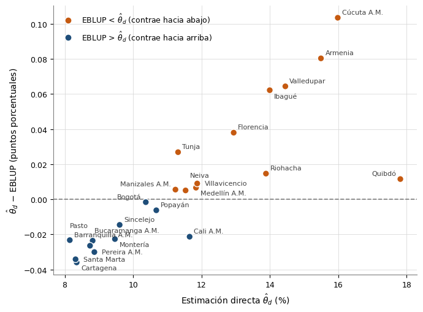
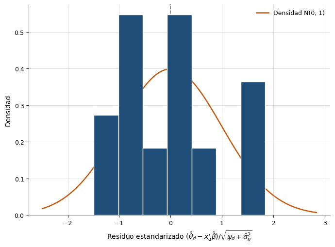
```
INTERPRETACIÓN:
  Gráfica 1 (Efecto suavizador): corr(θ̂_d, θ̂_d−EBLUP)=0.816 (p=0.0000)  ✓ el EBLUP contrae los extremos hacia el predictor sintético
  Gráfica 2 (Residuos estandarizados): media=0.002 (≈ 0 por construcción del GLS con intercepto; no informa sobre sesgo), sd=0.954, Shapiro-Wilk p=0.3906: los diagnósticos no muestran evidencia fuerte contra la aproximación normal, dentro de la limitada potencia disponible con 23 áreas

=================================================================
EC2: COB_ACUEDUCTO — GRÁFICAS DE VALIDACIÓN
=================================================================
Gráfica 1 (Efecto suavizador): compara el residuo del EBLUP (θ̂_d − EBLUP)
contra la estimación directa. Como θ̂_d − EBLUP = (1 − γd)(θ̂_d − x'β̂), se espera
residuo negativo para θ̂_d pequeños (el EBLUP sube la estimación) y positivo para
θ̂_d grandes (el EBLUP la baja). Es una descripción de la contracción hacia el
predictor sintético, no una prueba de validez del modelo.
Gráfica 2 (Histograma de residuos estandarizados): distribución de
(θ̂_d − x'β̂)/√(ψ_d + σ̂²_u). Bajo el supuesto de normalidad del modelo se verían
aproximadamente normales y con desviación ≈ 1; la media es ≈ 0 por construcción
del GLS con intercepto. Con 23 residuos marginales (mezclan u_d y e_d) ni el
histograma ni Shapiro-Wilk pueden demostrar normalidad: solo mostrar si hay
evidencia fuerte en contra.


```
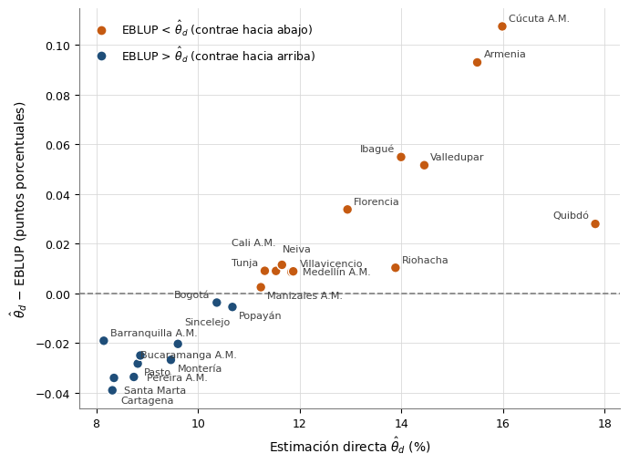
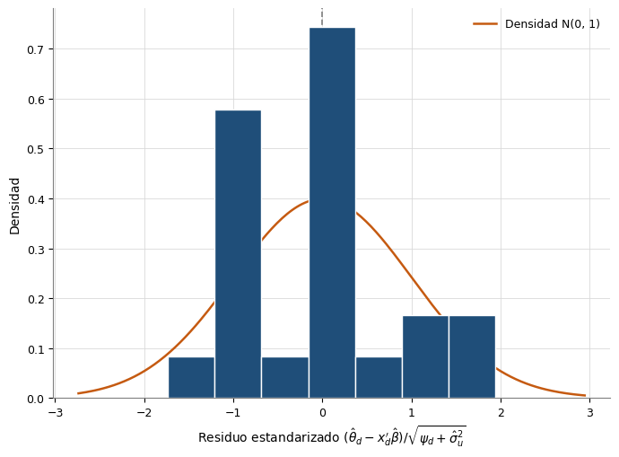
```
INTERPRETACIÓN:
  Gráfica 1 (Efecto suavizador): corr(θ̂_d, θ̂_d−EBLUP)=0.869 (p=0.0000)  ✓ el EBLUP contrae los extremos hacia el predictor sintético
  Gráfica 2 (Residuos estandarizados): media=0.002 (≈ 0 por construcción del GLS con intercepto; no informa sobre sesgo), sd=0.978, Shapiro-Wilk p=0.3167: los diagnósticos no muestran evidencia fuerte contra la aproximación normal, dentro de la limitada potencia disponible con 23 áreas

=================================================================
EC3: TASA_HOMICIDIOS — GRÁFICAS DE VALIDACIÓN
=================================================================
Gráfica 1 (Efecto suavizador): compara el residuo del EBLUP (θ̂_d − EBLUP)
contra la estimación directa. Como θ̂_d − EBLUP = (1 − γd)(θ̂_d − x'β̂), se espera
residuo negativo para θ̂_d pequeños (el EBLUP sube la estimación) y positivo para
θ̂_d grandes (el EBLUP la baja). Es una descripción de la contracción hacia el
predictor sintético, no una prueba de validez del modelo.
Gráfica 2 (Histograma de residuos estandarizados): distribución de
(θ̂_d − x'β̂)/√(ψ_d + σ̂²_u). Bajo el supuesto de normalidad del modelo se verían
aproximadamente normales y con desviación ≈ 1; la media es ≈ 0 por construcción
del GLS con intercepto. Con 23 residuos marginales (mezclan u_d y e_d) ni el
histograma ni Shapiro-Wilk pueden demostrar normalidad: solo mostrar si hay
evidencia fuerte en contra.


```
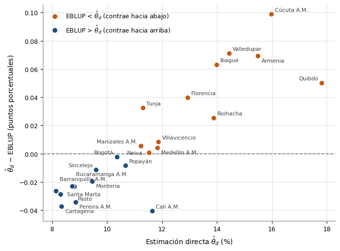
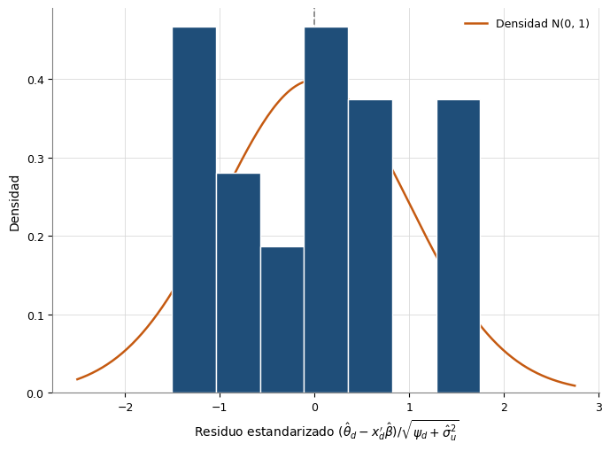
```
INTERPRETACIÓN:
  Gráfica 1 (Efecto suavizador): corr(θ̂_d, θ̂_d−EBLUP)=0.879 (p=0.0000)  ✓ el EBLUP contrae los extremos hacia el predictor sintético
  Gráfica 2 (Residuos estandarizados): media=0.002 (≈ 0 por construcción del GLS con intercepto; no informa sobre sesgo), sd=0.977, Shapiro-Wilk p=0.3567: los diagnósticos no muestran evidencia fuerte contra la aproximación normal, dentro de la limitada potencia disponible con 23 áreas

=================================================================
EC0: intercepto — GRÁFICAS DE VALIDACIÓN
=================================================================
Gráfica 1 (Efecto suavizador): compara el residuo del EBLUP (θ̂_d − EBLUP)
contra la estimación directa. Como θ̂_d − EBLUP = (1 − γd)(θ̂_d − x'β̂), se espera
residuo negativo para θ̂_d pequeños (el EBLUP sube la estimación) y positivo para
θ̂_d grandes (el EBLUP la baja). Es una descripción de la contracción hacia el
predictor sintético, no una prueba de validez del modelo.
Gráfica 2 (Histograma de residuos estandarizados): distribución de
(θ̂_d − x'β̂)/√(ψ_d + σ̂²_u). Bajo el supuesto de normalidad del modelo se verían
aproximadamente normales y con desviación ≈ 1; la media es ≈ 0 por construcción
del GLS con intercepto. Con 23 residuos marginales (mezclan u_d y e_d) ni el
histograma ni Shapiro-Wilk pueden demostrar normalidad: solo mostrar si hay
evidencia fuerte en contra.


```
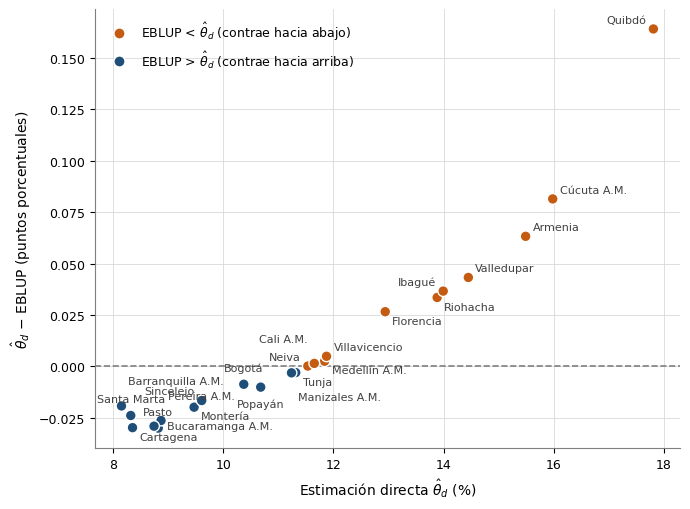
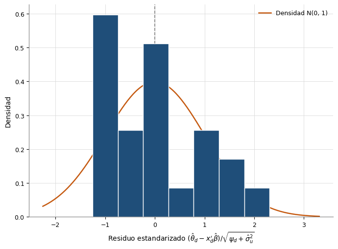
```
INTERPRETACIÓN:
  Gráfica 1 (Efecto suavizador): corr(θ̂_d, θ̂_d−EBLUP)=0.939 (p=0.0000)  ✓ el EBLUP contrae los extremos hacia el predictor sintético
  Gráfica 2 (Residuos estandarizados): media=0.002 (≈ 0 por construcción del GLS con intercepto; no informa sobre sesgo), sd=1.002, Shapiro-Wilk p=0.1393: los diagnósticos no muestran evidencia fuerte contra la aproximación normal, dentro de la limitada potencia disponible con 23 áreas


```


## Celda 8

```python
for i, (modelo, covars) in enumerate(zip(modelos, nombres_covars), 1):
    param_names = ["Intercepto"] + covars

    print("=" * 65)
    print(f"{etiqueta_especificacion(i, covars)}: {' + '.join(covars) or 'intercepto'}")
    print("=" * 65)

    print(f"\nVarianza de efectos aleatorios (Â):   {modelo.A_hat:.6f}")
    print(f"Desv. estándar de efectos aleatorios: {np.sqrt(modelo.A_hat):.6f}")
    aviso = aviso_encuesta_sin_peso(modelo, UMBRAL_GAMMA_SIN_PESO)
    if aviso:
        print(aviso)

    print(
        "\nCOEFICIENTES (prueba z con la normal asintótica de β̂, Morales et al. p. 272):"
    )
    coef_df = pd.DataFrame(
        {
            "Parametro": param_names,
            "Coef": modelo.beta_hat.round(4),
            "SE": modelo.se_beta.round(4),
            "z": modelo.t_stats.round(3),
            "p_valor": modelo.p_vals.round(4),
        }
    )
    coef_df["Signif"] = [
        "***" if pv < 0.01 else "**" if pv < 0.05 else "*" if pv < 0.10 else ""
        for pv in modelo.p_vals
    ]
    display(coef_df)
    print("Signif: *** p<0.01  ** p<0.05  * p<0.10")

    print("\nDIAGNÓSTICOS:")
    print(f"  R² predictor sintético:       {modelo.r2:.4f}")
    # R-10 (G7-B22): la media es ≈ 0 por construcción y Shapiro-Wilk con 23 áreas no
    # demuestra normalidad; solo dice si hay evidencia fuerte en contra.
    print(
        f"  Media residuos estand.:       {modelo.residuals.mean():.4f}  ({NOTA_MEDIA_RESIDUOS})"
    )
    print(
        f"  Desv. std residuos estand.:   {modelo.residuals.std(ddof=1):.4f}  (≈ 1 si ψ_d y  son adecuadas)"
    )
    print(
        f"  Shapiro-Wilk: W={modelo.sw_stat:.4f}, p={modelo.sw_pval:.4f}: "
        + lectura_normalidad(modelo.sw_pval)
    )
    print(
        f"  Reducción media del CV:       {modelo.resultados['MEJORA_CV_PCT'].mean():.2f} pp"
    )
    print(f"  Shrinkage promedio (γ̄):       {modelo.gamma_i.mean():.4f}")

    cook = distancia_cook(modelo)
    umbral_cook = 4 / modelo.n
    influyentes = np.where(cook > umbral_cook)[0]
    print(
        f"  Distancia de Cook máxima:     {cook.max():.4f} en {nombres_dominio[int(np.argmax(cook))]}  "
        f"(umbral 4/n = {umbral_cook:.4f}; {len(influyentes)} dominio(s) lo superan"
        + (f": {', '.join(nombres_dominio[influyentes])})" if len(influyentes) else ")")
    )

    # La comparación MSE_EBLUP frente a Di es descriptiva: g1 = γ·Di < Di por construcción,
    # de modo que el EBLUP «mejora» casi siempre; lo informativo es cuánto (p. 440). Por eso
    # no se reporta el % de dominios que mejoran ni una prueba de Wilcoxon (R-64).
    validacion = modelo.validar_mse_directo()
    print(
        "\nGANANCIA DE PRECISIÓN (descriptiva: MSE_EBLUP < Di es lo esperado, p. 440):"
    )
    print(f"  Reducción media del MSE:      {validacion['pct_mejora_mse'].mean():.2f}%")
    print(
        f"  Ratio Di/MSE medio:           {validacion['mse_ratio'].mean():.4f}  (>1 indica ganancia)"
    )
    print(f"  Ratio Di/MSE mediana:         {np.median(validacion['mse_ratio']):.4f}")

    print("\n  Detalle por dominio (Di vs MSE_EBLUP):")
    detail_cols = [
        "NOMBRE_DOMINIO",
        "VARIANZA_DIRECTA",
        "MSE_EBLUP",
        "RATIO_MSE",
        "MEJORA_MSE_PCT",
        "MEJORA_MSE",
    ]
    display(modelo.resultados[detail_cols])
    print()
```

**Salida:**

```
=================================================================
EC1: TASA_HOMICIDIOS + COB_ACUEDUCTO
=================================================================

Varianza de efectos aleatorios (Â):   5.563634
Desv. estándar de efectos aleatorios: 2.358736

COEFICIENTES (prueba z con la normal asintótica de β̂, Morales et al. p. 272):

```
| Parametro | Coef | SE | z | p_valor | Signif |
|---|---|---|---|---|---|
| Intercepto | 13.7584 | 4.9973 | 2.753 | 0.0059 | *** |
| TASA_HOMICIDIOS | 0.0663 | 0.0505 | 1.311 | 0.1898 |  |
| COB_ACUEDUCTO | -0.0419 | 0.045 | -0.932 | 0.3512 |  |
```
Signif: *** p<0.01  ** p<0.05  * p<0.10

DIAGNÓSTICOS:
  R² predictor sintético:       0.2994
  Media residuos estand.:       0.0017  (≈ 0 por construcción del GLS con intercepto; no informa sobre sesgo)
  Desv. std residuos estand.:   0.9540  (≈ 1 si ψ_d y  son adecuadas)
  Shapiro-Wilk: W=0.9562, p=0.3906: los diagnósticos no muestran evidencia fuerte contra la aproximación normal, dentro de la limitada potencia disponible con 23 áreas
  Reducción media del CV:       0.01 pp
  Shrinkage promedio (γ̄):       0.9839
  Distancia de Cook máxima:     0.5260 en Cali A.M.  (umbral 4/n = 0.1739; 2 dominio(s) lo superan: Quibdó, Cali A.M.)

GANANCIA DE PRECISIÓN (descriptiva: MSE_EBLUP < Di es lo esperado, p. 440):
  Reducción media del MSE:      1.07%
  Ratio Di/MSE medio:           1.0108  (>1 indica ganancia)
  Ratio Di/MSE mediana:         1.0109

  Detalle por dominio (Di vs MSE_EBLUP):

```
| NOMBRE_DOMINIO | VARIANZA_DIRECTA | MSE_EBLUP | RATIO_MSE | MEJORA_MSE_PCT | MEJORA_MSE |
|---|---|---|---|---|---|
| Medellín A.M. | 0.05675037904994729 | 0.056311 | 1.0078 | 0.77 | ✓ |
| Barranquilla A.M. | 0.04147055418246772 | 0.041242 | 1.0055 | 0.55 | ✓ |
| Bogotá | 0.05508676206265383 | 0.054677 | 1.0075 | 0.74 | ✓ |
| Cartagena | 0.06844816711016304 | 0.0678 | 1.0096 | 0.95 | ✓ |
| Tunja | 0.10620234540680203 | 0.104849 | 1.0129 | 1.27 | ✓ |
| Manizales A.M. | 0.08081815960405384 | 0.079925 | 1.0112 | 1.1 | ✓ |
| Florencia | 0.13799347675174758 | 0.135375 | 1.0193 | 1.9 | ✓ |
| Popayán | 0.08739928252629321 | 0.08635 | 1.0122 | 1.2 | ✓ |
| Valledupar | 0.10813456899647185 | 0.106591 | 1.0145 | 1.43 | ✓ |
| Montería | 0.07043933023358807 | 0.069767 | 1.0096 | 0.95 | ✓ |
| Quibdó | 0.19330572203467966 | 0.193295 | 1.0001 | 0.01 | ✓ |
| Neiva | 0.09642917313876094 | 0.095166 | 1.0133 | 1.31 | ✓ |
| Riohacha | 0.10384312130633908 | 0.10252 | 1.0129 | 1.27 | ✓ |
| Santa Marta | 0.05424172482375958 | 0.053869 | 1.0069 | 0.69 | ✓ |
| Villavicencio | 0.10211532049425652 | 0.100675 | 1.0143 | 1.41 | ✓ |
| Pasto | 0.08100942799779919 | 0.080133 | 1.0109 | 1.08 | ✓ |
| Cúcuta A.M. | 0.13419769560010145 | 0.131754 | 1.0185 | 1.82 | ✓ |
| Armenia | 0.11684584132002303 | 0.115137 | 1.0148 | 1.46 | ✓ |
| Pereira A.M. | 0.07229601521767685 | 0.071591 | 1.0098 | 0.97 | ✓ |
| Bucaramanga A.M. | 0.07623129831447502 | 0.075469 | 1.0101 | 1.0 | ✓ |
| Sincelejo | 0.06320883850983965 | 0.06268 | 1.0084 | 0.84 | ✓ |
| Ibagué | 0.10847155613928848 | 0.106876 | 1.0149 | 1.47 | ✓ |
| Cali A.M. | 0.08067894417766375 | 0.080431 | 1.0031 | 0.31 | ✓ |
```

=================================================================
EC2: COB_ACUEDUCTO
=================================================================

Varianza de efectos aleatorios (Â):   5.756795
Desv. estándar de efectos aleatorios: 2.399332

COEFICIENTES (prueba z con la normal asintótica de β̂, Morales et al. p. 272):

```
| Parametro | Coef | SE | z | p_valor | Signif |
|---|---|---|---|---|---|
| Intercepto | 19.0532 | 2.9938 | 6.364 | 0.0 | *** |
| COB_ACUEDUCTO | -0.0833 | 0.0326 | -2.551 | 0.0107 | ** |
```
Signif: *** p<0.01  ** p<0.05  * p<0.10

DIAGNÓSTICOS:
  R² predictor sintético:       0.2392
  Media residuos estand.:       0.0017  (≈ 0 por construcción del GLS con intercepto; no informa sobre sesgo)
  Desv. std residuos estand.:   0.9775  (≈ 1 si ψ_d y  son adecuadas)
  Shapiro-Wilk: W=0.9517, p=0.3167: los diagnósticos no muestran evidencia fuerte contra la aproximación normal, dentro de la limitada potencia disponible con 23 áreas
  Reducción media del CV:       0.01 pp
  Shrinkage promedio (γ̄):       0.9845
  Distancia de Cook máxima:     1.2966 en Quibdó  (umbral 4/n = 0.1739; 1 dominio(s) lo superan: Quibdó)

GANANCIA DE PRECISIÓN (descriptiva: MSE_EBLUP < Di es lo esperado, p. 440):
  Reducción media del MSE:      1.10%
  Ratio Di/MSE medio:           1.0111  (>1 indica ganancia)
  Ratio Di/MSE mediana:         1.0108

  Detalle por dominio (Di vs MSE_EBLUP):

```
| NOMBRE_DOMINIO | VARIANZA_DIRECTA | MSE_EBLUP | RATIO_MSE | MEJORA_MSE_PCT | MEJORA_MSE |
|---|---|---|---|---|---|
| Medellín A.M. | 0.05675037904994729 | 0.056323 | 1.0076 | 0.75 | ✓ |
| Barranquilla A.M. | 0.04147055418246772 | 0.041243 | 1.0055 | 0.55 | ✓ |
| Bogotá | 0.05508676206265383 | 0.054687 | 1.0073 | 0.73 | ✓ |
| Cartagena | 0.06844816711016304 | 0.067822 | 1.0092 | 0.92 | ✓ |
| Tunja | 0.10620234540680203 | 0.10472 | 1.0142 | 1.4 | ✓ |
| Manizales A.M. | 0.08081815960405384 | 0.07995 | 1.0109 | 1.07 | ✓ |
| Florencia | 0.13799347675174758 | 0.135455 | 1.0187 | 1.84 | ✓ |
| Popayán | 0.08739928252629321 | 0.086385 | 1.0117 | 1.16 | ✓ |
| Valledupar | 0.10813456899647185 | 0.106573 | 1.0147 | 1.44 | ✓ |
| Montería | 0.07043933023358807 | 0.069775 | 1.0095 | 0.94 | ✓ |
| Quibdó | 0.19330572203467966 | 0.193128 | 1.0009 | 0.09 | ✓ |
| Neiva | 0.09642917313876094 | 0.095197 | 1.0129 | 1.28 | ✓ |
| Riohacha | 0.10384312130633908 | 0.102554 | 1.0126 | 1.24 | ✓ |
| Santa Marta | 0.05424172482375958 | 0.05386 | 1.0071 | 0.7 | ✓ |
| Villavicencio | 0.10211532049425652 | 0.100722 | 1.0138 | 1.36 | ✓ |
| Pasto | 0.08100942799779919 | 0.080144 | 1.0108 | 1.07 | ✓ |
| Cúcuta A.M. | 0.13419769560010145 | 0.131802 | 1.0182 | 1.79 | ✓ |
| Armenia | 0.11684584132002303 | 0.115053 | 1.0156 | 1.53 | ✓ |
| Pereira A.M. | 0.07229601521767685 | 0.071605 | 1.0097 | 0.96 | ✓ |
| Bucaramanga A.M. | 0.07623129831447502 | 0.075454 | 1.0103 | 1.02 | ✓ |
| Sincelejo | 0.06320883850983965 | 0.062673 | 1.0086 | 0.85 | ✓ |
| Ibagué | 0.10847155613928848 | 0.106912 | 1.0146 | 1.44 | ✓ |
| Cali A.M. | 0.08067894417766375 | 0.079821 | 1.0107 | 1.06 | ✓ |
```

=================================================================
EC3: TASA_HOMICIDIOS
=================================================================

Varianza de efectos aleatorios (Â):   5.528840
Desv. estándar de efectos aleatorios: 2.351348

COEFICIENTES (prueba z con la normal asintótica de β̂, Morales et al. p. 272):

```
| Parametro | Coef | SE | z | p_valor | Signif |
|---|---|---|---|---|---|
| Intercepto | 9.1908 | 0.979 | 9.388 | 0.0 | *** |
| TASA_HOMICIDIOS | 0.0993 | 0.0359 | 2.761 | 0.0058 | *** |
```
Signif: *** p<0.01  ** p<0.05  * p<0.10

DIAGNÓSTICOS:
  R² predictor sintético:       0.2689
  Media residuos estand.:       0.0019  (≈ 0 por construcción del GLS con intercepto; no informa sobre sesgo)
  Desv. std residuos estand.:   0.9774  (≈ 1 si ψ_d y  son adecuadas)
  Shapiro-Wilk: W=0.9542, p=0.3567: los diagnósticos no muestran evidencia fuerte contra la aproximación normal, dentro de la limitada potencia disponible con 23 áreas
  Reducción media del CV:       0.02 pp
  Shrinkage promedio (γ̄):       0.9838
  Distancia de Cook máxima:     0.6009 en Quibdó  (umbral 4/n = 0.1739; 2 dominio(s) lo superan: Quibdó, Cali A.M.)

GANANCIA DE PRECISIÓN (descriptiva: MSE_EBLUP < Di es lo esperado, p. 440):
  Reducción media del MSE:      1.16%
  Ratio Di/MSE medio:           1.0117  (>1 indica ganancia)
  Ratio Di/MSE mediana:         1.0110

  Detalle por dominio (Di vs MSE_EBLUP):

```
| NOMBRE_DOMINIO | VARIANZA_DIRECTA | MSE_EBLUP | RATIO_MSE | MEJORA_MSE_PCT | MEJORA_MSE |
|---|---|---|---|---|---|
| Medellín A.M. | 0.05675037904994729 | 0.056301 | 1.008 | 0.79 | ✓ |
| Barranquilla A.M. | 0.04147055418246772 | 0.04123 | 1.0058 | 0.58 | ✓ |
| Bogotá | 0.05508676206265383 | 0.054673 | 1.0076 | 0.75 | ✓ |
| Cartagena | 0.06844816711016304 | 0.067795 | 1.0096 | 0.95 | ✓ |
| Tunja | 0.10620234540680203 | 0.104807 | 1.0133 | 1.31 | ✓ |
| Manizales A.M. | 0.08081815960405384 | 0.07992 | 1.0112 | 1.11 | ✓ |
| Florencia | 0.13799347675174758 | 0.135356 | 1.0195 | 1.91 | ✓ |
| Popayán | 0.08739928252629321 | 0.086338 | 1.0123 | 1.21 | ✓ |
| Valledupar | 0.10813456899647185 | 0.106538 | 1.015 | 1.48 | ✓ |
| Montería | 0.07043933023358807 | 0.069752 | 1.0099 | 0.98 | ✓ |
| Quibdó | 0.19330572203467966 | 0.191612 | 1.0088 | 0.88 | ✓ |
| Neiva | 0.09642917313876094 | 0.095135 | 1.0136 | 1.34 | ✓ |
| Riohacha | 0.10384312130633908 | 0.102387 | 1.0142 | 1.4 | ✓ |
| Santa Marta | 0.05424172482375958 | 0.053831 | 1.0076 | 0.76 | ✓ |
| Villavicencio | 0.10211532049425652 | 0.100665 | 1.0144 | 1.42 | ✓ |
| Pasto | 0.08100942799779919 | 0.080128 | 1.011 | 1.09 | ✓ |
| Cúcuta A.M. | 0.13419769560010145 | 0.131706 | 1.0189 | 1.86 | ✓ |
| Armenia | 0.11684584132002303 | 0.114971 | 1.0163 | 1.6 | ✓ |
| Pereira A.M. | 0.07229601521767685 | 0.071567 | 1.0102 | 1.01 | ✓ |
| Bucaramanga A.M. | 0.07623129831447502 | 0.07545 | 1.0104 | 1.03 | ✓ |
| Sincelejo | 0.06320883850983965 | 0.062665 | 1.0087 | 0.86 | ✓ |
| Ibagué | 0.10847155613928848 | 0.106866 | 1.015 | 1.48 | ✓ |
| Cali A.M. | 0.08067894417766375 | 0.080008 | 1.0084 | 0.83 | ✓ |
```

=================================================================
EC0: intercepto
=================================================================

Varianza de efectos aleatorios (Â):   7.208863
Desv. estándar de efectos aleatorios: 2.684933

COEFICIENTES (prueba z con la normal asintótica de β̂, Morales et al. p. 272):

```
| Parametro | Coef | SE | z | p_valor | Signif |
|---|---|---|---|---|---|
| Intercepto | 11.527 | 0.5634 | 20.461 | 0.0 | *** |
```
Signif: *** p<0.01  ** p<0.05  * p<0.10

DIAGNÓSTICOS:
  R² predictor sintético:       -0.0000
  Media residuos estand.:       0.0019  (≈ 0 por construcción del GLS con intercepto; no informa sobre sesgo)
  Desv. std residuos estand.:   1.0016  (≈ 1 si ψ_d y  son adecuadas)
  Shapiro-Wilk: W=0.9349, p=0.1393: los diagnósticos no muestran evidencia fuerte contra la aproximación normal, dentro de la limitada potencia disponible con 23 áreas
  Reducción media del CV:       0.01 pp
  Shrinkage promedio (γ̄):       0.9875
  Distancia de Cook máxima:     0.2499 en Quibdó  (umbral 4/n = 0.1739; 1 dominio(s) lo superan: Quibdó)

GANANCIA DE PRECISIÓN (descriptiva: MSE_EBLUP < Di es lo esperado, p. 440):
  Reducción media del MSE:      0.98%
  Ratio Di/MSE medio:           1.0099  (>1 indica ganancia)
  Ratio Di/MSE mediana:         1.0088

  Detalle por dominio (Di vs MSE_EBLUP):

```
| NOMBRE_DOMINIO | VARIANZA_DIRECTA | MSE_EBLUP | RATIO_MSE | MEJORA_MSE_PCT | MEJORA_MSE |
|---|---|---|---|---|---|
| Medellín A.M. | 0.05675037904994729 | 0.056404 | 1.0061 | 0.61 | ✓ |
| Barranquilla A.M. | 0.04147055418246772 | 0.041286 | 1.0045 | 0.45 | ✓ |
| Bogotá | 0.05508676206265383 | 0.054761 | 1.006 | 0.59 | ✓ |
| Cartagena | 0.06844816711016304 | 0.067945 | 1.0074 | 0.73 | ✓ |
| Tunja | 0.10620234540680203 | 0.104994 | 1.0115 | 1.14 | ✓ |
| Manizales A.M. | 0.08081815960405384 | 0.080117 | 1.0087 | 0.87 | ✓ |
| Florencia | 0.13799347675174758 | 0.135959 | 1.015 | 1.47 | ✓ |
| Popayán | 0.08739928252629321 | 0.08658 | 1.0095 | 0.94 | ✓ |
| Valledupar | 0.10813456899647185 | 0.106882 | 1.0117 | 1.16 | ✓ |
| Montería | 0.07043933023358807 | 0.069907 | 1.0076 | 0.76 | ✓ |
| Quibdó | 0.19330572203467966 | 0.189328 | 1.021 | 2.06 | ✓ |
| Neiva | 0.09642917313876094 | 0.095433 | 1.0104 | 1.03 | ✓ |
| Riohacha | 0.10384312130633908 | 0.102688 | 1.0112 | 1.11 | ✓ |
| Santa Marta | 0.05424172482375958 | 0.053926 | 1.0059 | 0.58 | ✓ |
| Villavicencio | 0.10211532049425652 | 0.100998 | 1.0111 | 1.09 | ✓ |
| Pasto | 0.08100942799779919 | 0.080305 | 1.0088 | 0.87 | ✓ |
| Cúcuta A.M. | 0.13419769560010145 | 0.132273 | 1.0146 | 1.43 | ✓ |
| Armenia | 0.11684584132002303 | 0.115385 | 1.0127 | 1.25 | ✓ |
| Pereira A.M. | 0.07229601521767685 | 0.071735 | 1.0078 | 0.78 | ✓ |
| Bucaramanga A.M. | 0.07623129831447502 | 0.075608 | 1.0082 | 0.82 | ✓ |
| Sincelejo | 0.06320883850983965 | 0.06278 | 1.0068 | 0.68 | ✓ |
| Ibagué | 0.10847155613928848 | 0.107212 | 1.0118 | 1.16 | ✓ |
| Cali A.M. | 0.08067894417766375 | 0.079981 | 1.0087 | 0.87 | ✓ |
```


```


## Celda 9

```python
if len(modelos) > 1:
    print("=" * 65)
    print("TABLA 1 — DIAGNÓSTICOS POR ESPECIFICACIÓN CANDIDATA (informativa)")
    print("=" * 65)
    df_diag_variantes = tabla_diagnosticos(modelos, nombres_covars)

    df_cook_variantes = tabla_cook(modelos, nombres_covars, nombres_dominio)
    df_diag_variantes = df_diag_variantes.merge(
        df_cook_variantes[["Modelo", "Cook_max", "N_influyentes"]],
        on="Modelo",
        how="left",
    )

    display(df_diag_variantes)
    print(
        "  SW_pval: p-valor de Shapiro-Wilk; p > 0.05 no demuestra normalidad, solo que no hay "
        "evidencia fuerte en contra con 23 áreas"
    )
    print("  Media_resid: ≈ 0 por construcción del GLS; SD_resid con ddof = 1")
    print("  Ratio_MSE_medio: ganancia de precisión (Di/MSE)")
    print("    del EBLUP frente a la estimación directa (descriptiva, p. 440)")
    print(
        "  Cook_max / N_influyentes: distancia de Cook máxima y dominios que superan 4/n"
    )

    print("\n" + "=" * 65)
    print("TABLA 2 — SELECCIÓN DEL BENCHMARK (significancia + AIC + parsimonia)")
    print("=" * 65)
    df_sel_modelo = tabla_seleccion(
        modelos,
        nombres_covars,
        delta_aic=DELTA_AIC_EQUIVALENTE,
        alfa=ALFA_SIGNIFICANCIA,
    )
    # R-04: RMSE dejar-un-dominio-fuera de cada especificación (covariables fijas, reajusta β̂ y
    # Â); descriptiva, no interviene en la regla. La validación del procedimiento completo, que
    # repite la selección, está en la celda 10a-ter.
    df_sel_modelo = df_sel_modelo.merge(
        rmse_loao_especificaciones(
            nombres_covars,
            [etiqueta_especificacion(i, c) for i, c in enumerate(nombres_covars, 1)],
            df,
            Y_COL,
            SE_COL,
            ["CODIGO_DOMINIO", "NOMBRE_DOMINIO"],
        ),
        on="Modelo",
        how="left",
    )
    display(df_sel_modelo)
    print(
        f"  Candidata: todas las covariables con p < {ALFA_SIGNIFICANCIA} "
        "(Morales et al., p. 453: no sobreparametrizar al predecir fuera de muestra; "
        "p. 454 admite una covariable con p > 0.05 si es interpretable, a reportar aparte)"
    )
    print(
        "  Criterio: regla estricta o respaldo (ninguna cumple la regla: compiten todas y el "
        "benchmark se reporta como excepción, R-05)"
    )
    print(
        f"  Equivalente_AIC: ΔAIC ≤ {DELTA_AIC_EQUIVALENTE} frente a la mejor candidata; "
        "entre ellas se elige la de menos covariables"
    )
    print("  MSE_medio y Cook_max: informativas, no intervienen en la decisión")
    print(
        "  EC0: modelo de solo intercepto (R-04). Sin covariables cumple la regla de forma "
        "trivial; gana solo si ninguna especificación con covariables lo supera en AIC por más "
        f"de {DELTA_AIC_EQUIVALENTE} (Morales et al., p. 453: no sobreparametrizar al predecir "
        "fuera de muestra)"
    )
    print(
        "  RMSE_LOAO: error de predecir cada dominio retirado con x'β̂(-d), covariables fijas "
        "(R-04). Descriptiva: optimista para las especificaciones con covariables, porque se "
        "eligieron viendo a todos los dominios; no interviene en la decisión"
    )
    # G7-B16: AICc como complemento (n pequeño); tampoco interviene en la decisión.
    print(
        "  AICc / Delta_AICc: AIC con corrección de muestra pequeña (n = "
        f"{modelos[0].n} dominios), complemento que no interviene en la decisión"
    )

    pendientes.agregar(df_diag_variantes, TBL_FH_DIAGNOSTICOS_VARIANTES)
    pendientes.agregar(df_cook_variantes, TBL_FH_COOK)
    pendientes.agregar(df_sel_modelo, TBL_FH_SELECCION_MODELO)
```

**Salida:**

```
=================================================================
TABLA 1 — DIAGNÓSTICOS POR ESPECIFICACIÓN CANDIDATA (informativa)
=================================================================

```
| Modelo | Covariables | R2 | Media_resid | SD_resid | SW_pval | Delta_CV_pp | Gamma_prom | Ratio_MSE_medio | Corr_suavizador | Corr_suavizador_pval | Cook_max | N_influyentes |
|---|---|---|---|---|---|---|---|---|---|---|---|---|
| EC1 | TASA_HOMICIDIOS + COB_ACUEDUCTO | 0.2994 | 0.0017 | 0.954 | 0.3906 | 0.01 | 0.9839 | 1.0108 | 0.8164 | 0.0 | 0.526 | 2 |
| EC2 | COB_ACUEDUCTO | 0.2392 | 0.0017 | 0.9775 | 0.3167 | 0.01 | 0.9845 | 1.0111 | 0.8689 | 0.0 | 1.2966 | 1 |
| EC3 | TASA_HOMICIDIOS | 0.2689 | 0.0019 | 0.9774 | 0.3567 | 0.02 | 0.9838 | 1.0117 | 0.8789 | 0.0 | 0.6009 | 2 |
| EC0 |  | -0.0 | 0.0019 | 1.0016 | 0.1393 | 0.01 | 0.9875 | 1.0099 | 0.9388 | 0.0 | 0.2499 | 1 |
```
  SW_pval: p-valor de Shapiro-Wilk; p > 0.05 no demuestra normalidad, solo que no hay evidencia fuerte en contra con 23 áreas
  Media_resid: ≈ 0 por construcción del GLS; SD_resid con ddof = 1
  Ratio_MSE_medio: ganancia de precisión (Di/MSE)
    del EBLUP frente a la estimación directa (descriptiva, p. 440)
  Cook_max / N_influyentes: distancia de Cook máxima y dominios que superan 4/n

=================================================================
TABLA 2 — SELECCIÓN DEL BENCHMARK (significancia + AIC + parsimonia)
=================================================================

```
| Modelo | Covariables | N_covariables | AIC | Delta_AIC | AICc | Delta_AICc | p_max_covariables | Todas_signif | Candidata | Equivalente_AIC | Elegida | Criterio | MSE_medio | Cook_max | RMSE_LOAO | N_LOAO |
|---|---|---|---|---|---|---|---|---|---|---|---|---|---|---|---|---|
| EC3 | TASA_HOMICIDIOS | 1 | 108.9036 | 0.0 | 110.1668 | 0.0 | 0.0058 | sí | sí | sí | sí | regla estricta: todas las covariables con p < alfa (Morales p. 453) | 0.089987 | 0.6009 | 2.5243249659229865 | 23 |
| EC2 | COB_ACUEDUCTO | 1 | 109.8218 | 0.9182 | 111.0849 | 0.9182 | 0.0107 | sí | sí | sí |  | regla estricta: todas las covariables con p < alfa (Morales p. 453) | 0.090081 | 1.2966 | 2.599361163525286 | 23 |
| EC0 |  | 0 | 114.0417 | 5.1381 | 114.6417 | 4.475 | None | sí | sí | no |  | regla estricta: todas las covariables con p < alfa (Morales p. 453) | 0.090108 | 0.2499 | 2.7715364261213886 | 23 |
| EC1 | TASA_HOMICIDIOS + COB_ACUEDUCTO | 2 | 109.9261 | 1.0225 | 112.1483 | 1.9816 | 0.3512 | no | no | no |  | regla estricta: todas las covariables con p < alfa (Morales p. 453) | 0.090108 | 0.526 | 2.5517333717717405 | 23 |
```
  Candidata: todas las covariables con p < 0.05 (Morales et al., p. 453: no sobreparametrizar al predecir fuera de muestra; p. 454 admite una covariable con p > 0.05 si es interpretable, a reportar aparte)
  Criterio: regla estricta o respaldo (ninguna cumple la regla: compiten todas y el benchmark se reporta como excepción, R-05)
  Equivalente_AIC: ΔAIC ≤ 2.0 frente a la mejor candidata; entre ellas se elige la de menos covariables
  MSE_medio y Cook_max: informativas, no intervienen en la decisión
  EC0: modelo de solo intercepto (R-04). Sin covariables cumple la regla de forma trivial; gana solo si ninguna especificación con covariables lo supera en AIC por más de 2.0 (Morales et al., p. 453: no sobreparametrizar al predecir fuera de muestra)
  RMSE_LOAO: error de predecir cada dominio retirado con x'β̂(-d), covariables fijas (R-04). Descriptiva: optimista para las especificaciones con covariables, porque se eligieron viendo a todos los dominios; no interviene en la decisión
  AICc / Delta_AICc: AIC con corrección de muestra pequeña (n = 23 dominios), complemento que no interviene en la decisión

```


## Celda 10

```python
modelo_ganador = (
    elegir_ganador(
        modelos,
        nombres_covars,
        delta_aic=DELTA_AIC_EQUIVALENTE,
        alfa=ALFA_SIGNIFICANCIA,
    )
    if len(modelos) > 1
    else modelos[0]
)

if set(modelo_ganador.covars) != set(covars_eda):
    print(
        "\nAVISO: el benchmark seleccionado no coincide con el conjunto completo (EC1) elegido por el análisis"
    )
    print(
        "exploratorio: alguna covariable no es significativa o no aporta ajuste suficiente."
    )
    print("Ambas cifras deben reportarse y la diferencia explicarse en el documento.")
    print(f"  conjunto del EDA: {' + '.join(covars_eda)}")
    print(f"  benchmark:        {' + '.join(modelo_ganador.covars)}")

# G7-B17: aviso de inferencia posterior a la selección.
print("\nNOTA SOBRE LA INFERENCIA: " + ADVERTENCIA_POST_SELECCION)

aviso = aviso_encuesta_sin_peso(modelo_ganador, UMBRAL_GAMMA_SIN_PESO)
if aviso:
    print("\n" + aviso)

# G7-B16 y D-36: redacción calculada desde los datos. Dice si el benchmark se eligió por la
# regla de parsimonia (frente a especificaciones con más covariables) o por el menor AIC (frente
# a las que tienen su mismo número de covariables), con la lectura de AICc.
if len(modelos) > 1:
    print("\nREDACCIÓN SUGERIDA PARA EL DOCUMENTO:")
    print(
        redaccion_seleccion(
            modelos,
            nombres_covars,
            delta_aic=DELTA_AIC_EQUIVALENTE,
            alfa=ALFA_SIGNIFICANCIA,
        )
    )
```

**Salida:**

```
Especificaciones con todas las covariables significativas (p < 0.05): EC2, EC3, EC0
Equivalentes por AIC (ΔAIC ≤ 2.0): EC2, EC3
Benchmark seleccionado (Fay-Herriot clásico): EC3 (TASA_HOMICIDIOS)
Equivalentes por AICc (ΔAICc ≤ 2.0, complemento): EC2, EC3

AVISO: el benchmark seleccionado no coincide con el conjunto completo (EC1) elegido por el análisis
exploratorio: alguna covariable no es significativa o no aporta ajuste suficiente.
Ambas cifras deben reportarse y la diferencia explicarse en el documento.
  conjunto del EDA: TASA_HOMICIDIOS + COB_ACUEDUCTO
  benchmark:        TASA_HOMICIDIOS

NOTA SOBRE LA INFERENCIA: Los p-valores de los coeficientes son descriptivos: los mismos dominios se usaron para filtrar, seleccionar, comparar especificaciones y estimar β̂, así que la significancia no es una demostración fuerte. Los coeficientes del benchmark se reportan como asociaciones preliminares, condicionales a la selección.

REDACCIÓN SUGERIDA PARA EL DOCUMENTO:
Compitieron las 3 de 4 especificaciones con todas sus covariables significativas (p < 0.05; Morales et al., p. 453). Varias especificaciones tuvieron soporte similar (ΔAIC ≤ 2: EC2, EC3). Frente a EC2, con el mismo número de covariables (1), decidió el menor AIC. EC3 no es claramente superior a las demás. Como complemento, con n = 23 dominios se calculó el AICc: EC3 queda a ΔAICc = 0.00 de la mejor de las que compitieron y 2 de 3 tienen soporte similar (ΔAICc ≤ 2). La lectura se mantiene con AICc.

```


## Celda 11

```python
# El benchmark se reajusta (incluida Â) una vez sin cada dominio. De estos 23 reajustes salen la
# sensibilidad de Cook, la estabilidad de coeficientes (G7-B17), el LOAO completo (G7-B18), la
# sensibilidad de la extrapolación (B20) y el ejercicio 1 de la validación predictiva (G7-B19).
reajustes_loao = reajustes_sin_dominio(
    FayHerriotClasico, modelo_ganador.covars, modelo_ganador.df, Y_COL, SE_COL
)
# R-41: se cuentan los reajustes fallidos (matriz singular) y los que no convergen o dejan Â
# en la cota del optimizador; también se avisa si el benchmark mismo está en ese caso.
print("Reajustes dejar-un-dominio-fuera: " + resumen_ajustes(reajustes_loao)["texto"])
if modelo_ganador.avisos_ajuste():
    print(
        "⚠ AVISO: el ajuste del benchmark tiene problemas de convergencia: "
        + "; ".join(modelo_ganador.avisos_ajuste())
    )
```

**Salida:**

```
Reajustes dejar-un-dominio-fuera: 23 ajustes: 0 fallidos (matriz singular), 0 sin convergencia, 0 con  en la cota.

```


## Celda 12

```python
%md
## Ganancia de precisión del benchmark seleccionado

**Cómo leer la figura.** Cada columna es un dominio, ordenados de menor a mayor
varianza directa ψ_d. El punto gris es el CV de la estimación directa y el azul el CV
del EBLUP; el segmento entre ambos es la ganancia. Las líneas discontinuas marcan los
umbrales de confiabilidad (5 % y 20 %). Es la misma lectura que las comparaciones de
RMSE directo frente a EBLUP del libro (Fig. 17.2, Tabla 19.5): la ganancia debe ser
grande a la derecha (muestras pequeñas) y casi nula a la izquierda, donde el MSE del
EBLUP tiende a ψ_d (p. 440).
```


## Celda 13

```python
fig = figura_cv_directo_vs_eblup(modelo_ganador, nombres_dominio)
guardar_figura(fig, "cv_directo_vs_eblup")
display(fig)
plt.close(fig)
print(interpretar_cv(modelo_ganador))
```

**Salida:**

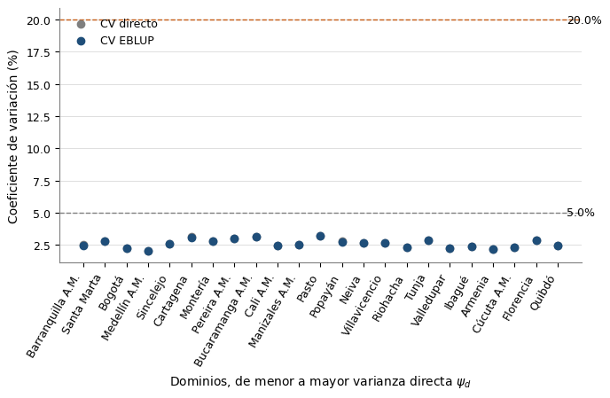
```
INTERPRETACIÓN (ganancia de precisión del modelo elegido):
  Reducción media del CV en el tercio de menor ψ_d: 0.02 pp; en el tercio de mayor ψ_d: 0.01 pp.
  Dominios con CV < 5.0%: 23 con la estimación directa, 23 con el EBLUP (de 23).
  Lectura: la ganancia se concentra donde la varianza directa es grande; donde la muestra es grande el MSE del EBLUP tiende a ψ_d y el EBLUP casi coincide con la estimación directa (Morales et al., p. 440). Que MSE_EBLUP < ψ_d es lo esperado por construcción (g1 = γd·ψ_d < ψ_d), no una validación independiente del modelo.

```


## Celda 14

```python
%md
## Supuestos del benchmark: Q-Q normal y residuos frente a ajustados (D-20)

**Cómo leer las figuras.** El gráfico cuantil-cuantil ubica cada residuo estandarizado
(θ̂_d − x_d'β̂)/√(ψ_d + σ̂²_u) frente al cuantil de la N(0, 1) que le corresponde; si el
supuesto de normalidad es razonable, los puntos siguen la recta y = x y quedan dentro de
la banda gris del 95 % (envolvente de los estadísticos de orden de una normal con 23
datos, guía visual y no prueba). El segundo gráfico pone los mismos residuos frente al
valor ajustado x_d'β̂: sin curvatura ni embudo, el modelo de enlace no deja estructura
visible. Igual que Shapiro-Wilk (celda 6), con 23 residuos marginales estos gráficos
solo muestran si hay evidencia fuerte en contra de los supuestos.
```


## Celda 15

```python
for nombre_fig, fig in zip(
    ["ganador_qq", "ganador_residuos_ajustados"], graficar_supuestos(modelo_ganador)
):
    guardar_figura(fig, nombre_fig)
    display(fig)
    plt.close(fig)
print(interpretar_supuestos(modelo_ganador))
```

**Salida:**

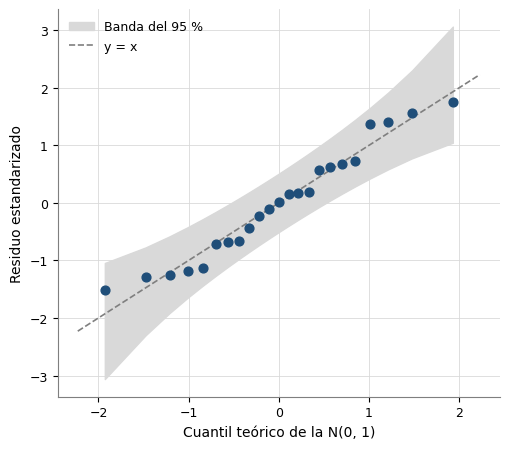
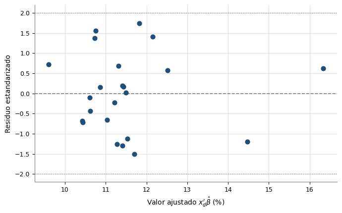
```
INTERPRETACIÓN (supuestos, D-20):
  Q-Q normal: 0 de 23 residuos fuera de la banda del 95 %.
  Residuos frente a ajustados: 0 de 23 con |residuo| > 2; Spearman entre |residuo| y x'β̂ = 0.154 (p = 0.483), sin indicio de que la dispersión cambie con el nivel ajustado.
  Lectura: con 23 residuos marginales estos gráficos solo muestran si hay evidencia fuerte en contra de los supuestos; no los demuestran.

```


## Celda 16

```python
%md
## Robustez del benchmark seleccionado: distancia de Cook

**Cómo leer la figura.** Cada barra es un dominio y su altura es la distancia de Cook
en el ajuste por mínimos cuadrados generalizados del benchmark: cuánto cambiarían
los coeficientes si ese dominio no estuviera. La línea discontinua es el umbral
convencional 4/n y las barras naranjas lo superan. La tabla siguiente compara con el modelo
completo (incluida Â) reajustado sin el dominio más influyente (celda 8a). `Cambio_signif` marca si una
covariable cruza el umbral de significancia en cualquier sentido (pierde o gana): si
ninguna cambia de signo ni de significancia, la conclusión no depende de un solo
territorio. Si ninguna covariable era significativa en el modelo completo, no perder
significancia no prueba nada y la estabilidad se lee en el cambio relativo de cada
coeficiente. Cook no interviene en la selección; es un diagnóstico de regresión
general, no del libro.
```


## Celda 17

```python
fig = figura_cook([modelo_ganador], [modelo_ganador.covars], nombres_dominio)
guardar_figura(fig, "cook")
display(fig)
plt.close(fig)

df_sensibilidad = sensibilidad_cook(
    modelo_ganador, reajustes_loao, nombres_dominio, alfa=ALFA_SIGNIFICANCIA
)
display(df_sensibilidad)
print(
    interpretar_cook(
        modelo_ganador, nombres_dominio, df_sensibilidad, alfa=ALFA_SIGNIFICANCIA
    )
)
```

**Salida:**

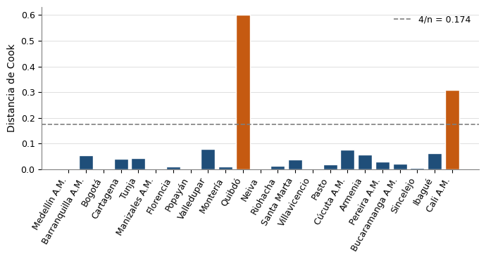
| Dominio_excluido | Cook | Parametro | Valor_completo | Valor_sin_dominio | Cambio_pct | Cambia_signo | p_completo | p_sin_dominio | Cambio_signif |
|---|---|---|---|---|---|---|---|---|---|
| Quibdó | 0.6009 | Intercepto | 9.1908 | 9.9341 | 8.1 | no | 0.0 | 0.0 | no |
| Quibdó | 0.6009 | TASA_HOMICIDIOS | 0.0993 | 0.0613 | -38.2 | no | 0.0058 | 0.2555 | pierde |
| Quibdó | 0.6009 | A_hat | 5.5288 | 5.5557 | 0.5 | no | None | None | no |
```
INTERPRETACIÓN (robustez del modelo elegido):
  Dominios por encima del umbral 4/n = 0.174: Quibdó, Cali A.M..
  Dominio más influyente: Quibdó (Cook = 0.601). Cambio relativo de cada coeficiente al reajustar sin él: TASA_HOMICIDIOS -38.2 %.
  ✗ Sin ese dominio dejan de ser significativas TASA_HOMICIDIOS: la significancia de las covariables depende de un solo territorio y debe reportarse como limitación.

```


## Celda 18

```python
%md
## Estabilidad de los coeficientes del benchmark (análisis de sensibilidad, G7-B17)

Los mismos 23 dominios filtran, seleccionan, comparan y luego calculan los p-valores,
así que **la significancia es descriptiva y condicional a la selección**; los
coeficientes se reportan como asociaciones preliminares. Para medir cuánto dependen de
los dominios se hacen dos ejercicios con la especificación **fija**: (1) dejar un
dominio fuera, reajustando todo el modelo (incluida Â), y (2) bootstrap de dominios
(remuestreo con reemplazo, `ESTABILIDAD_REPLICAS`). El bootstrap no repite la
selección, así que subestima la incertidumbre de haber escogido las covariables con
estos mismos datos. Es un análisis propio: ni Morales et al. (§16.8.2, pp. 453-454) ni
los artículos espaciales consultados lo tratan.
```


## Celda 19

```python
detalle_loo = dejar_uno_fuera_coeficientes(
    modelo_ganador, reajustes_loao, nombres_dominio, alfa=ALFA_SIGNIFICANCIA
)
resumen_loo = resumen_dejar_uno_fuera(detalle_loo, modelo_ganador.n)
replicas_boot = bootstrap_dominios(
    modelo_ganador,
    FayHerriotClasico,
    replicas=ESTABILIDAD_REPLICAS,
    semilla=ESTABILIDAD_SEMILLA,
)
resumen_boot = resumen_bootstrap(modelo_ganador, replicas_boot, alfa=ALFA_SIGNIFICANCIA)
df_estabilidad = tabla_estabilidad(resumen_loo, resumen_boot)
display(df_estabilidad.round(4))
print(interpretar_estabilidad(df_estabilidad))
```

**Salida:**

```
Bootstrap de dominios: 1000 ajustes: 0 fallidos (matriz singular), 0 sin convergencia, 0 con  en la cota.

```
| Parametro | Beta_min | Dominio_beta_min | Beta_max | Dominio_beta_max | Cambio_pct_max_abs | Cambio_en_EE_max_abs | Dominio_max_cambio | N_cambia_signo | N_cruza_alfa | p_max | N_reajustes | N_dominios | Beta | EE_bootstrap | IC_inf | IC_sup | IC_incluye_cero | Prop_mismo_signo | Prop_p_menor_alfa | N_replicas |
|---|---|---|---|---|---|---|---|---|---|---|---|---|---|---|---|---|---|---|---|---|
| Intercepto | 8.75 | Cali A.M. | 9.9341 | Quibdó | 8.0873 | 0.7593 | Quibdó | 0 | 0 | 0.0 | 23 | 23 | 9.1908 | 1.0656 | 7.2289 | 11.2852 | False | 1.0 | 0.998 | 1000 |
| TASA_HOMICIDIOS | 0.0613 | Quibdó | 0.1249 | Cali A.M. | 38.1963 | 1.0546 | Quibdó | 0 | 1 | 0.2555 | 23 | 23 | 0.0993 | 0.0468 | 0.0108 | 0.1909 | False | 0.986 | 0.704 | 1000 |
```
- TASA_HOMICIDIOS: β̂ = 0.099; dejar-uno-fuera entre 0.061 y 0.125 (cambio máximo 38 %, signo cambia en 0 de 23, cruza el umbral de significancia en 1); bootstrap de dominios: IC [0.011, 0.191], mismo signo en 99 % y p < alfa en 70 % de las réplicas.

Los p-valores de los coeficientes son descriptivos: los mismos dominios se usaron para filtrar, seleccionar, comparar especificaciones y estimar β̂, así que la significancia no es una demostración fuerte. Los coeficientes del benchmark se reportan como asociaciones preliminares, condicionales a la selección.

```


## Celda 20

```python
# Coeficientes del modelo benchmark, para el capítulo de resultados.
cook_ganador = distancia_cook(modelo_ganador)
df_coef_ganador = pd.DataFrame(
    {
        "Parametro": ["Intercepto"] + list(modelo_ganador.covars),
        "Coeficiente": modelo_ganador.beta_hat.round(4),
        "Error_estandar": modelo_ganador.se_beta.round(4),
        "z": modelo_ganador.t_stats.round(3),
        "p_valor": modelo_ganador.p_vals.round(4),
    }
)
df_coef_ganador["Modelo"] = " + ".join(modelo_ganador.covars)
df_coef_ganador["A_hat"] = round(float(modelo_ganador.A_hat), 6)
df_coef_ganador["R2"] = round(float(modelo_ganador.r2), 4)
df_coef_ganador["AIC"] = round(float(modelo_ganador.aic), 3)
# G7-B16: AICc del benchmark junto al AIC (columna nueva en fh_coeficientes).
df_coef_ganador["AICc"] = round(float(modelo_ganador.aicc), 3)
df_coef_ganador["Cook_max"] = round(float(cook_ganador.max()), 4)
pendientes.agregar(df_coef_ganador, TBL_FH_COEFICIENTES)
# El detalle dejar-un-dominio-fuera se escribe una sola vez, en fh_loao_coeficientes (R-39).
pendientes.agregar(df_estabilidad, TBL_FH_ESTABILIDAD)

resultados_ganador = modelo_ganador.resultados.copy()
resultados_ganador["COOK_D"] = cook_ganador.round(4)
resultados_ganador["FUERA_DE_RANGO"] = marca_fuera_de_rango(
    modelo_ganador.eblup, TASA_MINIMA, TASA_MAXIMA
)
if resultados_ganador["FUERA_DE_RANGO"].any():
    print(
        f"⚠ AVISO: EBLUP fuera de [{TASA_MINIMA}, {TASA_MAXIMA}] en: "
        + ", ".join(
            f"{m} ({v:.2f})"
            for m, v in resultados_ganador.loc[
                resultados_ganador["FUERA_DE_RANGO"], ["NOMBRE_DOMINIO", "EBLUP"]
            ].values
        )
    )
```


## Celda 21

```python
# Sustentación completa en shared/benchmarking.py. Los EBLUP de los dominios se multiplican por
# un factor de razón λ₁ (Fay y Herriot, 1979; DANE, nota SAE 2024, PDF 25; INE Chile, ENUSC
# 2018, PDF 23) para que su promedio ponderado por la PEA expandida reproduzca la tasa directa
# del conjunto de los dominios.
#
# Valor de referencia: Σ PEA_d·TD_d / Σ PEA_d. Por la propiedad de benchmarking del Hájek
# (Molina, 2019, PDF 26) es exactamente la estimación directa de las 23 ciudades juntas en la
# misma ventana que las directas (por defecto el año calendario, G7-B2). Se contrasta con la cifra
# oficial del DANE del «Total 23 ciudades y A.M.» en esa ventana: la publicada si es un trimestre
# móvil, o la reconstruida con los 4 trimestres que no se pisan si es el año, porque el anexo no
# publica la serie anual de las 23 ciudades (preprocesamiento/shared/ventana.py). Si difieren más
# de TOLERANCIA_DANE_PP se advierte y el notebook sigue (R-04): un valor de referencia que no
# reproduce la cifra oficial indicaría un problema en los datos, no algo que el ajuste deba absorber.
PER_MODELO, MES_MODELO = PERIODO["PER"], PERIODO["MES"]
N_MESES_MODELO = PERIODO["N_MESES_VENTANA"]
PERIODO_MODELO = PERIODO["PERIODO"]
print(
    f"Ventana de las estimaciones directas: {PERIODO_MODELO} ({N_MESES_MODELO} meses)"
)

pea_dominio = (
    df.set_index("DOMINIO")
    .loc[resultados_ganador["DOMINIO"], COL_PESO_NIVEL1]
    .to_numpy(dtype=float)
)
referencia_n1 = promedio_ponderado(resultados_ganador[Y_COL], pea_dominio)

cifras_dane = td_dane_ventana(
    spark.table(TBL_DATOS_MUNICIPALES).toPandas(),
    PER_MODELO,
    MES_MODELO,
    N_MESES_MODELO,
)
total_dane = cifras_dane.loc[
    cifras_dane["CIUDAD"] == NOMBRE_TOTAL_23, "TD_DANE"
].tolist()
if total_dane:
    dif_dane = referencia_n1 - float(total_dane[0])
    print(
        f"Valor de referencia (directa del conjunto): {referencia_n1:.4f} %  |  "
        f"DANE «{NOMBRE_TOTAL_23}» {PERIODO_MODELO}: {float(total_dane[0]):.4f} %  "
        f"(dif. {dif_dane:+.4f} pp)"
    )
    if abs(dif_dane) > TOLERANCIA_DANE_PP:
        print(
            f"⚠ ADVERTENCIA: la tasa directa del conjunto de dominios ({referencia_n1:.4f}) no "
            f"reproduce la cifra oficial del DANE ({float(total_dane[0]):.4f}; tolerancia "
            f"{TOLERANCIA_DANE_PP} pp). El benchmarking sigue con la directa del conjunto, pero "
            "hay que revisar la estimación directa."
        )
else:
    print(
        f"Sin cifra oficial para {PERIODO_MODELO}: se usa la estimación directa "
        f"del conjunto ({referencia_n1:.4f} %) sin contraste con el DANE."
    )

eblup_n1, lambda_n1 = benchmark_nivel1(modelo_ganador.eblup, pea_dominio, referencia_n1)

resultados_ganador["PEA_EXPANDIDA"] = pea_dominio.round(0)
resultados_ganador["LAMBDA_N1"] = round(lambda_n1, 6)
resultados_ganador["EBLUP_BENCHMARK"] = eblup_n1.round(4)
# R-09: RMSE^B = √(λ²·MSE + (θ̂^B − θ̂)²), con el sesgo que introduce el ajuste de razón
# (shared/benchmarking.py). Con λ₁ ≈ 1 el CV casi no cambia; es el que se publica.
rmse_eblup_n1 = rmse_benchmark(
    modelo_ganador.rmse, modelo_ganador.eblup, eblup_n1, lambda_n1
)
resultados_ganador["RMSE_EBLUP_BENCHMARK"] = rmse_eblup_n1.round(4)
resultados_ganador["CV_EBLUP_BENCHMARK_PCT"] = (100 * rmse_eblup_n1 / eblup_n1).round(2)

print(
    f"λ₁ = {lambda_n1:.6f}  (agregado de los EBLUP antes del ajuste: "
    f"{promedio_ponderado(modelo_ganador.eblup, pea_dominio):.4f} %)"
)

pendientes.agregar(resultados_ganador, TBL_FAY_HERRIOT_RESULTADOS)
```

**Salida:**

```
Ventana de las estimaciones directas: Ene-Dic 2018 (12 meses)
Valor de referencia (directa del conjunto): 10.8340 %  |  DANE «Total 23 ciudades y A.M.» Ene-Dic 2018: 10.8340 %  (dif. +0.0000 pp)
λ₁ = 0.999745  (agregado de los EBLUP antes del ajuste: 10.8368 %)

```


## Celda 22

```python
# Para municipios sin estimación directa propia (Y ni Di), el EBLUP no puede calcularse: el
# predictor es el sintético ŷ_m = x_m'β̂ del benchmark seleccionado, sin contracción, con las
# covariables del municipio (no las del dominio). Su MSE es x_m'Cov(β̂)x_m + Â (Morales et al.,
# p. 441). Usar el β̂ estimado con dominios para predecir municipios supone que el modelo de
# enlace vale también para los municipios; por eso las covariables de los dominios A.M. se
# agregaron con el denominador de cada indicador: x_D y x_m son el mismo indicador sobre
# territorios distintos (preprocesamiento/shared/reglas_agregacion.py).
covars_ganador = modelo_ganador.covars
beta_ganador = modelo_ganador.beta_hat

# La tabla de dominios objetivo conserva los códigos de indicador; se renombran a los alias
# del modelo con el mapa del catálogo y se valida que ningún municipio quede sin covariable.
df_new, X_new = preparar_municipios(
    spark.table(TBL_MUNICIPIOS_SIN_ENCUESTA).toPandas(), covars_ganador, alias_a_codigo
)

df_new["DOMINIO"] = (
    df_new["PER"].astype(str)
    + "_"
    + df_new["MES"].astype(str)
    + "_"
    + df_new["CODIGO_MUNICIPIO"]
)

# Incertidumbre: x_m'Cov(β̂)x_m (estimar β) + Â (efecto aleatorio no observado).
y_sintetico, rmse_sintetico, cv_sintetico = prediccion_sintetica(
    X_new, beta_ganador, modelo_ganador.cov_beta, modelo_ganador.A_hat
)

df_pred = df_new[["DOMINIO"] + MUNICIPIO_COLS].copy()
df_pred["PRED_SINTETICO"] = y_sintetico.round(4)
df_pred["RMSE_SINTETICO"] = rmse_sintetico.round(4)
df_pred["CV_SINTETICO_PCT"] = cv_sintetico.round(2)
# Extrapolación (B20, shared/extrapolacion.py), con cualquier número de covariables:
# FUERA_DEL_RANGO si alguna covariable del municipio sale del [mín, máx] de los dominios;
# COMBINACION_ATIPICA si todas están dentro pero x_m'Cov(β̂)x_m (término de la varianza del
# sintético, Morales et al., p. 441) supera el máximo de la muestra (umbral de extrapolación
# oculta de Montgomery, Peck y Vining, sec. 3.8; inerte con una sola covariable, R-66). Se agregan la covariable responsable, la predicción con las
# covariables acotadas al rango y la parte de la predicción que viene de fuera (pp).
estado_ext = estado_extrapolacion(
    modelo_ganador.X,
    X_new,
    modelo_ganador.cov_beta,
    beta_ganador,
    covars_ganador,
)
for col in estado_ext.columns:
    df_pred[col] = estado_ext[col].to_numpy()
df_pred["EXTRAPOLA"] = df_pred["ESTADO_EXTRAPOLACION"] != ESTADO_DENTRO
df_pred["FUERA_DE_RANGO"] = marca_fuera_de_rango(y_sintetico, TASA_MINIMA, TASA_MAXIMA)

print(
    f"\nPredicciones sintéticas para {len(df_pred)} municipios sin estimación directa propia"
)

n_extrapola = int(df_pred["EXTRAPOLA"].sum())
print(
    f"Municipios cuya predicción es una extrapolación: {n_extrapola} de {len(df_pred)}"
    + (
        ": " + ", ".join(df_pred.loc[df_pred["EXTRAPOLA"], "MUNICIPIO"])
        if n_extrapola
        else ""
    )
)
if df_pred["FUERA_DE_RANGO"].any():
    print(
        f"⚠ AVISO: predicción sintética fuera de [{TASA_MINIMA}, {TASA_MAXIMA}] en: "
        + ", ".join(
            f"{m} ({v:.2f})"
            for m, v in df_pred.loc[
                df_pred["FUERA_DE_RANGO"], ["MUNICIPIO", "PRED_SINTETICO"]
            ].values
        )
    )
```

**Salida:**

```

Predicciones sintéticas para 83 municipios sin estimación directa propia
Municipios cuya predicción es una extrapolación: 21 de 83: Argelia, Ansermanuevo, Yumbo, Balboa, Andalucía, Caloto, Puerto Tejada, Toro, Patía, Ginebra, El Águila, Puracé, Suárez, Silvia, Villa Rica, Guacarí, Buenos Aires, Guachené, Argelia, Corinto, El Tambo

```


## Celda 23

```python
# β̂ se estimó solo con los dominios con encuesta y se aplica a municipios cuyas covariables
# pueden quedar fuera del rango que tomaron esos dominios (Benedetti et al., 2024, p. 144: en un
# área fuera de muestra el estimador es solo X_r β̂). Allí la predicción supone que la recta
# sigue valiendo donde el modelo no vio datos; el libro advierte que al predecir fuera de muestra
# se pueden obtener predicciones absurdas (Morales et al., p. 453) y el CV del sintético no mide
# ese riesgo (Molina, 2019, PDF 40-41). Esta celda lo documenta sin cambiar la tasa publicada:
#   1. rango de cada covariable en los dominios frente a los municipios;
#   2. estado de cada municipio, covariable responsable y parte de la predicción que viene de
#      fuera del rango (calculados en la celda 10);
#   3. sensibilidad: la predicción con las covariables acotadas al rango y el mín–máx al
#      reajustar el modelo quitando un dominio cada vez (como la sensibilidad de Cook de la
#      celda 8, pero para todos los dominios).
rangos = rangos_covariables(
    modelo_ganador.X, X_new, covars_ganador, df["NOMBRE_DOMINIO"].values
)
display(rangos)

fig = figura_rangos(modelo_ganador.X, X_new, covars_ganador)
if fig is not None:
    guardar_figura(fig, "rangos_covariables")
    plt.show()

sens_mun, sens_dom = sensibilidad_quitar_dominio(
    modelo_ganador, reajustes_loao, X_new, df["NOMBRE_DOMINIO"].values
)
df_sens = pd.concat(
    [
        df_pred[
            [
                "PER",
                "MES",
                "CODIGO_DEPARTAMENTO",
                "DEPARTAMENTO",
                "CODIGO_MUNICIPIO",
                "MUNICIPIO",
                "ESTADO_EXTRAPOLACION",
                "COVARIABLES_FUERA",
                "COVARIABLE_PRINCIPAL",
                "RAZON_H",
                "PRED_SINTETICO",
                "CV_SINTETICO_PCT",
                "PRED_ACOTADA",
                "APORTE_EXTRAPOLADO_PP",
            ]
        ].reset_index(drop=True),
        sens_mun.drop(columns="PRED_BASE"),
    ],
    axis=1,
)

print(
    "Sensibilidad al quitar cada dominio (de mayor a menor cambio medio de las predicciones):"
)
display(sens_dom)
print("Municipios que extrapolan, de mayor a menor aporte de fuera del rango:")
display(
    df_sens[df_sens["ESTADO_EXTRAPOLACION"] != ESTADO_DENTRO].sort_values(
        "APORTE_EXTRAPOLADO_PP", key=np.abs, ascending=False
    )
)

max_directa = float(df[Y_COL].max())
fig = figura_sensibilidad(df_sens, max_directa)
if fig is not None:
    guardar_figura(fig, "sensibilidad_extrapolacion")
    plt.show()

print(interpretar_extrapolacion(rangos, df_sens, sens_dom, max_directa))

# R-04: con el modelo de solo intercepto (EC0) no hay covariables cuyo rango comparar; la tabla
# de rangos no se escribe y todos los municipios quedan DENTRO_DEL_RANGO.
if covars_ganador:
    pendientes.agregar(rangos, TBL_FH_RANGOS_COVARIABLES, PER_MES)
else:
    print("Modelo de solo intercepto (EC0): no hay rangos de covariables que comparar.")
pendientes.agregar(df_sens, TBL_FH_SENSIBILIDAD_EXTRAPOLACION)
```

**Salida:**

| COVARIABLE | MIN_DOMINIOS | DOMINIO_MIN | MAX_DOMINIOS | DOMINIO_MAX | MIN_MUNICIPIOS | MEDIANA_MUNICIPIOS | MAX_MUNICIPIOS | N_DEBAJO | N_ENCIMA | N_MUNICIPIOS | PCT_FUERA |
|---|---|---|---|---|---|---|---|---|---|---|---|
| TASA_HOMICIDIOS | 4.06 | Tunja | 71.96 | Quibdó | 0.0 | 42.67 | 221.47 | 3 | 18 | 83 | 25.3 |
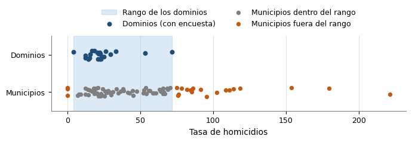
```
Sensibilidad al quitar cada dominio (de mayor a menor cambio medio de las predicciones):

```
| DOMINIO_EXCLUIDO | Intercepto | TASA_HOMICIDIOS | A_HAT | CAMBIO_MEDIO_PP | CAMBIO_MAX_PP |
|---|---|---|---|---|---|
| Quibdó | 9.9341 | 0.0613 | 5.5557 | 1.3056 | 7.6534 |
| Cali A.M. | 8.75 | 0.1249 | 5.2823 | 0.9265 | 5.2486 |
| Armenia | 9.1577 | 0.0942 | 5.2205 | 0.2931 | 1.1645 |
| Cúcuta A.M. | 9.0719 | 0.0963 | 4.9091 | 0.2712 | 0.7811 |
| Tunja | 8.8979 | 0.1081 | 5.6392 | 0.2637 | 1.6609 |
| Valledupar | 8.8555 | 0.1063 | 5.0841 | 0.2057 | 1.2136 |
| Barranquilla A.M. | 9.3174 | 0.1008 | 5.1419 | 0.2046 | 0.4659 |
| Ibagué | 8.8903 | 0.1056 | 5.2434 | 0.187 | 1.1098 |
| Riohacha | 9.2063 | 0.0959 | 5.708 | 0.1561 | 0.7264 |
| Bucaramanga A.M. | 9.3791 | 0.0946 | 5.6559 | 0.1348 | 0.8332 |
| Pasto | 9.3703 | 0.0949 | 5.6709 | 0.1289 | 0.797 |
| Pereira A.M. | 9.3112 | 0.0993 | 5.4394 | 0.1227 | 0.1304 |
| Cartagena | 9.3511 | 0.0984 | 5.3212 | 0.1155 | 0.1603 |
| Santa Marta | 9.3683 | 0.0975 | 5.3485 | 0.1001 | 0.2182 |
| Sincelejo | 9.2918 | 0.097 | 5.7566 | 0.0662 | 0.4012 |
| Montería | 9.307 | 0.0974 | 5.6827 | 0.0601 | 0.2997 |
| Florencia | 9.0981 | 0.1001 | 5.6702 | 0.055 | 0.0927 |
| Manizales A.M. | 9.1594 | 0.0999 | 5.8028 | 0.0184 | 0.1061 |
| Popayán | 9.2251 | 0.0989 | 5.7953 | 0.0184 | 0.0518 |
| Villavicencio | 9.1673 | 0.0994 | 5.7982 | 0.0169 | 0.0236 |
| Bogotá | 9.2151 | 0.0987 | 5.8088 | 0.0157 | 0.0944 |
| Medellín A.M. | 9.1705 | 0.0994 | 5.8028 | 0.0153 | 0.0203 |
| Neiva | 9.1892 | 0.0993 | 5.8097 | 0.0009 | 0.0018 |
```
Municipios que extrapolan, de mayor a menor aporte de fuera del rango:

```
| PER | MES | CODIGO_DEPARTAMENTO | DEPARTAMENTO | CODIGO_MUNICIPIO | MUNICIPIO | ESTADO_EXTRAPOLACION | COVARIABLES_FUERA | COVARIABLE_PRINCIPAL | RAZON_H | PRED_SINTETICO | CV_SINTETICO_PCT | PRED_ACOTADA | APORTE_EXTRAPOLADO_PP | PRED_MIN_SIN_DOMINIO | PRED_MAX_SIN_DOMINIO | AMPLITUD_SIN_DOMINIO_PP | CAMBIO_MAX_PP | DOMINIO_MAS_INFLUYENTE |
|---|---|---|---|---|---|---|---|---|---|---|---|---|---|---|---|---|---|---|
| 2018 | 12 | 19 | Cauca | 19212 | Corinto | FUERA_DEL_RANGO | TASA_HOMICIDIOS | TASA_HOMICIDIOS | 15.523 | 31.1739 | 24.09 | 16.3336 | 14.8404 | 23.5205 | 36.4225 | 12.902 | 7.6534 | Quibdó |
| 2018 | 12 | 76 | Valle del Cauca | 76243 | El Águila | FUERA_DEL_RANGO | TASA_HOMICIDIOS | TASA_HOMICIDIOS | 9.678 | 27.0169 | 22.59 | 16.3336 | 10.6834 | 20.9513 | 31.1896 | 10.2383 | 6.0656 | Quibdó |
| 2018 | 12 | 19 | Cauca | 19573 | Puerto Tejada | FUERA_DEL_RANGO | TASA_HOMICIDIOS | TASA_HOMICIDIOS | 6.765 | 24.456 | 21.52 | 16.3336 | 8.1224 | 19.3686 | 27.9659 | 8.5974 | 5.0875 | Quibdó |
| 2018 | 12 | 19 | Cauca | 19050 | Argelia | FUERA_DEL_RANGO | TASA_HOMICIDIOS | TASA_HOMICIDIOS | 3.637 | 20.9601 | 19.93 | 16.3336 | 4.6265 | 17.2079 | 23.5652 | 6.3573 | 3.7521 | Quibdó |
| 2018 | 12 | 19 | Cauca | 19532 | Patía | FUERA_DEL_RANGO | TASA_HOMICIDIOS | TASA_HOMICIDIOS | 3.301 | 20.5045 | 19.72 | 16.3336 | 4.1709 | 16.9264 | 22.9917 | 6.0653 | 3.5781 | Quibdó |
| 2018 | 12 | 76 | Valle del Cauca | 76054 | Argelia | FUERA_DEL_RANGO | TASA_HOMICIDIOS | TASA_HOMICIDIOS | 3.104 | 20.2255 | 19.59 | 16.3336 | 3.892 | 16.754 | 22.6406 | 5.8866 | 3.4716 | Quibdó |
| 2018 | 12 | 76 | Valle del Cauca | 76041 | Ansermanuevo | FUERA_DEL_RANGO | TASA_HOMICIDIOS | TASA_HOMICIDIOS | 2.949 | 20.0002 | 19.49 | 16.3336 | 3.6667 | 16.6147 | 22.3569 | 5.7422 | 3.3855 | Quibdó |
| 2018 | 12 | 76 | Valle del Cauca | 76318 | Guacarí | FUERA_DEL_RANGO | TASA_HOMICIDIOS | TASA_HOMICIDIOS | 2.531 | 19.359 | 19.21 | 16.3336 | 3.0254 | 16.2184 | 21.5498 | 5.3313 | 3.1406 | Quibdó |
| 2018 | 12 | 76 | Valle del Cauca | 76823 | Toro | FUERA_DEL_RANGO | TASA_HOMICIDIOS | TASA_HOMICIDIOS | 2.135 | 18.7009 | 18.93 | 16.3336 | 2.3674 | 15.8117 | 20.7214 | 4.9097 | 2.8892 | Quibdó |
| 2018 | 12 | 19 | Cauca | 19300 | Guachené | FUERA_DEL_RANGO | TASA_HOMICIDIOS | TASA_HOMICIDIOS | 1.897 | 18.2741 | 18.76 | 16.3336 | 1.9405 | 15.5479 | 20.1841 | 4.6362 | 2.7262 | Quibdó |
| 2018 | 12 | 19 | Cauca | 19142 | Caloto | FUERA_DEL_RANGO | TASA_HOMICIDIOS | TASA_HOMICIDIOS | 1.621 | 17.7421 | 18.56 | 16.3336 | 1.4085 | 15.2191 | 19.5143 | 4.2953 | 2.523 | Quibdó |
| 2018 | 12 | 19 | Cauca | 19256 | El Tambo | FUERA_DEL_RANGO | TASA_HOMICIDIOS | TASA_HOMICIDIOS | 1.583 | 17.6636 | 18.53 | 16.3336 | 1.3301 | 15.1706 | 19.4156 | 4.245 | 2.493 | Quibdó |
| 2018 | 12 | 76 | Valle del Cauca | 76036 | Andalucía | FUERA_DEL_RANGO | TASA_HOMICIDIOS | TASA_HOMICIDIOS | 1.55 | 17.5971 | 18.51 | 16.3336 | 1.2636 | 15.1295 | 19.3319 | 4.2024 | 2.4676 | Quibdó |
| 2018 | 12 | 19 | Cauca | 19845 | Villa Rica | FUERA_DEL_RANGO | TASA_HOMICIDIOS | TASA_HOMICIDIOS | 1.43 | 17.345 | 18.43 | 16.3336 | 1.0115 | 14.9737 | 19.0145 | 4.0408 | 2.3713 | Quibdó |
| 2018 | 12 | 76 | Valle del Cauca | 76892 | Yumbo | FUERA_DEL_RANGO | TASA_HOMICIDIOS | TASA_HOMICIDIOS | 1.256 | 16.9589 | 18.32 | 16.3336 | 0.6253 | 14.7351 | 18.5285 | 3.7934 | 2.2238 | Quibdó |
| 2018 | 12 | 19 | Cauca | 19110 | Buenos Aires | FUERA_DEL_RANGO | TASA_HOMICIDIOS | TASA_HOMICIDIOS | 1.175 | 16.7693 | 18.27 | 16.3336 | 0.4358 | 14.6179 | 18.2898 | 3.6719 | 2.1514 | Quibdó |
| 2018 | 12 | 76 | Valle del Cauca | 76306 | Ginebra | FUERA_DEL_RANGO | TASA_HOMICIDIOS | TASA_HOMICIDIOS | 0.292 | 9.1908 | 27.71 | 9.5938 | -0.403 | 8.75 | 9.9341 | 1.1841 | 0.7433 | Quibdó |
| 2018 | 12 | 19 | Cauca | 19585 | Puracé | FUERA_DEL_RANGO | TASA_HOMICIDIOS | TASA_HOMICIDIOS | 0.292 | 9.1908 | 27.71 | 9.5938 | -0.403 | 8.75 | 9.9341 | 1.1841 | 0.7433 | Quibdó |
| 2018 | 12 | 19 | Cauca | 19743 | Silvia | FUERA_DEL_RANGO | TASA_HOMICIDIOS | TASA_HOMICIDIOS | 0.292 | 9.1908 | 27.71 | 9.5938 | -0.403 | 8.75 | 9.9341 | 1.1841 | 0.7433 | Quibdó |
| 2018 | 12 | 19 | Cauca | 19075 | Balboa | FUERA_DEL_RANGO | TASA_HOMICIDIOS | TASA_HOMICIDIOS | 1.152 | 16.7147 | 18.25 | 16.3336 | 0.3812 | 14.5842 | 18.2211 | 3.637 | 2.1306 | Quibdó |
| 2018 | 12 | 19 | Cauca | 19780 | Suárez | FUERA_DEL_RANGO | TASA_HOMICIDIOS | TASA_HOMICIDIOS | 1.129 | 16.6581 | 18.24 | 16.3336 | 0.3246 | 14.5492 | 18.1499 | 3.6007 | 2.109 | Quibdó |
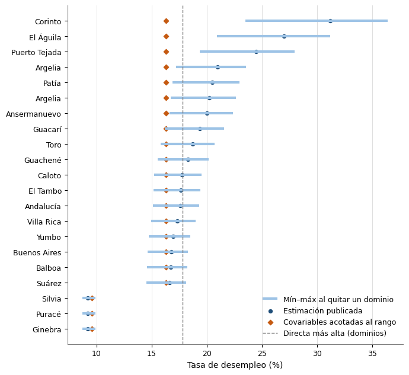
```
Rango de las covariables (dominios con encuesta frente a municipios):
  • TASA_HOMICIDIOS: dominios de 4.06 (Tunja) a 71.96 (Quibdó); municipios de 0 a 221.5. Fuera del rango: 3 por debajo y 18 por encima (25 % de 83).

Estado de los 83 municipios: 62 dentro del rango, 21 fuera del rango de alguna covariable y 0 con una combinación de covariables que el modelo no vio (cada valor dentro de su rango).

Parte de la predicción que viene de salirse del rango, en los 21 municipios que extrapolan: mediana 1.4 pp, máximo 14.8 pp. Mayores: Corinto: 31.2 %, de los cuales 14.8 pp vienen de TASA_HOMICIDIOS (acotada: 16.3 %); El Águila: 27.0 %, de los cuales 10.7 pp vienen de TASA_HOMICIDIOS (acotada: 16.3 %); Puerto Tejada: 24.5 %, de los cuales 8.1 pp vienen de TASA_HOMICIDIOS (acotada: 16.3 %).
10 de ellos tienen una predicción mayor que la directa más alta de los dominios (17.8 %), un valor que el modelo nunca observó.

Al quitar un dominio a la vez, la predicción de los municipios que extrapolan se mueve en una franja de 4.30 pp (mediana; máximo 12.90 pp) frente a 0.79 pp en los que están dentro. El dominio que más cambia las predicciones es Quibdó (cambio medio 1.31 pp, máximo 7.65 pp).

Lectura: la tasa publicada no cambia, pero en los municipios marcados la predicción supone que la relación lineal sigue valiendo fuera de lo observado, y su CV no mide ese riesgo (Morales et al., 2021, p. 441 y 453; Molina, 2019, PDF 40-41).

```


## Celda 24

```python
%md
## Sensibilidad a dominios individuales: dejar-un-dominio-fuera completo (G7-B18)

Con 23 dominios, retirar uno puede mover los coeficientes (la revisión citó cambios de
~37 % y ~47 % al retirar un solo dominio). Esta celda usa los 23 reajustes del benchmark
(**incluida Â**, celda 8a), uno por dominio, y reporta:

1. **Coeficientes**: por β_j el mínimo y el máximo de β̂_j(-d) con el dominio que los produce,
   el cambio relativo máximo, el **cambio estandarizado Δβ/EE(β̂)** (estilo DFBETAS: el
   porcentual se infla cuando |β̂| es pequeño), los cambios de signo y los cruces del umbral
   de significancia. Los 3 dominios que más mueven cada coeficiente y un mapa de calor.
2. **Predicciones**: EBLUP de los 22 dominios que quedan, la predicción sintética de los
   municipios objetivo (separando los que extrapolan, B20), Â y los cambios de clase de
   confiabilidad por CV. El error de predecir el dominio retirado como si no tuviera
   encuesta se mide contra la directa en la validación predictiva (G7-B19).

**Cómo leer.** Se marca un coeficiente como movido si cambia más de `LOAO_UMBRAL_CAMBIO_EE`
errores estándar y una predicción si cambia más de `LOAO_UMBRAL_PRED_PP` puntos
porcentuales; ambos son convenciones propias (`shared/config.py`). El LOAO es un
diagnóstico de sensibilidad: no interviene en la selección ni cambia las tasas publicadas.
Ni Morales et al. ni los artículos espaciales consultados tratan este análisis; sí respaldan
su lectura: en un área fuera de muestra el predictor es solo x'β̂ (Benedetti et al., 2024,
p. 144; Morales et al., p. 441), así que un β̂ que depende de un dominio mueve directamente
las predicciones de los municipios.
```


## Celda 25

```python
nombres_municipio = (
    df_pred["MUNICIPIO"].astype(str)
    + " ("
    + df_pred["CODIGO_MUNICIPIO"].astype(str)
    + ")"
).to_numpy()
municipios_extrapolan = dict(zip(nombres_municipio, df_pred["EXTRAPOLA"].astype(bool)))

# `detalle_loo` y `resumen_loo` salen de la celda de estabilidad: mismos 23 reajustes (8a).
detalle_pred_loao, por_dominio_loao = dejar_uno_fuera_predicciones(
    modelo_ganador,
    reajustes_loao,
    nombres_dominio,
    X_obj=X_new,
    nombres_obj=nombres_municipio,
)
df_influencia = resumen_influencia_dominios(
    detalle_loo,
    detalle_pred_loao,
    por_dominio_loao,
    municipios_extrapolan=municipios_extrapolan,
    umbral_ee=LOAO_UMBRAL_CAMBIO_EE,
    umbral_pp=LOAO_UMBRAL_PRED_PP,
)

print("Cada coeficiente: mínimo y máximo de β̂(-d) y dominio responsable")
display(
    resumen_loo[
        [
            "Parametro",
            "Beta_completo",
            "Beta_min",
            "Dominio_beta_min",
            "Beta_max",
            "Dominio_beta_max",
            "Cambio_pct_max_abs",
            "Cambio_en_EE_max_abs",
            "Dominio_max_cambio",
            "N_cambia_signo",
            "N_cruza_alfa",
        ]
    ].round(4)
)
print("Los 3 dominios que más mueven cada coeficiente:")
display(top_dominios_por_parametro(detalle_loo, k=3).round(4))

fig = figura_influencia(detalle_loo, LOAO_UMBRAL_CAMBIO_EE)
if fig is not None:
    guardar_figura(fig, "influencia_dominios")
    display(fig)
    plt.close(fig)

print("Influencia de cada dominio en coeficientes y predicciones (de mayor a menor):")
display(df_influencia.round(4))
print(
    interpretar_influencia(
        resumen_loo, df_influencia, LOAO_UMBRAL_CAMBIO_EE, LOAO_UMBRAL_PRED_PP
    )
)

pendientes.agregar(detalle_loo, TBL_FH_LOAO_COEFICIENTES, PER_MES)
pendientes.agregar(detalle_pred_loao, TBL_FH_LOAO_PREDICCIONES, PER_MES)
pendientes.agregar(df_influencia, TBL_FH_LOAO_DOMINIOS, PER_MES)
```

**Salida:**

```
Cada coeficiente: mínimo y máximo de β̂(-d) y dominio responsable

```
| Parametro | Beta_completo | Beta_min | Dominio_beta_min | Beta_max | Dominio_beta_max | Cambio_pct_max_abs | Cambio_en_EE_max_abs | Dominio_max_cambio | N_cambia_signo | N_cruza_alfa |
|---|---|---|---|---|---|---|---|---|---|---|
| Intercepto | 9.1908 | 8.75 | Cali A.M. | 9.9341 | Quibdó | 8.0873 | 0.7593 | Quibdó | 0 | 0 |
| TASA_HOMICIDIOS | 0.0993 | 0.0613 | Quibdó | 0.1249 | Cali A.M. | 38.1963 | 1.0546 | Quibdó | 0 | 1 |
```
Los 3 dominios que más mueven cada coeficiente:

```
| Parametro | Dominio_excluido | Beta_completo | Beta_sin_dominio | Cambio_pct | Cambio_en_EE | Cambia_signo | Cruza_alfa |
|---|---|---|---|---|---|---|---|
| TASA_HOMICIDIOS | Quibdó | 0.0993 | 0.0613 | -38.1963 | -1.0546 | False | True |
| TASA_HOMICIDIOS | Cali A.M. | 0.0993 | 0.1249 | 25.8808 | 0.7146 | False | False |
| TASA_HOMICIDIOS | Tunja | 0.0993 | 0.1081 | 8.8879 | 0.2454 | False | False |
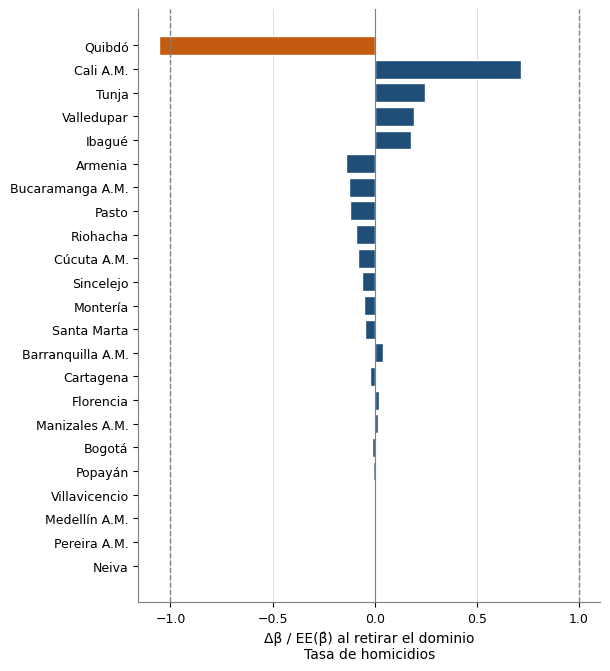
```
Influencia de cada dominio en coeficientes y predicciones (de mayor a menor):

```
| Dominio_excluido | Cambio_en_EE_max_abs | Parametro_max | N_coef_sobre_umbral | N_cambia_signo | N_cruza_alfa | Cambio_EBLUP_max_pp | Dominio_EBLUP_max | N_EBLUP_sobre_umbral | Cambio_sintetico_max_pp | Municipio_max | Cambio_sintetico_medio_pp | N_sintetico_sobre_umbral | Cambio_sintetico_max_extrapolan_pp | Cambio_sintetico_max_no_extrapolan_pp | N_cambia_confiabilidad | A_completo | A_sin_dominio | Cambio_A_pct |
|---|---|---|---|---|---|---|---|---|---|---|---|---|---|---|---|---|---|---|
| Quibdó | 1.0546 | TASA_HOMICIDIOS | 1 | 0 | 1 | -0.0184 | Cali A.M. | 0 | -7.6534 | Corinto (19212) | 1.3056 | 51 | 7.6534 | 1.9304 | 48 | 5.5288 | 5.5557 | 0.485 |
| Cali A.M. | 0.7146 | TASA_HOMICIDIOS | 0 | 0 | 0 | 0.0474 | Quibdó | 0 | 5.2486 | Corinto (19212) | 0.9265 | 45 | 5.2486 | 1.3708 | 7 | 5.5288 | 5.2823 | -4.459 |
| Tunja | 0.2454 | TASA_HOMICIDIOS | 0 | 0 | 0 | 0.0123 | Quibdó | 0 | 1.6609 | Corinto (19212) | 0.2637 | 10 | 1.6609 | 0.3292 | 2 | 5.5288 | 5.6392 | 1.9969 |
| Valledupar | 0.1945 | TASA_HOMICIDIOS | 0 | 0 | 0 | -0.0123 | Cúcuta A.M. | 0 | 1.2136 | Corinto (19212) | 0.2057 | 3 | 1.2136 | 0.2868 | 6 | 5.5288 | 5.0841 | -8.0438 |
| Ibagué | 0.1771 | TASA_HOMICIDIOS | 0 | 0 | 0 | -0.0085 | Cúcuta A.M. | 0 | 1.1098 | Corinto (19212) | 0.187 | 3 | 1.1098 | 0.2563 | 4 | 5.5288 | 5.2434 | -5.1634 |
| Armenia | 0.1421 | TASA_HOMICIDIOS | 0 | 0 | 0 | -0.0172 | Quibdó | 0 | -1.1645 | Corinto (19212) | 0.2931 | 10 | 1.1645 | 0.3933 | 4 | 5.5288 | 5.2205 | -5.5769 |
| Bucaramanga A.M. | 0.1283 | TASA_HOMICIDIOS | 0 | 0 | 0 | 0.0038 | Tunja | 0 | -0.8332 | Corinto (19212) | 0.1348 | 3 | 0.8332 | 0.1563 | 5 | 5.5288 | 5.6559 | 2.2988 |
| Pasto | 0.1226 | TASA_HOMICIDIOS | 0 | 0 | 0 | 0.0039 | Cúcuta A.M. | 0 | -0.797 | Corinto (19212) | 0.1289 | 2 | 0.797 | 0.149 | 5 | 5.5288 | 5.6709 | 2.5686 |
| Riohacha | 0.0932 | TASA_HOMICIDIOS | 0 | 0 | 0 | -0.0059 | Quibdó | 0 | -0.7264 | Corinto (19212) | 0.1561 | 2 | 0.7264 | 0.2207 | 8 | 5.5288 | 5.708 | 3.2406 |
| Cúcuta A.M. | 0.0832 | TASA_HOMICIDIOS | 0 | 0 | 0 | -0.0187 | Quibdó | 0 | -0.7811 | Corinto (19212) | 0.2712 | 3 | 0.7811 | 0.3298 | 8 | 5.5288 | 4.9091 | -11.2094 |
| Sincelejo | 0.0631 | TASA_HOMICIDIOS | 0 | 0 | 0 | 0.0047 | Cúcuta A.M. | 0 | -0.4012 | Corinto (19212) | 0.0662 | 0 | 0.4012 | 0.0852 | 7 | 5.5288 | 5.7566 | 4.1188 |
| Montería | 0.0522 | TASA_HOMICIDIOS | 0 | 0 | 0 | 0.0041 | Cúcuta A.M. | 0 | -0.2997 | Corinto (19212) | 0.0601 | 0 | 0.2997 | 0.1031 | 4 | 5.5288 | 5.6827 | 2.7821 |
| Santa Marta | 0.0497 | TASA_HOMICIDIOS | 0 | 0 | 0 | 0.0031 | Pasto | 0 | -0.2182 | Corinto (19212) | 0.1001 | 0 | 0.2182 | 0.1651 | 6 | 5.5288 | 5.3485 | -3.2624 |
| Barranquilla A.M. | 0.0426 | TASA_HOMICIDIOS | 0 | 0 | 0 | 0.0062 | Cali A.M. | 0 | 0.4659 | Corinto (19212) | 0.2046 | 0 | 0.4659 | 0.2346 | 10 | 5.5288 | 5.1419 | -6.9994 |
| Cartagena | 0.025 | TASA_HOMICIDIOS | 0 | 0 | 0 | 0.0032 | Cali A.M. | 0 | 0.1603 | Ginebra (76306) | 0.1155 | 0 | 0.1603 | 0.1541 | 6 | 5.5288 | 5.3212 | -3.7555 |
| Florencia | 0.0231 | TASA_HOMICIDIOS | 0 | 0 | 0 | -0.0018 | Cartagena | 0 | -0.0927 | Ginebra (76306) | 0.055 | 0 | 0.0927 | 0.087 | 4 | 5.5288 | 5.6702 | 2.5562 |
| Manizales A.M. | 0.0173 | TASA_HOMICIDIOS | 0 | 0 | 0 | 0.0042 | Cúcuta A.M. | 0 | 0.1061 | Corinto (19212) | 0.0184 | 0 | 0.1061 | 0.0271 | 6 | 5.5288 | 5.8028 | 4.9559 |
| Bogotá | 0.0149 | TASA_HOMICIDIOS | 0 | 0 | 0 | 0.0049 | Cúcuta A.M. | 0 | -0.0944 | Corinto (19212) | 0.0157 | 0 | 0.0944 | 0.0206 | 7 | 5.5288 | 5.8088 | 5.0632 |
| Popayán | 0.0108 | TASA_HOMICIDIOS | 0 | 0 | 0 | 0.005 | Cúcuta A.M. | 0 | -0.0518 | Corinto (19212) | 0.0184 | 0 | 0.0518 | 0.0316 | 6 | 5.5288 | 5.7953 | 4.8189 |
| Villavicencio | 0.0037 | TASA_HOMICIDIOS | 0 | 0 | 0 | 0.004 | Cúcuta A.M. | 0 | -0.0236 | Ginebra (76306) | 0.0169 | 0 | 0.0236 | 0.0226 | 6 | 5.5288 | 5.7982 | 4.8717 |
| Medellín A.M. | 0.0028 | TASA_HOMICIDIOS | 0 | 0 | 0 | 0.0042 | Cúcuta A.M. | 0 | -0.0203 | Ginebra (76306) | 0.0153 | 0 | 0.0203 | 0.0196 | 6 | 5.5288 | 5.8028 | 4.9551 |
| Pereira A.M. | 0.0013 | TASA_HOMICIDIOS | 0 | 0 | 0 | 0.0034 | Quibdó | 0 | 0.1304 | Corinto (19212) | 0.1227 | 0 | 0.1304 | 0.1235 | 4 | 5.5288 | 5.4394 | -1.6176 |
| Neiva | 0.0004 | TASA_HOMICIDIOS | 0 | 0 | 0 | 0.0046 | Cúcuta A.M. | 0 | 0.0018 | Corinto (19212) | 0.0009 | 0 | 0.0018 | 0.0015 | 6 | 5.5288 | 5.8097 | 5.0803 |
```
- TASA_HOMICIDIOS: β̂ = 0.099; al retirar un dominio queda entre 0.061 (sin Quibdó) y 0.125 (sin Cali A.M.); cambio máximo 38 % = 1.05 EE (sin Quibdó), que supera 1 EE; signo cambia en 0 de 23 y cruza la significancia en 1.

Dominio más influyente en los coeficientes: Quibdó (1.05 EE en TASA_HOMICIDIOS). Dominios con algún coeficiente sobre 1 EE: 1 de 23.
EBLUP de los dominios que quedan: el mayor cambio es +0.05 pp en Quibdó al retirar Cali A.M.; 0 exclusiones mueven algún EBLUP más de 0.5 pp.
Predicción sintética de municipios: el mayor cambio es -7.65 pp en Corinto (19212) al retirar Quibdó; 10 exclusiones mueven algún municipio más de 0.5 pp.
  Máximo en municipios que extrapolan: 7.65 pp; en los que no extrapolan: 1.93 pp.
Cambios de clase de confiabilidad (CV) sumados sobre todas las exclusiones: 175. Â cambia como máximo 11 %.

Los p-valores de los coeficientes son descriptivos: los mismos dominios se usaron para filtrar, seleccionar, comparar especificaciones y estimar β̂, así que la significancia no es una demostración fuerte. Los coeficientes del benchmark se reportan como asociaciones preliminares, condicionales a la selección.

```


## Celda 26

```python
%md
## Validación predictiva del benchmark: dejar-un-dominio-fuera (G7-B19)

Ninguna cifra del ajuste con los 23 dominios dice qué tan bien predice el modelo **un
dominio sin encuesta**, que es el uso real (municipios objetivo, predictor x'β̂). Para cada
dominio d: se retira, se ajusta con los demás (reestimando  y β̂), se predice como si no
tuviera estimación directa y se compara con y_d. Dos ejercicios:

1. **Covariables del benchmark fijas**: solo se reajustan los coeficientes. Es optimista, porque
   las covariables se escogieron viendo también al dominio retirado.
2. **Procedimiento completo**: en cada iteración se repite todo con los 22 dominios que
   quedan: la selección de covariables de `eda_seleccion_covariables` (Fay-Herriot
   univariado con ψ_d, falsos descubrimientos, robustez, redundancia, parsimonia, VIF) y la
   elección de la especificación de la celda 8 (subconjuntos del conjunto y EC0,
   significancia, AIC, parsimonia). Mide el error del **procedimiento**; su diferencia con
   el ejercicio 1 es el costo de seleccionar con los mismos datos.

**R-04.** La validación no decide el benchmark (la regla es la de Morales et al., p. 453).
Si el procedimiento completo predice peor que el modelo de solo intercepto, la celda
imprime una **advertencia** con las tres RMSE y la inestabilidad del conjunto entre
iteraciones: los municipios sin encuesta reciben solo la predicción sintética (Benedetti et
al., 2024, p. 141), así que esa falta de capacidad predictiva es una limitación a reportar.

La RMSE se complementa con **errores estandarizados**, porque y_d es una estimación con
ruido ψ_d y ψ_d varía mucho entre dominios: `Z_psi = (pred − y_d)/√ψ_d` (error en unidades
del ruido de la directa) y `Z_pred = (pred − y_d)/√(ψ_d + x'Cov(β̂)x + Â)` (error contra
su desviación esperada si el modelo fuera correcto: media ≈ 0, sd ≈ 1, cobertura ≈ nominal).
Se reporta también el RMSE corregido por ruido, la comparación con un modelo de solo
intercepto y el error dentro de muestra.

Es un análisis propio: Morales et al. no desarrollan la validación cruzada por área; sí
respaldan su lectura (p. 441). Con 23 predicciones las métricas son de baja precisión. El
pre-filtrado no depende de la respuesta y no se repite. No cambia las tasas publicadas.
```


## Celda 27

```python
# Candidatas del catálogo con sus códigos: la selección completa trabaja sobre las 18, no solo
# sobre las covariables que ya quedaron en el benchmark.
indicadores_dict = {
    fila["CODIGO_INDICADOR"]: fila["INDICADOR"]
    for fila in spark.table(TBL_DIM_INDICADORES)
    .select("CODIGO_INDICADOR", "INDICADOR")
    .collect()
}
df_prefiltradas = spark.table(TBL_COVARIABLES_PREFILTRADAS).toPandas()
catalogo_val, _ = resolver_catalogo(indicadores_dict, list(df_prefiltradas.columns))
CAND_VAL, ALIAS_VAL, SIGNO_VAL, DIM_VAL = mapas_catalogo(catalogo_val)

# Mismas filas y mismo orden que `df`; la tasa y su error estándar deben coincidir con las del modelo.
df_val = df[["CODIGO_DOMINIO"]].merge(
    df_prefiltradas[["CODIGO_DOMINIO", "NOMBRE_DOMINIO", Y_COL, SE_COL] + CAND_VAL],
    on="CODIGO_DOMINIO",
    how="left",
)
for _col in [Y_COL, SE_COL] + CAND_VAL:
    df_val[_col] = pd.to_numeric(df_val[_col], errors="coerce")
if len(df_val) != len(df) or df_val[CAND_VAL + [Y_COL, SE_COL]].isna().any().any():
    raise ValueError(
        "Las candidatas pre-filtradas no cubren los dominios del modelo o tienen faltantes."
    )
if not (
    np.allclose(df_val[Y_COL], df[Y_COL]) and np.allclose(df_val[SE_COL], df[SE_COL])
):
    raise ValueError(
        f"La tasa o su error estándar de {TBL_COVARIABLES_PREFILTRADAS} no coinciden con "
        f"los de {TBL_COVARIABLES_SELECCIONADAS}."
    )

covars_benchmark = [alias_a_codigo[a] for a in modelo_ganador.covars]
covars_eda_codigos = [alias_a_codigo[a] for a in covars_eda]
COLS_ID = ["CODIGO_DOMINIO", "NOMBRE_DOMINIO"]


selector = crear_selector(
    CAND_VAL, SIGNO_VAL, ALIAS_VAL, DIM_VAL, cfg_pre, Y_COL, SE_COL
)

# Comprobación: con los 23 dominios el procedimiento debe reproducir lo que dejó el análisis (EC1) y
# el benchmark seleccionado; si no, este ejercicio ya no valida el modelo que se reporta.
_sel_todos = selector(df_val)
_m2_repetido = ajustar_benchmark(
    df_val, _sel_todos, Y_COL, SE_COL, DELTA_AIC_EQUIVALENTE, ALFA_SIGNIFICANCIA
)
# R-32: si alguna comprobación falla se advierte y la validación sigue (R-04: el notebook muestra
# el proceso completo), pero su lectura deja de aplicar al modelo reportado.
_ok_seleccion = set(_sel_todos) == set(covars_eda_codigos)
_ok_benchmark = set(_m2_repetido.covars) == set(covars_benchmark)
print(
    "Selección repetida con los 23 dominios = conjunto del análisis (EC1): "
    + ("PASS" if _ok_seleccion else "FAIL")
    + f"  ({[ALIAS_VAL[c] for c in _sel_todos]})"
)
print(
    "Benchmark repetido con los 23 dominios = benchmark seleccionado: "
    + ("PASS" if _ok_benchmark else "FAIL")
)
if not (_ok_seleccion and _ok_benchmark):
    print(
        "⚠ ADVERTENCIA: la selección repetida dentro del modelo no reproduce el conjunto del "
        "análisis o el benchmark: analisis.shared.seleccion.seleccionar_covariables quedó "
        "desincronizada de eda_seleccion_covariables (o la tabla de seleccionadas es de otra "
        "corrida). La validación sigue, pero el ejercicio del procedimiento completo no valida "
        "el modelo reportado."
    )

# Ejercicio 1 con los reajustes de la celda 8a (R-39): el benchmark con sus covariables (alias)
# sobre los mismos dominios; `df_val` tiene la misma tasa y error (comprobado arriba).
cv_fijas = loao_covariables_fijas(
    modelo_ganador.covars,
    modelo_ganador.df,
    Y_COL,
    SE_COL,
    COLS_ID,
    reajustes=reajustes_loao,
)
cv_nulo = loao_covariables_fijas(
    [], df_val, Y_COL, SE_COL, COLS_ID, alias=ALIAS_VAL, ejercicio=EJERCICIO_NULO
)
cv_completo, df_seleccion_cv = loao_procedimiento_completo(
    df_val,
    Y_COL,
    SE_COL,
    COLS_ID,
    selector,
    DELTA_AIC_EQUIVALENTE,
    ALFA_SIGNIFICANCIA,
    alias=ALIAS_VAL,
)
detalle_cv = pd.concat([cv_fijas, cv_completo, cv_nulo], ignore_index=True)

rmse_dentro = float(np.sqrt(np.mean((modelo_ganador.Y - modelo_ganador.mu_hat) ** 2)))
df_metricas_cv = metricas_validacion_cruzada(
    detalle_cv, rmse_dentro_muestra=rmse_dentro, nivel=VALIDACION_NIVEL_COBERTURA
)
df_frecuencia_cv = frecuencia_seleccion(
    df_seleccion_cv, covars_benchmark, alias=ALIAS_VAL
)
resumen_sel_cv = resumen_seleccion(df_seleccion_cv, covars_benchmark)

print("\nMétricas de predicción fuera de muestra (error = predicción − directa):")
display(df_metricas_cv.round(4))
print(
    "Selección en cada iteración (qué elige el procedimiento al retirar cada dominio):"
)
display(df_seleccion_cv.drop(columns=["_Seleccion_EDA", "_Benchmark"]))
print("Frecuencia con que entra cada covariable:")
display(df_frecuencia_cv.round(3))
print("Detalle por dominio (benchmark con covariables fijas y procedimiento completo):")
display(
    detalle_cv[detalle_cv["Ejercicio"] != EJERCICIO_NULO][
        [
            "Ejercicio",
            "NOMBRE_DOMINIO",
            "Directa",
            "SE_directa",
            "Prediccion",
            "RMSE_sintetico",
            "Error",
            "Z_psi",
            "Z_pred",
            "Covariables",
        ]
    ].round(3)
)

fig = figura_validacion(detalle_cv[detalle_cv["Ejercicio"] != EJERCICIO_NULO])
guardar_figura(fig, "validacion_cruzada")
display(fig)
plt.close(fig)
print(interpretar_validacion_cruzada(df_metricas_cv, detalle_cv, resumen_sel_cv))
# R-04: la validación no decide el benchmark, pero si el procedimiento pierde frente al modelo
# de solo intercepto se advierte (y se reporta como limitación en el documento).
_aviso_cv = advertencia_validacion(df_metricas_cv, resumen_sel_cv)
if _aviso_cv:
    print("\n" + _aviso_cv)

pendientes.agregar(detalle_cv, TBL_FH_VALIDACION_CRUZADA, PER_MES)
pendientes.agregar(df_metricas_cv, TBL_FH_VALIDACION_METRICAS, PER_MES)
pendientes.agregar(
    df_seleccion_cv.drop(columns=["_Seleccion_EDA", "_Benchmark"]),
    TBL_FH_VALIDACION_SELECCION,
    PER_MES,
)
pendientes.agregar(df_frecuencia_cv, TBL_FH_VALIDACION_FRECUENCIA, PER_MES)
```

**Salida:**

```
Catálogo de elegibilidad conceptual: 18 de 18 entradas activas (6 variables de la literatura excluidas o sin dato utilizable)
  · activa: 18
  · sin dato utilizable: sin dato en los dominios con encuesta para el período de estimación: 1
  · sin dato utilizable: la serie termina en 2016; no existe dato para 2018: 1
  · sin dato utilizable: solo se publica para departamentos y 23 ciudades principales; no existe en los municipios objetivo sin encuesta, por lo que no permite predicción sintética: 1
  · sin dato utilizable: solo se publica a nivel departamental: 1
  · sin dato utilizable: solo existe para 2022-2023; el IICA se evaluó como proxy y se excluyó (ver IICA_CONFLICTO), así que no tiene sustituto: 1
  · excluida del catálogo (R-01): mide la incidencia del conflicto en el propio municipio (expulsión, presencia armada), no la recepción de desplazados del argumento de Ibáñez (2008); en los 23 dominios es casi la tasa de homicidios (r = 0.92), solo toma 13 valores distintos por redondeo y Quibdó aporta cerca de la mitad de su suma de cuadrados; en los 83 municipios objetivo llega a 0.8 frente a un máximo de 0.1 en los dominios, donde la relación estimada en capitales urbanas no aplica (Morales et al., p. 454): 1
Selección repetida con los 23 dominios = conjunto del análisis (EC1): PASS  (['TASA_HOMICIDIOS', 'COB_ACUEDUCTO'])
Benchmark repetido con los 23 dominios = benchmark seleccionado: PASS

Métricas de predicción fuera de muestra (error = predicción − directa):

```
| Ejercicio | Descripcion | N | RMSE | MAE | Sesgo_medio | RMSE_corregido | Z_psi_media | Z_psi_sd | Z_psi_cuad_medio | Z_pred_media | Z_pred_sd | Z_pred_cuad_medio | Z_pred_max_abs | Cobertura | Nivel_nominal | RMSE_dentro_muestra | Inflacion_vs_dentro | Habilidad_vs_nulo |
|---|---|---|---|---|---|---|---|---|---|---|---|---|---|---|---|---|---|---|
| COVARIABLES_FIJAS | Covariables del benchmark fijas | 23 | 2.5243 | 2.1261 | -0.0676 | 2.5062 | 0.9155 | 8.8297 | 75.4113 | -0.0157 | 1.0494 | 1.0537 | 1.8986 | 1.0 | 0.95 | 2.2668 | 1.1136 | 0.1704 |
| PROCEDIMIENTO_COMPLETO | Procedimiento completo | 23 | 3.4346 | 2.9059 | -0.4079 | 3.4213 | -0.1534 | 11.8144 | 133.5342 | -0.1697 | 1.4357 | 2.0004 | 3.1721 | 0.8696 | 0.95 | 2.2668 | 1.5152 | -0.5357 |
| SIN_COVARIABLES | Sin covariables (referencia) | 23 | 2.7715 | 2.2306 | -0.0102 | 2.755 | 1.2981 | 9.2278 | 83.1352 | -0.0189 | 1.0676 | 1.0905 | 2.6629 | 0.9565 | 0.95 | None | None | None |
```
Selección en cada iteración (qué elige el procedimiento al retirar cada dominio):

```
| Dominio_excluido | Seleccion_EDA | Benchmark |
|---|---|---|
| Medellín A.M. | TASA_HOMICIDIOS + COB_ACUEDUCTO | TASA_HOMICIDIOS |
| Barranquilla A.M. | TASA_HOMICIDIOS | TASA_HOMICIDIOS |
| Bogotá | TASA_HOMICIDIOS + ING_TRIB_PC | TASA_HOMICIDIOS + ING_TRIB_PC |
| Cartagena | TASA_HOMICIDIOS | TASA_HOMICIDIOS |
| Tunja | TASA_HOMICIDIOS + COB_ACUEDUCTO | TASA_HOMICIDIOS |
| Manizales A.M. | TASA_HOMICIDIOS + COB_ACUEDUCTO | TASA_HOMICIDIOS |
| Florencia | — | — |
| Popayán | TASA_HOMICIDIOS + COB_ACUEDUCTO | TASA_HOMICIDIOS |
| Valledupar | TASA_HOMICIDIOS + COB_ACUEDUCTO | TASA_HOMICIDIOS |
| Montería | TASA_HOMICIDIOS + COB_ACUEDUCTO | TASA_HOMICIDIOS |
| Quibdó | — | — |
| Neiva | TASA_HOMICIDIOS + VA_PCT_PRIM | TASA_HOMICIDIOS + VA_PCT_PRIM |
| Riohacha | — | — |
| Santa Marta | COB_ACUEDUCTO + TASA_HOMICIDIOS | COB_ACUEDUCTO |
| Villavicencio | TASA_HOMICIDIOS + COB_ACUEDUCTO | TASA_HOMICIDIOS |
| Pasto | — | — |
| Cúcuta A.M. | COB_ACUEDUCTO + TASA_HOMICIDIOS | COB_ACUEDUCTO |
| Armenia | COB_NET_MEDIA + COB_ACUEDUCTO | COB_NET_MEDIA |
| Pereira A.M. | TASA_HOMICIDIOS | TASA_HOMICIDIOS |
| Bucaramanga A.M. | TASA_HOMICIDIOS + COB_ACUEDUCTO | TASA_HOMICIDIOS |
| Sincelejo | TASA_HOMICIDIOS + COB_ACUEDUCTO | TASA_HOMICIDIOS |
| Ibagué | TASA_HOMICIDIOS + COB_ACUEDUCTO | TASA_HOMICIDIOS |
| Cali A.M. | TASA_HOMICIDIOS + COB_NET_MEDIA | TASA_HOMICIDIOS |
```
Frecuencia con que entra cada covariable:

```
| Covariable | Codigo | Frecuencia_EDA | Frecuencia_benchmark | En_benchmark |
|---|---|---|---|---|
| TASA_HOMICIDIOS | 060010003 | 0.783 | 0.696 | sí |
| COB_ACUEDUCTO | 030010004 | 0.565 | 0.087 | no |
| COB_NET_MEDIA | 040010010 | 0.087 | 0.043 | no |
| ING_TRIB_PC | 070010020 | 0.043 | 0.043 | no |
| VA_PCT_PRIM | 120210008 | 0.043 | 0.043 | no |
```
Detalle por dominio (benchmark con covariables fijas y procedimiento completo):

```
| Ejercicio | NOMBRE_DOMINIO | Directa | SE_directa | Prediccion | RMSE_sintetico | Error | Z_psi | Z_pred | Covariables |
|---|---|---|---|---|---|---|---|---|---|
| COVARIABLES_FIJAS | Medellín A.M. | 11.838 | 0.238 | 11.417 | 2.464 | -0.421 | -1.766 | -0.17 | TASA_HOMICIDIOS |
| COVARIABLES_FIJAS | Barranquilla A.M. | 8.148 | 0.204 | 11.867 | 2.32 | 3.719 | 18.265 | 1.597 | TASA_HOMICIDIOS |
| COVARIABLES_FIJAS | Bogotá | 10.37 | 0.235 | 10.628 | 2.491 | 0.258 | 1.099 | 0.103 | TASA_HOMICIDIOS |
| COVARIABLES_FIJAS | Cartagena | 8.348 | 0.262 | 11.545 | 2.36 | 3.196 | 12.216 | 1.346 | TASA_HOMICIDIOS |
| COVARIABLES_FIJAS | Tunja | 11.314 | 0.326 | 9.337 | 2.549 | -1.977 | -6.067 | -0.769 | TASA_HOMICIDIOS |
| COVARIABLES_FIJAS | Manizales A.M. | 11.237 | 0.284 | 10.841 | 2.477 | -0.396 | -1.393 | -0.159 | TASA_HOMICIDIOS |
| COVARIABLES_FIJAS | Florencia | 12.94 | 0.371 | 11.238 | 2.437 | -1.702 | -4.582 | -0.69 | TASA_HOMICIDIOS |
| COVARIABLES_FIJAS | Popayán | 10.678 | 0.296 | 11.246 | 2.465 | 0.569 | 1.923 | 0.229 | TASA_HOMICIDIOS |
| COVARIABLES_FIJAS | Valledupar | 14.45 | 0.329 | 10.525 | 2.324 | -3.926 | -11.938 | -1.673 | TASA_HOMICIDIOS |
| COVARIABLES_FIJAS | Montería | 9.467 | 0.265 | 11.112 | 2.446 | 1.645 | 6.198 | 0.669 | TASA_HOMICIDIOS |
| COVARIABLES_FIJAS | Quibdó | 17.813 | 0.44 | 14.349 | 3.643 | -3.465 | -7.88 | -0.944 | TASA_HOMICIDIOS |
| COVARIABLES_FIJAS | Neiva | 11.534 | 0.311 | 11.494 | 2.465 | -0.039 | -0.127 | -0.016 | TASA_HOMICIDIOS |
| COVARIABLES_FIJAS | Riohacha | 13.884 | 0.322 | 12.42 | 2.474 | -1.464 | -4.542 | -0.587 | TASA_HOMICIDIOS |
| COVARIABLES_FIJAS | Santa Marta | 8.316 | 0.233 | 11.418 | 2.367 | 3.102 | 13.318 | 1.304 | TASA_HOMICIDIOS |
| COVARIABLES_FIJAS | Villavicencio | 11.873 | 0.32 | 11.394 | 2.463 | -0.48 | -1.501 | -0.193 | TASA_HOMICIDIOS |
| COVARIABLES_FIJAS | Pasto | 8.816 | 0.285 | 10.553 | 2.473 | 1.737 | 6.104 | 0.698 | TASA_HOMICIDIOS |
| COVARIABLES_FIJAS | Cúcuta A.M. | 15.983 | 0.366 | 11.62 | 2.269 | -4.363 | -11.911 | -1.899 | TASA_HOMICIDIOS |
| COVARIABLES_FIJAS | Armenia | 15.491 | 0.342 | 11.964 | 2.349 | -3.527 | -10.318 | -1.486 | TASA_HOMICIDIOS |
| COVARIABLES_FIJAS | Pereira A.M. | 8.867 | 0.269 | 11.653 | 2.386 | 2.786 | 10.363 | 1.161 | TASA_HOMICIDIOS |
| COVARIABLES_FIJAS | Bucaramanga A.M. | 8.739 | 0.276 | 10.566 | 2.469 | 1.827 | 6.616 | 0.735 | TASA_HOMICIDIOS |
| COVARIABLES_FIJAS | Sincelejo | 9.606 | 0.251 | 10.688 | 2.479 | 1.083 | 4.307 | 0.435 | TASA_HOMICIDIOS |
| COVARIABLES_FIJAS | Ibagué | 13.994 | 0.329 | 10.525 | 2.361 | -3.469 | -10.532 | -1.455 | TASA_HOMICIDIOS |
| COVARIABLES_FIJAS | Cali A.M. | 11.651 | 0.284 | 15.402 | 2.654 | 3.75 | 13.204 | 1.405 | TASA_HOMICIDIOS |
| PROCEDIMIENTO_COMPLETO | Medellín A.M. | 11.838 | 0.238 | 11.417 | 2.464 | -0.421 | -1.766 | -0.17 | TASA_HOMICIDIOS |
| PROCEDIMIENTO_COMPLETO | Barranquilla A.M. | 8.148 | 0.204 | 11.867 | 2.32 | 3.719 | 18.265 | 1.597 | TASA_HOMICIDIOS |
| PROCEDIMIENTO_COMPLETO | Bogotá | 10.37 | 0.235 | 5.392 | 2.972 | -4.978 | -21.211 | -1.67 | TASA_HOMICIDIOS + ING_TRIB_PC |
| PROCEDIMIENTO_COMPLETO | Cartagena | 8.348 | 0.262 | 11.545 | 2.36 | 3.196 | 12.216 | 1.346 | TASA_HOMICIDIOS |
| PROCEDIMIENTO_COMPLETO | Tunja | 11.314 | 0.326 | 9.337 | 2.549 | -1.977 | -6.067 | -0.769 | TASA_HOMICIDIOS |
| PROCEDIMIENTO_COMPLETO | Manizales A.M. | 11.237 | 0.284 | 10.841 | 2.477 | -0.396 | -1.393 | -0.159 | TASA_HOMICIDIOS |
| PROCEDIMIENTO_COMPLETO | Florencia | 12.94 | 0.371 | 11.464 | 2.793 | -1.476 | -3.975 | -0.524 | — |
| PROCEDIMIENTO_COMPLETO | Popayán | 10.678 | 0.296 | 11.246 | 2.465 | 0.569 | 1.923 | 0.229 | TASA_HOMICIDIOS |
| PROCEDIMIENTO_COMPLETO | Valledupar | 14.45 | 0.329 | 10.525 | 2.324 | -3.926 | -11.938 | -1.673 | TASA_HOMICIDIOS |
| PROCEDIMIENTO_COMPLETO | Montería | 9.467 | 0.265 | 11.112 | 2.446 | 1.645 | 6.198 | 0.669 | TASA_HOMICIDIOS |
| PROCEDIMIENTO_COMPLETO | Quibdó | 17.813 | 0.44 | 11.244 | 2.428 | -6.569 | -14.942 | -2.663 | — |
| PROCEDIMIENTO_COMPLETO | Neiva | 11.534 | 0.311 | 14.352 | 2.616 | 2.818 | 9.076 | 1.07 | TASA_HOMICIDIOS + VA_PCT_PRIM |
| PROCEDIMIENTO_COMPLETO | Riohacha | 13.884 | 0.322 | 11.42 | 2.759 | -2.464 | -7.645 | -0.887 | — |
| PROCEDIMIENTO_COMPLETO | Santa Marta | 8.316 | 0.233 | 12.815 | 2.341 | 4.499 | 19.316 | 1.912 | COB_ACUEDUCTO |
| PROCEDIMIENTO_COMPLETO | Villavicencio | 11.873 | 0.32 | 11.394 | 2.463 | -0.48 | -1.501 | -0.193 | TASA_HOMICIDIOS |
| PROCEDIMIENTO_COMPLETO | Pasto | 8.816 | 0.285 | 11.65 | 2.743 | 2.835 | 9.959 | 1.028 | — |
| PROCEDIMIENTO_COMPLETO | Cúcuta A.M. | 15.983 | 0.366 | 11.042 | 2.265 | -4.942 | -13.49 | -2.153 | COB_ACUEDUCTO |
| PROCEDIMIENTO_COMPLETO | Armenia | 15.491 | 0.342 | 8.48 | 2.184 | -7.011 | -20.51 | -3.172 | COB_NET_MEDIA |
| PROCEDIMIENTO_COMPLETO | Pereira A.M. | 8.867 | 0.269 | 11.653 | 2.386 | 2.786 | 10.363 | 1.161 | TASA_HOMICIDIOS |
| PROCEDIMIENTO_COMPLETO | Bucaramanga A.M. | 8.739 | 0.276 | 10.566 | 2.469 | 1.827 | 6.616 | 0.735 | TASA_HOMICIDIOS |
| PROCEDIMIENTO_COMPLETO | Sincelejo | 9.606 | 0.251 | 10.688 | 2.479 | 1.083 | 4.307 | 0.435 | TASA_HOMICIDIOS |
| PROCEDIMIENTO_COMPLETO | Ibagué | 13.994 | 0.329 | 10.525 | 2.361 | -3.469 | -10.532 | -1.455 | TASA_HOMICIDIOS |
| PROCEDIMIENTO_COMPLETO | Cali A.M. | 11.651 | 0.284 | 15.402 | 2.654 | 3.75 | 13.204 | 1.405 | TASA_HOMICIDIOS |
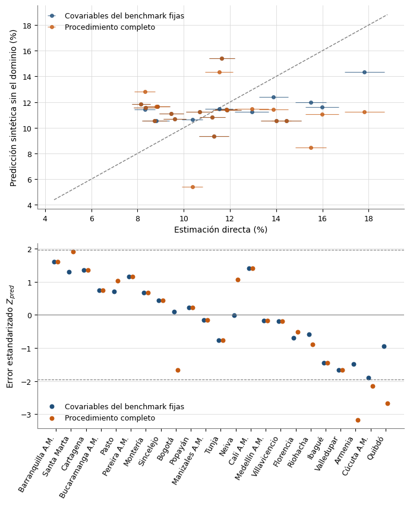
```
- Covariables del benchmark fijas: RMSE 2.52 pp, MAE 2.13, sesgo -0.07; RMSE corregido por ruido 2.51; Z_psi: media +0.92, media de Z² 75.41; Z_pred: media -0.02, sd 1.05, cobertura 100 % (nominal 95 %); habilidad frente a solo intercepto +0.17.
- Procedimiento completo: RMSE 3.43 pp, MAE 2.91, sesgo -0.41; RMSE corregido por ruido 3.42; Z_psi: media -0.15, media de Z² 133.53; Z_pred: media -0.17, sd 1.44, cobertura 87 % (nominal 95 %); habilidad frente a solo intercepto -0.54.
- Sin covariables (referencia): RMSE 2.77 pp, MAE 2.23, sesgo -0.01; RMSE corregido por ruido 2.76; Z_psi: media +1.30, media de Z² 83.14; Z_pred: media -0.02, sd 1.07, cobertura 96 % (nominal 95 %).
- Costo de seleccionar con los mismos datos: la RMSE pasa de 2.52 (covariables fijas) a 3.43 (procedimiento completo), 1.36 veces.
- Error dentro de muestra del ajuste con todos los dominios: 2.27 pp.
- El procedimiento completo reproduce el benchmark en 14 de 23 iteraciones; obtiene 6 conjuntos distintos (sin covariables en 4); Jaccard mediano con el benchmark 1.00.
- Procedimiento completo: |Z_pred| > 1.96 en Quibdó (-2.66), Cúcuta A.M. (-2.15), Armenia (-3.17).

Con 23 dominios son 23 predicciones: las métricas tienen baja precisión y se leen como orden de magnitud. La directa es una estimación con ruido ψ_d, por eso se reportan los errores estandarizados y el RMSE corregido. El pre-filtrado de covariables no se repitió (no depende de la respuesta).

⚠ ADVERTENCIA (R-04): repitiendo la selección en cada iteración, el procedimiento predice peor que el modelo de solo intercepto (RMSE 3.43 frente a 2.77 pp; habilidad -0.54). Con las covariables del benchmark fijas la RMSE es 2.52, pero ese ejercicio es optimista porque la selección vio al dominio retirado. El benchmark cambia entre iteraciones: se reproduce en 14 de 23, aparecen 6 conjuntos distintos y en 4 no queda ninguna covariable. La regla del benchmark no cambia (significancia, AIC y parsimonia; Morales et al., p. 453), pero la predicción de los municipios sin encuesta es sintética (Benedetti et al., 2024, p. 141) y esta falta de capacidad predictiva fuera de la muestra se reporta como limitación en el documento.

```


## Celda 28

```python
# Sustentación completa en shared/benchmarking.py. Los municipios que forman un dominio A.M. con
# estimación directa (Cali y Yumbo en Cali A.M.) reciben su predicción sintética y luego un
# factor de razón λ_D por dominio, para que su promedio ponderado por la población de 15 años y
# más (PET CNPV 2018, suma de los grupos de edad de TerriData; aproximación de la PEA municipal)
# reproduzca el valor ya ajustado
# del dominio (nivel 1). Así municipio, ciudad A.M. y total quedan coherentes, como en el DANE
# («departamentales, de ciudades principales y nacional», nota SAE 2024, PDF 25).
#
# Por qué Yumbo recibe estimación propia y no la tasa de Cali A.M.: el modelo anidado
# (Morales et al., p. 462) exige estimaciones directas por municipio, que la GEIH pública no
# permite, y asignarle la tasa del A.M. es el sintético básico, sesgado si Yumbo difiere de Cali
# (Morales et al., p. 42).
#
# El peso es el denominador de la tasa (PEA ≈ PET). Las covariables del dominio se agregaron con
# el denominador de cada indicador, así que el agregado de los sintéticos municipales,
# Σ w_m x_m'β̂ / Σ w_m, no es exactamente el sintético del dominio x̄_D'β̂: λ_D − 1 combina la
# separación del dominio respecto de su predicción sintética y esa brecha de agregación, que se
# imprime abajo; la consistencia del ajuste sigue siendo exacta. Los municipios sin dominio padre
# no se ajustan: el único territorio de la GEIH que los contiene es el departamento, que con la
# ventana anual sí es representativo (Metodología GEIH v9, PDF 9), pero su estimación directa
# exige los registros sin AREA (resto de cabeceras y zona rural), que el proyecto decidió no usar.
pesos_n2 = (
    spark.table(TBL_TERRIDATA)
    .filter(f"ANO = {PER_MODELO} AND MES = {MES_MODELO}")
    .selectExpr(
        "CODIGO_ENTIDAD AS CODIGO_MUNICIPIO",
        f"{EXPR_PESO_POBLACION} AS PESO_N2",
    )
    .toPandas()
)
df_pred = df_pred.merge(
    pesos_n2, on="CODIGO_MUNICIPIO", how="left", validate="one_to_one"
)

# Valor de referencia de cada dominio: su EBLUP ajustado en el nivel 1 (sin redondear).
objetivos_n2 = dict(zip(resultados_ganador["CODIGO_DOMINIO"], eblup_n1))

df_bm2 = benchmark_nivel2(
    df_pred.assign(PRED_EXACTA=y_sintetico),
    col_pred="PRED_EXACTA",
    col_peso="PESO_N2",
    col_padre="CODIGO_DOMINIO_PADRE",
    objetivos=objetivos_n2,
)
df_pred["LAMBDA_N2"] = df_bm2["LAMBDA_N2"].round(6)
df_pred["PRED_BENCHMARK"] = df_bm2["PRED_BENCHMARK"].round(4)
# R-09: el RMSE del municipio ajustado incluye el sesgo (λ_D − 1)·θ̂ del ajuste de razón; con
# λ_D lejos de 1 domina el error, así que el CV publicado (CV_BENCHMARK_PCT) sube. En los
# municipios sin dominio padre λ = 1 y coincide con el del sintético.
rmse_n2 = rmse_benchmark(
    rmse_sintetico, y_sintetico, df_bm2["PRED_BENCHMARK"], df_bm2["LAMBDA_N2"]
)
df_pred["RMSE_BENCHMARK"] = rmse_n2.round(4)
df_pred["CV_BENCHMARK_PCT"] = (
    100 * rmse_n2 / np.abs(df_bm2["PRED_BENCHMARK"].to_numpy(dtype=float))
).round(2)
df_pred["TIPO"] = np.where(df_bm2["BENCHMARK"], "SINTETICO_BENCHMARK", "SINTETICO")

ajustados = df_pred[df_bm2["BENCHMARK"]]
print(f"Municipios ajustados a su dominio A.M.: {len(ajustados)}")
display(
    ajustados[
        [
            "CODIGO_DOMINIO_PADRE",
            "MUNICIPIO",
            "PESO_N2",
            "PRED_SINTETICO",
            "LAMBDA_N2",
            "PRED_BENCHMARK",
            "CV_SINTETICO_PCT",
            "CV_BENCHMARK_PCT",
        ]
    ]
)

# Brecha de agregación de cada dominio A.M.: sintético del dominio (x̄_D'β̂, con las covariables
# agregadas por su denominador) frente al promedio ponderado por la PET de los sintéticos de sus
# municipios, que es la base del λ_D. Solo se imprime.
_en_n2 = df_bm2["BENCHMARK"].to_numpy()
display(
    brecha_agregacion(
        y_sintetico[_en_n2],
        df_pred.loc[_en_n2, "PESO_N2"],
        df_pred.loc[_en_n2, "CODIGO_DOMINIO_PADRE"],
        dict(
            zip(
                resultados_ganador["CODIGO_DOMINIO"],
                resultados_ganador["PRED_SINTETICO"],
            )
        ),
        objetivos_n2,
    ).round(4)
)

pendientes.agregar(df_pred, TBL_FAY_HERRIOT_PREDICCION_SINTETICA)
```

**Salida:**

```
Municipios ajustados a su dominio A.M.: 2

```
| CODIGO_DOMINIO_PADRE | MUNICIPIO | PESO_N2 | PRED_SINTETICO | LAMBDA_N2 | PRED_BENCHMARK | CV_SINTETICO_PCT | CV_BENCHMARK_PCT |
|---|---|---|---|---|---|---|---|
| 76001 | Yumbo | 82360.0 | 16.9589 | 0.807749 | 13.6985 | 18.32 | 30.03 |
| 76001 | Cali | 1769861.0 | 14.3553 | 0.807749 | 11.5955 | 18.2 | 29.96 |
| CODIGO_DOMINIO | SINTETICO_DOMINIO | AGREGADO_MUNICIPIOS | BRECHA_PP | EBLUP_AJUSTADO |
|---|---|---|---|---|
| 76001 | 14.475 | 14.4711 | -0.0039 | 11.689 |


## Celda 29

```python
# Resultados finales del Fay-Herriot clásico, benchmark no espacial (R-11, D-03): la tabla lleva
# MODELO_FUENTE y ESTADO_RESULTADO. Dos niveles: los 23 dominios con el EBLUP ajustado (nivel 1) y los municipios objetivo con la
# predicción sintética (ajustada en el nivel 2 cuando pertenecen a un dominio A.M.). La tasa sin
# ajustar se conserva en TASA_SIN_AJUSTE_PCT para trazabilidad.
tabla_dominios = pd.DataFrame(
    {
        "PER": resultados_ganador["PER"],
        "MES": resultados_ganador["MES"],
        "CODIGO": resultados_ganador["CODIGO_DOMINIO"],
        "TASA_DESEMPLEO_PCT": resultados_ganador["EBLUP_BENCHMARK"],
        "TASA_SIN_AJUSTE_PCT": resultados_ganador["EBLUP"],
        "LAMBDA": resultados_ganador["LAMBDA_N1"],
        # R-09: CV del valor publicado (EBLUP ajustado), con el sesgo del ajuste.
        "CV_PCT": resultados_ganador["CV_EBLUP_BENCHMARK_PCT"],
        "TIPO": "EBLUP_BENCHMARK",
    }
)
tabla_municipios = pd.DataFrame(
    {
        "PER": df_pred["PER"],
        "MES": df_pred["MES"],
        "CODIGO": df_pred["CODIGO_MUNICIPIO"],
        "CODIGO_DOMINIO_PADRE": df_pred["CODIGO_DOMINIO_PADRE"],
        "TASA_DESEMPLEO_PCT": df_pred["PRED_BENCHMARK"],
        "TASA_SIN_AJUSTE_PCT": df_pred["PRED_SINTETICO"],
        "LAMBDA": df_pred["LAMBDA_N2"],
        "CV_PCT": df_pred["CV_BENCHMARK_PCT"],
        "TIPO": df_pred["TIPO"],
        # Estado de extrapolación (B20): entra a la etiqueta CALIDAD_REPORTADA (B21).
        "ESTADO_EXTRAPOLACION": df_pred["ESTADO_EXTRAPOLACION"],
    }
)

# CONFIABILIDAD (solo por el CV), BASE_CV y CALIDAD_REPORTADA (B21, shared/consolidacion.py):
# la etiqueta que se cita es CALIDAD_REPORTADA; en los municipios dice «condicional al modelo»
# y, si extrapolan, «extrapolado».
dim_dominio = spark.table(TBL_DIM_DOMINIO).toPandas()
df_final = construir_tabla_final(
    tabla_dominios,
    tabla_municipios,
    dim_dominio,
    spark.table(TBL_DIM_DIVIPOLA).toPandas(),
)

# Marcas de aviso. Los dominios no extrapolan (están en la muestra de ajuste y definen el rango).
# Un mismo código puede ser dominio y municipio (76001), así que se une por NIVEL + CODIGO.
marcas = pd.concat(
    [
        resultados_ganador[["CODIGO_DOMINIO", "FUERA_DE_RANGO"]]
        .rename(columns={"CODIGO_DOMINIO": "CODIGO"})
        .assign(
            NIVEL="DOMINIO",
            EXTRAPOLA=False,
            APORTE_EXTRAPOLADO_PP=0.0,
        ),
        df_pred[
            [
                "CODIGO_MUNICIPIO",
                "FUERA_DE_RANGO",
                "EXTRAPOLA",
                "APORTE_EXTRAPOLADO_PP",
            ]
        ]
        .rename(columns={"CODIGO_MUNICIPIO": "CODIGO"})
        .assign(NIVEL="MUNICIPIO"),
    ],
    ignore_index=True,
)
df_final = df_final.merge(
    marcas, on=["NIVEL", "CODIGO"], how="left", validate="one_to_one"
)

print(
    f"\nTabla final consolidada: {(df_final['NIVEL'] == 'DOMINIO').sum()} dominios + "
    f"{(df_final['NIVEL'] == 'MUNICIPIO').sum()} municipios "
    f"({(df_final['TIPO'] == 'SINTETICO_BENCHMARK').sum()} ajustados a su dominio A.M.)"
)
display(df_final)

# R-11: la tabla dice de qué modelo sale y en qué estado está (columnas y comentario en UC).
pendientes.agregar(
    df_final, TBL_FAY_HERRIOT_ESTIMACIONES_FINALES, comentario=COMENTARIO_TABLA_FINAL
)
```

**Salida:**

```

Tabla final consolidada: 23 dominios + 83 municipios (2 ajustados a su dominio A.M.)

```
| NIVEL | PER | MES | DEPARTAMENTO | CODIGO | NOMBRE | CODIGO_DOMINIO_PADRE | TIPO | TASA_DESEMPLEO_PCT | TASA_SIN_AJUSTE_PCT | LAMBDA | CV_PCT | CONFIABILIDAD | BASE_CV | ESTADO_EXTRAPOLACION | CALIDAD_REPORTADA | MODELO_FUENTE | ESTADO_RESULTADO | FUERA_DE_RANGO | EXTRAPOLA | APORTE_EXTRAPOLADO_PP |
|---|---|---|---|---|---|---|---|---|---|---|---|---|---|---|---|---|---|---|---|---|
| DOMINIO | 2018 | 12 | ANTIOQUIA | 05001 | Medellín A.M. | None | EBLUP_BENCHMARK | 11.8307 | 11.8337 | 0.999745 | 2.01 | Confiable | EBLUP | DENTRO_DEL_RANGO | Confiable | FH_CLASICO_BENCHMARK_NO_ESPACIAL | FINAL_TRAS_COMPARACION_ESPACIAL | False | False | 0.0 |
| DOMINIO | 2018 | 12 | ATLÁNTICO | 08001 | Barranquilla A.M. | None | EBLUP_BENCHMARK | 8.1723 | 8.1743 | 0.999745 | 2.48 | Confiable | EBLUP | DENTRO_DEL_RANGO | Confiable | FH_CLASICO_BENCHMARK_NO_ESPACIAL | FINAL_TRAS_COMPARACION_ESPACIAL | False | False | 0.0 |
| DOMINIO | 2018 | 12 | BOGOTÁ, D.C. | 11001 | Bogotá | None | EBLUP_BENCHMARK | 10.3696 | 10.3723 | 0.999745 | 2.25 | Confiable | EBLUP | DENTRO_DEL_RANGO | Confiable | FH_CLASICO_BENCHMARK_NO_ESPACIAL | FINAL_TRAS_COMPARACION_ESPACIAL | False | False | 0.0 |
| DOMINIO | 2018 | 12 | BOLÍVAR | 13001 | Cartagena | None | EBLUP_BENCHMARK | 8.3837 | 8.3858 | 0.999745 | 3.11 | Confiable | EBLUP | DENTRO_DEL_RANGO | Confiable | FH_CLASICO_BENCHMARK_NO_ESPACIAL | FINAL_TRAS_COMPARACION_ESPACIAL | False | False | 0.0 |
| DOMINIO | 2018 | 12 | BOYACÁ | 15001 | Tunja | None | EBLUP_BENCHMARK | 11.2786 | 11.2815 | 0.999745 | 2.87 | Confiable | EBLUP | DENTRO_DEL_RANGO | Confiable | FH_CLASICO_BENCHMARK_NO_ESPACIAL | FINAL_TRAS_COMPARACION_ESPACIAL | False | False | 0.0 |
| DOMINIO | 2018 | 12 | CALDAS | 17001 | Manizales A.M. | None | EBLUP_BENCHMARK | 11.2288 | 11.2317 | 0.999745 | 2.52 | Confiable | EBLUP | DENTRO_DEL_RANGO | Confiable | FH_CLASICO_BENCHMARK_NO_ESPACIAL | FINAL_TRAS_COMPARACION_ESPACIAL | False | False | 0.0 |
| DOMINIO | 2018 | 12 | CAQUETÁ | 18001 | Florencia | None | EBLUP_BENCHMARK | 12.8972 | 12.9005 | 0.999745 | 2.85 | Confiable | EBLUP | DENTRO_DEL_RANGO | Confiable | FH_CLASICO_BENCHMARK_NO_ESPACIAL | FINAL_TRAS_COMPARACION_ESPACIAL | False | False | 0.0 |
| DOMINIO | 2018 | 12 | CAUCA | 19001 | Popayán | None | EBLUP_BENCHMARK | 10.6832 | 10.686 | 0.999745 | 2.75 | Confiable | EBLUP | DENTRO_DEL_RANGO | Confiable | FH_CLASICO_BENCHMARK_NO_ESPACIAL | FINAL_TRAS_COMPARACION_ESPACIAL | False | False | 0.0 |
| DOMINIO | 2018 | 12 | CESAR | 20001 | Valledupar | None | EBLUP_BENCHMARK | 14.3758 | 14.3795 | 0.999745 | 2.27 | Confiable | EBLUP | DENTRO_DEL_RANGO | Confiable | FH_CLASICO_BENCHMARK_NO_ESPACIAL | FINAL_TRAS_COMPARACION_ESPACIAL | False | False | 0.0 |
| DOMINIO | 2018 | 12 | CÓRDOBA | 23001 | Montería | None | EBLUP_BENCHMARK | 9.4847 | 9.4871 | 0.999745 | 2.78 | Confiable | EBLUP | DENTRO_DEL_RANGO | Confiable | FH_CLASICO_BENCHMARK_NO_ESPACIAL | FINAL_TRAS_COMPARACION_ESPACIAL | False | False | 0.0 |
| DOMINIO | 2018 | 12 | CHOCÓ | 27001 | Quibdó | None | EBLUP_BENCHMARK | 17.7586 | 17.7631 | 0.999745 | 2.46 | Confiable | EBLUP | DENTRO_DEL_RANGO | Confiable | FH_CLASICO_BENCHMARK_NO_ESPACIAL | FINAL_TRAS_COMPARACION_ESPACIAL | False | False | 0.0 |
| DOMINIO | 2018 | 12 | HUILA | 41001 | Neiva | None | EBLUP_BENCHMARK | 11.5301 | 11.533 | 0.999745 | 2.67 | Confiable | EBLUP | DENTRO_DEL_RANGO | Confiable | FH_CLASICO_BENCHMARK_NO_ESPACIAL | FINAL_TRAS_COMPARACION_ESPACIAL | False | False | 0.0 |
| DOMINIO | 2018 | 12 | LA GUAJIRA | 44001 | Riohacha | None | EBLUP_BENCHMARK | 13.8552 | 13.8587 | 0.999745 | 2.31 | Confiable | EBLUP | DENTRO_DEL_RANGO | Confiable | FH_CLASICO_BENCHMARK_NO_ESPACIAL | FINAL_TRAS_COMPARACION_ESPACIAL | False | False | 0.0 |
| DOMINIO | 2018 | 12 | MAGDALENA | 47001 | Santa Marta | None | EBLUP_BENCHMARK | 8.343 | 8.3452 | 0.999745 | 2.78 | Confiable | EBLUP | DENTRO_DEL_RANGO | Confiable | FH_CLASICO_BENCHMARK_NO_ESPACIAL | FINAL_TRAS_COMPARACION_ESPACIAL | False | False | 0.0 |
| DOMINIO | 2018 | 12 | META | 50001 | Villavicencio | None | EBLUP_BENCHMARK | 11.862 | 11.865 | 0.999745 | 2.67 | Confiable | EBLUP | DENTRO_DEL_RANGO | Confiable | FH_CLASICO_BENCHMARK_NO_ESPACIAL | FINAL_TRAS_COMPARACION_ESPACIAL | False | False | 0.0 |
| DOMINIO | 2018 | 12 | NARIÑO | 52001 | Pasto | None | EBLUP_BENCHMARK | 8.8369 | 8.8392 | 0.999745 | 3.2 | Confiable | EBLUP | DENTRO_DEL_RANGO | Confiable | FH_CLASICO_BENCHMARK_NO_ESPACIAL | FINAL_TRAS_COMPARACION_ESPACIAL | False | False | 0.0 |
| DOMINIO | 2018 | 12 | NORTE DE SANTANDER | 54001 | Cúcuta A.M. | None | EBLUP_BENCHMARK | 15.8806 | 15.8847 | 0.999745 | 2.28 | Confiable | EBLUP | DENTRO_DEL_RANGO | Confiable | FH_CLASICO_BENCHMARK_NO_ESPACIAL | FINAL_TRAS_COMPARACION_ESPACIAL | False | False | 0.0 |
| DOMINIO | 2018 | 12 | QUINDÍO | 63001 | Armenia | None | EBLUP_BENCHMARK | 15.4184 | 15.4223 | 0.999745 | 2.2 | Confiable | EBLUP | DENTRO_DEL_RANGO | Confiable | FH_CLASICO_BENCHMARK_NO_ESPACIAL | FINAL_TRAS_COMPARACION_ESPACIAL | False | False | 0.0 |
| DOMINIO | 2018 | 12 | RISARALDA | 66001 | Pereira A.M. | None | EBLUP_BENCHMARK | 8.8987 | 8.901 | 0.999745 | 3.01 | Confiable | EBLUP | DENTRO_DEL_RANGO | Confiable | FH_CLASICO_BENCHMARK_NO_ESPACIAL | FINAL_TRAS_COMPARACION_ESPACIAL | False | False | 0.0 |
| DOMINIO | 2018 | 12 | SANTANDER | 68001 | Bucaramanga A.M. | None | EBLUP_BENCHMARK | 8.76 | 8.7622 | 0.999745 | 3.13 | Confiable | EBLUP | DENTRO_DEL_RANGO | Confiable | FH_CLASICO_BENCHMARK_NO_ESPACIAL | FINAL_TRAS_COMPARACION_ESPACIAL | False | False | 0.0 |
| DOMINIO | 2018 | 12 | SUCRE | 70001 | Sincelejo | None | EBLUP_BENCHMARK | 9.6147 | 9.6171 | 0.999745 | 2.6 | Confiable | EBLUP | DENTRO_DEL_RANGO | Confiable | FH_CLASICO_BENCHMARK_NO_ESPACIAL | FINAL_TRAS_COMPARACION_ESPACIAL | False | False | 0.0 |
| DOMINIO | 2018 | 12 | TOLIMA | 73001 | Ibagué | None | EBLUP_BENCHMARK | 13.9277 | 13.9313 | 0.999745 | 2.35 | Confiable | EBLUP | DENTRO_DEL_RANGO | Confiable | FH_CLASICO_BENCHMARK_NO_ESPACIAL | FINAL_TRAS_COMPARACION_ESPACIAL | False | False | 0.0 |
| DOMINIO | 2018 | 12 | VALLE DEL CAUCA | 76001 | Cali A.M. | None | EBLUP_BENCHMARK | 11.689 | 11.692 | 0.999745 | 2.42 | Confiable | EBLUP | DENTRO_DEL_RANGO | Confiable | FH_CLASICO_BENCHMARK_NO_ESPACIAL | FINAL_TRAS_COMPARACION_ESPACIAL | False | False | 0.0 |
| MUNICIPIO | 2018 | 12 | CAUCA | 19022 | ALMAGUER | None | SINTETICO | 14.5707 | 14.5707 | 1.0 | 18.15 | Aceptable | CONDICIONAL_AL_MODELO | DENTRO_DEL_RANGO | Aceptable · condicional al modelo | FH_CLASICO_BENCHMARK_NO_ESPACIAL | FINAL_TRAS_COMPARACION_ESPACIAL | False | False | 0.0 |
| MUNICIPIO | 2018 | 12 | CAUCA | 19050 | ARGELIA | None | SINTETICO | 20.9601 | 20.9601 | 1.0 | 19.93 | Aceptable | CONDICIONAL_AL_MODELO | FUERA_DEL_RANGO | Aceptable · condicional al modelo · extrapolado (fuera del rango) | FH_CLASICO_BENCHMARK_NO_ESPACIAL | FINAL_TRAS_COMPARACION_ESPACIAL | False | True | 4.6265 |
| MUNICIPIO | 2018 | 12 | CAUCA | 19075 | BALBOA | None | SINTETICO | 16.7147 | 16.7147 | 1.0 | 18.25 | Aceptable | CONDICIONAL_AL_MODELO | FUERA_DEL_RANGO | Aceptable · condicional al modelo · extrapolado (fuera del rango) | FH_CLASICO_BENCHMARK_NO_ESPACIAL | FINAL_TRAS_COMPARACION_ESPACIAL | False | True | 0.3812 |
| MUNICIPIO | 2018 | 12 | CAUCA | 19100 | BOLÍVAR | None | SINTETICO | 15.4521 | 15.4521 | 1.0 | 18.07 | Aceptable | CONDICIONAL_AL_MODELO | DENTRO_DEL_RANGO | Aceptable · condicional al modelo | FH_CLASICO_BENCHMARK_NO_ESPACIAL | FINAL_TRAS_COMPARACION_ESPACIAL | False | False | 0.0 |
| MUNICIPIO | 2018 | 12 | CAUCA | 19110 | BUENOS AIRES | None | SINTETICO | 16.7693 | 16.7693 | 1.0 | 18.27 | Aceptable | CONDICIONAL_AL_MODELO | FUERA_DEL_RANGO | Aceptable · condicional al modelo · extrapolado (fuera del rango) | FH_CLASICO_BENCHMARK_NO_ESPACIAL | FINAL_TRAS_COMPARACION_ESPACIAL | False | True | 0.4358 |
| MUNICIPIO | 2018 | 12 | CAUCA | 19130 | CAJIBÍO | None | SINTETICO | 12.9706 | 12.9706 | 1.0 | 18.96 | Aceptable | CONDICIONAL_AL_MODELO | DENTRO_DEL_RANGO | Aceptable · condicional al modelo | FH_CLASICO_BENCHMARK_NO_ESPACIAL | FINAL_TRAS_COMPARACION_ESPACIAL | False | False | 0.0 |
| MUNICIPIO | 2018 | 12 | CAUCA | 19137 | CALDONO | None | SINTETICO | 10.4335 | 10.4335 | 1.0 | 23.34 | No confiable | CONDICIONAL_AL_MODELO | DENTRO_DEL_RANGO | No confiable · condicional al modelo | FH_CLASICO_BENCHMARK_NO_ESPACIAL | FINAL_TRAS_COMPARACION_ESPACIAL | False | False | 0.0 |
| MUNICIPIO | 2018 | 12 | CAUCA | 19142 | CALOTO | None | SINTETICO | 17.7421 | 17.7421 | 1.0 | 18.56 | Aceptable | CONDICIONAL_AL_MODELO | FUERA_DEL_RANGO | Aceptable · condicional al modelo · extrapolado (fuera del rango) | FH_CLASICO_BENCHMARK_NO_ESPACIAL | FINAL_TRAS_COMPARACION_ESPACIAL | False | True | 1.4085 |
| MUNICIPIO | 2018 | 12 | CAUCA | 19212 | CORINTO | None | SINTETICO | 31.1739 | 31.1739 | 1.0 | 24.09 | No confiable | CONDICIONAL_AL_MODELO | FUERA_DEL_RANGO | No confiable · condicional al modelo · extrapolado (fuera del rango) | FH_CLASICO_BENCHMARK_NO_ESPACIAL | FINAL_TRAS_COMPARACION_ESPACIAL | False | True | 14.8404 |
| MUNICIPIO | 2018 | 12 | CAUCA | 19256 | EL TAMBO | None | SINTETICO | 17.6636 | 17.6636 | 1.0 | 18.53 | Aceptable | CONDICIONAL_AL_MODELO | FUERA_DEL_RANGO | Aceptable · condicional al modelo · extrapolado (fuera del rango) | FH_CLASICO_BENCHMARK_NO_ESPACIAL | FINAL_TRAS_COMPARACION_ESPACIAL | False | True | 1.3301 |
| MUNICIPIO | 2018 | 12 | CAUCA | 19290 | FLORENCIA | None | SINTETICO | 13.0074 | 13.0074 | 1.0 | 18.93 | Aceptable | CONDICIONAL_AL_MODELO | DENTRO_DEL_RANGO | Aceptable · condicional al modelo | FH_CLASICO_BENCHMARK_NO_ESPACIAL | FINAL_TRAS_COMPARACION_ESPACIAL | False | False | 0.0 |
| MUNICIPIO | 2018 | 12 | CAUCA | 19300 | GUACHENÉ | None | SINTETICO | 18.2741 | 18.2741 | 1.0 | 18.76 | Aceptable | CONDICIONAL_AL_MODELO | FUERA_DEL_RANGO | Aceptable · condicional al modelo · extrapolado (fuera del rango) | FH_CLASICO_BENCHMARK_NO_ESPACIAL | FINAL_TRAS_COMPARACION_ESPACIAL | False | True | 1.9405 |
| MUNICIPIO | 2018 | 12 | CAUCA | 19318 | GUAPI | None | SINTETICO | 10.9884 | 10.9884 | 1.0 | 21.94 | No confiable | CONDICIONAL_AL_MODELO | DENTRO_DEL_RANGO | No confiable · condicional al modelo | FH_CLASICO_BENCHMARK_NO_ESPACIAL | FINAL_TRAS_COMPARACION_ESPACIAL | False | False | 0.0 |
| MUNICIPIO | 2018 | 12 | CAUCA | 19355 | INZÁ | None | SINTETICO | 9.8787 | 9.8787 | 1.0 | 25.06 | No confiable | CONDICIONAL_AL_MODELO | DENTRO_DEL_RANGO | No confiable · condicional al modelo | FH_CLASICO_BENCHMARK_NO_ESPACIAL | FINAL_TRAS_COMPARACION_ESPACIAL | False | False | 0.0 |
| MUNICIPIO | 2018 | 12 | CAUCA | 19364 | JAMBALÓ | None | SINTETICO | 10.8604 | 10.8604 | 1.0 | 22.23 | No confiable | CONDICIONAL_AL_MODELO | DENTRO_DEL_RANGO | No confiable · condicional al modelo | FH_CLASICO_BENCHMARK_NO_ESPACIAL | FINAL_TRAS_COMPARACION_ESPACIAL | False | False | 0.0 |
| MUNICIPIO | 2018 | 12 | CAUCA | 19392 | LA SIERRA | None | SINTETICO | 11.9612 | 11.9612 | 1.0 | 20.13 | No confiable | CONDICIONAL_AL_MODELO | DENTRO_DEL_RANGO | No confiable · condicional al modelo | FH_CLASICO_BENCHMARK_NO_ESPACIAL | FINAL_TRAS_COMPARACION_ESPACIAL | False | False | 0.0 |
| MUNICIPIO | 2018 | 12 | CAUCA | 19397 | LA VEGA | None | SINTETICO | 10.4058 | 10.4058 | 1.0 | 23.42 | No confiable | CONDICIONAL_AL_MODELO | DENTRO_DEL_RANGO | No confiable · condicional al modelo | FH_CLASICO_BENCHMARK_NO_ESPACIAL | FINAL_TRAS_COMPARACION_ESPACIAL | False | False | 0.0 |
| MUNICIPIO | 2018 | 12 | CAUCA | 19418 | LÓPEZ DE MICAY | None | SINTETICO | 15.067 | 15.067 | 1.0 | 18.08 | Aceptable | CONDICIONAL_AL_MODELO | DENTRO_DEL_RANGO | Aceptable · condicional al modelo | FH_CLASICO_BENCHMARK_NO_ESPACIAL | FINAL_TRAS_COMPARACION_ESPACIAL | False | False | 0.0 |
| MUNICIPIO | 2018 | 12 | CAUCA | 19450 | MERCADERES | None | SINTETICO | 16.1906 | 16.1906 | 1.0 | 18.14 | Aceptable | CONDICIONAL_AL_MODELO | DENTRO_DEL_RANGO | Aceptable · condicional al modelo | FH_CLASICO_BENCHMARK_NO_ESPACIAL | FINAL_TRAS_COMPARACION_ESPACIAL | False | False | 0.0 |
| MUNICIPIO | 2018 | 12 | CAUCA | 19455 | MIRANDA | None | SINTETICO | 15.8373 | 15.8373 | 1.0 | 18.1 | Aceptable | CONDICIONAL_AL_MODELO | DENTRO_DEL_RANGO | Aceptable · condicional al modelo | FH_CLASICO_BENCHMARK_NO_ESPACIAL | FINAL_TRAS_COMPARACION_ESPACIAL | False | False | -0.0 |
| MUNICIPIO | 2018 | 12 | CAUCA | 19473 | MORALES | None | SINTETICO | 11.4907 | 11.4907 | 1.0 | 20.91 | No confiable | CONDICIONAL_AL_MODELO | DENTRO_DEL_RANGO | No confiable · condicional al modelo | FH_CLASICO_BENCHMARK_NO_ESPACIAL | FINAL_TRAS_COMPARACION_ESPACIAL | False | False | 0.0 |
| MUNICIPIO | 2018 | 12 | CAUCA | 19513 | PADILLA | None | SINTETICO | 12.1875 | 12.1875 | 1.0 | 19.81 | Aceptable | CONDICIONAL_AL_MODELO | DENTRO_DEL_RANGO | Aceptable · condicional al modelo | FH_CLASICO_BENCHMARK_NO_ESPACIAL | FINAL_TRAS_COMPARACION_ESPACIAL | False | False | 0.0 |
| MUNICIPIO | 2018 | 12 | CAUCA | 19517 | PÁEZ | None | SINTETICO | 10.7085 | 10.7085 | 1.0 | 22.61 | No confiable | CONDICIONAL_AL_MODELO | DENTRO_DEL_RANGO | No confiable · condicional al modelo | FH_CLASICO_BENCHMARK_NO_ESPACIAL | FINAL_TRAS_COMPARACION_ESPACIAL | False | False | 0.0 |
| MUNICIPIO | 2018 | 12 | CAUCA | 19532 | PATÍA | None | SINTETICO | 20.5045 | 20.5045 | 1.0 | 19.72 | Aceptable | CONDICIONAL_AL_MODELO | FUERA_DEL_RANGO | Aceptable · condicional al modelo · extrapolado (fuera del rango) | FH_CLASICO_BENCHMARK_NO_ESPACIAL | FINAL_TRAS_COMPARACION_ESPACIAL | False | True | 4.1709 |
| MUNICIPIO | 2018 | 12 | CAUCA | 19533 | PIAMONTE | None | SINTETICO | 11.444 | 11.444 | 1.0 | 21.0 | No confiable | CONDICIONAL_AL_MODELO | DENTRO_DEL_RANGO | No confiable · condicional al modelo | FH_CLASICO_BENCHMARK_NO_ESPACIAL | FINAL_TRAS_COMPARACION_ESPACIAL | False | False | 0.0 |
| MUNICIPIO | 2018 | 12 | CAUCA | 19548 | PIENDAMÓ - TUNÍA | None | SINTETICO | 11.1363 | 11.1363 | 1.0 | 21.61 | No confiable | CONDICIONAL_AL_MODELO | DENTRO_DEL_RANGO | No confiable · condicional al modelo | FH_CLASICO_BENCHMARK_NO_ESPACIAL | FINAL_TRAS_COMPARACION_ESPACIAL | False | False | 0.0 |
| MUNICIPIO | 2018 | 12 | CAUCA | 19573 | PUERTO TEJADA | None | SINTETICO | 24.456 | 24.456 | 1.0 | 21.52 | No confiable | CONDICIONAL_AL_MODELO | FUERA_DEL_RANGO | No confiable · condicional al modelo · extrapolado (fuera del rango) | FH_CLASICO_BENCHMARK_NO_ESPACIAL | FINAL_TRAS_COMPARACION_ESPACIAL | False | True | 8.1224 |
| MUNICIPIO | 2018 | 12 | CAUCA | 19585 | PURACÉ | None | SINTETICO | 9.1908 | 9.1908 | 1.0 | 27.71 | No confiable | CONDICIONAL_AL_MODELO | FUERA_DEL_RANGO | No confiable · condicional al modelo · extrapolado (fuera del rango) | FH_CLASICO_BENCHMARK_NO_ESPACIAL | FINAL_TRAS_COMPARACION_ESPACIAL | False | True | -0.403 |
| MUNICIPIO | 2018 | 12 | CAUCA | 19622 | ROSAS | None | SINTETICO | 12.651 | 12.651 | 1.0 | 19.26 | Aceptable | CONDICIONAL_AL_MODELO | DENTRO_DEL_RANGO | Aceptable · condicional al modelo | FH_CLASICO_BENCHMARK_NO_ESPACIAL | FINAL_TRAS_COMPARACION_ESPACIAL | False | False | -0.0 |
| MUNICIPIO | 2018 | 12 | CAUCA | 19693 | SAN SEBASTIÁN | None | SINTETICO | 10.0971 | 10.0971 | 1.0 | 24.34 | No confiable | CONDICIONAL_AL_MODELO | DENTRO_DEL_RANGO | No confiable · condicional al modelo | FH_CLASICO_BENCHMARK_NO_ESPACIAL | FINAL_TRAS_COMPARACION_ESPACIAL | False | False | 0.0 |
| MUNICIPIO | 2018 | 12 | CAUCA | 19698 | SANTANDER DE QUILICHAO | None | SINTETICO | 15.2119 | 15.2119 | 1.0 | 18.07 | Aceptable | CONDICIONAL_AL_MODELO | DENTRO_DEL_RANGO | Aceptable · condicional al modelo | FH_CLASICO_BENCHMARK_NO_ESPACIAL | FINAL_TRAS_COMPARACION_ESPACIAL | False | False | 0.0 |
| MUNICIPIO | 2018 | 12 | CAUCA | 19701 | SANTA ROSA | None | SINTETICO | 11.05 | 11.05 | 1.0 | 21.8 | No confiable | CONDICIONAL_AL_MODELO | DENTRO_DEL_RANGO | No confiable · condicional al modelo | FH_CLASICO_BENCHMARK_NO_ESPACIAL | FINAL_TRAS_COMPARACION_ESPACIAL | False | False | 0.0 |
| MUNICIPIO | 2018 | 12 | CAUCA | 19743 | SILVIA | None | SINTETICO | 9.1908 | 9.1908 | 1.0 | 27.71 | No confiable | CONDICIONAL_AL_MODELO | FUERA_DEL_RANGO | No confiable · condicional al modelo · extrapolado (fuera del rango) | FH_CLASICO_BENCHMARK_NO_ESPACIAL | FINAL_TRAS_COMPARACION_ESPACIAL | False | True | -0.403 |
| MUNICIPIO | 2018 | 12 | CAUCA | 19760 | SOTARÁ - PAISPAMBA | None | SINTETICO | 11.3269 | 11.3269 | 1.0 | 21.22 | No confiable | CONDICIONAL_AL_MODELO | DENTRO_DEL_RANGO | No confiable · condicional al modelo | FH_CLASICO_BENCHMARK_NO_ESPACIAL | FINAL_TRAS_COMPARACION_ESPACIAL | False | False | 0.0 |
| MUNICIPIO | 2018 | 12 | CAUCA | 19780 | SUÁREZ | None | SINTETICO | 16.6581 | 16.6581 | 1.0 | 18.24 | Aceptable | CONDICIONAL_AL_MODELO | FUERA_DEL_RANGO | Aceptable · condicional al modelo · extrapolado (fuera del rango) | FH_CLASICO_BENCHMARK_NO_ESPACIAL | FINAL_TRAS_COMPARACION_ESPACIAL | False | True | 0.3246 |
| MUNICIPIO | 2018 | 12 | CAUCA | 19785 | SUCRE | None | SINTETICO | 11.2832 | 11.2832 | 1.0 | 21.31 | No confiable | CONDICIONAL_AL_MODELO | DENTRO_DEL_RANGO | No confiable · condicional al modelo | FH_CLASICO_BENCHMARK_NO_ESPACIAL | FINAL_TRAS_COMPARACION_ESPACIAL | False | False | -0.0 |
| MUNICIPIO | 2018 | 12 | CAUCA | 19807 | TIMBÍO | None | SINTETICO | 11.4291 | 11.4291 | 1.0 | 21.03 | No confiable | CONDICIONAL_AL_MODELO | DENTRO_DEL_RANGO | No confiable · condicional al modelo | FH_CLASICO_BENCHMARK_NO_ESPACIAL | FINAL_TRAS_COMPARACION_ESPACIAL | False | False | 0.0 |
| MUNICIPIO | 2018 | 12 | CAUCA | 19809 | TIMBIQUÍ | None | SINTETICO | 14.5151 | 14.5151 | 1.0 | 18.16 | Aceptable | CONDICIONAL_AL_MODELO | DENTRO_DEL_RANGO | Aceptable · condicional al modelo | FH_CLASICO_BENCHMARK_NO_ESPACIAL | FINAL_TRAS_COMPARACION_ESPACIAL | False | False | 0.0 |
| MUNICIPIO | 2018 | 12 | CAUCA | 19821 | TORIBÍO | None | SINTETICO | 10.6003 | 10.6003 | 1.0 | 22.89 | No confiable | CONDICIONAL_AL_MODELO | DENTRO_DEL_RANGO | No confiable · condicional al modelo | FH_CLASICO_BENCHMARK_NO_ESPACIAL | FINAL_TRAS_COMPARACION_ESPACIAL | False | False | 0.0 |
| MUNICIPIO | 2018 | 12 | CAUCA | 19824 | TOTORÓ | None | SINTETICO | 11.2117 | 11.2117 | 1.0 | 21.45 | No confiable | CONDICIONAL_AL_MODELO | DENTRO_DEL_RANGO | No confiable · condicional al modelo | FH_CLASICO_BENCHMARK_NO_ESPACIAL | FINAL_TRAS_COMPARACION_ESPACIAL | False | False | 0.0 |
| MUNICIPIO | 2018 | 12 | CAUCA | 19845 | VILLA RICA | None | SINTETICO | 17.345 | 17.345 | 1.0 | 18.43 | Aceptable | CONDICIONAL_AL_MODELO | FUERA_DEL_RANGO | Aceptable · condicional al modelo · extrapolado (fuera del rango) | FH_CLASICO_BENCHMARK_NO_ESPACIAL | FINAL_TRAS_COMPARACION_ESPACIAL | False | True | 1.0115 |
| MUNICIPIO | 2018 | 12 | VALLE DEL CAUCA | 76001 | SANTIAGO DE CALI | 76001 | SINTETICO_BENCHMARK | 11.5955 | 14.3553 | 0.807749 | 29.96 | No confiable | CONDICIONAL_AL_MODELO | DENTRO_DEL_RANGO | No confiable · condicional al modelo | FH_CLASICO_BENCHMARK_NO_ESPACIAL | FINAL_TRAS_COMPARACION_ESPACIAL | False | False | 0.0 |
| MUNICIPIO | 2018 | 12 | VALLE DEL CAUCA | 76020 | ALCALÁ | None | SINTETICO | 13.4262 | 13.4262 | 1.0 | 18.62 | Aceptable | CONDICIONAL_AL_MODELO | DENTRO_DEL_RANGO | Aceptable · condicional al modelo | FH_CLASICO_BENCHMARK_NO_ESPACIAL | FINAL_TRAS_COMPARACION_ESPACIAL | False | False | 0.0 |
| MUNICIPIO | 2018 | 12 | VALLE DEL CAUCA | 76036 | ANDALUCÍA | None | SINTETICO | 17.5971 | 17.5971 | 1.0 | 18.51 | Aceptable | CONDICIONAL_AL_MODELO | FUERA_DEL_RANGO | Aceptable · condicional al modelo · extrapolado (fuera del rango) | FH_CLASICO_BENCHMARK_NO_ESPACIAL | FINAL_TRAS_COMPARACION_ESPACIAL | False | True | 1.2636 |
| MUNICIPIO | 2018 | 12 | VALLE DEL CAUCA | 76041 | ANSERMANUEVO | None | SINTETICO | 20.0002 | 20.0002 | 1.0 | 19.49 | Aceptable | CONDICIONAL_AL_MODELO | FUERA_DEL_RANGO | Aceptable · condicional al modelo · extrapolado (fuera del rango) | FH_CLASICO_BENCHMARK_NO_ESPACIAL | FINAL_TRAS_COMPARACION_ESPACIAL | False | True | 3.6667 |
| MUNICIPIO | 2018 | 12 | VALLE DEL CAUCA | 76054 | ARGELIA | None | SINTETICO | 20.2255 | 20.2255 | 1.0 | 19.59 | Aceptable | CONDICIONAL_AL_MODELO | FUERA_DEL_RANGO | Aceptable · condicional al modelo · extrapolado (fuera del rango) | FH_CLASICO_BENCHMARK_NO_ESPACIAL | FINAL_TRAS_COMPARACION_ESPACIAL | False | True | 3.892 |
| MUNICIPIO | 2018 | 12 | VALLE DEL CAUCA | 76100 | BOLÍVAR | None | SINTETICO | 16.006 | 16.006 | 1.0 | 18.12 | Aceptable | CONDICIONAL_AL_MODELO | DENTRO_DEL_RANGO | Aceptable · condicional al modelo | FH_CLASICO_BENCHMARK_NO_ESPACIAL | FINAL_TRAS_COMPARACION_ESPACIAL | False | False | 0.0 |
| MUNICIPIO | 2018 | 12 | VALLE DEL CAUCA | 76109 | BUENAVENTURA | None | SINTETICO | 12.122 | 12.122 | 1.0 | 19.9 | Aceptable | CONDICIONAL_AL_MODELO | DENTRO_DEL_RANGO | Aceptable · condicional al modelo | FH_CLASICO_BENCHMARK_NO_ESPACIAL | FINAL_TRAS_COMPARACION_ESPACIAL | False | False | 0.0 |
| MUNICIPIO | 2018 | 12 | VALLE DEL CAUCA | 76111 | GUADALAJARA DE BUGA | None | SINTETICO | 14.7166 | 14.7166 | 1.0 | 18.12 | Aceptable | CONDICIONAL_AL_MODELO | DENTRO_DEL_RANGO | Aceptable · condicional al modelo | FH_CLASICO_BENCHMARK_NO_ESPACIAL | FINAL_TRAS_COMPARACION_ESPACIAL | False | False | 0.0 |
| MUNICIPIO | 2018 | 12 | VALLE DEL CAUCA | 76113 | BUGALAGRANDE | None | SINTETICO | 15.7211 | 15.7211 | 1.0 | 18.09 | Aceptable | CONDICIONAL_AL_MODELO | DENTRO_DEL_RANGO | Aceptable · condicional al modelo | FH_CLASICO_BENCHMARK_NO_ESPACIAL | FINAL_TRAS_COMPARACION_ESPACIAL | False | False | 0.0 |
| MUNICIPIO | 2018 | 12 | VALLE DEL CAUCA | 76122 | CAICEDONIA | None | SINTETICO | 15.734 | 15.734 | 1.0 | 18.09 | Aceptable | CONDICIONAL_AL_MODELO | DENTRO_DEL_RANGO | Aceptable · condicional al modelo | FH_CLASICO_BENCHMARK_NO_ESPACIAL | FINAL_TRAS_COMPARACION_ESPACIAL | False | False | 0.0 |
| MUNICIPIO | 2018 | 12 | VALLE DEL CAUCA | 76126 | CALIMA | None | SINTETICO | 11.9393 | 11.9393 | 1.0 | 20.16 | No confiable | CONDICIONAL_AL_MODELO | DENTRO_DEL_RANGO | No confiable · condicional al modelo | FH_CLASICO_BENCHMARK_NO_ESPACIAL | FINAL_TRAS_COMPARACION_ESPACIAL | False | False | 0.0 |
| MUNICIPIO | 2018 | 12 | VALLE DEL CAUCA | 76130 | CANDELARIA | None | SINTETICO | 15.5683 | 15.5683 | 1.0 | 18.08 | Aceptable | CONDICIONAL_AL_MODELO | DENTRO_DEL_RANGO | Aceptable · condicional al modelo | FH_CLASICO_BENCHMARK_NO_ESPACIAL | FINAL_TRAS_COMPARACION_ESPACIAL | False | False | 0.0 |
| MUNICIPIO | 2018 | 12 | VALLE DEL CAUCA | 76147 | CARTAGO | None | SINTETICO | 12.5547 | 12.5547 | 1.0 | 19.37 | Aceptable | CONDICIONAL_AL_MODELO | DENTRO_DEL_RANGO | Aceptable · condicional al modelo | FH_CLASICO_BENCHMARK_NO_ESPACIAL | FINAL_TRAS_COMPARACION_ESPACIAL | False | False | 0.0 |
| MUNICIPIO | 2018 | 12 | VALLE DEL CAUCA | 76233 | DAGUA | None | SINTETICO | 11.8549 | 11.8549 | 1.0 | 20.29 | No confiable | CONDICIONAL_AL_MODELO | DENTRO_DEL_RANGO | No confiable · condicional al modelo | FH_CLASICO_BENCHMARK_NO_ESPACIAL | FINAL_TRAS_COMPARACION_ESPACIAL | False | False | 0.0 |
| MUNICIPIO | 2018 | 12 | VALLE DEL CAUCA | 76243 | EL ÁGUILA | None | SINTETICO | 27.0169 | 27.0169 | 1.0 | 22.59 | No confiable | CONDICIONAL_AL_MODELO | FUERA_DEL_RANGO | No confiable · condicional al modelo · extrapolado (fuera del rango) | FH_CLASICO_BENCHMARK_NO_ESPACIAL | FINAL_TRAS_COMPARACION_ESPACIAL | False | True | 10.6834 |
| MUNICIPIO | 2018 | 12 | VALLE DEL CAUCA | 76246 | EL CAIRO | None | SINTETICO | 10.641 | 10.641 | 1.0 | 22.78 | No confiable | CONDICIONAL_AL_MODELO | DENTRO_DEL_RANGO | No confiable · condicional al modelo | FH_CLASICO_BENCHMARK_NO_ESPACIAL | FINAL_TRAS_COMPARACION_ESPACIAL | False | False | 0.0 |
| MUNICIPIO | 2018 | 12 | VALLE DEL CAUCA | 76248 | EL CERRITO | None | SINTETICO | 16.0457 | 16.0457 | 1.0 | 18.12 | Aceptable | CONDICIONAL_AL_MODELO | DENTRO_DEL_RANGO | Aceptable · condicional al modelo | FH_CLASICO_BENCHMARK_NO_ESPACIAL | FINAL_TRAS_COMPARACION_ESPACIAL | False | False | 0.0 |
| MUNICIPIO | 2018 | 12 | VALLE DEL CAUCA | 76250 | EL DOVIO | None | SINTETICO | 13.6585 | 13.6585 | 1.0 | 18.48 | Aceptable | CONDICIONAL_AL_MODELO | DENTRO_DEL_RANGO | Aceptable · condicional al modelo | FH_CLASICO_BENCHMARK_NO_ESPACIAL | FINAL_TRAS_COMPARACION_ESPACIAL | False | False | 0.0 |
| MUNICIPIO | 2018 | 12 | VALLE DEL CAUCA | 76275 | FLORIDA | None | SINTETICO | 12.3046 | 12.3046 | 1.0 | 19.66 | Aceptable | CONDICIONAL_AL_MODELO | DENTRO_DEL_RANGO | Aceptable · condicional al modelo | FH_CLASICO_BENCHMARK_NO_ESPACIAL | FINAL_TRAS_COMPARACION_ESPACIAL | False | False | 0.0 |
| MUNICIPIO | 2018 | 12 | VALLE DEL CAUCA | 76306 | GINEBRA | None | SINTETICO | 9.1908 | 9.1908 | 1.0 | 27.71 | No confiable | CONDICIONAL_AL_MODELO | FUERA_DEL_RANGO | No confiable · condicional al modelo · extrapolado (fuera del rango) | FH_CLASICO_BENCHMARK_NO_ESPACIAL | FINAL_TRAS_COMPARACION_ESPACIAL | False | True | -0.403 |
| MUNICIPIO | 2018 | 12 | VALLE DEL CAUCA | 76318 | GUACARÍ | None | SINTETICO | 19.359 | 19.359 | 1.0 | 19.21 | Aceptable | CONDICIONAL_AL_MODELO | FUERA_DEL_RANGO | Aceptable · condicional al modelo · extrapolado (fuera del rango) | FH_CLASICO_BENCHMARK_NO_ESPACIAL | FINAL_TRAS_COMPARACION_ESPACIAL | False | True | 3.0254 |
| MUNICIPIO | 2018 | 12 | VALLE DEL CAUCA | 76364 | JAMUNDÍ | None | SINTETICO | 15.6477 | 15.6477 | 1.0 | 18.08 | Aceptable | CONDICIONAL_AL_MODELO | DENTRO_DEL_RANGO | Aceptable · condicional al modelo | FH_CLASICO_BENCHMARK_NO_ESPACIAL | FINAL_TRAS_COMPARACION_ESPACIAL | False | False | 0.0 |
| MUNICIPIO | 2018 | 12 | VALLE DEL CAUCA | 76377 | LA CUMBRE | None | SINTETICO | 11.0162 | 11.0162 | 1.0 | 21.87 | No confiable | CONDICIONAL_AL_MODELO | DENTRO_DEL_RANGO | No confiable · condicional al modelo | FH_CLASICO_BENCHMARK_NO_ESPACIAL | FINAL_TRAS_COMPARACION_ESPACIAL | False | False | 0.0 |
| MUNICIPIO | 2018 | 12 | VALLE DEL CAUCA | 76400 | LA UNIÓN | None | SINTETICO | 14.7454 | 14.7454 | 1.0 | 18.11 | Aceptable | CONDICIONAL_AL_MODELO | DENTRO_DEL_RANGO | Aceptable · condicional al modelo | FH_CLASICO_BENCHMARK_NO_ESPACIAL | FINAL_TRAS_COMPARACION_ESPACIAL | False | False | 0.0 |
| MUNICIPIO | 2018 | 12 | VALLE DEL CAUCA | 76403 | LA VICTORIA | None | SINTETICO | 15.7132 | 15.7132 | 1.0 | 18.08 | Aceptable | CONDICIONAL_AL_MODELO | DENTRO_DEL_RANGO | Aceptable · condicional al modelo | FH_CLASICO_BENCHMARK_NO_ESPACIAL | FINAL_TRAS_COMPARACION_ESPACIAL | False | False | 0.0 |
| MUNICIPIO | 2018 | 12 | VALLE DEL CAUCA | 76497 | OBANDO | None | SINTETICO | 14.8347 | 14.8347 | 1.0 | 18.1 | Aceptable | CONDICIONAL_AL_MODELO | DENTRO_DEL_RANGO | Aceptable · condicional al modelo | FH_CLASICO_BENCHMARK_NO_ESPACIAL | FINAL_TRAS_COMPARACION_ESPACIAL | False | False | 0.0 |
| MUNICIPIO | 2018 | 12 | VALLE DEL CAUCA | 76520 | PALMIRA | None | SINTETICO | 13.6238 | 13.6238 | 1.0 | 18.5 | Aceptable | CONDICIONAL_AL_MODELO | DENTRO_DEL_RANGO | Aceptable · condicional al modelo | FH_CLASICO_BENCHMARK_NO_ESPACIAL | FINAL_TRAS_COMPARACION_ESPACIAL | False | False | 0.0 |
| MUNICIPIO | 2018 | 12 | VALLE DEL CAUCA | 76563 | PRADERA | None | SINTETICO | 15.0283 | 15.0283 | 1.0 | 18.08 | Aceptable | CONDICIONAL_AL_MODELO | DENTRO_DEL_RANGO | Aceptable · condicional al modelo | FH_CLASICO_BENCHMARK_NO_ESPACIAL | FINAL_TRAS_COMPARACION_ESPACIAL | False | False | 0.0 |
| MUNICIPIO | 2018 | 12 | VALLE DEL CAUCA | 76606 | RESTREPO | None | SINTETICO | 11.7845 | 11.7845 | 1.0 | 20.4 | No confiable | CONDICIONAL_AL_MODELO | DENTRO_DEL_RANGO | No confiable · condicional al modelo | FH_CLASICO_BENCHMARK_NO_ESPACIAL | FINAL_TRAS_COMPARACION_ESPACIAL | False | False | 0.0 |
| MUNICIPIO | 2018 | 12 | VALLE DEL CAUCA | 76616 | RIOFRÍO | None | SINTETICO | 11.7438 | 11.7438 | 1.0 | 20.47 | No confiable | CONDICIONAL_AL_MODELO | DENTRO_DEL_RANGO | No confiable · condicional al modelo | FH_CLASICO_BENCHMARK_NO_ESPACIAL | FINAL_TRAS_COMPARACION_ESPACIAL | False | False | 0.0 |
| MUNICIPIO | 2018 | 12 | VALLE DEL CAUCA | 76622 | ROLDANILLO | None | SINTETICO | 11.6187 | 11.6187 | 1.0 | 20.68 | No confiable | CONDICIONAL_AL_MODELO | DENTRO_DEL_RANGO | No confiable · condicional al modelo | FH_CLASICO_BENCHMARK_NO_ESPACIAL | FINAL_TRAS_COMPARACION_ESPACIAL | False | False | 0.0 |
| MUNICIPIO | 2018 | 12 | VALLE DEL CAUCA | 76670 | SAN PEDRO | None | SINTETICO | 13.2922 | 13.2922 | 1.0 | 18.71 | Aceptable | CONDICIONAL_AL_MODELO | DENTRO_DEL_RANGO | Aceptable · condicional al modelo | FH_CLASICO_BENCHMARK_NO_ESPACIAL | FINAL_TRAS_COMPARACION_ESPACIAL | False | False | 0.0 |
| MUNICIPIO | 2018 | 12 | VALLE DEL CAUCA | 76736 | SEVILLA | None | SINTETICO | 11.5463 | 11.5463 | 1.0 | 20.81 | No confiable | CONDICIONAL_AL_MODELO | DENTRO_DEL_RANGO | No confiable · condicional al modelo | FH_CLASICO_BENCHMARK_NO_ESPACIAL | FINAL_TRAS_COMPARACION_ESPACIAL | False | False | 0.0 |
| MUNICIPIO | 2018 | 12 | VALLE DEL CAUCA | 76823 | TORO | None | SINTETICO | 18.7009 | 18.7009 | 1.0 | 18.93 | Aceptable | CONDICIONAL_AL_MODELO | FUERA_DEL_RANGO | Aceptable · condicional al modelo · extrapolado (fuera del rango) | FH_CLASICO_BENCHMARK_NO_ESPACIAL | FINAL_TRAS_COMPARACION_ESPACIAL | False | True | 2.3674 |
| MUNICIPIO | 2018 | 12 | VALLE DEL CAUCA | 76828 | TRUJILLO | None | SINTETICO | 11.2564 | 11.2564 | 1.0 | 21.36 | No confiable | CONDICIONAL_AL_MODELO | DENTRO_DEL_RANGO | No confiable · condicional al modelo | FH_CLASICO_BENCHMARK_NO_ESPACIAL | FINAL_TRAS_COMPARACION_ESPACIAL | False | False | 0.0 |
| MUNICIPIO | 2018 | 12 | VALLE DEL CAUCA | 76834 | TULUÁ | None | SINTETICO | 13.9047 | 13.9047 | 1.0 | 18.36 | Aceptable | CONDICIONAL_AL_MODELO | DENTRO_DEL_RANGO | Aceptable · condicional al modelo | FH_CLASICO_BENCHMARK_NO_ESPACIAL | FINAL_TRAS_COMPARACION_ESPACIAL | False | False | 0.0 |
| MUNICIPIO | 2018 | 12 | VALLE DEL CAUCA | 76845 | ULLOA | None | SINTETICO | 12.8237 | 12.8237 | 1.0 | 19.09 | Aceptable | CONDICIONAL_AL_MODELO | DENTRO_DEL_RANGO | Aceptable · condicional al modelo | FH_CLASICO_BENCHMARK_NO_ESPACIAL | FINAL_TRAS_COMPARACION_ESPACIAL | False | False | 0.0 |
| MUNICIPIO | 2018 | 12 | VALLE DEL CAUCA | 76863 | VERSALLES | None | SINTETICO | 11.9244 | 11.9244 | 1.0 | 20.19 | No confiable | CONDICIONAL_AL_MODELO | DENTRO_DEL_RANGO | No confiable · condicional al modelo | FH_CLASICO_BENCHMARK_NO_ESPACIAL | FINAL_TRAS_COMPARACION_ESPACIAL | False | False | 0.0 |
| MUNICIPIO | 2018 | 12 | VALLE DEL CAUCA | 76869 | VIJES | None | SINTETICO | 9.97 | 9.97 | 1.0 | 24.75 | No confiable | CONDICIONAL_AL_MODELO | DENTRO_DEL_RANGO | No confiable · condicional al modelo | FH_CLASICO_BENCHMARK_NO_ESPACIAL | FINAL_TRAS_COMPARACION_ESPACIAL | False | False | 0.0 |
| MUNICIPIO | 2018 | 12 | VALLE DEL CAUCA | 76890 | YOTOCO | None | SINTETICO | 11.05 | 11.05 | 1.0 | 21.8 | No confiable | CONDICIONAL_AL_MODELO | DENTRO_DEL_RANGO | No confiable · condicional al modelo | FH_CLASICO_BENCHMARK_NO_ESPACIAL | FINAL_TRAS_COMPARACION_ESPACIAL | False | False | 0.0 |
| MUNICIPIO | 2018 | 12 | VALLE DEL CAUCA | 76892 | YUMBO | 76001 | SINTETICO_BENCHMARK | 13.6985 | 16.9589 | 0.807749 | 30.03 | No confiable | CONDICIONAL_AL_MODELO | FUERA_DEL_RANGO | No confiable · condicional al modelo · extrapolado (fuera del rango) | FH_CLASICO_BENCHMARK_NO_ESPACIAL | FINAL_TRAS_COMPARACION_ESPACIAL | False | True | 0.6253 |
| MUNICIPIO | 2018 | 12 | VALLE DEL CAUCA | 76895 | ZARZAL | None | SINTETICO | 14.399 | 14.399 | 1.0 | 18.19 | Aceptable | CONDICIONAL_AL_MODELO | DENTRO_DEL_RANGO | Aceptable · condicional al modelo | FH_CLASICO_BENCHMARK_NO_ESPACIAL | FINAL_TRAS_COMPARACION_ESPACIAL | False | False | 0.0 |


## Celda 30

```python
%md
## 11a. Calidad reportada de los municipios (B21)

**Qué significa el CV de cada nivel.** En un dominio, el CV es el del EBLUP, que combina
la estimación directa de la encuesta con el modelo. En un municipio, el CV es el del
sintético x_m'β̂, y su MSE x_m'Cov(β̂)x_m + Â se deriva **suponiendo que el modelo es
correcto también en ese municipio** (Morales et al., p. 3 y p. 441). Ese CV no incluye la
incertidumbre por la selección del modelo, por una mala especificación ni por aplicar la
recta fuera de los datos con que se estimó: el sintético es sesgado si el modelo no se
cumple, aunque su varianza sea pequeña (Molina, 2019, PDF 37 y 41; Benedetti et al., 2024,
p. 144).

**Cómo se reporta.** La tabla final conserva `CONFIABILIDAD` (solo por el CV) y agrega
`BASE_CV` y `CALIDAD_REPORTADA`, que es la que debe citarse:

* dominio → la categoría por CV («Confiable»);
* municipio dentro del rango → «… · condicional al modelo»;
* municipio extrapolado (celda 10a) → «… · condicional al modelo · extrapolado».

Así «Aceptable» en un municipio nunca se lee como una validación empírica. La etiqueta sale
del modelo ganador y de los umbrales de `config.py`: si cambian las covariables, el estado
de extrapolación y la etiqueta se recalculan solos. La tasa publicada no cambia.
```


## Celda 31

```python
# Resumen por estado de extrapolación y categoría por CV: muestra si el CV distingue o no a los
# municipios extrapolados (CV = RMSE / tasa predicha).
display(resumen_calidad(df_pred))

print("Etiquetas publicadas en la tabla final (CALIDAD_REPORTADA):")
display(
    df_final.groupby(["NIVEL", "BASE_CV", "CALIDAD_REPORTADA"])
    .size()
    .rename("N")
    .reset_index()
)
print(interpretar_calidad(df_pred))
```

**Salida:**

| EXTRAPOLA | ESTADO_EXTRAPOLACION | CONFIABILIDAD | N_MUNICIPIOS | CV_MEDIO_PCT | TASA_MEDIA_PCT | TASA_MAX_PCT | RMSE_MEDIO | APORTE_MEDIO_PP | APORTE_MAX_PP |
|---|---|---|---|---|---|---|---|---|---|
| False | DENTRO_DEL_RANGO | Aceptable | 33 | 18.48 | 14.36 | 16.19 | 2.65 | 0.0 | 0.0 |
| False | DENTRO_DEL_RANGO | No confiable | 29 | 21.79 | 11.13 | 11.96 | 2.42 | 0.0 | 0.0 |
| True | FUERA_DEL_RANGO | Aceptable | 15 | 18.85 | 18.36 | 20.96 | 3.47 | 2.03 | 4.63 |
| True | FUERA_DEL_RANGO | No confiable | 6 | 25.22 | 18.37 | 31.17 | 4.42 | 5.81 | 14.84 |
```
Etiquetas publicadas en la tabla final (CALIDAD_REPORTADA):

```
| NIVEL | BASE_CV | CALIDAD_REPORTADA | N |
|---|---|---|---|
| DOMINIO | EBLUP | Confiable | 23 |
| MUNICIPIO | CONDICIONAL_AL_MODELO | Aceptable · condicional al modelo | 32 |
| MUNICIPIO | CONDICIONAL_AL_MODELO | Aceptable · condicional al modelo · extrapolado (fuera del rango) | 14 |
| MUNICIPIO | CONDICIONAL_AL_MODELO | No confiable · condicional al modelo | 30 |
| MUNICIPIO | CONDICIONAL_AL_MODELO | No confiable · condicional al modelo · extrapolado (fuera del rango) | 7 |
```
De 83 municipios, 21 tienen una predicción extrapolada y 62 quedan dentro del rango de los dominios.
El CV de todo municipio es condicional al modelo base: supone que la relación estimada con los dominios también vale en el municipio (Morales et al., p. 441), y no incluye la incertidumbre por selección del modelo, mala especificación ni extrapolación. Por eso CALIDAD_REPORTADA dice «condicional al modelo» en todos.
15 de 21 municipios extrapolados quedan como «Confiable» o «Aceptable» por su CV; su etiqueta agrega «extrapolado» para que esa categoría no se lea como una validación empírica.
Extrapolados frente a dentro del rango: CV medio 20.7 % vs 20.0 %, RMSE medio 3.74 vs 2.54 pp (1.5 veces) y tasa predicha media 18.4 % vs 12.8 % (1.4 veces).
El error crece más que el CV porque el CV divide el error por la tasa predicha, que también sube cuando el municipio extrapola: un CV parecido no significa una estimación igual de buena.
En los extrapolados, la parte de la predicción que viene de fuera del rango es en promedio 3.1 pp (máximo 14.8 pp); ver la celda 10a.

```


## Celda 32

```python
%md
## 12. Verificación del benchmarking

Siguiendo la presentación del DANE (tabla de diferencias entre la estimación directa y el
agregado del modelo antes del ajuste, nota SAE 2024, PDF 19, y diferencias prácticamente
nulas después, PDF 25), para cada nivel se muestra el agregado ponderado antes y después
del ajuste y se comprueba que:

* **(a) consistencia:** después del ajuste el agregado iguala al valor de referencia;
* **(b) razones conservadas:** todas las unidades de un territorio se multiplicaron por el
  mismo λ, así que el orden entre dominios o municipios no cambia;
* **(c) rango:** las tasas ajustadas siguen en [0, 100];
* **(d) miembros completos:** las unidades son exactamente los miembros del territorio
  (en el nivel 2, los municipios del A.M. según `dim_dominio_geih`).

Si alguna falla, la celda imprime una **advertencia** y el notebook sigue (R-04: el código
muestra el proceso completo); las celdas anteriores solo registran sus tablas y la celda 13
las escribe todas después de la verificación (R-38), así que la advertencia queda a la vista
antes de publicar. **λ** es además un diagnóstico del modelo: «si el
modelo es adecuado, el factor de ajuste estará en torno a uno» (INE Chile, ENUSC 2018,
PDF 23); se avisa si se aleja de 1 más de `UMBRAL_LAMBDA_AVISO`. Por último se repite la
comprobación sobre la tabla final publicada (valores redondeados a 4 decimales).
```


## Celda 33

```python
# Nivel 1: los 23 dominios frente al total de las 23 ciudades.
print("NIVEL 1 — dominios → «" + NOMBRE_TOTAL_23 + "» (pesos: PEA expandida)")
detalle_n1 = pd.DataFrame(
    {
        "TERRITORIO": NOMBRE_TOTAL_23,
        "CODIGO_DOMINIO": resultados_ganador["CODIGO_DOMINIO"].values,
        "NOMBRE_DOMINIO": resultados_ganador["NOMBRE_DOMINIO"].values,
        "PESO": pea_dominio,
        "DIRECTA": resultados_ganador[Y_COL].values,
        "EBLUP": modelo_ganador.eblup,
        "EBLUP_BENCHMARK": eblup_n1,
    }
)
verificacion_n1 = verificar_benchmark(
    detalle_n1,
    col_grupo="TERRITORIO",
    col_id="CODIGO_DOMINIO",
    col_peso="PESO",
    col_antes="EBLUP",
    col_despues="EBLUP_BENCHMARK",
    objetivos={NOMBRE_TOTAL_23: referencia_n1},
    miembros_esperados={NOMBRE_TOTAL_23: set(df["CODIGO_DOMINIO"])},
    tasa_min=TASA_MINIMA,
    tasa_max=TASA_MAXIMA,
    umbral_lambda=UMBRAL_LAMBDA_AVISO,
)
display(verificacion_n1)
detalle_n1["DIF_EBLUP_DIRECTA_PP"] = detalle_n1["EBLUP"] - detalle_n1["DIRECTA"]
detalle_n1["CAMBIO_AJUSTE_PP"] = detalle_n1["EBLUP_BENCHMARK"] - detalle_n1["EBLUP"]
display(detalle_n1.round(4))

# Nivel 2: municipios de cada dominio A.M. frente al valor ajustado del dominio.
ajustados_bm2 = df_bm2[df_bm2["BENCHMARK"]]
if ajustados_bm2.empty:
    print("\nNIVEL 2 — no hay municipios objetivo dentro de un dominio A.M.")
else:
    print(
        "\nNIVEL 2 — municipios → su dominio A.M. (pesos: población de 15 años y más)"
    )
    miembros_n2 = {
        padre: set(
            dim_dominio.loc[dim_dominio["CODIGO_DOMINIO"] == padre, "CODIGO_MUNICIPIO"]
        )
        for padre in ajustados_bm2["CODIGO_DOMINIO_PADRE"].unique()
    }
    verificacion_n2 = verificar_benchmark(
        ajustados_bm2,
        col_grupo="CODIGO_DOMINIO_PADRE",
        col_id="CODIGO_MUNICIPIO",
        col_peso="PESO_N2",
        col_antes="PRED_EXACTA",
        col_despues="PRED_BENCHMARK",
        objetivos={p: objetivos_n2[p] for p in miembros_n2},
        miembros_esperados=miembros_n2,
        tasa_min=TASA_MINIMA,
        tasa_max=TASA_MAXIMA,
        umbral_lambda=UMBRAL_LAMBDA_AVISO,
    )
    display(verificacion_n2)

# Comprobación sobre la tabla final publicada (redondeada a 4 decimales): los agregados deben
# coincidir con los valores de referencia salvo el redondeo.
TOLERANCIA_REDONDEO = 1e-3
dom_final = df_final[df_final["NIVEL"] == "DOMINIO"].merge(
    detalle_n1[["CODIGO_DOMINIO", "PESO"]].rename(columns={"CODIGO_DOMINIO": "CODIGO"}),
    on="CODIGO",
)
agregado_publicado = promedio_ponderado(
    dom_final["TASA_DESEMPLEO_PCT"], dom_final["PESO"]
)
print(
    f"\nTabla final, nivel 1: agregado {agregado_publicado:.4f} vs referencia "
    f"{referencia_n1:.4f} → "
    + (
        "PASS"
        if abs(agregado_publicado - referencia_n1) <= TOLERANCIA_REDONDEO
        else "FAIL"
    )
)
if abs(agregado_publicado - referencia_n1) > TOLERANCIA_REDONDEO:
    print("⚠ ADVERTENCIA: la tabla final no reproduce el total de las 23 ciudades.")

mun_final = df_final[df_final["TIPO"] == "SINTETICO_BENCHMARK"].merge(
    df_pred[["CODIGO_MUNICIPIO", "PESO_N2"]].rename(
        columns={"CODIGO_MUNICIPIO": "CODIGO"}
    ),
    on="CODIGO",
)
for padre, sub in mun_final.groupby("CODIGO_DOMINIO_PADRE"):
    valor_dominio = dom_final.loc[
        dom_final["CODIGO"] == padre, "TASA_DESEMPLEO_PCT"
    ].iloc[0]
    agregado = promedio_ponderado(sub["TASA_DESEMPLEO_PCT"], sub["PESO_N2"])
    ok = abs(agregado - valor_dominio) <= TOLERANCIA_REDONDEO
    print(
        f"Tabla final, nivel 2 ({padre}): agregado {agregado:.4f} vs dominio "
        f"{valor_dominio:.4f} → {'PASS' if ok else 'FAIL'}"
    )
    if not ok:
        print(
            f"⚠ ADVERTENCIA: la tabla final no reproduce el valor del dominio {padre}."
        )
```

**Salida:**

```
NIVEL 1 — dominios → «Total 23 ciudades y A.M.» (pesos: PEA expandida)

```
| TERRITORIO | N_UNIDADES | REFERENCIA | AGREGADO_ANTES | DIF_ANTES_PP | AGREGADO_DESPUES | DIF_DESPUES_PP | LAMBDA | CONSISTENTE | RAZONES_CONSERVADAS | EN_RANGO | MIEMBROS_COMPLETOS | OK |
|---|---|---|---|---|---|---|---|---|---|---|---|---|
| Total 23 ciudades y A.M. | 23 | 10.834004965581581 | 10.836765032304132 | 0.0027600667225513575 | 10.834004965581585 | 3.552713678800501e-15 | 0.9997453052904328 | True | True | True | True | True |
| TERRITORIO | CODIGO_DOMINIO | NOMBRE_DOMINIO | PESO | DIRECTA | EBLUP | EBLUP_BENCHMARK | DIF_EBLUP_DIRECTA_PP | CAMBIO_AJUSTE_PP |
|---|---|---|---|---|---|---|---|---|
| Total 23 ciudades y A.M. | 05001 | Medellín A.M. | 2040764.1497 | 11.8378 | 11.8337 | 11.8307 | -0.0041 | -0.003 |
| Total 23 ciudades y A.M. | 08001 | Barranquilla A.M. | 938958.6917 | 8.1479 | 8.1743 | 8.1723 | 0.0265 | -0.0021 |
| Total 23 ciudades y A.M. | 11001 | Bogotá | 4333474.2155 | 10.3699 | 10.3723 | 10.3696 | 0.0024 | -0.0026 |
| Total 23 ciudades y A.M. | 13001 | Cartagena | 403260.5793 | 8.3485 | 8.3858 | 8.3837 | 0.0374 | -0.0021 |
| Total 23 ciudades y A.M. | 15001 | Tunja | 83439.4308 | 11.3139 | 11.2815 | 11.2786 | -0.0324 | -0.0029 |
| Total 23 ciudades y A.M. | 17001 | Manizales A.M. | 236030.6858 | 11.2371 | 11.2317 | 11.2288 | -0.0054 | -0.0029 |
| Total 23 ciudades y A.M. | 18001 | Florencia | 69607.8137 | 12.9401 | 12.9005 | 12.8972 | -0.0396 | -0.0033 |
| Total 23 ciudades y A.M. | 19001 | Popayán | 132019.3509 | 10.6775 | 10.686 | 10.6832 | 0.0084 | -0.0027 |
| Total 23 ciudades y A.M. | 20001 | Valledupar | 205750.7313 | 14.4504 | 14.3795 | 14.3758 | -0.071 | -0.0037 |
| Total 23 ciudades y A.M. | 23001 | Montería | 202389.9026 | 9.4675 | 9.4871 | 9.4847 | 0.0197 | -0.0024 |
| Total 23 ciudades y A.M. | 27001 | Quibdó | 49680.6838 | 17.8131 | 17.7631 | 17.7586 | -0.05 | -0.0045 |
| Total 23 ciudades y A.M. | 41001 | Neiva | 166938.4472 | 11.5337 | 11.533 | 11.5301 | -0.0007 | -0.0029 |
| Total 23 ciudades y A.M. | 44001 | Riohacha | 58310.39 | 13.8839 | 13.8587 | 13.8552 | -0.0252 | -0.0035 |
| Total 23 ciudades y A.M. | 47001 | Santa Marta | 219826.1383 | 8.3164 | 8.3452 | 8.343 | 0.0288 | -0.0021 |
| Total 23 ciudades y A.M. | 50001 | Villavicencio | 262642.1355 | 11.8733 | 11.865 | 11.862 | -0.0083 | -0.003 |
| Total 23 ciudades y A.M. | 52001 | Pasto | 167862.9085 | 8.8159 | 8.8392 | 8.8369 | 0.0233 | -0.0023 |
| Total 23 ciudades y A.M. | 54001 | Cúcuta A.M. | 446606.4079 | 15.9834 | 15.8847 | 15.8806 | -0.0987 | -0.004 |
| Total 23 ciudades y A.M. | 63001 | Armenia | 158573.681 | 15.4915 | 15.4223 | 15.4184 | -0.0692 | -0.0039 |
| Total 23 ciudades y A.M. | 66001 | Pereira A.M. | 340084.0804 | 8.8666 | 8.901 | 8.8987 | 0.0344 | -0.0023 |
| Total 23 ciudades y A.M. | 68001 | Bucaramanga A.M. | 637258.9812 | 8.7391 | 8.7622 | 8.76 | 0.0231 | -0.0022 |
| Total 23 ciudades y A.M. | 70001 | Sincelejo | 135144.6494 | 9.6057 | 9.6171 | 9.6147 | 0.0115 | -0.0024 |
| Total 23 ciudades y A.M. | 73001 | Ibagué | 273059.2484 | 13.9941 | 13.9313 | 13.9277 | -0.0629 | -0.0035 |
| Total 23 ciudades y A.M. | 76001 | Cali A.M. | 1229927.9859 | 11.6514 | 11.692 | 11.689 | 0.0406 | -0.003 |
```

NIVEL 2 — municipios → su dominio A.M. (pesos: población de 15 años y más)

```
| TERRITORIO | N_UNIDADES | REFERENCIA | AGREGADO_ANTES | DIF_ANTES_PP | AGREGADO_DESPUES | DIF_DESPUES_PP | LAMBDA | CONSISTENTE | RAZONES_CONSERVADAS | EN_RANGO | MIEMBROS_COMPLETOS | OK |
|---|---|---|---|---|---|---|---|---|---|---|---|---|
| 76001 | 2 | 11.689006072872079 | 14.471079002722707 | 2.782072929850628 | 11.68900607287208 | 1.7763568394002505e-15 | 0.8077494477552651 | True | True | True | True | True |
```

Tabla final, nivel 1: agregado 10.8340 vs referencia 10.8340 → PASS
Tabla final, nivel 2 (76001): agregado 11.6890 vs dominio 11.6890 → PASS

```


## Celda 34

```python
# R-38: el job no tiene transacciones; las tablas se escriben al final, después de la verificación
# del benchmarking y de la tabla final redondeada. Desde R-04 una verificación fallida no detiene la
# escritura: se advierte en la celda 12 y en el registro de la corrida.
print(f"Tablas a escribir: {len(pendientes.tablas())}")
pendientes.escribir_todas()
```

**Salida:**

```
Tablas a escribir: 17
Tabla escrita: tesis.modelo.fh_diagnosticos_variantes (4 filas)
Tabla escrita: tesis.modelo.fh_cook (4 filas)
Tabla escrita: tesis.modelo.fh_seleccion_modelo (4 filas)
Tabla escrita: tesis.modelo.fh_coeficientes (2 filas)
Tabla escrita: tesis.modelo.fh_estabilidad_coeficientes (2 filas)
Tabla escrita: tesis.modelo.fay_herriot_resultados (23 filas)
Tabla escrita: tesis.modelo.fh_rangos_covariables (1 filas)
Tabla escrita: tesis.modelo.fh_sensibilidad_extrapolacion (83 filas)
Tabla escrita: tesis.modelo.fh_loao_coeficientes (46 filas)
Tabla escrita: tesis.modelo.fh_loao_predicciones (2415 filas)
Tabla escrita: tesis.modelo.fh_loao_dominios (23 filas)
Tabla escrita: tesis.modelo.fh_validacion_cruzada (69 filas)
Tabla escrita: tesis.modelo.fh_validacion_cruzada_metricas (3 filas)
Tabla escrita: tesis.modelo.fh_validacion_cruzada_seleccion (23 filas)
Tabla escrita: tesis.modelo.fh_validacion_cruzada_frecuencia (5 filas)
Tabla escrita: tesis.modelo.fay_herriot_prediccion_sintetica (83 filas)
Tabla escrita: tesis.modelo.fay_herriot_estimaciones_finales (106 filas)

```
