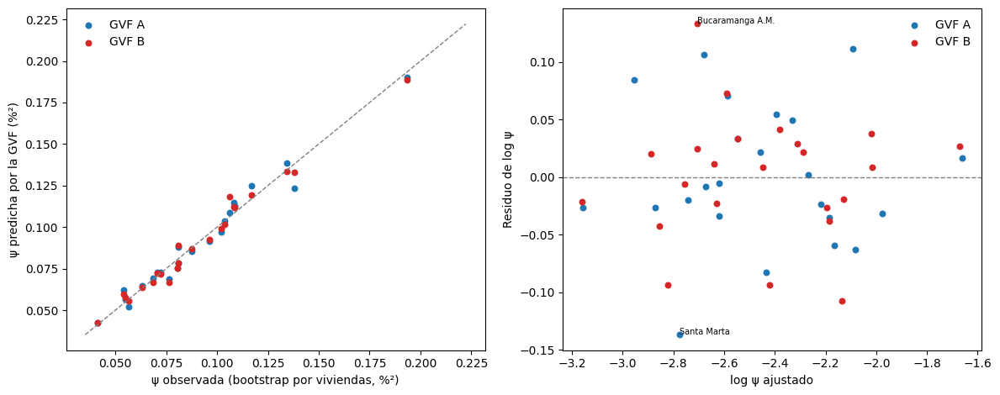
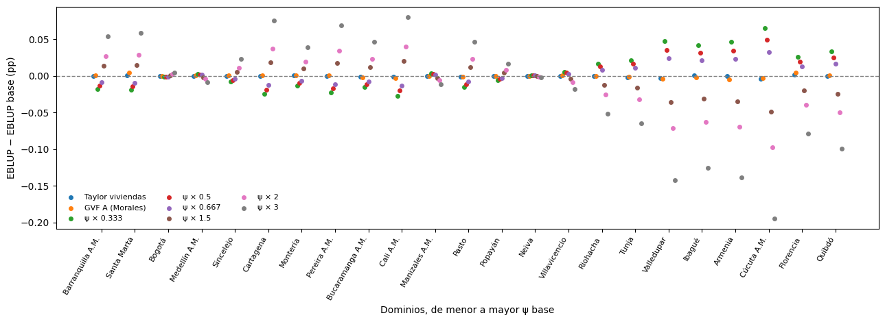

# modelo__sensibilidad_varianza


## Celda 0

```python
%md
# Sensibilidad del Fay-Herriot a la varianza de muestreo ψ_d (G7-B3)

El modelo trata la varianza de muestreo ψ_d de cada estimación directa como **conocida**
(Morales et al., 2021, p. 427). ψ_d es el bootstrap por viviendas dentro de cada dominio
(`preprocesamiento/shared/bootstrap.py`). Los microdatos no traen el estrato interno ni el
segmento de la GEIH, así que ψ_d es una aproximación a la varianza del diseño: **no se sabe si
esta es mayor o menor, ni por cuánto**, y el DANE no publica los CV por ciudad para
compararla. Este notebook mide cuánto cambian las conclusiones si ψ_d se equivoca.

1. **Varianzas directas alternativas** con los mismos microdatos: bootstrap por personas
   (cada persona es su propio conglomerado) y linealización de Taylor con viviendas como
   conglomerado (DANE, GEIH v9, PDF 15). La razón ψ_viviendas / ψ_personas es el efecto de
   remuestrear la vivienda completa.
2. **Función de varianza generalizada (GVF)**, dos formas sobre la ψ_d base:
   A) `log ψ = b0 + b1·y + b2·n` (Morales, p. 427, ec. 16.6; ejemplo p. 454-455) y
   B) `log ψ = b0 + b1·log(p(1−p)) + b2·log n`, la forma del efecto de diseño
   ψ ≈ deff·p(1−p)/n (Téllez, 2020, p. 15; Chile pobreza 2016, PDF 4). Se retransforma con el
   factor Δ que conserva la media de las ψ (ENUSC 2018, PDF 15-16). Se evalúa con R²,
   residuos y la figura de ψ observada contra predicha (Morales, Fig. 16.1). Es **solo un
   escenario**: la GVF estabiliza ψ̂ inestables por muestras pequeñas (ENUSC, PDF 15) y aquí
   cada dominio tiene miles de viviendas.
3. **Escenarios del modelo** (R-65): base, Taylor (método independiente), GVF A (la del
   libro) y la grilla ψ_d × k con k ∈ {1/3, 1/2, 2/3, 3/2, 2, 3}, simétrica en escala log
   porque no se presume la dirección del error. El bootstrap por personas y la GVF B quedan
   solo como columnas de `sensibilidad_varianza_directa` (y la GVF B en `gvf_ajuste` y la
   figura): en la corrida anterior cambiaban el EBLUP ≤ 0,0075 pp, eran indistinguibles de
   Taylor y la GVF A y daban el mismo ganador. La razón es una sola: con Â/ψ̄ alto, γ ≈ 1 y
   el EBLUP casi coincide con la directa cualquiera sea ψ (Morales, pp. 427 y 440; Benedetti
   et al., 2024, p. 143). La grilla es la que acota el error desconocido del diseño. En cada uno se reajustan todas las variantes, se elige el ganador con la regla
   del modelo (p. 453) y se comparan con la base: Â/ψ̄ (Benedetti et al., 2024, p. 143:
   subestimar ψ pesa más cuando  es pequeña frente a ψ), γ, coeficientes, EBLUP, CV y
   confiabilidad, λ₁ del benchmarking y la predicción sintética de los municipios.

No alimenta al modelo: `fay_herriot.py` sigue usando la ψ_d base.

## Salidas

* `tesis.modelo.sensibilidad_varianza_directa`: una fila por dominio con cada ψ_d
* `tesis.modelo.gvf_ajuste`: coeficientes y bondad de ajuste de las dos GVF
* `tesis.modelo.sensibilidad_varianza_fh`: una fila por escenario
* `tesis.modelo.sensibilidad_varianza_coeficientes`: escenario × parámetro
* `tesis.modelo.sensibilidad_varianza_dominios` y `..._municipios`: escenario × unidad
```


## Celda 1

```python
import os
import sys

import numpy as np
import pandas as pd
import matplotlib.pyplot as plt


# R-67: `code/` en sys.path (el notebook está en code/<carpeta>/); `comun.entorno` hace el resto
_ruta_nb = (
    dbutils.notebook.entry_point.getDbutils()
    .notebook()
    .getContext()
    .notebookPath()
    .get()
)
CODE_DIR = "/Workspace" + os.path.dirname(os.path.dirname(_ruta_nb))
sys.path.insert(0, CODE_DIR)

from comun.entorno import agregar_rutas

agregar_rutas(CODE_DIR, "modelo")

from shared.config import *
from shared.fay_herriot import FayHerriotClasico
from shared.seleccion_modelo import elegir_ganador, subconjuntos_covariables
from shared.datos_modelo import alias_desde_catalogo, periodo_unico, preparar_municipios
from shared.escritura import escribir_tabla
from shared.sensibilidad_varianza import (
    ESCENARIO_BASE,
    ajustar_escenarios,
    ajustar_gvf,
    escenarios_psi,
    figura_escenarios,
    figura_gvf,
    interpretar_sensibilidad,
    tabla_gvf,
)

# La estimación directa y la preparación de la PEA se importan por ruta completa porque
# `shared` aquí es modelo/shared.
from preprocesamiento.shared.config import (
    BOOTSTRAP_REPLICAS,
    BOOTSTRAP_SEED,
    GRUPO_COLS,
)
from preprocesamiento.shared.estimador_sae import EstimacionDirecta
from analisis.shared.ventana_temporal import preparar_datos_ventana

import warnings

warnings.filterwarnings("ignore")
```


## Celda 2

```python
# Mapa código → alias del catálogo de literatura (R-63), como en fay_herriot.py.
alias_a_codigo = {alias: codigo for codigo, alias in alias_desde_catalogo().items()}

df = (
    spark.table(TBL_COVARIABLES_SELECCIONADAS)
    .toPandas()
    .sort_values("CODIGO_DOMINIO")
    .reset_index(drop=True)
)
covars_eda = [c for c in df.columns if c in alias_a_codigo]
# R-04: subconjuntos del conjunto del EDA más el modelo de solo intercepto (EC0).
nombres_covars = subconjuntos_covariables(covars_eda)

PERIODO = periodo_unico(df, TBL_COVARIABLES_SELECCIONADAS)
PER_MODELO, MES_MODELO = PERIODO["PER"], PERIODO["MES"]
N_MESES_MODELO = PERIODO["N_MESES_VENTANA"]
print(f"Ventana: {PERIODO['PERIODO']} — {len(df)} dominios")

# Modelo base: el mismo que fay_herriot.py (ψ_d = SE_BOOTSTRAP_PCT², bootstrap por viviendas).
modelos_base = [FayHerriotClasico(c, df, Y_COL, SE_COL) for c in nombres_covars]
for m in modelos_base:
    m.ajustar()
ganador_base = (
    elegir_ganador(
        modelos_base,
        nombres_covars,
        delta_aic=DELTA_AIC_EQUIVALENTE,
        alfa=ALFA_SIGNIFICANCIA,
    )
    if len(modelos_base) > 1
    else modelos_base[0]
)
covars_referencia = list(ganador_base.covars)
print(
    "Especificación de referencia: "
    + (" + ".join(covars_referencia) or "EC0 (solo intercepto, R-04)")
)
```

**Salida:**

```
Ventana: Ene-Dic 2018 — 23 dominios
Especificaciones con todas las covariables significativas (p < 0.05): EC2, EC3, EC0
Equivalentes por AIC (ΔAIC ≤ 2.0): EC2, EC3
Benchmark seleccionado (Fay-Herriot clásico): EC3 (TASA_HOMICIDIOS)
Equivalentes por AICc (ΔAICc ≤ 2.0, complemento): EC2, EC3
Especificación de referencia: TASA_HOMICIDIOS

```


## Celda 3

```python
# preparar_datos_ventana replica el filtro de estimacion_directa (PEA 15+, ventana, dominio,
# FEX := FEX_C18). Se estima dos veces con la misma semilla: por viviendas (debe reproducir la
# tabla) y por personas.
df_pea, _, _ = preparar_datos_ventana(spark, PER_MODELO, MES_MODELO, N_MESES_MODELO)
estimador = EstimacionDirecta(
    spark, num_replicas=BOOTSTRAP_REPLICAS, seed=BOOTSTRAP_SEED
)

por_viviendas = estimador.estimar(df_pea, GRUPO_COLS, col_conglomerado="ID_VIVIENDA")
por_personas = estimador.estimar(df_pea, GRUPO_COLS, col_conglomerado=None)

directa = (
    df[["CODIGO_DOMINIO", "NOMBRE_DOMINIO", Y_COL, SE_COL, "N_PEA", "N_VIVIENDAS"]]
    .merge(
        por_viviendas[["CODIGO_DOMINIO", "SE_BOOTSTRAP_PCT", "SE_TAYLOR_PCT"]].rename(
            columns={"SE_BOOTSTRAP_PCT": "SE_VIVIENDAS_RECALC_PCT"}
        ),
        on="CODIGO_DOMINIO",
        how="left",
        validate="one_to_one",
    )
    .merge(
        por_personas[["CODIGO_DOMINIO", "SE_BOOTSTRAP_PCT"]].rename(
            columns={"SE_BOOTSTRAP_PCT": "SE_PERSONAS_PCT"}
        ),
        on="CODIGO_DOMINIO",
        how="left",
        validate="one_to_one",
    )
)
directa["PSI_VIVIENDAS"] = directa[SE_COL] ** 2
directa["PSI_PERSONAS"] = directa["SE_PERSONAS_PCT"] ** 2
directa["PSI_TAYLOR"] = directa["SE_TAYLOR_PCT"] ** 2
directa["EFECTO_VIVIENDA"] = directa["PSI_VIVIENDAS"] / directa["PSI_PERSONAS"]
directa["RAZON_BOOT_TAYLOR"] = directa["PSI_VIVIENDAS"] / directa["PSI_TAYLOR"]

dif_recalc = (directa["SE_VIVIENDAS_RECALC_PCT"] - directa[SE_COL]).abs().max()
print(
    f"[{'PASS' if dif_recalc < 1e-9 else 'FAIL'}] el bootstrap por viviendas recalculado "
    f"reproduce SE_BOOTSTRAP_PCT de la tabla (dif. máx. {dif_recalc:.2e} pp)"
)
print(
    "ψ viviendas / ψ personas: mediana "
    f"{directa['EFECTO_VIVIENDA'].median():.3f}, rango "
    f"[{directa['EFECTO_VIVIENDA'].min():.3f}, {directa['EFECTO_VIVIENDA'].max():.3f}]"
)
print(
    "ψ bootstrap / ψ Taylor:      mediana "
    f"{directa['RAZON_BOOT_TAYLOR'].median():.3f}, rango "
    f"[{directa['RAZON_BOOT_TAYLOR'].min():.3f}, {directa['RAZON_BOOT_TAYLOR'].max():.3f}]"
)
```

**Salida:**

```
Convirtiendo a Pandas...
Datos: 314,744 filas — 23 dominios — remuestreo por conglomerado ID_VIVIENDA

✔ Bootstrap: 2,000 réplicas por dominio — 23 dominios estimados
Aproximación a la varianza del diseño: no reproduce el estrato interno, el segmento ni la calibración del FEX de la GEIH (G7-B3, R-25).
Convirtiendo a Pandas...
Datos: 314,744 filas — 23 dominios — remuestreo por personas

✔ Bootstrap: 2,000 réplicas por dominio — 23 dominios estimados
Aproximación a la varianza del diseño: no reproduce el estrato interno, el segmento ni la calibración del FEX de la GEIH (G7-B3, R-25).
[PASS] el bootstrap por viviendas recalculado reproduce SE_BOOTSTRAP_PCT de la tabla (dif. máx. 0.00e+00 pp)
ψ viviendas / ψ personas: mediana 1.104, rango [0.939, 1.173]
ψ bootstrap / ψ Taylor:      mediana 1.000, rango [0.938, 1.053]

```


## Celda 4

```python
%md
## Función de varianza generalizada

**Cómo leer la figura.** Izquierda: cada punto es un dominio; si la GVF reprodujera bien la
varianza, los puntos caerían sobre la diagonal (Morales et al., p. 455). Derecha: residuos de
log ψ; se rotulan los que superan dos desviaciones estándar residuales. Un R² bajo indica que
el tamaño de muestra y la tasa no explican bien la varianza, como encontró el Ministerio de
Desarrollo Social de Chile con la Casen (Chile pobreza 2016, PDF 4); en ese caso la GVF
cambiaría las ψ por algo peor sustentado.
```


## Celda 5

```python
psi_base = directa["PSI_VIVIENDAS"].to_numpy()
gvf_a = ajustar_gvf(psi_base, directa[Y_COL], directa["N_PEA"], "A")
gvf_b = ajustar_gvf(psi_base, directa[Y_COL], directa["N_PEA"], "B")

df_gvf = tabla_gvf([gvf_a, gvf_b])
display(df_gvf)
for g in (gvf_a, gvf_b):
    razon = g["psi_delta"] / psi_base
    print(
        f"GVF {g['forma']}: R² = {g['r2']:.3f} (ajustado {g['r2_ajustado']:.3f}), "
        f"σ̂² = {g['sigma2']:.4f}, Δ = {g['delta']:.4f}, exp(σ̂²/2) = {np.exp(g['sigma2'] / 2):.4f}; "
        f"ψ_gvf/ψ entre {razon.min():.3f} y {razon.max():.3f}"
    )

directa["PSI_GVF_A"] = gvf_a["psi_delta"]
directa["PSI_GVF_B"] = gvf_b["psi_delta"]
directa["RAZON_GVF_A"] = directa["PSI_GVF_A"] / directa["PSI_VIVIENDAS"]
directa["RAZON_GVF_B"] = directa["PSI_GVF_B"] / directa["PSI_VIVIENDAS"]

fig = figura_gvf(psi_base, [gvf_a, gvf_b], directa["NOMBRE_DOMINIO"])
display(fig)
plt.close(fig)

display(directa)
escribir_tabla(spark, directa, TBL_SENS_VARIANZA_DIRECTA)
escribir_tabla(spark, df_gvf, TBL_GVF_AJUSTE)
```

**Salida:**

| FORMA | PARAMETRO | COEF | SE | P_VALOR | R2 | R2_AJUSTADO | SIGMA2 | DELTA |
|---|---|---|---|---|---|---|---|---|
| A | Intercepto | -2.4564183631437575 | 0.11108021204776229 | 1.5732780727030131e-15 | 0.9702324933972539 | 0.9672557427369793 | 0.004106601377939796 | 1.0016259896434199 |
| A | TASA_PCT | 0.07784326038130146 | 0.005556507770067063 | 8.424797262258933e-12 | 0.9702324933972539 | 0.9672557427369793 | 0.004106601377939796 | 1.0016259896434199 |
| A | N_PEA | -6.56308692893652e-05 | 4.874669892454324e-06 | 1.734127903876242e-11 | 0.9702324933972539 | 0.9672557427369793 | 0.004106601377939796 | 1.0016259896434199 |
| B | Intercepto | 9.39025775397477 | 0.5551121883027911 | 2.5719264617984517e-13 | 0.97645813841536 | 0.9741039522568959 | 0.003247737289956016 | 1.001340368656917 |
| B | LOG_P_1MENOSP | 1.0031790204768716 | 0.06870177179268888 | 3.947653633597339e-12 | 0.97645813841536 | 0.9741039522568959 | 0.003247737289956016 | 1.001340368656917 |
| B | LOG_N_PEA | -1.0031260087746001 | 0.06391971731825295 | 1.0427137001133938e-12 | 0.97645813841536 | 0.9741039522568959 | 0.003247737289956016 | 1.001340368656917 |
```
GVF A: R² = 0.970 (ajustado 0.967), σ̂² = 0.0041, Δ = 1.0016, exp(σ̂²/2) = 1.0021; ψ_gvf/ψ entre 0.896 y 1.149
GVF B: R² = 0.976 (ajustado 0.974), σ̂² = 0.0032, Δ = 1.0013, exp(σ̂²/2) = 1.0016; ψ_gvf/ψ entre 0.876 y 1.115

```

| CODIGO_DOMINIO | NOMBRE_DOMINIO | TASA_DESEMPLEO_PCT | SE_BOOTSTRAP_PCT | N_PEA | N_VIVIENDAS | SE_VIVIENDAS_RECALC_PCT | SE_TAYLOR_PCT | SE_PERSONAS_PCT | PSI_VIVIENDAS | PSI_PERSONAS | PSI_TAYLOR | EFECTO_VIVIENDA | RAZON_BOOT_TAYLOR | PSI_GVF_A | PSI_GVF_B | RAZON_GVF_A | RAZON_GVF_B |
|---|---|---|---|---|---|---|---|---|---|---|---|---|---|---|---|---|---|
| 05001 | Medellín A.M. | 11.837792024340981 | 0.2382233805694716 | 21615 | 11274 | 0.2382233805694716 | 0.2321531281890359 | 0.22304438208570246 | 0.05675037904994729 | 0.04974879637999283 | 0.05389507492795494 | 1.1407387349931997 | 1.0529789433600236 | 0.05223969634149103 | 0.0556988531110233 | 0.9205171351457175 | 0.9814710323256428 |
| 08001 | Barranquilla A.M. | 8.147876963504446 | 0.20364320313348963 | 20333 | 8765 | 0.20364320313348963 | 0.20227860631932773 | 0.2010266009288132 | 0.04147055418246772 | 0.04041169428099232 | 0.040916634574489574 | 1.0262018190604159 | 1.0135377607112268 | 0.04263802359219687 | 0.04242329764029096 | 1.0281517677480836 | 1.0229739745852255 |
| 11001 | Bogotá | 10.369891846009237 | 0.23470569243768638 | 18637 | 9526 | 0.23470569243768638 | 0.23779264282685864 | 0.22508010179805737 | 0.05508676206265383 | 0.05066105222542387 | 0.05654534098258197 | 1.0873592166530042 | 0.9742051441448124 | 0.05665755068297975 | 0.05753627435113807 | 1.0285148112088955 | 1.0444664416053033 |
| 13001 | Cartagena | 8.348479134679252 | 0.2616260061808899 | 13211 | 6965 | 0.2616260061808899 | 0.2606218125063337 | 0.26102551882889263 | 0.06844816711016304 | 0.06813432147989258 | 0.06792372915408657 | 1.0046062780615357 | 1.0077209829702778 | 0.0691159138419742 | 0.06684971014620816 | 1.0097555093146098 | 0.9766471911310313 |
| 15001 | Tunja | 11.31387295825135 | 0.3258870132527561 | 9801 | 5569 | 0.3258870132527561 | 0.3364846488784757 | 0.33634554183078513 | 0.10620234540680203 | 0.11312832350944443 | 0.11322191893087107 | 0.9387776828314424 | 0.9380016379305943 | 0.10889914663658865 | 0.11837618679170006 | 1.0253930477660986 | 1.1146287432567221 |
| 17001 | Manizales A.M. | 11.237104562268692 | 0.2842853489085462 | 12968 | 7307 | 0.2842853489085462 | 0.2848882724745271 | 0.27933261268563025 | 0.08081815960405384 | 0.07802670850978033 | 0.08116132779352038 | 1.0357755843811303 | 0.9957717770421451 | 0.08793459754279385 | 0.08885713216004497 | 1.0880549368310914 | 1.0994698789897697 |
| 18001 | Florencia | 12.940077494574945 | 0.37147473231937 | 9796 | 5868 | 0.37147473231937 | 0.3645259854600956 | 0.3456740390846828 | 0.13799347675174758 | 0.11949054129711882 | 0.13287919407565385 | 1.154848536576802 | 1.0384882126330623 | 0.123635709016428 | 0.13302543410990036 | 0.8959532865372366 | 0.9639979891891208 |
| 19001 | Popayán | 10.67751322056855 | 0.29563369653389177 | 12701 | 6957 | 0.29563369653389177 | 0.299812301472087 | 0.2842367825350129 | 0.08739928252629321 | 0.08079054854585621 | 0.08988741611398957 | 1.0818008306588724 | 0.9723194447536343 | 0.0856745963209519 | 0.08674387424143741 | 0.9802665862294412 | 0.9925009878123584 |
| 20001 | Valledupar | 14.450446813558157 | 0.32883821097383414 | 12703 | 6490 | 0.32883821097383414 | 0.3366087407085093 | 0.3163642370329924 | 0.10813456899647185 | 0.10008633047346739 | 0.11330544432136846 | 1.0804129643372031 | 0.9543633992535218 | 0.11490693574432798 | 0.11251139038942921 | 1.0626290631266777 | 1.0404756909245199 |
| 23001 | Montería | 9.467462710346696 | 0.2654040885773768 | 13713 | 6391 | 0.2654040885773768 | 0.2717789915904437 | 0.26575004172714256 | 0.07043933023358807 | 0.07062308467797801 | 0.07386382026991847 | 0.997398096596491 | 0.9536377887873064 | 0.0729623561770931 | 0.07216058827169478 | 1.0358184260857999 | 1.0244360364074834 |
| 27001 | Quibdó | 17.81311521809962 | 0.43966546604740253 | 8997 | 5176 | 0.43966546604740253 | 0.44078451237259886 | 0.41096630728079786 | 0.19330572203467966 | 0.16889330572001518 | 0.19429098634754977 | 1.1445434217217256 | 0.9949289242316798 | 0.19039704839691846 | 0.1884300767009751 | 0.9849529873862741 | 0.9747775426284079 |
| 41001 | Neiva | 11.533679893497528 | 0.3105304705479978 | 12725 | 6929 | 0.3105304705479978 | 0.30900394115747837 | 0.2949377775756369 | 0.09642917313876094 | 0.08698829264125585 | 0.09548343565085435 | 1.1085304724446055 | 1.0099047283066436 | 0.09143497102079579 | 0.09264553699621268 | 0.9482085975083647 | 0.9607625366951593 |
| 44001 | Riohacha | 13.883929931442381 | 0.3222469880485139 | 13582 | 7288 | 0.3222469880485139 | 0.32634787140688726 | 0.3123295284986555 | 0.10384312130633908 | 0.09754973437219244 | 0.10650293317180622 | 1.0645146496261566 | 0.9750259285237108 | 0.1037862495222364 | 0.10174187115639959 | 0.9994523297895207 | 0.9797651483939821 |
| 47001 | Santa Marta | 8.316388353479095 | 0.23289852902875874 | 14754 | 7740 | 0.23289852902875874 | 0.23568482568403623 | 0.23586650904044174 | 0.05424172482375958 | 0.05563301008692478 | 0.055547337057714544 | 0.9749917313301695 | 0.9764955026989248 | 0.06230355729044875 | 0.059627976685749685 | 1.1486278781304136 | 1.0993008957493688 |
| 50001 | Villavicencio | 11.873324720682339 | 0.3195548786894929 | 12177 | 6685 | 0.3195548786894929 | 0.31960334391576795 | 0.3040699127748911 | 0.10211532049425652 | 0.09245851185492988 | 0.10214629744214064 | 1.1044447768581702 | 0.9996967393957508 | 0.09732275220605899 | 0.09930483254335283 | 0.9530670984040334 | 0.9724773135186726 |
| 52001 | Pasto | 8.815888010228242 | 0.28462155223699975 | 11830 | 6202 | 0.28462155223699975 | 0.27993345521493146 | 0.26823755474619326 | 0.08100942799779919 | 0.07195138577621703 | 0.07836273934857003 | 1.125891143358301 | 1.0337748357348286 | 0.07847702189072886 | 0.07847055414895157 | 0.9687393656558206 | 0.9686595262848099 |
| 54001 | Cúcuta A.M. | 15.983358846687304 | 0.36633003644268847 | 11656 | 5926 | 0.36633003644268847 | 0.37285390934612567 | 0.34849052858462 | 0.13419769560010145 | 0.12144564851318784 | 0.1390200377146889 | 1.105002091413171 | 0.9653118917685495 | 0.13867941979302822 | 0.13326576855326597 | 1.0333964318305582 | 0.9930555659494144 |
| 63001 | Armenia | 15.491457817733293 | 0.34182720974203185 | 12693 | 6798 | 0.34182720974203185 | 0.34255752284685154 | 0.31988322975540096 | 0.11684584132002303 | 0.10232528067874663 | 0.11734565645897121 | 1.1419058960303676 | 0.9957406592282098 | 0.12468799109634077 | 0.11926488513428445 | 1.0671153520546726 | 1.0207028661605169 |
| 66001 | Pereira A.M. | 8.866599810615549 | 0.26887918331041705 | 13033 | 7030 | 0.26887918331041705 | 0.2674950783964665 | 0.24823881545933138 | 0.07229601521767685 | 0.06162250950065198 | 0.07155361696633177 | 1.1732079041167895 | 1.0103754119333257 | 0.07280608255543854 | 0.07157678458132788 | 1.007055262122344 | 0.9900515867412134 |
| 68001 | Bucaramanga A.M. | 8.739145745214026 | 0.27610015993199827 | 13778 | 6283 | 0.27610015993199827 | 0.2706166200877431 | 0.2569837473579073 | 0.07623129831447502 | 0.06604064640611272 | 0.07323335506771389 | 1.154308785012423 | 1.0409368551254976 | 0.06864738678203045 | 0.06681218920071677 | 0.9005144645292691 | 0.8764403949293657 |
| 70001 | Sincelejo | 9.60566705797104 | 0.25141368003718423 | 15737 | 7219 | 0.25141368003718423 | 0.2494779390892907 | 0.23816531908696825 | 0.06320883850983965 | 0.056722719215797406 | 0.06223924209223984 | 1.1143478201277037 | 1.0155785383145066 | 0.06457743438990456 | 0.06367545125642314 | 1.0216519700777584 | 1.0073820806960543 |
| 73001 | Ibagué | 13.99413661480143 | 0.3293502028833267 | 12477 | 6579 | 0.3293502028833267 | 0.3283163868737748 | 0.31749388423030594 | 0.10847155613928848 | 0.10080236652364691 | 0.10779164988985016 | 1.076081444118105 | 1.0063075966471717 | 0.11255415112687552 | 0.11152062058815174 | 1.0376374704382831 | 1.0281093455038843 |
| 76001 | Cali A.M. | 11.651373436219085 | 0.28404039180662977 | 15827 | 8182 | 0.28404039180662977 | 0.2796511550000639 | 0.26733261717969076 | 0.08067894417766375 | 0.0714667282081431 | 0.07820476849286975 | 1.1289021646925064 | 1.0316371460778582 | 0.07527911303122124 | 0.07509841624017359 | 0.9330701312283972 | 0.9308304292480423 |
```
Tabla escrita: tesis.modelo.sensibilidad_varianza_directa (23 filas)
Tabla escrita: tesis.modelo.gvf_ajuste (6 filas)

```


## Celda 6

```python
df_new, X_municipios = preparar_municipios(
    spark.table(TBL_MUNICIPIOS_SIN_ENCUESTA).toPandas(),
    covars_referencia,
    alias_a_codigo,
)
print(f"Municipios objetivo: {len(df_new)}")
```

**Salida:**

```
Municipios objetivo: 83

```


## Celda 7

```python
# R-65: solo Taylor (método independiente) y la GVF A (la del libro) reajustan el FH; el bootstrap
# por personas y la GVF B quedan como columnas de `directa`, porque daban lo mismo.
escenarios = escenarios_psi(
    psi_base,
    {
        "Taylor viviendas": directa["PSI_TAYLOR"].to_numpy(),
        "GVF A (Morales)": directa["PSI_GVF_A"].to_numpy(),
    },
)
# `directa` conserva el orden de `df` (merge por la izquierda), así que cada vector ψ está
# alineado con los dominios del modelo.
resumen, coeficientes, dominios, municipios = ajustar_escenarios(
    df,
    escenarios,
    nombres_covars,
    covars_referencia,
    Y_COL,
    df[COL_PESO_NIVEL1].to_numpy(dtype=float),
    X_municipios,
    delta_aic=DELTA_AIC_EQUIVALENTE,
    alfa=ALFA_SIGNIFICANCIA,
)

municipios = municipios.merge(
    df_new[["CODIGO_MUNICIPIO", "MUNICIPIO"]]
    .reset_index(drop=True)
    .rename_axis("FILA_MUNICIPIO")
    .reset_index(),
    on="FILA_MUNICIPIO",
    how="left",
).drop(columns="FILA_MUNICIPIO")

display(resumen)
display(coeficientes)
```

**Salida:**

| ESCENARIO | PSI_MEDIA | PSI_MIN | PSI_MAX | A_HAT | RAZON_A_PSI | GAMMA_MEDIA | GAMMA_MIN | GAMMA_MAX | GANADOR | MISMO_GANADOR | REF_TODAS_SIGNIF | REF_MISMOS_SIGNOS | REF_MISMA_SIGNIF | REF_AIC | MAX_DIF_EBLUP_PP | MEDIA_DIF_EBLUP_PP | CV_EBLUP_MEDIANO | CV_EBLUP_MAX | N_CONFIABLE | N_ACEPTABLE | N_NO_CONFIABLE | N_CAMBIA_CONFIABILIDAD | LAMBDA_N1 | MAX_DIF_SINTETICO_PP | CV_SINTETICO_MEDIANO | N_EXTRAPOLA |
|---|---|---|---|---|---|---|---|---|---|---|---|---|---|---|---|---|---|---|---|---|---|---|---|---|---|---|
| BASE (bootstrap viviendas) | 0.09111381326081966 | 0.04147055418246772 | 0.19330572203467966 | 5.528839513132299 | 60.680585251169425 | 0.9838213675979123 | 0.9662179630033387 | 0.9925550725756171 | TASA_HOMICIDIOS | True | True | True | True | 108.90359835891098 | 0.0 | 0.0 | 2.602951178198356 | 3.2024260172485763 | 23 | 0 | 0 | 0 | 0.9997453052904327 | 0.0 | 19.49154078223616 | 21 |
| Taylor viviendas | 0.09153573725416243 | 0.040916634574489574 | 0.19429098634754977 | 5.5270147598966135 | 60.38094984202776 | 0.9837435304311595 | 0.9660407964606514 | 0.992651375946349 | TASA_HOMICIDIOS | True | True | True | True | 108.90046429928422 | 0.003503775131406428 | 0.0007901794196049518 | 2.583125093477425 | 3.1505029839754197 | 23 | 0 | 0 | 0 | 0.9997748248856447 | 0.00047951987448691114 | 19.48928064588806 | 21 |
| GVF A (Morales) | 0.09111381326081966 | 0.04263802359219687 | 0.19039704839691846 | 5.523969569342766 | 60.62713623377848 | 0.9838064512557007 | 0.9666809882645874 | 0.9923403935196883 | TASA_HOMICIDIOS | True | True | True | True | 108.89244972238082 | 0.00461249811466935 | 0.0014745655350570592 | 2.611337156342929 | 3.1527490487289427 | 23 | 0 | 0 | 0 | 0.999784183129769 | 0.0006099898020579531 | 19.4807648824632 | 21 |
| ψ × 0.333 | 0.03037127108693988 | 0.013823518060822573 | 0.06443524067822655 | 5.594616804497319 | 184.20752916406883 | 0.9946044723931734 | 0.988613774857724 | 0.9975352295351666 | TASA_HOMICIDIOS | True | True | True | True | 108.91143780979175 | 0.06571694551652385 | 0.02097090972439375 | 1.508361783030788 | 1.858961412241263 | 23 | 0 | 0 | 0 | 0.9999146390396269 | 0.041910540356667525 | 19.477360730509428 | 21 |
| ψ × 0.5 | 0.04555690663040983 | 0.02073527709123386 | 0.09665286101733983 | 5.5781618384876195 | 122.44382358402103 | 0.991907717166684 | 0.9829681027248747 | 0.9962965425755836 | TASA_HOMICIDIOS | True | True | True | True | 108.9094824510313 | 0.04925570283363356 | 0.015729964483813797 | 1.845662681901606 | 2.2736800121805203 | 23 | 0 | 0 | 0 | 0.9998721308286387 | 0.031426033316503066 | 19.480931681723103 | 21 |
| ψ × 0.667 | 0.06074254217387976 | 0.027647036121645145 | 0.1288704813564531 | 5.561713921189415 | 91.56208683641559 | 0.9892116210335843 | 0.9773537351807313 | 0.9950536320103853 | TASA_HOMICIDIOS | True | True | True | True | 108.90752403203327 | 0.032815802153974616 | 0.010487824048207535 | 2.129227536721759 | 2.6218701456256466 | 23 | 0 | 0 | 0 | 0.9998297385744058 | 0.020946103899586177 | 19.484485226130957 | 21 |
| ψ × 1.5 | 0.13667071989122945 | 0.06220583127370158 | 0.2899585830520195 | 5.479583552022673 | 40.09332471785944 | 0.9757407009438509 | 0.949743224633151 | 0.988775136157069 | TASA_HOMICIDIOS | True | True | True | True | 108.89768905043458 | 0.04906376030381665 | 0.01574041951548883 | 3.1790914016483622 | 3.9061735881313027 | 23 | 0 | 0 | 0 | 0.999619546169527 | 0.031384659982137464 | 19.501999645765164 | 21 |
| ψ × 2 | 0.18222762652163932 | 0.08294110836493544 | 0.3866114440693593 | 5.430386808407322 | 29.80001941562066 | 0.9676654338418578 | 0.9335376379209409 | 0.984956253352423 | TASA_HOMICIDIOS | True | True | True | True | 108.89175683291256 | 0.09793597519767694 | 0.031491074119708994 | 3.6606342267755805 | 4.491998903135611 | 23 | 0 | 0 | 0 | 0.9994948757450884 | 0.06272794908246127 | 19.512297297057877 | 21 |
| ψ × 3 | 0.2733414397824589 | 0.12441166254740316 | 0.579917166104039 | 5.332211921413065 | 19.507513846626225 | 0.9515303965269853 | 0.9019106048735508 | 0.9771998818256209 | TASA_HOMICIDIOS | True | True | True | True | 108.87983280736717 | 0.1951050260928291 | 0.06302144202535054 | 4.458075146310292 | 5.4562990003014455 | 19 | 4 | 0 | 4 | 0.9992488967858264 | 0.12528897828369523 | 19.36822652466307 | 21 |
| ESCENARIO | PARAMETRO | COEF | SE | P_VALOR |
|---|---|---|---|---|
| BASE (bootstrap viviendas) | Intercepto | 9.190810433831432 | 0.9789690488514056 | 0.0 |
| BASE (bootstrap viviendas) | TASA_HOMICIDIOS | 0.09926001414167578 | 0.03594912477051006 | 0.005760268877609276 |
| Taylor viviendas | Intercepto | 9.190330913956945 | 0.9788880400601088 | 0.0 |
| Taylor viviendas | TASA_HOMICIDIOS | 0.09926119467218435 | 0.035945348458476065 | 0.0057545757684360765 |
| GVF A (Morales) | Intercepto | 9.190406508884381 | 0.9784746663067192 | 0.0 |
| GVF A (Morales) | TASA_HOMICIDIOS | 0.09925908370028413 | 0.035926336616947385 | 0.005729906995005862 |
| ψ × 0.333 | Intercepto | 9.192684334366884 | 0.9780326269659638 | 0.0 |
| ψ × 0.333 | TASA_HOMICIDIOS | 0.09944079095036866 | 0.035854991068755844 | 0.005547123034357115 |
| ψ × 0.5 | Intercepto | 9.1922171345583 | 0.9782679769749105 | 0.0 |
| ψ × 0.5 | TASA_HOMICIDIOS | 0.09939555996092729 | 0.0358786362544764 | 0.005600001509819874 |
| ψ × 0.667 | Intercepto | 9.1917490838645 | 0.9785024908013803 | 0.0 |
| ψ × 0.667 | TASA_HOMICIDIOS | 0.09935035348274461 | 0.03590220655156825 | 0.005653151860754768 |
| ψ × 1.5 | Intercepto | 9.189396103955415 | 0.9796629470602952 | 0.0 |
| ψ × 1.5 | TASA_HOMICIDIOS | 0.09912468958256564 | 0.0360189579585225 | 0.0059229923369761295 |
| ψ × 2 | Intercepto | 9.187974167389049 | 0.9803491495633939 | 0.0 |
| ψ × 2 | TASA_HOMICIDIOS | 0.09898958617111507 | 0.036088122489225855 | 0.006088137296902829 |
| ψ × 3 | Intercepto | 9.185107638945095 | 0.9817023984885244 | 0.0 |
| ψ × 3 | TASA_HOMICIDIOS | 0.09872004853280163 | 0.0362246111860931 | 0.006425858079054603 |


## Celda 8

```python
%md
## Cambio de los EBLUP por escenario

**Cómo leer la figura.** Cada columna es un dominio, de menor a mayor ψ base; cada punto es
cuánto cambia su EBLUP frente a la base en un escenario. Si  es grande frente a ψ, el peso γ
de la estimación directa es cercano a 1 y el EBLUP casi no se mueve aunque ψ cambie; los
dominios de la derecha (ψ más alta) son los primeros en moverse.
```


## Celda 9

```python
fig = figura_escenarios(dominios, [e for e in escenarios if e != ESCENARIO_BASE])
display(fig)
plt.close(fig)

print(interpretar_sensibilidad(resumen))

escribir_tabla(spark, resumen, TBL_SENS_VARIANZA_FH)
escribir_tabla(spark, coeficientes, TBL_SENS_VARIANZA_COEFICIENTES)
escribir_tabla(spark, dominios, TBL_SENS_VARIANZA_DOMINIOS)
escribir_tabla(spark, municipios, TBL_SENS_VARIANZA_MUNICIPIOS)
```

**Salida:**


```
Base: Â = 5.5288, ψ̄ = 0.0911 (Â/ψ̄ = 60.7); γ entre 0.966 y 0.993.
En los 8 escenarios alternativos Â/ψ̄ va de 19.5 a 184.2 y el γ mínimo de 0.902 a 0.989.
El modelo ganador es el mismo en todos los escenarios.
Los coeficientes de la especificación de referencia conservan el signo en todos los escenarios y la significancia en todos.
El mayor cambio de un EBLUP es 0.195 pp (ψ × 3); el de una predicción sintética municipal, 0.125 pp.
Algún dominio cambia de categoría de confiabilidad en: ψ × 3.
Tabla escrita: tesis.modelo.sensibilidad_varianza_fh (9 filas)
Tabla escrita: tesis.modelo.sensibilidad_varianza_coeficientes (18 filas)
Tabla escrita: tesis.modelo.sensibilidad_varianza_dominios (207 filas)
Tabla escrita: tesis.modelo.sensibilidad_varianza_municipios (747 filas)

```
