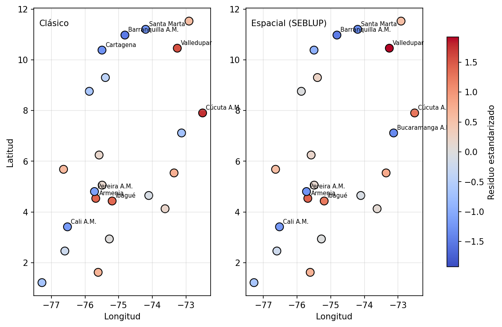

# Componente espacial del Fay-Herriot (SEBLUP)

Documento de método, código y resultados del componente espacial del modelo de área pequeña.
Código: `code/modelo/fay_herriot_espacial.py` (orquestador) y `code/modelo/shared/`
(`matriz_proximidad.py`, `fay_herriot_espacial.py`, `figuras_espacial.py`, `prediccion_espacial.py`,
`sensibilidad_espacial.py`, `cuadro_comparativo.py`, parámetros en `config.py`).
Tablas de salida: `tesis.modelo.fhe_*`. Figuras: `docs/img/fhe_*.png`.

**Corrida de referencia de este documento (R-44):** job `modelo` del bundle `dev`, run `899936223549833`
(2026-10-27), con el código de la rama `revision/doc-samuel` (= `test-2` en `2ad1cff` más los cambios de
R-62 y R-46, que no tocan el modelo), cierre diciembre de 2018: 23 dominios con encuesta y 83 municipios
objetivo. Las tres tareas (`fay_herriot`, `sensibilidad_varianza`, `fay_herriot_espacial`) terminaron con
éxito y todas las cifras salen de las tablas `tesis.modelo.fh_*` y `fhe_*` de esa corrida. La versión
anterior del documento describía la corrida previa al bloque 05 de la revisión (R-12 a R-16, R-42, R-43,
R-45) y al bloque 04 (R-01, R-02, R-05, R-07); ver «Qué cambió frente al cierre anterior».

> **Figuras.** Las cinco imágenes de `docs/img/` (`fhe_perfil_rho`, `fhe_validacion`, `fhe_mapa_clasico`,
> `fhe_mapa_espacial`, `fhe_mapa_residuos`) se regeneraron con una segunda corrida de la tarea
> `fay_herriot_espacial` (2026-10-27, tras crear el volumen `/Volumes/tesis/modelo/figuras`), que dio las
> mismas cifras que la primera (ρ̂ = 0.3724, RMSE 2.5243 y 2.3464, 21 objetivos que extrapolan). Las
> figuras del clásico (`fh_*`) se guardarán en el mismo volumen la próxima vez que corra `fay_herriot`.

> **Qué implementa el código actual** (bloque 05 de la revisión): (R-14) Cali y Yumbo no son nodos de W sino
> subáreas del nodo «Cali A.M.» con benchmarking de nivel 2, y se predicen los mismos 83 municipios del
> clásico (81 nodos con MSE bootstrap y 2 subáreas con MSE del sintético); (R-13) la prueba principal de ρ
> es la de la estructura `muestra`, y el ρ̂ de la `completa` es condicional al conjunto de nodos sin dato
> (no se interpreta su signo; tabla `fhe_sensibilidad_rho_objetivos`); la estructura `completa` es la
> verosimilitud marginal (MML) de Benedetti et al. (2024, ecs. 18-20), no el estimador de Saei y Chambers;
> (R-43) el criterio es `p(LRT) < 0.05`, porque ΔAIC = LRT − 2 es el mismo estadístico; (R-12) hay I de
> Moran de los residuos del SEBLUP con la misma estandarización que el clásico y un mapa de residuos; (R-15)
> la validación dejar-uno-fuera trae `Z_psi`, `Z_pred`, cobertura y habilidad frente al modelo nulo, y la
> extrapolación (B20) y la calidad reportada (B21) se calculan con el espacial; (R-16) cuadro de
> coeficientes clásico frente a espacial (`fhe_coeficientes_comparacion`); (R-42) sensibilidad al centroide
> del A.M. (`fhe_sensibilidad_centroide`) y justificación de k y la potencia en `config.py`.

## 1. Conclusión

Con los datos disponibles **no hay evidencia de dependencia espacial** en los efectos aleatorios del
Fay-Herriot: ρ no es significativo en ninguno de los 8 casos y el clásico tiene menor AIC en todos. El
predictor espacial con efecto solo mejora la validación dejar-un-dominio-fuera en uno de los cuatro
escenarios (`knn3`), sin respaldo en la verosimilitud. El modelo recomendado sigue siendo el **Fay-Herriot
clásico** (el benchmark seleccionado); el SEBLUP queda como análisis de sensibilidad. Es un resultado
legítimo de la tesis y no un fallo de implementación.

| Evidencia | Resultado de esta corrida |
|---|---|
| I de Moran de los residuos del clásico (4 escenarios de W) | −0.024 a 0.092, p entre 0.33 y 0.65: ninguno significativo |
| I de Moran de los residuos del SEBLUP | −0.115 a −0.038, p entre 0.52 y 0.98: ninguno significativo |
| ρ̂ del SEBLUP | 0.19 a 0.33 (muestra) y 0.22 a 0.89 (completa), ninguno con p(LRT) < 0.05 |
| ΔAIC (AIC clásico − AIC espacial), los 8 casos | −0.50 a −2.00: el clásico tiene menor AIC en todos |
| Razón de verosimilitudes ρ = 0 | p entre 0.56 y 0.96 (muestra); entre 0.22 y 0.92 (completa) |
| Perfil de verosimilitud de ρ | Plano: la ganancia máxima frente a ρ = 0 es ≤ 0.94 unidades de log-verosimilitud |
| Validación dejar-un-dominio-fuera (RMSE, completa) | Clásico 2.524; espacial con efecto 2.346 (`knn3`), 2.590, 2.602 y 2.859 (peor en 3 de 4) |
| Efecto espacial `û_r` en los 81 nodos objetivo | Entre −0.82 y +0.71 pp (media absoluta 0.13 pp); en Cali y Yumbo −2.84 pp |

El hallazgo que más pesa sobre la calidad de las estimaciones no es espacial: **21 de los 83 municipios
objetivo extrapolan** (su tasa de homicidios queda fuera del rango de las 23 ciudades) y 37 de 83 tienen
CV ≥ 20 % (ver §7).

### Qué cambió frente al cierre anterior

| Medida | Cierre anterior | Esta corrida | Lectura |
|---|---|---|---|
| Benchmark clásico | `IICA_CONFLICTO + VA_PCT_PRIM` (EC4) | `TASA_HOMICIDIOS` (EC3) | el IICA salió del catálogo (R-01) |
| AIC del clásico (benchmark) | 102.67 | **108.90** | otro modelo: no comparable |
| Â del clásico | 4.035 | 5.529 | mayor |
| p máximo de las covariables del clásico | 0.086 | **0.0058** | ahora todas cumplen p < 0.05 |
| RMSE dejar-un-dominio-fuera, clásico | 2.084 | **2.524** | otro modelo: no comparable |
| I de Moran de los residuos: p | 0.82-0.91 | 0.33-0.65 | sin evidencia en ambos |
| ρ̂ (completa) | 0.11-0.39 | 0.22-0.89 | positivo; no significativo en ambos |
| ΔAIC máximo a favor del espacial | −1.09 | −0.50 | el clásico sigue con menor AIC |
| RMSE del espacial con efecto | 2.115-2.440 | 2.346-2.859 | mejor que el clásico solo en `knn3` |
| Municipios objetivo que extrapolan | 74 de 82 | 21 de 83 | mucho menor |
| No confiables (CV ≥ 20 %) | 36 de 82 | 37 de 83 | igual |

En resumen, el cambio de covariables (R-01, R-02, R-07) rehízo el benchmark, y por eso las cifras
absolutas no son comparables con las del cierre anterior; **la conclusión espacial no cambia**: sin
evidencia de dependencia, y el clásico con menor AIC en los ocho casos.

## 2. Qué se hizo (trazabilidad)

Orden cronológico de los cambios que llevan a esta corrida.

1. **Especificaciones candidatas EC1…ECk (G7-B15)** (commit `cd28731`). Las variantes dejar-una-fuera dejaron de
   llamarse M1…M5: son *especificaciones candidatas del modelo base Fay-Herriot clásico*, no los modelos
   finales del objetivo 1. De ellas sale el **benchmark seleccionado**. La comparación del objetivo 1 es
   después, entre ese benchmark y las especificaciones espaciales (este documento).
2. **AICc como complemento (G7-B16)** (mismo commit). `AICc = AIC + 2k(k+1)/(n−k−1)` con `k = p + 1`, n = 23. No
   reemplaza la regla de selección (ΔAIC ≤ 2 con parsimonia). Es una convención externa al libro y una
   aproximación en Fay-Herriot (las varianzas D_i son heterogéneas); ver `shared/fay_herriot.py`.
3. **Ajuste de citas de Morales et al.** La regla «todas las covariables con p < 0.05» (p. 453) se aplica
   porque el modelo también predice fuera de muestra; el libro admite además una covariable con p > 0.05
   si es interpretable (p. 454), que debe reportarse como excepción.
   Los p-valores de los coeficientes son descriptivos, no demostración fuerte (G7-B17): los mismos 23 dominios
   filtran, seleccionan, comparan y calculan los p; ver `shared/estabilidad_coeficientes.py`.
4. **Componente espacial** (commit `b34c964`), traído desde la rama `test` a `test-2`: SEBLUP, matrices de
   proximidad, Moran, perfil de ρ y validación dejar-un-dominio-fuera.
5. **Corrección de compatibilidad** (commit `ac7ab2a`). `test-2` cambió `marca_extrapolacion` (B20): ahora
   recibe la matriz de diseño de los municipios objetivo y no el vector `x'Cov(β̂)x`. El notebook espacial
   usaba la firma anterior y fallaba con `IndexError`; se pasó `X_obj`.
6. **Bloques 04 y 05 de la revisión** (commits `bc55342`, `f9d5474` y anteriores): el IICA sale del
   catálogo (R-01), la selección mide el soporte en los objetivos (R-02) y la cota de covariables se
   calcula desde n (R-07), con lo que el benchmark pasa a `TASA_HOMICIDIOS`; el espacial incorpora
   R-12 a R-16, R-42, R-43 y R-45.
7. **Corrida de cierre (R-44)**. Los datos de `fhe_*` eran de la corrida del 2026-10-19, anterior al
   cuadro comparativo, que por eso no existía en Unity Catalog; la del 2026-10-20 tuvo
   `fay_herriot_espacial` deshabilitada. El 2026-10-27 se desplegó el bundle y se corrió el job `modelo`
   completo (run `899936223549833`: `fay_herriot`, `sensibilidad_varianza` y `fay_herriot_espacial`
   con éxito, 500 de 500 réplicas bootstrap válidas). Las 13 tablas `fhe_*` y
   `fay_herriot_estimaciones_finales` se reescribieron ese día y `fhe_cuadro_comparativo` ya existe.
8. **Este documento** se reescribió con las cifras de esas tablas.

Diferencia de datos entre la corrida anterior y esta: el EDA ya no incluye el IICA y deja dos
covariables candidatas en el modelo (`TASA_HOMICIDIOS` y `COB_ACUEDUCTO`). De las tres especificaciones
posibles gana la de una sola covariable, `TASA_HOMICIDIOS`, y el espacial usa las mismas covariables.


## 3. Qué es el modelo

Fay-Herriot clásico: `y_d = x_d'β + u_d + e_d`, con `u_d` independientes, `Var(u_d) = σ²_u` y
`Var(e_d) = D_d` conocida (la varianza bootstrap de la estimación directa).

Fay-Herriot espacial (Morales et al., 2021, §18.2, pp. 490-494): los efectos siguen un proceso
autorregresivo simultáneo, `u = ρWu + v`, con `v ~ N(0, σ²_u I)`. Entonces
`Cov(u) = σ²_u[(I − ρW)'(I − ρW)]⁻¹` y `Cov(y) = V = Cov(u) + diag(D)`. W es una matriz de
proximidad estandarizada por filas (cada fila suma 1), de modo que ρ ∈ (−1, 1). Con ρ = 0 se
recupera el modelo clásico, por lo que **la pregunta es si los datos justifican ρ ≠ 0**.

- **Estimación**: (σ²_u, ρ) por REML numérico (L-BFGS-B con tres puntos de partida, ρ ∈ {0, 0.5, 0.9});
  β por mínimos cuadrados generalizados; AIC con la verosimilitud ML y `p + 2` parámetros (coeficientes,
  σ²_u y ρ).
- **EBLUP**: `μ̂ = Xβ̂ + G V⁻¹ (y − Xβ̂)` (p. 491, ec. 18.9).
- **MSE**: bootstrap paramétrico (§18.2.3, p. 494). En cada réplica se simula `u*` y `e*`, se re-estiman
  σ²_u y ρ y se acumula el error frente a la verdad simulada; así el MSE incluye la incertidumbre de ρ̂.
  Se usaron 500 réplicas (las 500 fueron válidas).

## 4. Por qué la contigüidad no sirve aquí, y qué se hizo

Hallazgo de la exploración (`fhe_vecindad`): los 23 dominios con encuesta son capitales o áreas
metropolitanas dispersas por el país, y los municipios objetivo de Cauca y Valle no son contiguos a ellos.

- Los municipios objetivo tienen por vecinos contiguos a otros objetivos, sin dato.
- Cada objetivo tiene un dominio con encuesta cercano: mediana de 46 km en Cauca y 45 km en Valle; en
  Cauca 22 de 41 están a ≤ 50 km y 39 de 41 a ≤ 100 km (máximo 144 km); en Valle 25 de 40 a ≤ 50 km y
  40 de 40 a ≤ 100 km (máximo 79 km) (`fhe_vecindad`, sobre los 81 nodos).
- La distancia entre los propios dominios con encuesta se imprime en el notebook pero no se persiste en
  una tabla; la cifra de la versión anterior (vecino más cercano a 30-158 km) no se volvió a verificar.

Decisiones:

1. **ρ se estima solo con los dominios con encuesta**: son los únicos con dato.
2. **W se define sobre todas las unidades** (23 con encuesta + 81 nodos objetivo = 104) en la estructura
   `completa` (verosimilitud marginal, MML, de Benedetti et al., 2024, pp. 146-149; no es el estimador de
   Saei y Chambers, 2005, que el artículo distingue). La verosimilitud se evalúa
   sobre el bloque de los dominios con encuesta (verosimilitud marginal). Así un municipio sin encuesta
   recibe `x'β̂ + û_r`, con `û_r = G_rs V⁻¹ (y − Xβ̂)` calculado a partir de los dominios cercanos. La
   estructura `muestra` (Petrucci y Salvati, 2006) define W solo entre dominios con encuesta y deja a los
   objetivos con el sintético `x'β̂`.
3. **W por distancia entre centroides** (Haversine), no por contigüidad (Morales et al., p. 491 admite
   ambas). Cuatro escenarios: kNN con k = 3 y 5 (simetrizada) y distancia inversa con potencia 1 y 2.
   Siempre estandarizada por filas.
4. **Coordenada de cada dominio** = la de su municipio capital (`CODIGO_DOMINIO`). Es una simplificación:
   un área metropolitana agrupa varios municipios.
5. **Cali y Yumbo** (R-14). Cali (76001) figura en `municipios_sin_encuesta` pero pertenece al dominio
   «Cali A.M.», que sí tiene encuesta, y Yumbo es su municipio miembro. Ninguno es nodo de W: se predicen
   como subáreas del nodo «Cali A.M.» con `x'β̂ + û_D` y pasan por el benchmarking de nivel 2 con los pesos
   de población de 15 años y más del clásico. Los objetivos son los mismos 83 municipios del clásico
   (81 nodos con MSE bootstrap más 2 subáreas con MSE del sintético; 41 de Cauca y 42 de Valle).

## 5. Pasos del notebook y qué hace cada pieza

| Paso | Qué hace | Código |
|---|---|---|
| 1 | Carga covariables del benchmark clásico seleccionado (`fh_coeficientes`), dominios, objetivos, coordenadas | notebook |
| 2 | Diagnóstico de vecindad (distancia de cada objetivo al dominio más cercano) | `resumen_vecindad` |
| 3 | Fay-Herriot clásico de referencia | `FayHerriotClasico` (existente) |
| 4 | I de Moran de residuos, por escenario de W | `moran_i`, `proximidad_knn`, `proximidad_inversa` |
| 5 | Ajuste del SEBLUP por escenario y estructura; AIC y LRT | `FayHerriotEspacial` |
| 6 | Perfil de verosimilitud de ρ | `FayHerriotEspacial.perfil_rho` |
| 7 | Validación dejar-un-dominio-fuera | `validacion_dejar_uno_fuera`, `metricas_validacion` |
| 8 | Decisión por criterio explícito | notebook |
| 9 | Predicción en objetivos con MSE bootstrap; subáreas Cali y Yumbo (R-14); marcas de extrapolación (B20) | `FayHerriotEspacial`, `prediccion_espacial`, `marca_extrapolacion` |
| 10 | Escritura de tablas `fhe_*` y figuras `fhe_*` | notebook |

Detalles de implementación:

- `covarianza_sar(W, A, ρ)`: `G = A·M⁻¹M⁻ᵀ` con `M = I − ρW`.
- `FayHerriotEspacial._log_verosimilitud`: ML o REML perfilando β; en la estructura completa V es el bloque
  `G[:n,:n] + diag(D)`.
- `_estimar_theta`: L-BFGS-B sobre `(log σ²_u, ρ)` con `|ρ| ≤ 0.99`.
- `_bootstrap_mse`: simula sobre todas las unidades y devuelve el MSE de los dominios con encuesta, de los
  objetivos con efecto espacial y de los objetivos con sintético.
- `moran_i`: p-valor por 9 999 permutaciones, sin supuestos de normalidad.
- Clase hija de `ModeloAreaPequena`: respeta el contrato (A_hat, beta_hat, mse, cv, aic, …). `gamma_i` no se
  define: en el caso espacial no hay un peso escalar por dominio. No calcula AICc (el AICc solo existe en
  el clásico); la comparación espacial se hace con AIC y LRT.

**Validación dejar-un-dominio-fuera**: para cada uno de los 23 dominios se re-estima el modelo sin él, se le
trata como dominio sin encuesta y se predice con (a) el sintético clásico, (b) el sintético del modelo
espacial y (c) el predictor espacial con efecto. El referente es la estimación directa, que tiene ruido
`D_d`; por eso también se reporta el RMSE corregido por ese ruido. Con n = 23 es evidencia modesta.

**Criterio de decisión** (R-43, R-13): el espacial es preferido solo si la prueba de razón de
verosimilitudes de ρ = 0 tiene p < 0.05 en la estructura `muestra` del escenario de referencia. El
`ΔAIC` (AIC clásico − AIC espacial) se reporta, pero es el mismo estadístico, `ΔAIC = LRT − 2`, y no un
segundo respaldo. Un escenario con ρ̂ pegado a la cota
(|ρ̂| = 0.99) no se usa como referencia: es un artefacto de una verosimilitud plana. En esta corrida
ningún escenario de la tabla principal llegó a la cota (el máximo es 0.891); solo en la
sensibilidad con los objetivos de Valle (`inversa1`, §6.8) ρ̂ = 0.99. Ni el LRT ni el AIC respaldan la preferencia por el espacial.

## 6. Resultados

### 6.1 Benchmark clásico de partida (`fh_seleccion_modelo`, `fh_coeficientes`)

El EDA dejó dos covariables (`TASA_HOMICIDIOS` y `COB_ACUEDUCTO`), así que hay tres especificaciones
candidatas (EC1 = conjunto completo):

| Especificación | Covariables | AIC | ΔAIC | AICc | ΔAICc | p máx. | Cook máx. |
|---|---|---|---|---|---|---|---|
| **EC3 (benchmark)** | TASA_HOMICIDIOS | 108.90 | 0.00 | 110.17 | 0.00 | 0.006 | 0.60 |
| EC2 | COB_ACUEDUCTO | 109.82 | 0.92 | 111.08 | 0.92 | 0.011 | 1.30 |
| EC1 | TASA_HOMICIDIOS + COB_ACUEDUCTO | 109.93 | 1.02 | 112.15 | 1.98 | 0.351 | 0.53 |

- Las tres tienen soporte similar por AIC (ΔAIC ≤ 2). Son candidatas EC3 y EC2, que cumplen la regla
  estricta (todas las covariables con p < 0.05, Morales et al., p. 453); EC1 no, porque `COB_ACUEDUCTO`
  deja de ser significativa junto a `TASA_HOMICIDIOS` (p máx. = 0.351). Entre las candidatas, EC3 es la de
  menor AIC y AICc: fue seleccionada entre varias especificaciones con soporte similar mediante la regla
  de parsimonia predefinida. **No hay excepción por p > 0.05** (a diferencia del cierre anterior).
- Coeficientes del benchmark: intercepto 9.19 (EE 0.979, p < 0.001); `TASA_HOMICIDIOS` 0.0993 (EE 0.0359,
  p = 0.0058). Â = 5.529; R² del predictor sintético = 0.269.
- **Cook máximo 0.60 (Quibdó) frente al umbral 4/n = 0.17**: un dominio supera la regla de inspección. Es
  un diagnóstico, no un criterio de exclusión; el análisis de sensibilidad a dominios individuales
  (`fh_loao_*`, G7-B18) mide cuánto mueve el coeficiente.
- Ganancia de precisión mínima: CV medio 2.62 % (directo) frente a 2.61 % (EBLUP), γ promedio 0.984. El
  EBLUP casi reproduce la estimación directa en los dominios con encuesta.

### 6.2 I de Moran (`fhe_moran`)

W solo entre los 23 dominios. Residuos del clásico `y − Xβ̂`:

| Escenario | I | Esperado | p |
|---|---|---|---|
| knn3 | 0.092 | −0.045 | 0.335 |
| knn5 | 0.005 | −0.045 | 0.606 |
| inversa1 | −0.024 | −0.045 | 0.654 |
| inversa2 | 0.013 | −0.045 | 0.604 |

La tasa cruda tampoco muestra autocorrelación (p de 0.69 a 0.80). Los residuos del SEBLUP, con la misma
estandarización (R-12), tienen I entre −0.115 y −0.038 y p entre 0.52 y 0.98 (estructuras `muestra` y
`completa`). Con n = 23 la potencia es baja: un Moran no significativo no demuestra independencia, solo
que los datos no la contradicen.



### 6.3 SEBLUP frente al clásico (`fhe_comparacion_modelos`)

Clásico: Â = 5.529, AIC = 108.90.

| Escenario | Estructura | σ̂²_u | ρ̂ | AIC | ΔAIC | p(LRT) |
|---|---|---|---|---|---|---|
| knn3 | completa | 4.825 | 0.372 | 109.40 | −0.50 | 0.22 |
| knn3 | muestra | 5.383 | 0.234 | 110.57 | −1.67 | 0.56 |
| knn5 | completa | 5.469 | 0.222 | 110.86 | −1.96 | 0.84 |
| knn5 | muestra | 5.541 | 0.206 | 110.90 | −2.00 | 0.96 |
| inversa1 | completa | 5.479 | 0.891 | 110.89 | −1.99 | 0.92 |
| inversa1 | muestra | 5.631 | 0.326 | 110.79 | −1.89 | 0.74 |
| inversa2 | completa | 5.101 | 0.607 | 110.10 | −1.20 | 0.37 |
| inversa2 | muestra | 5.529 | 0.187 | 110.89 | −1.99 | 0.91 |

ΔAIC = AIC clásico − AIC espacial; positivo favorece al espacial. En ningún caso es positivo y el mejor
es −0.50: añadir ρ cuesta dos puntos de AIC y la verosimilitud casi no sube. Los ρ̂ son positivos (0.19 a
0.33 en `muestra`; 0.22 a 0.89 en `completa`), el signo esperado si el desempleo se pareciera entre
vecinos, pero ninguno es significativo (p ≥ 0.22). El ρ̂ de la estructura `completa` es condicional al
conjunto de nodos sin dato (R-13, §6.8) y no se interpreta su signo: la prueba principal es la de la
estructura `muestra`, con p entre 0.56 y 0.96. El escenario de referencia es **`knn3` con estructura
completa** (menor AIC entre las estructuras completas: ρ̂ = 0.372, σ̂²_u = 4.825, ΔAIC = −0.50,
p(LRT) = 0.22; p(LRT) de `muestra` = 0.56). El notebook concluye `espacial_preferido = false`.

### 6.4 Perfil de ρ (`fhe_perfil_rho`, `docs/img/fhe_perfil_rho.png`)

| Escenario | ρ del máximo | Ganancia máxima vs ρ = 0 | Rango de ρ con caída ≤ 1.92 |
|---|---|---|---|
| knn3 | 0.35 | 0.938 | −0.30 a 0.80 |
| knn5 | 0.20 | 0.132 | −0.70 a 0.80 |
| inversa1 | 0.90 | 0.162 | −0.90 a 0.95 |
| inversa2 | 0.60 | 0.619 | −0.80 a 0.95 |

Las curvas son prácticamente planas: **ρ no está identificado**. La ganancia máxima nunca llega a 1.92 (el
corte del intervalo al 95 %) y el intervalo de verosimilitud perfilada cubre casi todo el rango; en
`inversa1` llega al límite inferior de la rejilla (−0.9). Con 23 dominios dispersos los datos no informan
sobre la autocorrelación espacial.


### 6.5 Validación dejar-un-dominio-fuera (`fhe_validacion_cruzada_metricas`)

Estructura completa. Clásico: RMSE 2.524 (corregido por ruido 2.506; sesgo medio −0.068; habilidad frente
al modelo nulo 0.170).

| Escenario | RMSE sintético espacial | RMSE espacial con efecto |
|---|---|---|
| knn3 | 2.483 | **2.346** |
| knn5 | 2.523 | 2.590 |
| inversa1 | 2.567 | 2.602 |
| inversa2 | 2.500 | 2.859 |

El predictor espacial **con efecto solo mejora al clásico en `knn3`** (−7.1 %, habilidad 0.283 frente a
0.170) y es peor en `knn5` (+2.6 %), `inversa1` (+3.1 %) e `inversa2` (+13.3 %; además es el único con
cobertura nominal por debajo de 0.95, 0.91, y con habilidad negativa, −0.064). El sintético espacial
empata o gana por poco en `knn3` (−1.6 %), `knn5` (−0.05 %) e `inversa2` (−1.0 %) y pierde en `inversa1`
(+1.7 %). La mejora de `knn3` no se sostiene en los otros escenarios ni tiene respaldo en la verosimilitud
(p(LRT) = 0.22), y con n = 23 una diferencia de 0.18 pp en el RMSE es evidencia modesta. Los sesgos medios
llegan a 0.24 pp (`inversa2`, espacial con efecto) y −0.25 pp (`inversa1`, sintético de `muestra`). El RMSE
corregido por el ruido de la estimación directa lleva a la misma lectura (clásico 2.506; espacial con
efecto 2.327-2.843).


### 6.5b Cuadro comparativo del objetivo 1 (`fhe_cuadro_comparativo`)

Benchmark clásico seleccionado (EC3: `TASA_HOMICIDIOS`) frente a las ocho especificaciones espaciales, con
las mismas covariables. Se genera con `shared/cuadro_comparativo.py` (paso 7b del notebook). RMSE =
validación dejar-un-dominio-fuera (pp); «con efecto» solo existe en la estructura `completa`.

| Modelo | σ̂²_u | ρ̂ | AIC | ΔAIC | p(LRT) | RMSE sintético | RMSE con efecto | Veredicto |
|---|---|---|---|---|---|---|---|---|
| **Clásico (benchmark)** | 5.529 | — | 108.90 | 0.00 | — | **2.524** | — | Referencia |
| SEBLUP knn3 muestra | 5.383 | 0.234 | 110.57 | −1.67 | 0.56 | 2.530 | — | No preferido |
| SEBLUP knn3 completa | 4.825 | 0.372 | 109.40 | −0.50 | 0.22 | 2.483 | 2.346 | No preferido |
| SEBLUP knn5 muestra | 5.541 | 0.206 | 110.90 | −2.00 | 0.96 | 2.530 | — | No preferido |
| SEBLUP knn5 completa | 5.469 | 0.222 | 110.86 | −1.96 | 0.84 | 2.523 | 2.590 | No preferido |
| SEBLUP inversa1 muestra | 5.631 | 0.326 | 110.79 | −1.89 | 0.74 | 2.483 | — | No preferido |
| SEBLUP inversa1 completa | 5.479 | 0.891 | 110.89 | −1.99 | 0.92 | 2.567 | 2.602 | No preferido |
| SEBLUP inversa2 muestra | 5.529 | 0.187 | 110.89 | −1.99 | 0.91 | 2.520 | — | No preferido |
| SEBLUP inversa2 completa | 5.101 | 0.607 | 110.10 | −1.20 | 0.37 | 2.500 | 2.859 | No preferido |

Lectura: el clásico tiene el menor AIC; ninguna especificación espacial cumple p(LRT) < 0.05 (el veredicto
«No preferido» sale de ese criterio, R-43). La única ventaja predictiva es la de `knn3` con efecto
(2.346 frente a 2.524), que no se repite en los demás escenarios y no justifica el parámetro adicional.
Conclusión del objetivo 1: el benchmark clásico se mantiene.

### 6.6 Predicción en los 83 municipios objetivo (`fhe_prediccion_objetivo`)

Escenario de referencia `knn3` completa (ρ̂ = 0.372, σ̂²_u = 4.825, 500 de 500 réplicas válidas). Son 81
nodos de W con MSE bootstrap y 2 subáreas (Cali y Yumbo, R-14) que se predicen como `x'β̂ + û_D` del nodo
«Cali A.M.» con el MSE del sintético.

| Indicador | Valor |
|---|---|
| Tasa predicha (clásico): mínimo / mediana / máximo | 9.19 / 13.43 / 31.17 % |
| Efecto espacial `û_r` en los 81 nodos | entre −0.819 y +0.707 pp (media absoluta 0.126) |
| Efecto espacial en Cali y Yumbo (subáreas del nodo «Cali A.M.») | −2.837 pp |
| Diferencia absoluta espacial − clásico: media / máxima (83) | 0.215 / 2.785 pp (en los 81 nodos: 0.153 / 0.793) |
| CV mediano: clásico / sintético espacial / espacial con efecto | 19.5 / 19.3 / 19.9 % |
| Predicciones fuera de [0, 100] | 0 |
| Recomendado | CLÁSICO (83 de 83) |

Las dos mayores diferencias entre predictores (2.7-2.8 pp) son Cali y Yumbo, que heredan el efecto del
nodo «Cali A.M.»; en los 81 nodos restantes la diferencia es menor a 0.8 pp. Los β̂ del espacial son casi
los del clásico (`TASA_HOMICIDIOS` 0.1017 frente a 0.0993; diferencia de 0.07 errores estándar,
`fhe_coeficientes_comparacion`), así que las dos predicciones son muy parecidas. Mapas de la tasa predicha:


### 6.7 Sensibilidad al centroide del A.M. (`fhe_sensibilidad_centroide`, R-42)

El nodo de un A.M. se ubica en su capital; se comparó con la media de las coordenadas de sus municipios
miembro. ρ̂ cambia a lo más 0.13 (`knn5` completa), el ΔAIC de la alternativa respecto a la capital está
entre −0.37 y +0.04 y el p(LRT) pasa, por ejemplo, de 0.22 a 0.23 en `knn3` completa: la decisión no
depende de dónde se coloque el nodo.

### 6.8 ρ condicional al conjunto de nodos sin dato (`fhe_sensibilidad_rho_objetivos`, R-13)

Con la estructura completa, ρ̂ depende de qué objetivos entran a W: en `knn3` es 0.372 con los 81
objetivos, 0.398 solo con los de Valle (40), 0.262 solo con los de Cauca (41) y 0.234 sin objetivos
(estructura `muestra`); en `inversa1` va de 0.326 (sin objetivos) a 0.891 (todos) y 0.99 (solo Valle). Por
eso el signo y el tamaño de ρ̂ de la estructura `completa` no se interpretan, y la prueba principal es la
de `muestra`. En ningún subconjunto el p(LRT) baja de 0.22.

El cuadro de coeficientes (`fhe_coeficientes_comparacion`, R-16) muestra que el cambio de la pendiente de
`TASA_HOMICIDIOS` entre clásico y espacial es de a lo más 0.13 errores estándar en los ocho casos, y el
del intercepto de a lo más 0.21.

## 7. Advertencias que no son espaciales

- **Extrapolación**: 21 de 83 municipios objetivo se marcan `EXTRAPOLA = true`, todos como
  `FUERA_DEL_RANGO` (criterio B20 de `shared/extrapolacion.py`; ninguno por combinación atípica). La
  covariable que los saca del rango es la tasa de homicidios (`COVARIABLE_PRINCIPAL = TASA_HOMICIDIOS`). La
  mediana predicha es 13.4 % y el máximo 31.2 %. De los 21 que extrapolan, 15 son aceptables y 6 no
  confiables; ninguno de los 83 es «confiable» a secas, porque la calidad reportada (B21) siempre es
  «condicional al modelo».
- **Confiabilidad**: con el predictor recomendado (clásico), en la tabla final 46 municipios son aceptables
  (CV 5-20 %) y 37 no confiables (CV ≥ 20 %), incluidos Cali y Yumbo tras el benchmarking de nivel 2;
  ninguno es confiable. `fhe_prediccion_objetivo`, que no aplica el benchmarking, cuenta 48 y 35.
- **Significancia**: `TASA_HOMICIDIOS` tiene p = 0.0058 en el clásico y 0.004 en el espacial de referencia;
  como el benchmark tiene una sola covariable y cumple p < 0.05, no hace falta la excepción por
  interpretabilidad (Morales et al., p. 454). Las advertencias de selección posterior de G7-B17 siguen
  vigentes: los mismos 23 dominios eligen y calculan el p.
- **Influencia**: Quibdó tiene Cook = 0.60 (> 4/n = 0.17). Es una alerta para leer el coeficiente, no una
  causa de exclusión.

## 8. Limitaciones

- n = 23 dominios: potencia baja y ρ sin identificar. Que no aparezca dependencia espacial no prueba que no
  exista.
- Un dominio metropolitano se representa por una sola coordenada (la sensibilidad de §6.7 no cambia la
  conclusión).
- La contigüidad real (geometrías del Marco Geoestadístico Nacional) no se probó: el proyecto solo tiene
  centroides. Con contigüidad el resultado probablemente sea peor (más islas), pero no está verificado.
- Las predicciones comparten covariables con muy pocos puntos de apoyo (§7).
- Los efectos espaciales en los objetivos dependen de que ρ̂ esté bien estimado; con perfil plano, no lo está.
- Se comparan modelos con AIC y LRT; el AICc existe solo para el clásico. Con n = 23 y un parámetro más (ρ)
  la penalización por muestra pequeña sería mayor, lo que reforzaría la conclusión a favor del clásico.
- El ΔAIC ≤ 2, el AICc y la prueba LRT de ρ = 0 son convenciones estadísticas generales; no aparecen en
  el libro de referencia ni en los artículos espaciales consultados, que comparan por simulación (sesgo y
  MSE) o con AIC/BIC según el caso, y deben citarse con fuentes externas.

## 9. Cómo reproducir

```bash
databricks bundle deploy -t dev --profile tesis
databricks bundle run modelo -t dev --profile tesis
```

El job `modelo` ejecuta `fay_herriot`, `sensibilidad_varianza` (independiente) y `fay_herriot_espacial`
(tarea que depende de `fay_herriot`, definida en `dab/resources/modelo.yml`). El notebook lee
`fh_coeficientes` (benchmark clásico), por lo que debe correr después de `fay_herriot.py`. Escribe
`tesis.modelo.fhe_*` con `overwrite` y las figuras `fhe_*.png` en `/Volumes/tesis/modelo/figuras`.
Parámetros (escenarios de W, `RHO_LIMITE`, permutaciones, réplicas, semilla, `ALFA_LRT`) en
`code/modelo/shared/config.py`.

## 10. Referencias

- Morales, Esteban, Pérez y Hobza (2021), *A Course on Small Area Estimation and Mixed Models*, cap. 18
  (§18.2, pp. 490-494) y cap. 16 (§16.8.2, pp. 453-454; criterios de información, pp. 420 y 459).
- Marhuenda, Morales y Pardo (2014), *Computational Statistics & Data Analysis* 70:268-280, y Lombardía,
  López-Vizcaíno y Rueda (2017), *JRSS A* 180(4):1229-1252: criterios de información para Fay-Herriot,
  citados en Morales et al. (2021).
- Petrucci y Salvati (2006), *JABES* 11(2); Pratesi y Salvati (2008), *Stat. Methods & Applications* 17:113-141.
- Benedetti et al. (2024), *Int. Statistical Review*: verosimilitud marginal para áreas fuera de muestra (pp. 146-149).
- Saei y Chambers (2005), citado en Benedetti et al. (2024).

Nota: las páginas del libro y de Benedetti se verificaron con el texto de los PDF indexados; la consulta
semántica no estuvo disponible durante la sesión (error 402 de la API de HuggingFace), así que solo se
citan páginas leídas directamente.
