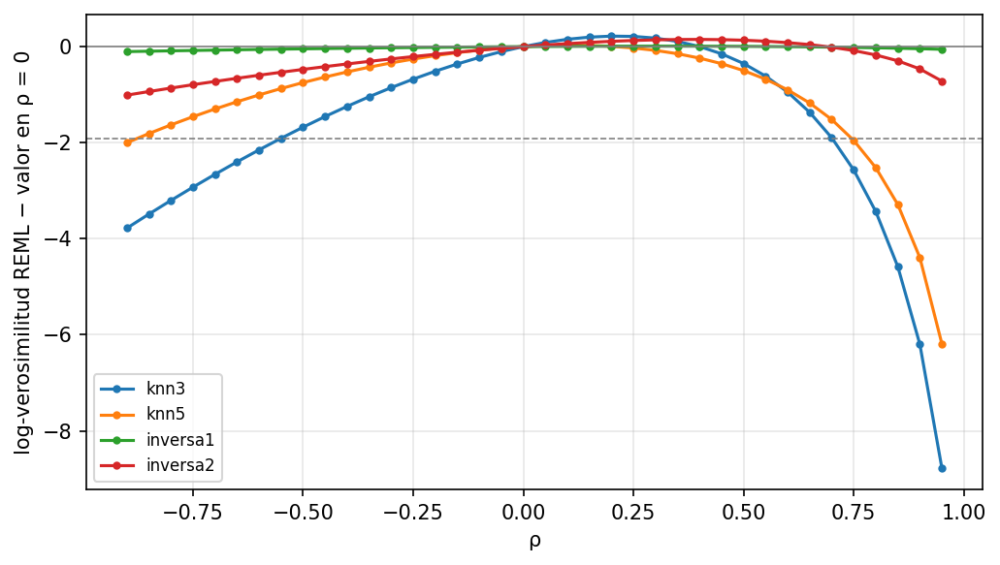
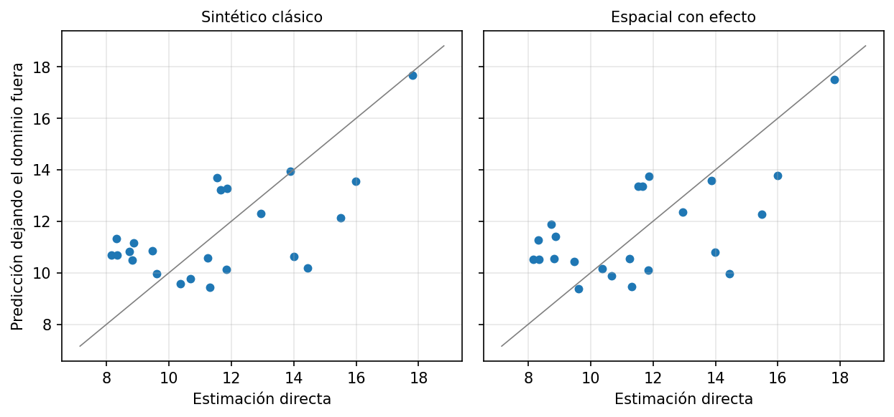
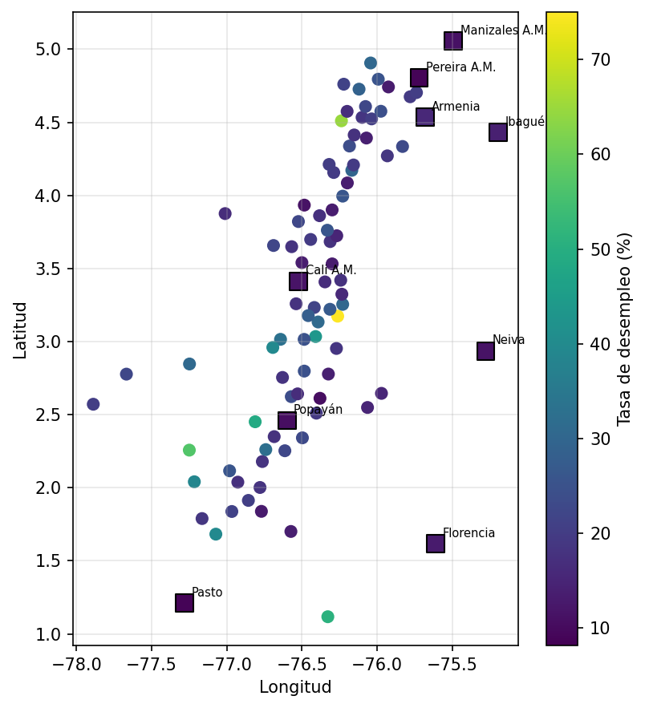

# Componente espacial del Fay-Herriot (SEBLUP)

Documento de método, código y resultados del componente espacial del modelo de área pequeña.
Código: `code/modelo/fay_herriot_espacial.py` (orquestador) y `code/modelo/shared/`
(`matriz_proximidad.py`, `fay_herriot_espacial.py`, `figuras_espacial.py`, parámetros en `config.py`).
Tablas de salida: `tesis.modelo.fhe_*`. Figuras: `docs/img/fhe_*.png`.

**Corrida de referencia de este documento:** rama `test-2`, job `modelo` del bundle `dev`, cierre
diciembre de 2018 (23 dominios con encuesta, 82 municipios objetivo). Todas las cifras salen de las
tablas `tesis.modelo.fh_*` y `fhe_*` de esa corrida. La versión anterior del documento describía una
corrida con los datos previos a la integración de `test-2` (ver §2).

## 1. Conclusión

Con los datos disponibles **no hay evidencia de dependencia espacial** en los efectos aleatorios del
Fay-Herriot, y el componente espacial **no mejora** la predicción en municipios sin encuesta. El
modelo recomendado sigue siendo el **Fay-Herriot clásico** (el benchmark seleccionado); el SEBLUP queda
como análisis de sensibilidad. Es un resultado legítimo de la tesis y no un fallo de implementación.

| Evidencia | Resultado de esta corrida |
|---|---|
| I de Moran de los residuos del clásico (4 escenarios de W) | −0.03 a −0.07, p entre 0.82 y 0.91: ninguno significativo |
| ρ̂ del SEBLUP (estructura completa) | +0.11 a +0.39 (positivo), pero ninguno con ΔAIC > 2 a favor del espacial |
| ΔAIC (AIC clásico − AIC espacial), los 8 casos | −1.09 a −2.00: el clásico tiene menor AIC en todos |
| Razón de verosimilitudes ρ = 0 | p entre 0.60 y 0.95 (completa); entre 0.34 y 0.82 (muestra) |
| Perfil de verosimilitud de ρ | Plano: la ganancia máxima frente a ρ = 0 es ≤ 0.22 unidades de log-verosimilitud |
| Validación dejar-un-dominio-fuera (RMSE, completa) | Clásico 2.084; espacial con efecto 2.115-2.440 (peor en los 4 escenarios) |
| Efecto espacial `û_r` en los 82 objetivos | Entre −0.23 y +0.42 pp (media absoluta 0.05 pp) |

El hallazgo que más pesa sobre la calidad de las estimaciones no es espacial: **74 de los 82
municipios objetivo extrapolan** (sus covariables quedan fuera de la nube de la muestra) y 36 de 82
tienen CV ≥ 20 % (ver §7).

### Qué cambió frente al cierre anterior

| Medida | Cierre anterior | Esta corrida | Lectura |
|---|---|---|---|
| AIC del clásico (benchmark) | 104.92 | **102.67** | mejora (−2.2) |
| Â del clásico | 4.188 | 4.035 | algo menor |
| RMSE dejar-un-dominio-fuera, clásico | 2.215 | **2.084** | mejora (−6 %) |
| p de `VA_PCT_PRIM` en el clásico | 0.057-0.074 | 0.086 | empeora; sigue por encima de 0.05 |
| I de Moran de los residuos: p | 0.49-0.97 | 0.82-0.91 | sin evidencia en ambos |
| Signo de ρ̂ (completa) | negativo o ≈ 0 | positivo (0.11-0.39) | no significativo en ambos |
| ΔAIC máximo a favor del espacial | +0.04 | −1.09 | el espacial queda más lejos del clásico |
| RMSE del espacial con efecto | 2.31-2.35 | 2.115-2.440 | sigue siendo peor que el clásico |
| Municipios objetivo que extrapolan | 73 de 82 | 74 de 82 | igual |
| No confiables (CV ≥ 20 %) | 45 de 82 | 36 de 82 | mejora |

En resumen, **los estadísticos del clásico mejoraron y el espacial siguió sin aportar**: la conclusión
no cambia, y la distancia entre ambos modelos en AIC se amplió a favor del clásico.

## 2. Qué se hizo (trazabilidad)

Orden cronológico de los cambios que llevan a esta corrida; los commits están en la rama `test-2`.

1. **Especificaciones candidatas EC1…ECk (G7-B15)** (commit `cd28731`). Las variantes dejar-una-fuera dejaron de
   llamarse M1…M5: son *especificaciones candidatas del modelo base Fay-Herriot clásico*, no los modelos
   finales del objetivo 1. De ellas sale el **benchmark seleccionado**. La comparación del objetivo 1 es
   después, entre ese benchmark y las especificaciones espaciales (este documento).
2. **AICc como complemento (G7-B16)** (mismo commit). `AICc = AIC + 2k(k+1)/(n−k−1)` con `k = p + 1`, n = 23. No
   reemplaza la regla de selección (ΔAIC ≤ 2 con parsimonia). Es una convención externa al libro y una
   aproximación en Fay-Herriot (las varianzas D_i son heterogéneas); ver `shared/fay_herriot.py`.
3. **Ajuste de citas de Morales et al.** La regla «todas las covariables con p < 0.05» (p. 453) se aplica
   porque el modelo también predice fuera de muestra; el libro admite además una covariable con p > 0.05
   si es interpretable (p. 454), que debe reportarse como excepción.
   Los p-valores de los coeficientes son descriptivos, no demostración fuerte (G7-B17): los mismos 23 dominios
   filtran, seleccionan, comparan y calculan los p; ver `shared/estabilidad_coeficientes.py`.
4. **Componente espacial** (commit `b34c964`), traído desde la rama `test` a `test-2`: SEBLUP, matrices de
   proximidad, Moran, perfil de ρ y validación dejar-un-dominio-fuera.
5. **Corrección de compatibilidad** (commit `ac7ab2a`). `test-2` cambió `marca_extrapolacion` (B20): ahora
   recibe la matriz de diseño de los municipios objetivo y no el vector `x'Cov(β̂)x`. El notebook espacial
   usaba la firma anterior y fallaba con `IndexError`; se pasó `X_obj`.
6. **Corrida completa en Databricks** (bundle `dev`): `dimensiones` → `ingesta_geih` + `ingesta_terridata`
   → `preprocesamiento` → `analisis` → `modelo`. El job `modelo` terminó con éxito
   (`fay_herriot`, `sensibilidad_varianza`, `fay_herriot_espacial`).
7. **Este documento** se reescribió con las cifras de las tablas de esa corrida y se regeneraron las
   cuatro figuras `fhe_*.png` desde el volumen `/Volumes/tesis/preprocesamiento/figuras_eda`.

Diferencia de datos entre la corrida anterior y esta: `test-2` trabaja con dominios que pueden ser una
ciudad o su área metropolitana («Cali A.M.»), con covariables agregadas por el denominador de cada
indicador, y con un conjunto del EDA de tres covariables. Por eso el
clásico tiene cifras distintas aunque el benchmark siga siendo `IICA_CONFLICTO + VA_PCT_PRIM`.

## 3. Qué es el modelo

Fay-Herriot clásico: `y_d = x_d'β + u_d + e_d`, con `u_d` independientes, `Var(u_d) = σ²_u` y
`Var(e_d) = D_d` conocida (la varianza bootstrap de la estimación directa).

Fay-Herriot espacial (Morales et al., 2021, §18.2, pp. 490-494): los efectos siguen un proceso
autorregresivo simultáneo, `u = ρWu + v`, con `v ~ N(0, σ²_u I)`. Entonces
`Cov(u) = σ²_u[(I − ρW)'(I − ρW)]⁻¹` y `Cov(y) = V = Cov(u) + diag(D)`. W es una matriz de
proximidad estandarizada por filas (cada fila suma 1), de modo que ρ ∈ (−1, 1). Con ρ = 0 se
recupera el modelo clásico, por lo que **la pregunta es si los datos justifican ρ ≠ 0**.

- **Estimación**: (σ²_u, ρ) por REML numérico (L-BFGS-B con tres puntos de partida, ρ ∈ {0, 0.5, 0.9});
  β por mínimos cuadrados generalizados; AIC con la verosimilitud ML y `p + 2` parámetros (coeficientes,
  σ²_u y ρ).
- **EBLUP**: `μ̂ = Xβ̂ + G V⁻¹ (y − Xβ̂)` (p. 491, ec. 18.9).
- **MSE**: bootstrap paramétrico (§18.2.3, p. 494). En cada réplica se simula `u*` y `e*`, se re-estiman
  σ²_u y ρ y se acumula el error frente a la verdad simulada; así el MSE incluye la incertidumbre de ρ̂.
  Se usaron 500 réplicas (las 500 fueron válidas).

## 4. Por qué la contigüidad no sirve aquí, y qué se hizo

Hallazgo de la exploración (`fhe_vecindad`): los 23 dominios con encuesta son capitales o áreas
metropolitanas dispersas por el país, y los municipios objetivo de Cauca y Valle no son contiguos a ellos.

- Los municipios objetivo tienen por vecinos contiguos a otros objetivos, sin dato.
- Cada objetivo tiene un dominio con encuesta cercano: mediana de 46 km en Cauca y 45 km en Valle; en
  Cauca 22 de 41 están a ≤ 50 km y 39 de 41 a ≤ 100 km (máximo 144 km); en Valle 26 de 41 a ≤ 50 km y
  41 de 41 a ≤ 100 km (`fhe_vecindad`).
- La distancia entre los propios dominios con encuesta se imprime en el notebook pero no se persiste en
  una tabla; la cifra de la versión anterior (vecino más cercano a 30-158 km) no se volvió a verificar.

Decisiones:

1. **ρ se estima solo con los dominios con encuesta**: son los únicos con dato.
2. **W se define sobre todas las unidades** (23 con encuesta + 82 objetivo = 105) en la estructura
   `completa` (Saei y Chambers, 2005; Benedetti et al., 2024, pp. 146-149). La verosimilitud se evalúa
   sobre el bloque de los dominios con encuesta (verosimilitud marginal). Así un municipio sin encuesta
   recibe `x'β̂ + û_r`, con `û_r = G_rs V⁻¹ (y − Xβ̂)` calculado a partir de los dominios cercanos. La
   estructura `muestra` (Petrucci y Salvati, 2006) define W solo entre dominios con encuesta y deja a los
   objetivos con el sintético `x'β̂`.
3. **W por distancia entre centroides** (Haversine), no por contigüidad (Morales et al., p. 491 admite
   ambas). Cuatro escenarios: kNN con k = 3 y 5 (simetrizada) y distancia inversa con potencia 1 y 2.
   Siempre estandarizada por filas.
4. **Coordenada de cada dominio** = la de su municipio capital (`CODIGO_DOMINIO`). Es una simplificación:
   un área metropolitana agrupa varios municipios.
5. **Cali** (76001) aparece en `municipios_sin_encuesta` pero es un dominio con encuesta; se excluye de los
   objetivos (se usa su EBLUP). Quedan 82 objetivos (41 por departamento). Yumbo, que pertenece al área
   metropolitana de Cali, se mantiene como objetivo.

## 5. Pasos del notebook y qué hace cada pieza

| Paso | Qué hace | Código |
|---|---|---|
| 1 | Carga covariables del benchmark clásico seleccionado (`fh_coeficientes`), dominios, objetivos, coordenadas | notebook |
| 2 | Diagnóstico de vecindad (distancia de cada objetivo al dominio más cercano) | `resumen_vecindad` |
| 3 | Fay-Herriot clásico de referencia | `FayHerriotClasico` (existente) |
| 4 | I de Moran de residuos, por escenario de W | `moran_i`, `proximidad_knn`, `proximidad_inversa` |
| 5 | Ajuste del SEBLUP por escenario y estructura; AIC y LRT | `FayHerriotEspacial` |
| 6 | Perfil de verosimilitud de ρ | `FayHerriotEspacial.perfil_rho` |
| 7 | Validación dejar-un-dominio-fuera | `validacion_dejar_uno_fuera`, `metricas_validacion` |
| 8 | Decisión por criterio explícito | notebook |
| 9 | Predicción en objetivos con MSE bootstrap; marcas de extrapolación (B20) | `FayHerriotEspacial`, `marca_extrapolacion` |
| 10 | Escritura de tablas `fhe_*` y figuras `fhe_*` | notebook |

Detalles de implementación:

- `covarianza_sar(W, A, ρ)`: `G = A·M⁻¹M⁻ᵀ` con `M = I − ρW`.
- `FayHerriotEspacial._log_verosimilitud`: ML o REML perfilando β; en la estructura completa V es el bloque
  `G[:n,:n] + diag(D)`.
- `_estimar_theta`: L-BFGS-B sobre `(log σ²_u, ρ)` con `|ρ| ≤ 0.99`.
- `_bootstrap_mse`: simula sobre todas las unidades y devuelve el MSE de los dominios con encuesta, de los
  objetivos con efecto espacial y de los objetivos con sintético.
- `moran_i`: p-valor por 9 999 permutaciones, sin supuestos de normalidad.
- Clase hija de `ModeloAreaPequena`: respeta el contrato (A_hat, beta_hat, mse, cv, aic, …). `gamma_i` no se
  define: en el caso espacial no hay un peso escalar por dominio. No calcula AICc (el AICc solo existe en
  el clásico); la comparación espacial se hace con AIC y LRT.

**Validación dejar-un-dominio-fuera**: para cada uno de los 23 dominios se re-estima el modelo sin él, se le
trata como dominio sin encuesta y se predice con (a) el sintético clásico, (b) el sintético del modelo
espacial y (c) el predictor espacial con efecto. El referente es la estimación directa, que tiene ruido
`D_d`; por eso también se reporta el RMSE corregido por ese ruido. Con n = 23 es evidencia modesta.

**Criterio de decisión**: el espacial es preferido solo si `ΔAIC > 2` (AIC clásico − AIC espacial) y la
prueba de razón de verosimilitudes de ρ = 0 tiene p < 0.05. Un escenario con ρ̂ pegado a la cota
(|ρ̂| = 0.99) no se usa como referencia: es un artefacto de una verosimilitud plana. En esta corrida
ningún escenario llegó a la cota. Ni el LRT ni el AIC respaldan la preferencia por el espacial.

## 6. Resultados

### 6.1 Benchmark clásico de partida (`fh_seleccion_modelo`, `fh_coeficientes`)

El EDA dejó tres covariables, así que hay cuatro especificaciones candidatas (EC1 = conjunto completo):

| Especificación | Covariables | AIC | ΔAIC | AICc | ΔAICc | p máx. | Cook máx. |
|---|---|---|---|---|---|---|---|
| **EC4 (benchmark)** | IICA_CONFLICTO + VA_PCT_PRIM | 102.67 | 0.00 | 104.89 | 0.00 | 0.086 | 0.11 |
| EC3 | IICA_CONFLICTO + ING_TRIB_PC | 103.25 | 0.58 | 105.48 | 0.58 | 0.123 | 0.61 |
| EC1 | IICA_CONFLICTO + VA_PCT_PRIM + ING_TRIB_PC | 104.04 | 1.37 | 107.57 | 2.68 | 0.468 | 0.37 |
| EC2 | VA_PCT_PRIM + ING_TRIB_PC | 112.05 | 9.38 | 114.27 | 9.38 | 0.292 | 0.43 |

- EC4, EC3 y EC1 tienen soporte similar por AIC (ΔAIC ≤ 2). Con AICc, EC1 sale de esa zona (ΔAICc = 2.68).
  EC4 es la de menor AIC y AICc y tiene dos covariables; fue seleccionada entre varias especificaciones con
  soporte similar mediante la regla de parsimonia predefinida.
- **Ninguna especificación tiene todas sus covariables con p < 0.05**: la regla estricta (Morales et al.,
  p. 453) no se cumple y el modelo entra en la rama de aviso del código. `VA_PCT_PRIM` (p = 0.086) se
  mantiene como excepción por interpretabilidad (p. 454) y debe reportarse así.
- Coeficientes del benchmark: intercepto 8.07; `IICA_CONFLICTO` 77.45 (EE 22.64, p < 0.001); `VA_PCT_PRIM`
  0.278 (EE 0.162, p = 0.086). Â = 4.035; R² del predictor sintético = 0.489.
- Cook máximo 0.11 frente al umbral 4/n = 0.17: ningún dominio influyente.
- Ganancia de precisión mínima: CV medio 2.62 % (directo) frente a 2.60 % (EBLUP), γ promedio 0.978. El
  EBLUP casi reproduce la estimación directa en los dominios con encuesta.

### 6.2 I de Moran (`fhe_moran`)

W solo entre los 23 dominios. Residuos del clásico `y − Xβ̂`:

| Escenario | I | Esperado | p |
|---|---|---|---|
| knn3 | −0.029 | −0.045 | 0.912 |
| knn5 | −0.029 | −0.045 | 0.872 |
| inversa1 | −0.055 | −0.045 | 0.844 |
| inversa2 | −0.070 | −0.045 | 0.822 |

La tasa cruda tampoco muestra autocorrelación (p de 0.69 a 0.80). Con n = 23 la potencia es baja: un Moran no
significativo no demuestra independencia, solo que los datos no la contradicen.

### 6.3 SEBLUP frente al clásico (`fhe_comparacion_modelos`)

Clásico: Â = 4.035, AIC = 102.67.

| Escenario | Estructura | σ̂²_u | ρ̂ | AIC | ΔAIC | p(LRT) |
|---|---|---|---|---|---|---|
| knn3 | completa | 3.903 | 0.215 | 104.39 | −1.72 | 0.60 |
| knn3 | muestra | 4.036 | 0.003 | 104.62 | −1.95 | 0.82 |
| knn5 | completa | 4.040 | 0.108 | 104.67 | −2.00 | 0.95 |
| knn5 | muestra | 4.049 | 0.058 | 104.60 | −1.92 | 0.78 |
| inversa1 | completa | 4.053 | 0.313 | 104.58 | −1.91 | 0.76 |
| inversa1 | muestra | 3.948 | −0.210 | 103.76 | −1.09 | 0.34 |
| inversa2 | completa | 3.964 | 0.389 | 104.57 | −1.90 | 0.75 |
| inversa2 | muestra | 3.969 | −0.129 | 104.18 | −1.51 | 0.48 |

ΔAIC = AIC clásico − AIC espacial; positivo favorece al espacial. En ningún caso es positivo y el mejor
es −1.09: añadir ρ cuesta dos puntos de AIC y la verosimilitud casi no sube. En la estructura completa
los ρ̂ son positivos (0.11-0.39), el signo esperado si el desempleo se pareciera entre vecinos, pero ninguno
es significativo (p ≥ 0.60). La referencia que eligió el notebook es **`knn3` con estructura completa**
(menor AIC entre las estructuras completas: ρ̂ = 0.215, σ̂²_u = 3.903, ΔAIC = −1.72, p(LRT) = 0.60).

### 6.4 Perfil de ρ (`fhe_perfil_rho`, `docs/img/fhe_perfil_rho.png`)

| Escenario | ρ del máximo | Ganancia máxima vs ρ = 0 | Rango de ρ con caída ≤ 1.92 |
|---|---|---|---|
| knn3 | 0.2 | 0.218 | −0.55 a 0.70 |
| knn5 | 0.1 | 0.028 | −0.85 a 0.70 |
| inversa1 | 0.3 | 0.010 | −0.90 a 0.95 |
| inversa2 | 0.4 | 0.150 | −0.90 a 0.95 |

Las curvas son prácticamente planas: **ρ no está identificado**. El intervalo de verosimilitud perfilada
cubre casi todo el rango (en dos escenarios llega al límite inferior de la rejilla, −0.9). Con 23 dominios
dispersos los datos no informan sobre la autocorrelación espacial.



### 6.5 Validación dejar-un-dominio-fuera (`fhe_validacion_cruzada_metricas`)

Estructura completa. Clásico: RMSE 2.084 (corregido por ruido 2.062; sesgo medio 0.031).

| Escenario | RMSE sintético espacial | RMSE espacial con efecto |
|---|---|---|
| knn3 | 2.076 | 2.115 |
| knn5 | 2.095 | 2.219 |
| inversa1 | 2.329 | 2.219 |
| inversa2 | 2.060 | 2.440 |

El predictor espacial **con efecto es peor que el clásico en los cuatro escenarios**. El sintético espacial
empata o gana por muy poco en `knn3` (−0.4 %) e `inversa2` (−1.2 %), y pierde en `knn5` e `inversa1`; esas
diferencias de décimas de punto no son relevantes con n = 23. Los sesgos medios llegan a 0.26 pp
(`inversa2`, espacial con efecto) y −0.21 pp (`inversa1`, sintético). El RMSE corregido por el ruido de la
estimación directa lleva a la misma conclusión (clásico 2.062; espacial con efecto 2.093-2.421).



### 6.5b Cuadro comparativo del objetivo 1 (`fhe_cuadro_comparativo`)

Benchmark clásico seleccionado (EC4: `IICA_CONFLICTO + VA_PCT_PRIM`) frente a las ocho especificaciones
espaciales, con las mismas covariables. Se genera con `shared/cuadro_comparativo.py` (paso 7b del notebook).
RMSE = validación dejar-un-dominio-fuera (pp); «con efecto» solo existe en la estructura `completa`.

| Modelo | σ̂²_u | ρ̂ | AIC | ΔAIC | p(LRT) | RMSE sintético | RMSE con efecto | Veredicto |
|---|---|---|---|---|---|---|---|---|
| **Clásico (benchmark)** | 4.035 | — | 102.67 | 0.00 | — | **2.084** | — | Referencia |
| SEBLUP knn3 completa | 3.903 | 0.215 | 104.39 | −1.72 | 0.60 | 2.076 | 2.115 | No preferido |
| SEBLUP knn3 muestra | 4.036 | 0.003 | 104.62 | −1.95 | 0.82 | 2.091 | — | No preferido |
| SEBLUP knn5 completa | 4.040 | 0.108 | 104.67 | −2.00 | 0.95 | 2.095 | 2.219 | No preferido |
| SEBLUP knn5 muestra | 4.049 | 0.058 | 104.60 | −1.92 | 0.78 | 2.090 | — | No preferido |
| SEBLUP inversa1 completa | 4.053 | 0.313 | 104.58 | −1.91 | 0.76 | 2.329 | 2.219 | No preferido |
| SEBLUP inversa1 muestra | 3.948 | −0.210 | 103.76 | −1.09 | 0.34 | 2.073 | — | No preferido |
| SEBLUP inversa2 completa | 3.964 | 0.389 | 104.57 | −1.90 | 0.75 | 2.060 | 2.440 | No preferido |
| SEBLUP inversa2 muestra | 3.969 | −0.129 | 104.18 | −1.51 | 0.48 | 2.086 | — | No preferido |

Lectura: el clásico tiene el menor AIC; ninguna especificación espacial cumple ΔAIC > 2 y p(LRT) < 0.05,
y las diferencias de RMSE (décimas de pp, con n = 23) no justifican el parámetro adicional. Conclusión del
objetivo 1: el benchmark clásico se mantiene.

### 6.6 Predicción en los 82 municipios objetivo (`fhe_prediccion_objetivo`)

Escenario de referencia `knn3` completa (ρ̂ = 0.215, σ̂²_u = 3.903, 500 de 500 réplicas válidas).

| Indicador | Valor |
|---|---|
| Tasa predicha (clásico): mínimo / mediana / máximo | 10.76 / 21.65 / 76.82 % |
| Efecto espacial `û_r` | entre −0.229 y +0.422 pp (media absoluta 0.050) |
| Diferencia absoluta espacial − clásico: media / máxima | 1.163 / 3.034 pp |
| CV mediano: clásico / sintético espacial / espacial con efecto | 19.0 / 19.1 / 19.1 % |
| Predicciones fuera de [0, 100] | 0 |
| Recomendado | CLÁSICO (82 de 82) |

La diferencia entre las dos predicciones **no viene del efecto espacial** (0.05 pp de media) sino de que el
modelo espacial estima otros β̂ (`IICA_CONFLICTO` 76.4 frente a 77.5; `VA_PCT_PRIM` 0.231 frente a 0.278) y
esos coeficientes se aplican a covariables extrapoladas: el sintético espacial difiere del clásico en
1.165 pp de media. Los mapas son parecidos, no idénticos.




## 7. Advertencias que no son espaciales

- **Extrapolación**: 74 de 82 municipios objetivo se marcan `EXTRAPOLA = true` (criterio B20 de
  `shared/extrapolacion.py`). El coeficiente de `IICA_CONFLICTO` (≈ 77) multiplica un indicador que en
  varios municipios objetivo toma valores muy por encima de los de las 23 ciudades, lo que explica una
  mediana predicha de 21.7 % y un máximo de 76.8 %. Conviene revisar
  esas predicciones antes de interpretarlas.
- **Confiabilidad**: con el predictor recomendado (clásico), 46 municipios son aceptables (CV 5-20 %) y 36
  no confiables (CV ≥ 20 %); ninguno es confiable.
- **Significancia**: `VA_PCT_PRIM` tiene p = 0.086 en el clásico y 0.143 en el espacial de referencia; el
  benchmark lo admite por interpretabilidad (Morales et al., p. 454), no por significancia.

## 8. Limitaciones

- n = 23 dominios: potencia baja y ρ sin identificar. Que no aparezca dependencia espacial no prueba que no
  exista.
- Un dominio metropolitano se representa por una sola coordenada.
- La contigüidad real (geometrías del Marco Geoestadístico Nacional) no se probó: el proyecto solo tiene
  centroides. Con contigüidad el resultado probablemente sea peor (más islas), pero no está verificado.
- Las predicciones comparten covariables con muy pocos puntos de apoyo (§7).
- Los efectos espaciales en los objetivos dependen de que ρ̂ esté bien estimado; con perfil plano, no lo está.
- Se comparan modelos con AIC y LRT; el AICc existe solo para el clásico. Con n = 23 y un parámetro más (ρ)
  la penalización por muestra pequeña sería mayor, lo que reforzaría la conclusión a favor del clásico.
- El ΔAIC ≤ 2, el AICc y la prueba LRT de ρ = 0 son convenciones estadísticas generales; no aparecen en
  el libro de referencia ni en los artículos espaciales consultados, que comparan por simulación (sesgo y
  MSE) o con AIC/BIC según el caso, y deben citarse con fuentes externas.

## 9. Cómo reproducir

```bash
databricks bundle deploy -t dev --profile tesis
databricks bundle run modelo -t dev --profile tesis
```

El job `modelo` ejecuta `fay_herriot`, `sensibilidad_varianza` (independiente) y `fay_herriot_espacial`
(tarea que depende de `fay_herriot`, definida en `dab/resources/modelo.yml`). El notebook lee
`fh_coeficientes` (benchmark clásico), por lo que debe correr después de `fay_herriot.py`. Escribe
`tesis.modelo.fhe_*` con `overwrite` y las figuras `fhe_*.png` en `/Volumes/tesis/preprocesamiento/figuras_eda`.
Parámetros (escenarios de W, `RHO_LIMITE`, permutaciones, réplicas, semilla, `ALFA_LRT`) en
`code/modelo/shared/config.py`.

## 10. Referencias

- Morales, Esteban, Pérez y Hobza (2021), *A Course on Small Area Estimation and Mixed Models*, cap. 18
  (§18.2, pp. 490-494) y cap. 16 (§16.8.2, pp. 453-454; criterios de información, pp. 420 y 459).
- Marhuenda, Morales y Pardo (2014), *Computational Statistics & Data Analysis* 70:268-280, y Lombardía,
  López-Vizcaíno y Rueda (2017), *JRSS A* 180(4):1229-1252: criterios de información para Fay-Herriot,
  citados en Morales et al. (2021).
- Petrucci y Salvati (2006), *JABES* 11(2); Pratesi y Salvati (2008), *Stat. Methods & Applications* 17:113-141.
- Benedetti et al. (2024), *Int. Statistical Review*: verosimilitud marginal para áreas fuera de muestra (pp. 146-149).
- Saei y Chambers (2005), citado en Benedetti et al. (2024).

Nota: las páginas del libro y de Benedetti se verificaron con el texto de los PDF indexados; la consulta
semántica no estuvo disponible durante la sesión (error 402 de la API de HuggingFace), así que solo se
citan páginas leídas directamente.
